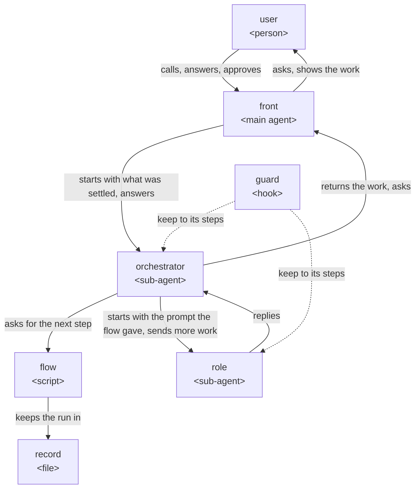
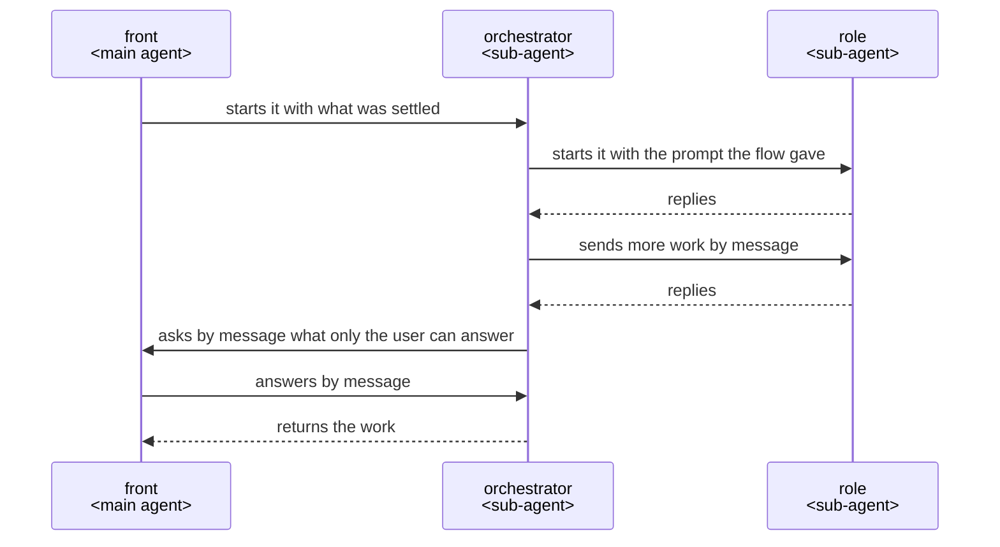

# How a plugin works

This is how a ccpm plugin is built when its work takes several steps, done by several roles that
work with one another, and ends in something made, such as a document or code.

## Who does what

- The user calls the plugin, answers what only they can decide, and approves.
- The front talks with the user.
- The orchestrator starts each role in the order the flow gives.
- The flow decides the next step and keeps the run in the record.
- Each role does one job.
- The guard keeps each agent to its steps.

## Why it is so

### Hearing until nothing is left to decide

The front asks the user, with its recommendation, each point only they can decide, until nothing is
left; facts it finds itself.

A request in rough words leaves points open, and one settled before the work is not met as rework
after it. Inspired by [grilling](https://github.com/mattpocock/skills/blob/main/skills/productivity/grilling/SKILL.md)
and Claude Code's [Let Claude interview you](https://code.claude.com/docs/en/best-practices#let-claude-interview-you).

### The front only talks

The front asks, shows and passes on, and does no work of its own.

A sub-agent cannot ask the user
([subagents](https://code.claude.com/docs/en/sub-agents#available-tools)), and hooks in the main
agent cannot tell which skill it runs, lasting the whole session once a skill has started
([hooks](https://code.claude.com/docs/en/hooks#hooks-in-skills-and-agents)).

### The user approves what is theirs

What the user decides, and what is hard to undo, such as a commit, a push or a merge, goes back
through the front to the user to approve.

An AI that decides these in the user's place has the user stand behind what they never saw.

### One agent for each job

Each job is done by an agent made for it, given only what the job needs.

An agent starts in a fresh context with its own prompt and tools
([subagents](https://code.claude.com/docs/en/sub-agents)), so nothing from other work leads it
astray, and it does the job the same way each time.

### The flow decides the order

The flow decides the next step and keeps the run in the record; the orchestrator does what it
prints.

Code decides the same way each time, where an AI deciding the order drifts; Anthropic's
[Building effective agents](https://www.anthropic.com/engineering/building-effective-agents) calls
this a workflow, "orchestrated through predefined code paths".

### Going on from the record

The record is kept in files under git, so a run stopped anywhere goes on from there in a new
conversation.

A conversation ends, is cleared or is compacted; what lives only in it is lost.

### JSON between agents

What agents hand on as data is JSON, read and changed in the part needed with `jq`.

An agent then changes only the part it needs, with a tool it already knows.

### Messages

An agent is started with its prompt and replies at its end; more work for an agent already started,
and a question for the user, go by message
([SendMessage](https://code.claude.com/docs/en/sub-agents#resume-subagents)). Roles do not message
one another.

What passes between roles goes through the orchestrator and the flow, so the record holds all of it.

### The guard keeps each agent to its steps

Each step that is not sure to hold has a hook that notices a drift and tells the agent the step
again. The hooks are in the plugin's `hooks/hooks.json`, each acting only in the agents it names.

A hook runs every time, where an instruction is advice
([best practices](https://code.claude.com/docs/en/best-practices)); Claude Code tells a hook which
agent it runs in, and reads no hooks from a plugin agent's own file
([subagents](https://code.claude.com/docs/en/sub-agents)).

### Checked as the user runs it

A plugin is checked by running it in Claude Code on the model its users run, and judged from the
records of every conversation and agent it started.

The outcome shows that something went wrong; only the records show where.
