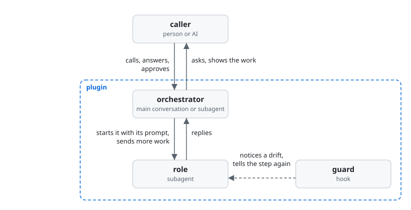
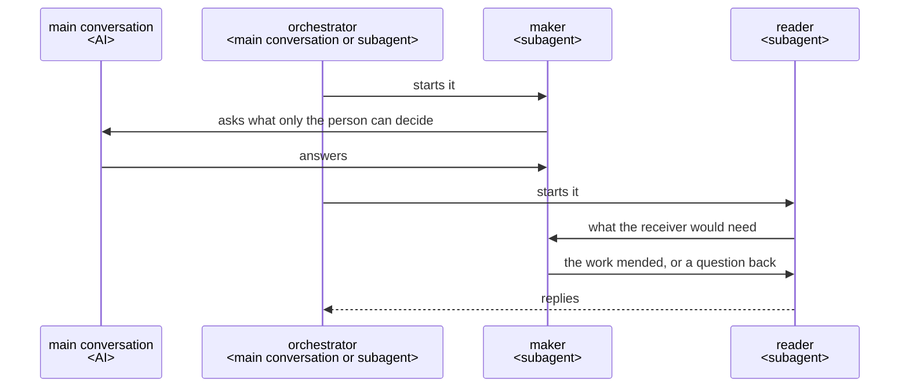

# How a plugin works

This is the architecture every ccpm plugin is built on. It says how a plugin's roles work together
when the work takes several steps and ends in something made, such as a document or code. It also
says where a plugin's files go, how its code is written, and how it is tested and released.

## Who does what

## Words used here

- **caller**: the person or the AI that calls the plugin.
- **main conversation**: the Claude Code conversation the person talks in. Only it can ask the
  person.
- **orchestrator**: the AI that runs the plugin's work from the call to the result.
- **role**: a subagent the orchestrator starts for one job.
- **run**: one use of the plugin, from the call to the result.
- **move**: one thing the orchestrator does, such as starting a role.
- **work**: what a role makes, such as a document or code.
- **maker**: the role that makes a work.
- **receiver**: the one a work is for.
- **reader**: a role that uses a work in the receiver's place.
- **checklist**: a list of items. Each item asks what the receiver should get from the work.
- **Good**: an item's Good is that the receiver gets what the item asks, at given lines of the
  work.
- **hook**: a script Claude Code runs on a tool call.
- **lane**: a step of a role held by a hook, which tells the role the step again when it drifts.
  The ccpm plugin [lane](../plugins/lane/README.md) lays them, and its code that runs in the hooks
  is the **guard**.

## Principles

Every plugin follows these. The reason for each is under Why it is so. A plugin's own design adds
only what that plugin gives beyond them.

1. The orchestrator holds the whole run and decides each move.
2. The caller decides only what is theirs to decide, and approves it by their own action. The
   plugin does the writing. It makes every other choice itself and reports it.
3. Each job has its own role. The role gets only what the job needs.
4. Nobody relays messages. Whoever needs something asks whoever has it, and goes on with the
   answer.
5. A work is first used by a reader, an AI that did not make it. For each item of the checklist,
   the reader gives the lines that give the item its Good, or says what the receiver would still
   need, and tells the maker directly. Before that, the maker checks its own work item by item. A
   work that the caller reads in full to approve, such as a plan, is read first by the caller.
6. What a machine can check is checked by a script, a hook or the project's own tools. They tell the
   role its step again, or stop what would break a rule. An AI reads only for what needs a reader.
7. A run that keeps a state has its course in a script. The script writes the state to a file
   before each next move, so a stopped run goes on from where it stopped.
8. The purpose comes first, speed second.
9. When the caller approves the finished work, the orchestrator looks once for what fell short and
   why. Lessons for the user's own project go into its checklists or rules. General lessons go to
   the plugin's makers as an issue, only if the user says yes. A plugin called by an AI leaves this
   to its caller.

## Why it is so

### The orchestrator holds the whole and decides

The orchestrator talks with the caller. It keeps everything the run has found. It decides each
move: what to ask, what to have made, and when to change the plan or remake a work.

Each move brings facts that the next move depends on. Only someone who holds the whole run can
weigh them. Because the orchestrator talks with the caller itself, it can answer "why" and change
its proposal when the caller objects. A go-between cannot. Anthropic's
[Building effective agents](https://www.anthropic.com/engineering/building-effective-agents)
describes the same pattern: "a central LLM dynamically breaks down tasks, delegates them to worker
LLMs", for "complex tasks where you can’t predict the subtasks needed".

The orchestrator does not report progress while the run goes. Claude Code already shows each role
while it runs, and a message that repeats it is read by no one.

### Where the orchestrator runs

A plugin that a person calls runs its orchestrator in the main conversation, started by a skill. A
plugin that an AI calls, such as one given what to make as JSON, runs its orchestrator as an agent
that the calling AI starts.

Only the main conversation can ask the person; a subagent cannot
([subagents](https://code.claude.com/docs/en/sub-agents#available-tools)). So a role that needs the
person's decision asks the main conversation directly, whoever called the plugin.

### Languages

A plugin that a person calls first proposes two languages: the one it talks in, and the one it
writes into the repository in. It proposes what the repository and the person's instructions set.
Where they set nothing, it proposes the person's own language for talking and English for the
repository. It records the answer.

What goes into the repository is written in the repository's language. What is shown to the person
is put into the language of the talk, with nothing added and nothing left out. A plugin that an AI
calls writes in the repository's language, and the caller that talks with the person translates.

The person decides from what they read, so a translation that adds or leaves out something changes
what they approve. People who were not in the conversation read the repository later, and English
reaches most of them.

### Asking until nothing is left to decide

The orchestrator asks the caller every point that only they can decide, one at a time, each with a
recommendation. It finds facts itself. It shows the caller each fact the work depends on, one at a
time, to confirm.

A rough request leaves points open. A point settled before the work does not come back later as
rework. A fact that was found but not shown is still a guess made for the caller. The work starts
only after the caller confirms that both understand it the same way
([grilling](https://github.com/mattpocock/skills/blob/main/skills/productivity/grilling/SKILL.md),
[Let Claude interview you](https://code.claude.com/docs/en/best-practices#let-claude-interview-you)).

Some choices follow from the purpose and the project's usual practice, such as where a test goes.
These are not the caller's. The role that meets them decides, and reports the choice with the
reason, so the caller can see and change it.

Each question costs the caller time and holds the run until the answer comes. A question about
something the caller does not care about spends their time on the plugin's job. In a trial of rn on
2026-10-27, most of its 11 questions were of this kind.

### The caller approves what is theirs

What the caller decides goes to the caller to approve. So does what is hard to undo, such as a
merge. A commit or a push can be undone, so it does not go to the caller.

If an AI decides these for the caller, the caller ends up answerable for something they never saw.

An approval counts only when it comes from the caller's own action, such as a skill that the AI
cannot call (`disable-model-invocation: true`). An agent saying it was approved does not count.
cc-sdd's agent sets its own approval flag, so the flag stops nothing.

### One agent for each job

Each job is done by a role made for it, given only what the job needs.

A role starts in a fresh context with its own prompt and tools
([subagents](https://code.claude.com/docs/en/sub-agents)), so nothing from other work leads it
astray.

### Messages

A role is started with its prompt and replies at its end. In between, whoever needs something
sends a message ([SendMessage](https://code.claude.com/docs/en/sub-agents#resume-subagents)) to
whoever has it.

A go-between holds nothing of what passes, and adds a move to every exchange. What the end of the
run needs from an exchange is in the files the roles write, and a script checks it there.

### JSON between agents

What agents pass on as data is JSON, read and changed with `jq`.

An agent then changes only the part it needs, with a tool it already knows, and leaves the rest as
it was.

### A plugin that uses another

A plugin that has another plugin do a job starts that plugin's orchestrator as one of its roles.
When a role of that plugin must ask something, it asks the main conversation, as every role does.

A subagent can start subagents down to three layers below the main conversation
([subagents](https://code.claude.com/docs/en/sub-agents#let-subagents-spawn-their-own-subagents)).

### Asking for what lies outside the work

Sometimes what keeps the work from going on lies outside it, such as a permission not given or a
tool not installed. Then the role does not look for a way round. It asks the main conversation for
what it needs, and goes on with the answer. It goes on with the rest of the work meanwhile.

The person can clear such a cause in a moment; the run cannot. A way round leaves a work checked
under other terms than the purpose set. A run that stops brings nothing back.

### Read by those who did not make it

Each work is used first by AIs that did not make it. They stand in for the receiver, with what the
receiver has, and do what the receiver does with it. Each gives its verdict from its own first
reading.

The maker finds the Good it meant. A reader that did not make the work finds only the Good its
lines give, which is what the receiver gets. A reader shown someone else's verdict finds what it
was told. So two readings add a check only when each is made on its own.

A reader judges an item by whether the receiver can use the work for what they use it for. Where it
finds no Good, it says in one sentence what the receiver would need. It does not say how to make
it. It leaves what a machine can check to the checks that do it (Principle 6).

A reader that hunts for defects finds one in every work. Each is then mended, whether or not the
receiver would ever meet it. The rounds go on, and the work does not get better for its receiver.
In a trial of rn on 2026-10-27, about 25 works were sent back. About 12 were for defects found by
running the work, 8 for what a linter or a type checker would have shown, and 5 for wording.

The maker holds the sources, so how the work gives each Good is the maker's to decide. The reader
says what the receiver would need, not how to give it. The maker then mends the work for the
receiver's use. When a reader names a fault for the maker to answer, the two end up arguing about
the fault, when both are there for the receiver's use.

When the receiver is the caller, and the caller reads the work in full to approve it as soon as it
is made, such as a plan, the caller reads it first. A reader in their place would add a reading the
caller makes anyway, and its time at every remake.

Once the maker has made the work, it checks it against its checklist item by item. It gives each
item as the lines of the work that give its Good, `<path>:<from>-<to>`, with no words. On a remake
it gives only the items sent back. Each item says what is run and how far, so maker and reader run
the same thing.

Finding the lines makes the maker look at the place. Lines can be checked by a script, a reader or
the caller. A claim in words is read by no one, and costs its writing at every round. In that trial
the maker rewrote such a claim for every item each round, 23,000 characters, and only a form check
read it. Two who run the same check see the same result. So when one of them finds no Good, it is
not because they chose to run different things.

### The guard tells each role its steps again

A role's step that is not sure to hold gets a hook. The hook notices when the role drifts from the
step and tells it the step again. The hooks are in the plugin's `hooks/hooks.json`, and each acts
only in the roles it names.

A hook runs every time, while an instruction is only advice
([best practices](https://code.claude.com/docs/en/best-practices)). Claude Code reads no hooks from
a plugin agent's own file ([subagents](https://code.claude.com/docs/en/sub-agents)). A hook is told
which subagent it runs in, but not which skill runs in the main conversation, and a skill's hooks
last the whole session once it starts
([hooks](https://code.claude.com/docs/en/hooks#hooks-in-skills-and-agents)). So an orchestrator in
the main conversation is held by its own steps, or by the script that keeps its course. What is hard
to undo is held by GitHub's branch protection or Claude Code's permission rules.

### What a machine can see of the work

A project whose work is code has a formatter, a linter and a type checker set up, and the command
that checks the work runs them. Makers and readers do not look for what these tools show.

A tool finds the same thing every time, at once. An AI reading for it finds only some, and spends a
round on each. In that trial the project had none of these tools, and 8 of the works sent back were
for what they would have shown.

### Where the course is kept

A plugin whose run is a fixed loop that keeps a state may keep its course in a script of its own.
The script gives the orchestrator each next step, so the orchestrator cannot go on without it. A
plugin whose course changes with what the run finds, such as rn, keeps its course in its skill's
steps and its plan in a document. A plugin whose run keeps no state, such as turn, where the maker
and the reader settle the work between them, keeps no course in a script.

The spec-driven tools read on 2026-10-21 (Spec Kit, BMAD-METHOD, OpenSpec, superpowers and cc-sdd)
all keep a fixed course outside the AI, with the plan as a file of tasks that the course walks
through. None of them runs the steps inside a task from code. OpenSpec calls its own steps
"prompt-level behavior contracts, not enforceable checks". A course and its rules kept in code are
followed the same way every time; an AI deciding may not follow them.

A course fixed in code has no move for what it did not foresee, so it does not suit a run whose
findings keep changing the course.

The script gives the orchestrator only the moves that need it, such as starting a role, sending a
message, asking or returning the result. The script does itself what a script can do, such as
checking a reply's form or waiting for a role to end.

Each move of the orchestrator is a turn of the model, which reads the whole conversation. So a move
that the script could make costs time, and adds to what every later move reads.

The run's state is kept in a file in its work folder, placed as
[Where a plugin writes its files](#where-a-plugin-writes-its-files) says. Each decision and answer
is written there before the next move. So a run stopped anywhere goes on from its last move in a new
conversation, and an answer is taken in where the run stands. What is kept is committed and pushed
at the end of a step.

A conversation can end, be cleared or be compacted, and what lives only in it is lost. Going on
after a stop needs the file, not the push. A run started again for an answer would make again what
it had already made.

### Where a plugin writes its files

Besides the work and the files its caller names, a plugin writes two kinds of files. What may be
kept goes in `.<plugin>/<yyyymmdd>-<name>/` at the root of the repository, as rn keeps
`.rn/<yyyymmdd>-<slug>/`. What is used only while the plugin runs, including its tests' and
trials', goes in `<plugin>/<yyyymmdd>-<name>/` in the system's temporary folder, the one Python's
`tempfile.gettempdir()` gives. A file that an agent reads with its tools goes in the folder that may
be kept, even if it is used only while the plugin runs, and is removed once it is used.

With one folder named after the plugin, the user chooses with one line of `.gitignore` whether git
keeps what is in it. The date at the front sorts the runs and shows the old ones.

What is used only while running needs no step to remove it. A run stopped partway would miss such a
step, but the system clears its temporary folder itself. That folder is the one TMPDIR names where
it is set; macOS and sandboxes set it to a folder of their own, so it is not always `/tmp`.

Claude Code lets an agent read without asking only inside the working folder and the folders added
to it (permissions, Permission system). A file outside it stops an agent that works on its own to
ask.

### The purpose before performance

A change is taken only if it still meets the requirements. Time or cost is cut only after that.

A work that misses the purpose costs the caller the fixing as well as the wait. So time saved by
leaving them more to fix is spent again by them.

### Learning from each run

A plugin takes in what is general, and leaves to the user's project only what is the project's own.
What a user finds missing in the plugin comes back to it as a lesson.

Once the caller approves the finished work, the orchestrator looks once through what the run kept:
each work sent back, each work made again, and each point asked again. It checks each cause it
doubts in the records of the run, so each lesson comes with the words it rests on, quoted. It puts
each lesson to the user.

- A lesson of the user's own project goes into their checklists or rules.
- A general lesson goes to the plugin's makers as an issue. The issue holds the need and its points,
  never the user's source. It is shown to the user in full, and opened only on their own yes, as
  [The caller approves what is theirs](#the-caller-approves-what-is-theirs) says, since an issue on
  a public repository cannot be undone.

Looked for once, the lessons cost the user one reading. Lessons made at every approval would be
weighed again in every session. What the run kept holds every send-back and remake, because each
move is kept before the next (Principle 7). A cause named without its record is a guess.

A plugin called by an AI is one move of its caller's run. So what fell short in it shows in what
that run kept, beside the rest.

A lesson of the project's own improves that project's later work. The plugins are open source, so
a general lesson, met once, improves the plugin for every user. The work and its source are the
user's, so the user chooses what leaves their project.

## Repository structure

### The plugin's folder and dev/

What runs on users' machines is in the plugin's folder, `plugins/<plugin>/`. What only its builders
need, such as its UX, its architecture, its tests and its trials, is in `dev/<plugin>/`.

Installing a plugin copies only its folder, so what only builders need stays off users' machines.
The plugins' folders are kept together in `plugins/`, as the official marketplaces
[anthropics/claude-plugins-official](https://github.com/anthropics/claude-plugins-official) and
[anthropics/claude-code](https://github.com/anthropics/claude-code) keep theirs. The root then holds
only what the whole repository needs.

### Entries pass the job to their parts

An entry is a skill, an agent, a hook or a command line: something whose form Claude Code fixes. An
entry holds only what Claude Code fixes, and hands the job to its part, kept in a file of its own
named after that part. The files then show the parts the logical view draws.

- A command line reads its arguments and calls the part's module.
- A hook's script reads the event and calls the part that answers it.
- A skill or an agent is its frontmatter and a body. The body points to its part and says where
  each script, file or folder the part names lies. The part names each of these by its name alone,
  such as `turn.py`, never by where it is installed.

The entries lie where Claude Code looks for them, in `agents/`, `skills/` and `hooks/`. A plugin's
own parts lie in `prompts/` if they are written as prompts, and in `scripts/` if they are written as
code. lane's guard, which every plugin takes in, lies in `hooks/lane/`, where lane lays it.

The form of an entry is Claude Code's: a skill's folder is named after its command, and an agent is
called by the name in its frontmatter. The job is the plugin's. A job kept in its entry is found by
the command that calls it, not where the logical view puts it. A second entry to the same job, such
as `/rn:ty` beside `/rn:up`, would come to repeat the first. Cockburn's
[ports and adapters](https://alistair.cockburn.us/hexagonal-architecture/) says the same: "as events
arrive from the outside world at a port, a technology-specific adapter converts it into a usable
procedure call or message and passes it to the application".

An agent's body has the agent read its part in full before anything else. Claude Code makes the body the agent's system prompt and takes in no other file
([subagents](https://code.claude.com/docs/en/sub-agents)). A skill's body links its part, as Claude
Code has a skill "reference supporting files from `SKILL.md`"
([skills](https://code.claude.com/docs/en/skills)). In a trial on 2026-10-26 with a plugin made for
it, each of twenty runs read its part first and followed it. After `/compact`, the part a skill
links came back attached in full, while the skill's own body survived only as the summary retold
it.

Claude Code replaces `${CLAUDE_PLUGIN_ROOT}` with the plugin's folder only in what an entry's own
body gives, not in what the Bash tool runs
([plugins reference](https://code.claude.com/docs/en/plugins-reference#environment-variables)). In
a trial of turn on 2026-10-26, it was not replaced in a part read with Read either: a part naming
`${CLAUDE_PLUGIN_ROOT}/scripts/turn.py` ran `/scripts/turn.py`. A part naming `probe.py`, whose
entry said where it lies, ran it in each of twelve runs, an agent's and a skill's, and in each of
three after `/compact`, where the summary kept where it lies. Where the plugin is installed is
Claude Code's business. The entry adapts to it, as ports and adapters has it, and the part holds
none of it.

### The READMEs

- `plugins/<plugin>/README.md` is for the plugin's users.
- `dev/<plugin>/README.md` links the plugin's architecture, and says how to run its tests and trials
  once they exist.
- `dev/README.md` lists each plugin's folder, says how to run the checks every plugin shares, and
  links [the order the work goes in](../.claude/rules/dev.md).
- The root `README.md` leads users to each plugin's README and builders to `dev/`.

No README is put deeper.

GitHub shows a folder's README when the folder is opened, so a visitor finds the way by opening
folders. A README further down would repeat its parent's and drift from it.

### The CHANGELOG

Each plugin keeps its `CHANGELOG.md` in its root, `plugins/<plugin>/CHANGELOG.md`, in the form that
Release gives.

A user then finds what changed for them in the same place for every plugin.

## Code

### Python 3.9 and the standard library

What runs on users' machines is Python 3, version 3.9 or later, with the standard library only. The
plugin's README says so. A script that only calls an existing tool may be sh.

python3 is wherever git is, while Node.js may not be, and users run 3.9.

### Code kept once

What the plugins already share is used, not written again. Code that more than one plugin needs,
such as how a hook reads a command, is kept once, in the plugin whose job it is. Its tests are in
that plugin's `dev/<plugin>/tests/`. Each other plugin takes it in through a relative symbolic
link. What the tests share, such as a repository made once and copied for each test, is kept beside
that code's tests, as lane's `dev/lane/testing.py` is.

Installing copies the target of a link within the marketplace into the plugin
([share files within a marketplace with symlinks](https://code.claude.com/docs/en/plugins/host-marketplace#share-files-within-a-marketplace-with-symlinks)).
So each plugin carries the shared code, while the code is written, tested and fixed in one place.

### No lines copied

No lines are copied between files, except a test's expected value, which is written out again.
`dev/check.sh` fails when two files share four or more similar lines of Python, not counting
comments, docstrings and imports, as pylint's `duplicate-code` finds them. It does this wherever
pyproject.toml's `test-quality` group is installed. It does not tell a test's expected value apart.

A copy gets fixed in one file and left wrong in the other. A test that takes its expected value
from the code checks the code against itself.

### Checks kept in lane

A check on what an AI does is a lane of [lane](../plugins/lane/README.md), laid in each plugin by
lane's `lay.py`. A check that no lane holds is added to lane as a lane of its own, in its own named
file, with one entry file for each hook event, as the official
[`hookify`](https://github.com/anthropics/claude-plugins-official/tree/main/plugins/hookify)
plugin does.

Each check is then written and tested once, in lane, and each plugin takes lane's code in through a
link. A check kept in a plugin of its own would read the AI's calls apart from lane and drift from
it. A check in a file of its own can be read, fixed and tested on its own.

## Test

Each part is checked by its kind. A part made of code is checked by unit tests. A part run by an AI
is checked by a trial of that part alone. The whole plugin is checked by acceptance tests of its
user stories.

### No check passes what it did not check

Every check ends in one of three ways: no problem, a problem found, or could not check, with why.
For each way a check can fail to check, what happens next is decided beforehand and tested.

- A hook whose script fails or times out, or that cannot parse a command, stops the call and says
  so.
- A skipped test is not a passed test.
- A CI job that did not run does not pass.
- A reader whose command did not run gives no Good.

A check that says nothing when it could not check is read as one that found nothing. What it was
there to stop then goes through unseen. A case decided only when it is met is decided in a hurry,
by whoever meets it.

### Unit tests: code

Each part made of code has unit tests, written with `unittest` in `dev/<plugin>/tests/`. They run
every line and every branch of it: C0 and C1 coverage, 100%.

Two more checks confirm that the unit tests are enough.

- Mutation testing with Cosmic Ray: the unit tests must catch every mutant. The only exception is a
  line marked `# pragma: no mutate`, where no input the code takes can tell the mutant apart. The
  plugin's `cosmic-ray.toml` gives the reason once.
- Property tests with Hypothesis, on new inputs each time: they must all pass. Each input a
  property test fails on is added as a unit test.

The unit tests hold every behavior the code must have. A line or branch that none of them runs goes
unnoticed. A gap the other two checks find is a missing unit test, and it is added so that every
push catches it again.

What runs when:

- Before each push, `dev/githooks/pre-push` runs the unit tests of each plugin the push changes,
  counting lines and branches. It also runs the linter, the formatter, the type checker and the
  manifests' check, and stops the push on a failure.
- On every push, CI runs every plugin's unit tests, counts the lines and branches they run, and
  fails on any line or branch not run. It runs the mutation testing and the property tests on what
  the push changed, the property tests on many inputs, each plugin in its own job, all at once.
- On a push that changes a plugin's version, CI runs both on the whole plugin, before it is
  released.
- Each check runs on Python 3.9 and the newest Python. Cosmic Ray and Hypothesis run on the newest
  only.
- CI's `tests` job runs on every push. It skips the checks when the push changes only what no check
  reads, such as the session records and the documents in `dev/`, and the commit before it passed.

The reasons:

- The code must run on 3.9. The two tools need newer versions only to test, not to run.
- A check left to be run by hand gets forgotten, and is found only by CI after the push.
- The tests are designed before the code, and the coverage shows each line and branch run. So the
  property tests and the mutation testing only confirm that design. Run before every push, on many
  inputs or once per mutant, they would make every change wait. A survivor that CI finds goes back
  to the test design that missed it.
- Checking what a change touches takes minutes; checking the whole takes long. So the whole is
  checked when it reaches users. A test weakened with no line of code changed is among what only
  the whole run finds.
- `main` takes a pull request only after `tests` has passed. So `tests` always runs, and passes
  only what it checked.

A plugin's whole test run takes seconds, and the time each check takes is read on every run.
Mutation testing runs the tests once for each mutant, so a slow test run makes every change wait.

### Unit tests: prompts

Each role, a skill or an agent, is tried on its own. Everything else is stood in for by mocks. The
model is Opus, named in each run. That is the model the maintainer uses: the person who has the
plugins built and decides what reaches their users. The role is judged from its input, its output
and the records of the run, against its Role and Steps.

A prompt is known by what the AI does with it, and only the records show where a run went wrong. A
role tried together with what lies around it does not show which of them went wrong. A smaller
model makes different slips from the ones users meet. A model left to the runner's settings changes
with whoever runs the trial.

### Acceptance tests: user stories

The whole plugin is tried as its user uses it, and its results are checked. Then it is shown to the
maintainer with:

- how close it came to the goal and to each key result of the UX;
- the time and the tokens it took, beside the size of the work;
- what could be improved.

The maintainer judges. Each run's time and tokens are kept with the trial's records, so runs can be
compared.

Each part can pass while a story is missed. And what reaches users is the maintainer's decision.
Whether the time and the tokens fit the work is judged by feel, since no bar is known before runs
gather. Runs kept side by side show whether a change made things better or worse, with the purpose
met as fully (Principle 8).

A trial that needs a real GitHub repository runs in `lovaizu/playground`, one at a time, on a branch
of its own. When it ends, the branch, its pull requests and anything else it made there are
removed. The code that runs a trial, of the whole or of a role, is kept in `dev/<plugin>/trials/`,
and is not counted in the lines and branches.

CI cannot start Claude Code, so each trial is a check of its own. The pull requests and pushes a
trial makes stay out of every repository people use, and `main` there takes nothing except a
reviewed pull request. Two trials at once, or one left behind, would mix with the next.

## Release

### On the maintainer's word

A plugin is released only on an explicit instruction from the maintainer, not on a merge to `main`.
Until then, the changes users would notice wait under the CHANGELOG's `## [Unreleased]`.

Users receive an update only when the version is bumped, so the maintainer decides when it reaches
them.

### The manifests checked

Each plugin passes `claude plugin validate <plugin-path> --strict`, and the marketplace passes
`claude plugin validate <marketplace-root> --strict`.

A malformed manifest fails for every user at install, before any behavior is reached.

### The version

`version` is written in one place only, the plugin's `plugin.json`. It is always set, in semver,
such as `0.1.0`. How far it goes up is decided by the largest change users see:

- major for a breaking change, or minor while the version is `0.x`;
- minor for a new or changed behavior users see;
- patch for no change in behavior.

When both are set, `plugin.json` wins over the marketplace entry, so a second copy means nothing.
`claude plugin validate --strict` fails when `version` is not set.

### The CHANGELOG's form

The CHANGELOG is in [Keep a Changelog](https://keepachangelog.com) form.

- Each release has one `## [x.y.z] - YYYY-MM-DD`, with its changes under `Added`, `Changed`,
  `Fixed` and `Removed` as they apply.
- Every change a user would notice gets one line, written as
  `<what changed> — <why it helps the user>`. Typos, refactors, internal documents and formatting
  get none.
- On a release, `## [Unreleased]` is renamed to the version and date, and no empty
  `## [Unreleased]` is left behind. It is made again when the next change users would notice lands.

A user reads what changed for them and why it helps them.

### The steps of a release

1. The assistant, the AI that builds the plugins, bumps `version` in `plugin.json`, finalizes
   `CHANGELOG.md`, makes the [final check](../.claude/rules/final-check.md), commits and pushes.
2. The assistant asks the maintainer to merge the pull request to `main`. It never merges it itself
   and never uses `--admin`, since `main` is protected and only the maintainer can clear its
   required review.
3. The maintainer merges, and says so.
4. The assistant tags `main` as `<plugin>--v<version>`, such as `rn--v0.2.0`, with
   `claude plugin tag --push` from the plugin's folder. It publishes a GitHub Release for that tag,
   with the CHANGELOG's matching section as its notes.

The tag is in Claude Code's own form. A plugin that depends on another with a version range
resolves the range against these tags, and the prefix lets each plugin number its versions apart
from the others. The command also checks the plugin, and refuses a tag that already exists. When a
plugin was released is read from its tags and Releases, not from merge commits.

### Registering in the marketplace

A plugin is registered on its first release, and again whenever it is renamed or removed.
Registering changes two things together:

- one entry under `plugins` in `.claude-plugin/marketplace.json`, with `name`, `description`,
  `source`, such as `./rn`, and `category`
  ([plugin entries](https://code.claude.com/docs/en/plugins/marketplace-reference#plugin-entries));
- a line in the root `README.md` linking the plugin's README, with a one-line description.

Claude Code installs from the marketplace entry, and people find the plugin from the root README. A
plugin counts as shipped only once both reach it.
