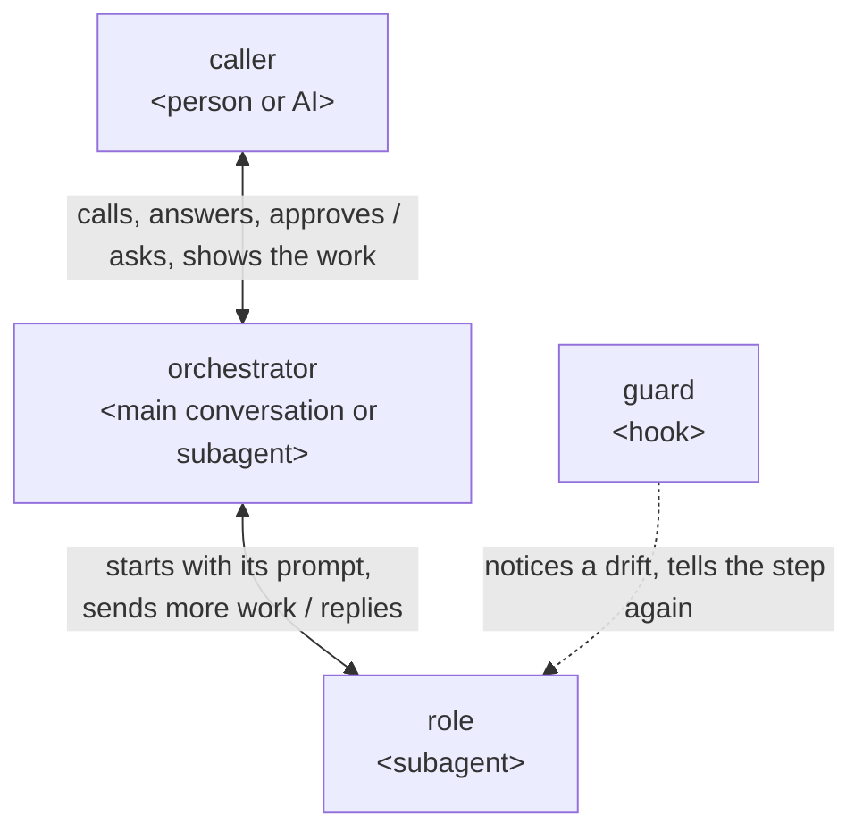
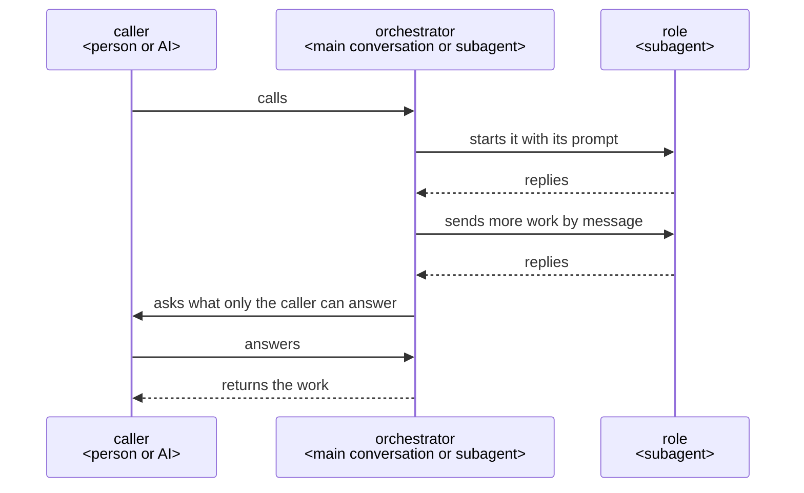

# How a plugin works

This is how a ccpm plugin is built when its work takes several steps, done by several roles that
work with one another, and ends in something made, such as a document or code.

## Who does what

## Principles

Every plugin holds these; each is said with its reason under Why it is so, and a plugin's design
adds only what that plugin gives on top of them.

1. The orchestrator holds the whole run and decides each move.
2. The caller answers only what is theirs to decide and approves it by their own action; the plugin
   does the writing.
3. Each job has a role of its own, given only what the job needs.
4. Each work is first used by AIs that did not make it, in its receiver's place and with what the
   receiver has, each reading it on its own.
5. What a machine can judge is checked by a script or a hook at the moment it happens, which tells
   the role its step again or stops what would break a rule.
6. A fixed course is kept in a script, and the state and each decision are kept before the next
   move, so a run stopped anywhere goes on from there.
7. The purpose comes first and performance after: time is never saved by leaving the caller more
   to fix.
8. After each run, a learner that did no part of the work reads the run's records and gives, from
   the facts, what fell short and why; each lesson goes to the user's own checklists or rules where
   it is their project's own, and to the plugin's makers as an issue where it is general, opened
   only on the user's yes.

## Why it is so

### The orchestrator holds the whole and decides

The orchestrator talks with the caller, holds everything the run has found, and decides each move:
what to ask, what to have made, when to change the plan or make a work again.

Each move brings facts the next one rests on, and only one that holds the whole can weigh them;
talking with the caller itself, it answers a why and changes its proposal on an objection, which a
go-between that holds nothing cannot. Anthropic's
[Building effective agents](https://www.anthropic.com/engineering/building-effective-agents) has
an orchestrator, where "a central LLM dynamically breaks down tasks, delegates them to worker
LLMs", for "complex tasks where you can’t predict the subtasks needed".

### Where the orchestrator runs

A plugin a person calls runs its orchestrator in the main conversation, started by its skill; a
plugin an AI calls, such as one given what to make as JSON, has its orchestrator as an agent the
calling AI starts.

Only the main conversation can ask the person; a subagent cannot
([subagents](https://code.claude.com/docs/en/sub-agents#available-tools)). A plugin an AI calls asks
that AI, which answers or asks the person in turn.

### Hearing until nothing is left to decide

The orchestrator asks the caller, with its recommendation, each point only they can decide, until
nothing is left. It finds facts itself, and shows the caller, one at a time, each it found that the
work rests on, to confirm.

A request in rough words leaves points open, and one settled before the work is not met as rework
after it; a fact found and not shown is still assumed in the caller's place, and the work starts
only once the caller confirms the understanding is shared
([grilling](https://github.com/mattpocock/skills/blob/main/skills/productivity/grilling/SKILL.md),
[Let Claude interview you](https://code.claude.com/docs/en/best-practices#let-claude-interview-you)).

### The caller approves what is theirs

What the caller decides, and what is hard to undo, such as a merge, goes to the caller to approve; a
commit or a push is not, as it can be undone.

An AI that decides these in the caller's place has them stand behind what they never saw.

An approval counts only from the caller's own action, such as a skill the AI cannot call
(`disable-model-invocation: true`), never from an agent saying it was given; cc-sdd's agent sets
its own approval flag, which then stops nothing.

### One agent for each job

Each job is done by a role made for it, given only what the job needs.

A role starts in a fresh context with its own prompt and tools
([subagents](https://code.claude.com/docs/en/sub-agents)), so nothing from other work leads it
astray.

### Read by those who did not make it

Each work is used first by AIs that did not make it, standing in for its receiver with what the
receiver has and doing what they do with it, and each gives its verdict from its own reading alone.

The maker finds the Good it meant; a reader that did not make it finds the Good its lines give,
which is what the receiver gets. A reader shown another's verdict finds what it was told, so two
readings add a check only when each is made on its own.

### Where the course is kept

A plugin whose run is a fixed loop, such as turn's make–read–check rounds, may keep its course in a
script of its own, which gives the orchestrator each next step, so the orchestrator cannot go on
without it. A plugin whose course changes with what the run finds, such as rn, keeps it in its
skill's steps, and its plan as a document.

The spec-driven tools read on 2026-10-21 (Spec Kit, BMAD-METHOD, OpenSpec, superpowers, cc-sdd)
all keep a fixed course outside and the plan as a file of tasks it walks, and none runs the steps
within a task from code; OpenSpec calls its own "prompt-level behavior contracts, not enforceable
checks". A course and its rules held in code are held the same way each time, where an AI deciding
may not.

A course fixed in code that the run's findings keep changing has no move for what it did not
foresee.

A run's state is kept in a file in its work folder, each plugin's own, so a run stopped anywhere
goes on from its last move in a new conversation; a conversation ends, is cleared or is compacted,
and what lives only in it is lost.

### The purpose before performance

A change is taken when the purpose is still met as fully; only then is time or cost cut.

A work that misses the purpose costs the caller the fixing as well as the wait, so time saved by
leaving them more to fix is spent again by them.

### Learning from each run

After each run, a learner that did no part of the work reads the records of every agent of the run
and gives each lesson with the words it rests on quoted. The orchestrator puts each to the user: a
lesson of their project's own goes into their checklists or rules; a general one goes to the
plugin's makers as an issue, holding the need and its points alone, never the user's source, and
opened only once the user says yes.

What fell short often lies in what a role did, which only its record shows, and a lesson without
the facts it rests on is a guess. A lesson of the project's own improves that project's later work;
a general one, met once, improves the plugin for every user. The work and its source are the
user's, so they choose what leaves their project.

### JSON between agents

What agents hand on as data is JSON, read and changed in the part needed with `jq`.

An agent then changes only the part it needs, with a tool it already knows, and leaves the rest as
it was.

### Messages

A role is started with its prompt and replies at its end; more work for a role already started goes
by message ([SendMessage](https://code.claude.com/docs/en/sub-agents#resume-subagents)), and so does
a question from an orchestrator that is a subagent. Roles do not message one another.

What passes between roles goes through the orchestrator.

### A plugin that uses another

A plugin that has another plugin do a job starts that plugin's orchestrator as one of its roles,
and answers what it asks, or asks its own caller in turn.

A subagent can start subagents down to three layers below the main conversation
([subagents](https://code.claude.com/docs/en/sub-agents#let-subagents-spawn-their-own-subagents)).

### The guard tells each role its steps again

Each step of a role that is not sure to hold has a hook that notices a drift and tells the role
the step again. The hooks are in the plugin's `hooks/hooks.json`, each acting only in the roles it
names.

A hook runs every time, where an instruction is advice
([best practices](https://code.claude.com/docs/en/best-practices)); Claude Code reads no hooks from
a plugin agent's own file ([subagents](https://code.claude.com/docs/en/sub-agents)). A hook is told
which subagent it runs in, and not which skill runs in the main conversation, where a skill's hooks
last the whole session once it has started
([hooks](https://code.claude.com/docs/en/hooks#hooks-in-skills-and-agents)); so an orchestrator in
the main conversation is held by its steps, or the script that keeps its course, and what is hard
to undo by GitHub's branch protection or Claude Code's permission rules.
