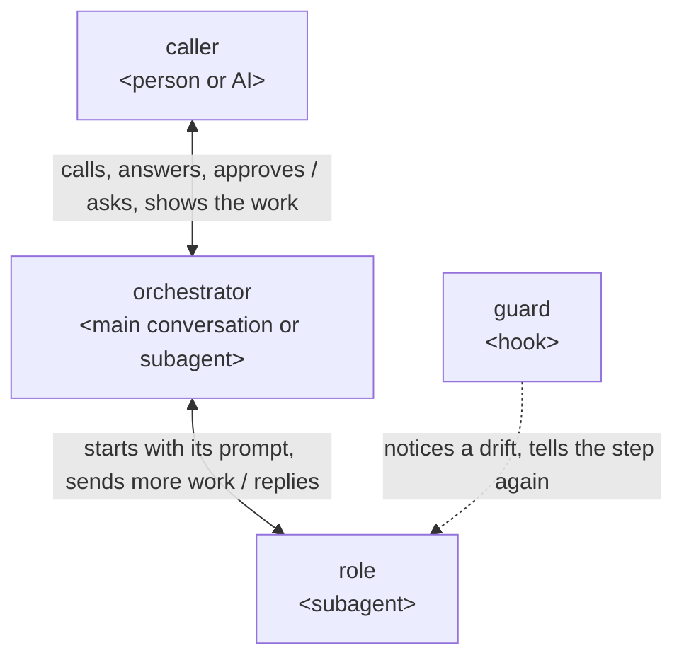
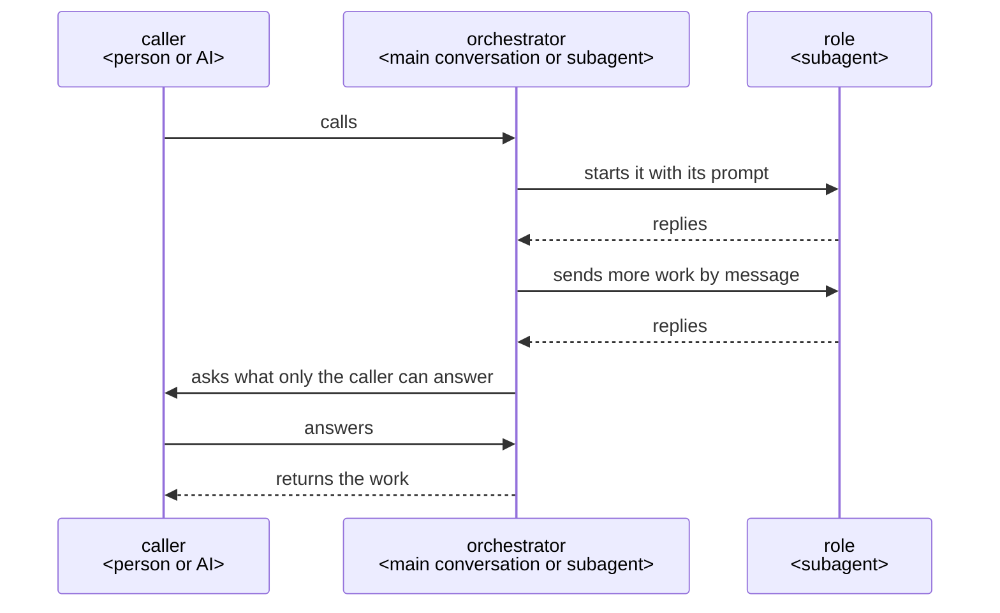

# How a plugin works

This is the architecture every ccpm plugin is built on: how its roles work with one another when
its work takes several steps and ends in something made, such as a document or code; where its
files are placed, how its code is written, and how it is tested and released.

## Who does what

## Principles

Every plugin holds these; each is said with its reason under Why it is so, and a plugin's design
adds only what that plugin gives on top of them.

1. The orchestrator holds the whole run and decides each move.
2. The caller answers only what is theirs to decide and approves it by their own action; the plugin
   does the writing.
3. Each job has a role of its own, given only what the job needs.
4. Each work is first used by AIs that did not make it, in its receiver's place and with what the
   receiver has, each reading it on its own.
5. What a machine can judge is checked by a script or a hook at the moment it happens, which tells
   the role its step again or stops what would break a rule.
6. A fixed course is kept in a script, and the state and each decision are kept before the next
   move, so a run stopped anywhere goes on from there.
7. The purpose comes first and performance after: time is never saved by leaving the caller more
   to fix.
8. After each run, a learner that did no part of the work reads the run's records and gives, from
   the facts, what fell short and why; each lesson goes to the user's own checklists or rules where
   it is their project's own, and to the plugin's makers as an issue where it is general, opened
   only on the user's yes.

## Why it is so

### The orchestrator holds the whole and decides

The orchestrator talks with the caller, holds everything the run has found, and decides each move:
what to ask, what to have made, when to change the plan or make a work again.

Each move brings facts the next one rests on, and only one that holds the whole can weigh them;
talking with the caller itself, it answers a why and changes its proposal on an objection, which a
go-between that holds nothing cannot. Anthropic's
[Building effective agents](https://www.anthropic.com/engineering/building-effective-agents) has
an orchestrator, where "a central LLM dynamically breaks down tasks, delegates them to worker
LLMs", for "complex tasks where you can’t predict the subtasks needed".

### Where the orchestrator runs

A plugin a person calls runs its orchestrator in the main conversation, started by its skill; a
plugin an AI calls, such as one given what to make as JSON, has its orchestrator as an agent the
calling AI starts.

Only the main conversation can ask the person; a subagent cannot
([subagents](https://code.claude.com/docs/en/sub-agents#available-tools)). A plugin an AI calls asks
that AI, which answers or asks the person in turn.

### Languages

A plugin a person calls proposes, as its first point, the language it talks in and the language of
what it writes into the repository: those the repository and the person's instructions set, else
the person's own for the talk and English for the repository; and records the answer. What goes into
the repository is in the second; what is shown to the person is put into the first, adding nothing
and leaving nothing out. A plugin an AI calls writes and tells in the repository's language, and
the caller that talks with the person puts it into theirs.

The person decides from what they read, and a translation that adds or leaves out changes what they
approve; the repository is read later by people who were not in the conversation, and English
reaches the most of them.

### Hearing until nothing is left to decide

The orchestrator asks the caller, with its recommendation, each point only they can decide, until
nothing is left. It finds facts itself, and shows the caller, one at a time, each it found that the
work rests on, to confirm.

A request in rough words leaves points open, and one settled before the work is not met as rework
after it; a fact found and not shown is still assumed in the caller's place, and the work starts
only once the caller confirms the understanding is shared
([grilling](https://github.com/mattpocock/skills/blob/main/skills/productivity/grilling/SKILL.md),
[Let Claude interview you](https://code.claude.com/docs/en/best-practices#let-claude-interview-you)).

### The caller approves what is theirs

What the caller decides, and what is hard to undo, such as a merge, goes to the caller to approve; a
commit or a push is not, as it can be undone.

An AI that decides these in the caller's place has them stand behind what they never saw.

An approval counts only from the caller's own action, such as a skill the AI cannot call
(`disable-model-invocation: true`), never from an agent saying it was given; cc-sdd's agent sets
its own approval flag, which then stops nothing.

### One agent for each job

Each job is done by a role made for it, given only what the job needs.

A role starts in a fresh context with its own prompt and tools
([subagents](https://code.claude.com/docs/en/sub-agents)), so nothing from other work leads it
astray.

### Read by those who did not make it

Each work is used first by AIs that did not make it, standing in for its receiver with what the
receiver has and doing what they do with it, and each gives its verdict from its own reading alone.

The maker finds the Good it meant; a reader that did not make it finds the Good its lines give,
which is what the receiver gets. A reader shown another's verdict finds what it was told, so two
readings add a check only when each is made on its own.

### Where the course is kept

A plugin whose run is a fixed loop, such as turn's make–read–check rounds, may keep its course in a
script of its own, which gives the orchestrator each next step, so the orchestrator cannot go on
without it. A plugin whose course changes with what the run finds, such as rn, keeps it in its
skill's steps, and its plan as a document.

The spec-driven tools read on 2026-10-21 (Spec Kit, BMAD-METHOD, OpenSpec, superpowers, cc-sdd)
all keep a fixed course outside and the plan as a file of tasks it walks, and none runs the steps
within a task from code; OpenSpec calls its own "prompt-level behavior contracts, not enforceable
checks". A course and its rules held in code are held the same way each time, where an AI deciding
may not.

A course fixed in code that the run's findings keep changing has no move for what it did not
foresee.

A run's state is kept in a file in its work folder, placed as
[Where a plugin writes its files](#where-a-plugin-writes-its-files) says, so a run stopped anywhere
goes on from its last move in a new conversation; a conversation ends, is cleared or is compacted,
and what lives only in it is lost.

### Where a plugin writes its files

Besides the work and the files its caller names, a plugin writes what may be kept in
`.<plugin>/<yyyymmdd>-<name>/` at the root of the repository, as rn keeps `.rn/<yyyymmdd>-<slug>/`,
and what is used only while it runs, its tests' and trials' too, in `<plugin>/<yyyymmdd>-<name>/`
in the system's temporary folder, the one Python's `tempfile.gettempdir()` gives. A file an agent
reads with its tools, though used only while the plugin runs, goes in the folder that may be kept,
and is removed once it is used.

In one folder of the plugin's name, what may be kept goes into git or stays out as the user
chooses, by one line of `.gitignore`, and the date at the front sorts the runs and shows the old
ones. What is used only while running needs no step to remove it, which a run stopped partway
would miss, as the system clears its temporary folder itself; that folder is the one TMPDIR names
where it is set, as macOS and sandboxes set it to a folder of their own, not always `/tmp`. Claude
Code lets an agent read without asking only inside the working folder and the folders added to it
(permissions, Permission system), so a file outside it stops an agent working on its own to ask.

### The purpose before performance

A change is taken when the purpose is still met as fully; only then is time or cost cut.

A work that misses the purpose costs the caller the fixing as well as the wait, so time saved by
leaving them more to fix is spent again by them.

### Learning from each run

A plugin takes in what is general and leaves to the user's project only what is the project's own,
and what a user meets that it lacks comes back to it as a lesson. After each run, a learner that
did no part of the work reads the records of every agent of the run and gives each lesson with the
words it rests on quoted. The orchestrator puts each to the user: a lesson of their project's own
goes into their checklists or rules; a general one goes to the plugin's makers as an issue,
holding the need and its points alone, never the user's source, shown to the user whole and opened
only on their own yes, an approval as The caller approves what is theirs says, since an issue on a
public repository is not undone.

What fell short often lies in what a role did, which only its record shows, and a lesson without
the facts it rests on is a guess. A lesson of the project's own improves that project's later work;
the plugins are open source, so a general one, met once, improves the plugin for every user. The
work and its source are the user's, so they choose what leaves their project.

### JSON between agents

What agents hand on as data is JSON, read and changed in the part needed with `jq`.

An agent then changes only the part it needs, with a tool it already knows, and leaves the rest as
it was.

### Messages

A role is started with its prompt and replies at its end; more work for a role already started goes
by message ([SendMessage](https://code.claude.com/docs/en/sub-agents#resume-subagents)), and so does
a question from an orchestrator that is a subagent. Roles do not message one another.

What passes between roles goes through the orchestrator.

### A plugin that uses another

A plugin that has another plugin do a job starts that plugin's orchestrator as one of its roles,
and answers what it asks, or asks its own caller in turn.

A subagent can start subagents down to three layers below the main conversation
([subagents](https://code.claude.com/docs/en/sub-agents#let-subagents-spawn-their-own-subagents)).

### The guard tells each role its steps again

Each step of a role that is not sure to hold has a hook that notices a drift and tells the role
the step again. The hooks are in the plugin's `hooks/hooks.json`, each acting only in the roles it
names.

A hook runs every time, where an instruction is advice
([best practices](https://code.claude.com/docs/en/best-practices)); Claude Code reads no hooks from
a plugin agent's own file ([subagents](https://code.claude.com/docs/en/sub-agents)). A hook is told
which subagent it runs in, and not which skill runs in the main conversation, where a skill's hooks
last the whole session once it has started
([hooks](https://code.claude.com/docs/en/hooks#hooks-in-skills-and-agents)); so an orchestrator in
the main conversation is held by its steps, or the script that keeps its course, and what is hard
to undo by GitHub's branch protection or Claude Code's permission rules.

## Repository structure

### The plugin's folder and dev/

What runs on users' machines is in the plugin's folder, `<plugin>/`; what only its builders need,
such as its UX, its architecture, its tests and its trials, is in `dev/<plugin>/`.

Installing a plugin copies its folder alone, so what only builders need stays off users' machines.

### The READMEs

`<plugin>/README.md` is for the plugin's users; `dev/<plugin>/README.md` links the plugin's
architecture and says how to run its tests and trials once they exist; `dev/README.md` lists each
plugin's folder and links [the order the work goes in](../.claude/rules/dev.md); and the root
`README.md` leads users to each plugin's README and builders to `dev/`. No README is put deeper.

GitHub shows a folder's README when it is opened, so a visitor finds the way by opening folders,
and a README further down repeats its parent's and drifts from it.

### The CHANGELOG

Each plugin keeps its `CHANGELOG.md` in its root, `<plugin>/CHANGELOG.md`, in the form Release
gives.

A user finds what changed for them in the same place for every plugin.

## Code

### Python 3.9 and the standard library

What runs on users' machines is Python 3, 3.9 or later, with the standard library alone, and the
plugin's README says so; a script that only calls an existing tool may be sh.

python3 is wherever git is, while Node.js may not be, and users run 3.9.

### Code kept once

What the plugins already share is used, not written again. Code more than one plugin needs, such
as how a hook reads a command, is kept once in the plugin whose job it is, with its tests in that
plugin's `dev/<plugin>/tests/`, and each other plugin takes it through a relative symbolic link;
what the tests share, such as a repository made once and copied for each test, is kept beside that
code's tests, as lane's `dev/lane/testing.py` is.

Installing copies the target of a link within the marketplace into the plugin
([share files within a marketplace with symlinks](https://code.claude.com/docs/en/plugins/host-marketplace#share-files-within-a-marketplace-with-symlinks)),
so each plugin carries the shared code while it is written, tested and fixed in one place.

### No lines copied

No lines are copied between files, but a test's expected value, written out again. `dev/check.sh`
fails on four lines or more of Python alike in two files, comments, docstrings and imports aside,
as pylint's `duplicate-code` finds them, wherever pyproject.toml's `test-quality` group is
installed; it does not tell a test's expected value apart.

A copy is fixed in one file and left wrong in the other; a test that takes its expected value from
the code checks the code against itself.

### Checks kept in lane

A check on what an AI does is a lane of [lane](../lane/README.md), laid in each plugin by lane's
`lay.py`; one no lane holds is added to lane as a lane of its own, in its own named file, with one
entry file per hook event, as the official
[`hookify`](https://github.com/anthropics/claude-plugins-official/tree/main/plugins/hookify) plugin
does.

Each check is then written and tested once, in lane, and each plugin takes lane's code through a
link; a check kept in a plugin of its own reads the AI's calls apart from lane's and drifts from
it, and a check in a file of its own is read, fixed and tested on its own.

## Test

Each part is checked by its kind: a part made of code by unit tests, a part run by an AI by a
trial of it alone, and the plugin as a whole by acceptance tests of its user stories.

### Unit tests: code

Each part made of code has unit tests, written with `unittest` in `dev/<plugin>/tests/`, that run
every line and every branch of it (C0 and C1 coverage, 100%). Mutation testing with Cosmic Ray, in
which the unit tests must catch every mutant but those of a line marked `# pragma: no mutate`, where
no input the code takes tells the mutant apart, for the reason the plugin's `cosmic-ray.toml` gives
once, and property tests with Hypothesis, on new inputs each
time, which must all pass, check that the unit tests are enough; each input a property test fails on
is added as a unit test.

The unit tests hold each behavior the code must have, and a line or branch none of them runs goes
unnoticed; a gap the other two find is a unit test missing, kept so that every push catches it
again.

CI runs every plugin's unit tests on every push, counts the lines and branches they run and fails
on any not run; it runs the mutation testing and the property tests on what the push changed, the
property tests on many inputs, each plugin's in a job of its own, all at once, and both whole for a
plugin whose version the push changes, before it is released. Each check runs on Python 3.9 and the
newest, Cosmic Ray and Hypothesis on the newest alone. Before each push, `dev/githooks/pre-push`
runs the checks on what the push changes, the unit tests of each plugin it changes, the property
tests on few inputs and the mutants on the lines it changes, and stops the push on a failure. CI's
`tests` job runs on every push, and skips the checks on a push that changes only what no check
reads, such as the session records and the documents of `dev/`, where the commit before it passed.

The code must run on 3.9, and the two tools need newer versions only to test, not to run; a check
left to be run by hand is forgotten and found only by CI after the push, and checking what a change
touches takes seconds to a minute where checking the whole takes long, so the whole is checked when
it reaches users; `main` takes a pull request only when `tests` has passed, so it always runs, and
passes on only what was checked.

A plugin's whole test run takes seconds, and the time each check takes is read on every run.

Mutation testing runs the tests once for each mutant, so a slow test run makes every change wait.

### Unit tests: prompts

Each role, a skill or an agent, is tried on its own, with everything but it stood in for by mocks,
on Opus, named in each run, the model used by the maintainer, the person who has the plugins built
and decides what reaches their users, and judged from its input, its output and the records of
the run against its Role and Steps.

A prompt is known by what the AI does with it, and only the records show where a run went wrong;
a role tried together with what lies around it does not show which of them went wrong; a smaller
model's slips are not the ones users meet, and a model left to the runner's settings changes with
whoever runs the trial.

### Acceptance tests: user stories

The whole plugin is tried as its user uses it, its results are checked, and it is shown to the
maintainer with how close it came to the goal and to each key result of the UX and what could be
improved; the maintainer judges.

Each part can pass while a story is missed; and what reaches users is the maintainer's to decide.

A trial that needs a real GitHub repository runs in `lovaizu/playground`, one at a time, on a
branch of its own, and the branch, its pull requests and whatever else it made there are removed
when it ends. The code that runs a trial, of the whole or of a role, is kept in
`dev/<plugin>/trials/`, out of the lines and branches counted.

CI cannot start Claude Code, so each trial is a check of its own; pull requests and pushes a trial
makes stay out of every repository people use, `main` there takes nothing but through a reviewed
pull request, and two trials at once, or one left behind, would mix with the next.

## Release

### On the maintainer's word

A plugin is released only on an explicit instruction from the maintainer, not on a merge to
`main`; until then, the changes users would notice wait under the CHANGELOG's `## [Unreleased]`.

Users receive an update only when the version is bumped, so the maintainer decides when it reaches
them.

### The manifests checked

Each plugin passes `claude plugin validate <plugin-path> --strict`, and the marketplace
`claude plugin validate <marketplace-root> --strict`.

A malformed manifest fails for every user at install, before any behavior is reached.

### The version

`version` is written in exactly one place, the plugin's `plugin.json`, and always set, in semver,
such as `0.1.0`. Its increment is decided by the largest change from the users' side: major for a
breaking change, minor instead on `0.x`; minor for a new or changed behavior users see; patch for
no change in behavior.

When both are set, `plugin.json` wins over the marketplace entry, so a second copy is meaningless;
`claude plugin validate --strict` fails when it is unset.

### The CHANGELOG's form

The CHANGELOG is in [Keep a Changelog](https://keepachangelog.com) form: one
`## [x.y.z] - YYYY-MM-DD` for each release, grouped under `Added`, `Changed`, `Fixed` and `Removed`
as they apply, with one line for every change a user would notice, written as
`<what changed> — <why it helps the user>`; typos, refactors, internal documents and formatting get
none. On a release, `## [Unreleased]` is renamed to the version and date, and no empty
`## [Unreleased]` is left behind; it is made again when the next change users would notice lands.

A user reads what changed for them and why it helps them.

### The steps of a release

1. The assistant, the AI that builds the plugins, bumps `version` in `plugin.json`, finalizes
   `CHANGELOG.md`, makes the [final check](../.claude/rules/final-check.md), commits and pushes.
2. The assistant asks the maintainer to merge the pull request to `main`; it never merges it itself
   and never uses `--admin`, as `main` is protected and only the maintainer can clear its required
   review.
3. The maintainer merges, and says so.
4. The assistant tags `main` as `<plugin>--v<version>`, such as `rn--v0.2.0`, with
   `claude plugin tag --push` from the plugin's folder, and publishes a GitHub Release for that tag
   with the CHANGELOG's matching section as its notes.

The tag is in Claude Code's own form: a plugin that depends on another with a version range
resolves it against these tags, and the prefix lets each plugin take versions apart from the
others; the command also checks the plugin and refuses a tag that already exists. When a plugin
was released is read from its tags and Releases, not from merge commits.

### Registering in the marketplace

On a plugin's first release, and whenever a plugin is renamed or removed, it is registered: one
entry under `plugins` in `.claude-plugin/marketplace.json`, with `name`, `description`, `source`,
such as `./rn`, and `category`
([plugin entries](https://code.claude.com/docs/en/plugins/marketplace-reference#plugin-entries));
and a line in the root `README.md` linking its README, with a one-line description. The two are
changed together.

Claude Code installs from the marketplace entry and people find the plugin from the root README; a
plugin counts as shipped only once both can reach it.
