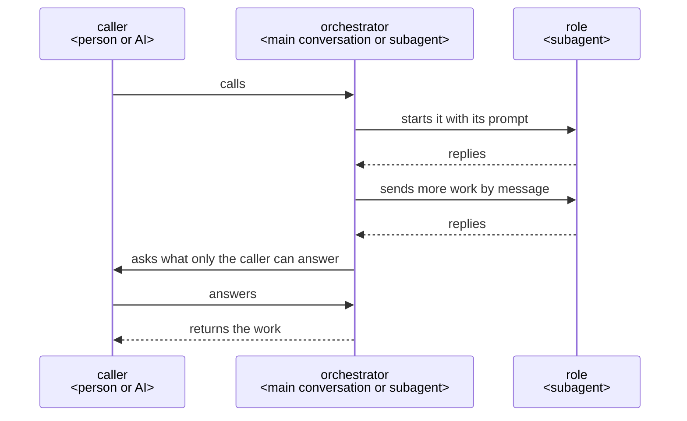

# How a plugin works

This is the architecture every ccpm plugin is built on: how its roles work with one another when
its work takes several steps and ends in something made, such as a document or code; where its
files are placed, how its code is written, and how it is tested and released.

## Who does what

## Principles

Every plugin holds these; each is said with its reason under Why it is so, and a plugin's design
adds only what that plugin gives on top of them.

1. The orchestrator holds the whole run and decides each move, and tells its caller only when a
   role starts or ends, when it asks and when it returns the result.
2. The caller answers only what is theirs to decide and approves it by their own action; the plugin
   does the writing, and settles and names as chosen each choice that is not the caller's.
3. Each job has a role of its own, given only what the job needs.
4. Each work is first used by AIs that did not make it, in its receiver's place and with what the
   receiver has, each first reading it on its own and giving each item the lines of its Good or,
   where it finds none, what the receiver would need to get it, which goes to the maker through the
   orchestrator. A work the caller reads whole to approve as soon as it is made, such as a plan, is
   read first by the caller. Every maker checks its work item by item, giving each by the lines of
   its Good.
5. What a machine can judge, of what an AI does or of the work it makes, is checked by a script, a
   hook or the project's own tools, such as a formatter, a linter and a type checker, which tells
   the role its step again or stops what would break a rule; an AI reads for what only a reader can
   judge.
6. A fixed course is kept in a script that gives the orchestrator only the moves the run needs, and
   the state and each decision are written to a file before the next move, so a run stopped
   anywhere, or given an answer, goes on from where it stood.
7. The purpose comes first and performance after: time is never saved by leaving the caller more
   to fix.
8. Once the caller approves the finished work, the orchestrator looks once for what fell short and
   why, in what the run kept and in the records; each lesson goes to the user's own checklists or
   rules where it is their project's own, and to the plugin's makers as an issue where it is
   general, opened only on the user's yes. A plugin an AI calls leaves this to its caller.
9. Each entry Claude Code gives the form of, a skill, an agent, a hook or a command line, takes the
   call and hands it to the part that does the job, kept in a file of its own named for that part,
   so the files show the parts the logical view draws.
10. Every check, a script's, a hook's, a test's, CI's or a reader's, ends in one of three: no
    problem, a problem found, or could not check with why; what follows each way it can fail to
    check is decided beforehand and tested.
11. Where what keeps the work from going on lies outside it, such as the environment, a permission
    or a missing tool, the run stops and tells its caller what was tried, what was confirmed and
    what was not, and what it needs.

## Why it is so

### The orchestrator holds the whole and decides

The orchestrator talks with the caller, holds everything the run has found, and decides each move:
what to ask, what to have made, when to change the plan or make a work again.

Each move brings facts the next one rests on, and only one that holds the whole can weigh them;
talking with the caller itself, it answers a why and changes its proposal on an objection, which a
go-between that holds nothing cannot. Anthropic's
[Building effective agents](https://www.anthropic.com/engineering/building-effective-agents) has
an orchestrator, where "a central LLM dynamically breaks down tasks, delegates them to worker
LLMs", for "complex tasks where you can’t predict the subtasks needed".

It tells its caller of the run when a role starts or ends, when it asks and when it returns the
result, each line said within the move it goes with.

These are where the caller can see the run going a slow or wrong way, or must act; a line before
every move is one more move for each, read by no one, as in a trial of rn on 2026-10-27 where turn
sent the main conversation 81 lines over 8 calls.

### Where the orchestrator runs

A plugin a person calls runs its orchestrator in the main conversation, started by its skill; a
plugin an AI calls, such as one given what to make as JSON, has its orchestrator as an agent the
calling AI starts.

Only the main conversation can ask the person; a subagent cannot
([subagents](https://code.claude.com/docs/en/sub-agents#available-tools)). A plugin an AI calls asks
that AI, which answers or asks the person in turn.

### Languages

A plugin a person calls proposes, as its first point, the language it talks in and the language of
what it writes into the repository: those the repository and the person's instructions set, else
the person's own for the talk and English for the repository; and records the answer. What goes into
the repository is in the second; what is shown to the person is put into the first, adding nothing
and leaving nothing out. A plugin an AI calls writes and tells in the repository's language, and
the caller that talks with the person puts it into theirs.

The person decides from what they read, and a translation that adds or leaves out changes what they
approve; the repository is read later by people who were not in the conversation, and English
reaches the most of them.

### Hearing until nothing is left to decide

The orchestrator asks the caller, with its recommendation, each point only they can decide, until
nothing is left. It finds facts itself, and shows the caller, one at a time, each it found that the
work rests on, to confirm.

A request in rough words leaves points open, and one settled before the work is not met as rework
after it; a fact found and not shown is still assumed in the caller's place, and the work starts
only once the caller confirms the understanding is shared
([grilling](https://github.com/mattpocock/skills/blob/main/skills/productivity/grilling/SKILL.md),
[Let Claude interview you](https://code.claude.com/docs/en/best-practices#let-claude-interview-you)).

A choice the purpose and the project's practice settle, such as where a test goes or what a file
holds that the work needs, is not the caller's: the role that meets it settles it and names it as
chosen with why, where the caller sees it and can change it.

A question costs the caller a reading and an answer and holds the run until it comes; asked of what
they do not care about, it spends their time on the plugin's job, as in that trial, where most of
its 11 questions were of this kind.

### The caller approves what is theirs

What the caller decides, and what is hard to undo, such as a merge, goes to the caller to approve; a
commit or a push is not, as it can be undone.

An AI that decides these in the caller's place has them stand behind what they never saw.

An approval counts only from the caller's own action, such as a skill the AI cannot call
(`disable-model-invocation: true`), never from an agent saying it was given; cc-sdd's agent sets
its own approval flag, which then stops nothing.

### One agent for each job

Each job is done by a role made for it, given only what the job needs.

A role starts in a fresh context with its own prompt and tools
([subagents](https://code.claude.com/docs/en/sub-agents)), so nothing from other work leads it
astray.

### Entries hand to the parts

An entry holds only what Claude Code fixes of it and hands the job to its part: a command line reads
its arguments and calls the part's module, a hook's script reads the event and calls the part that
answers it, and a skill or an agent is its frontmatter and a body that points to its part and says
where each script, file or folder the part names lies, the part naming each by its name alone, as
`turn.py`, never by where it is installed. The entries lie where Claude Code looks for them, in
`agents/`, `skills/` and `hooks/`; a plugin's own parts lie in `prompts/`, those written as a
prompt, and in `scripts/`, those written as code, each in a file named for the part the logical view
draws, and lane's guard, which each plugin takes in, in `hooks/lane/`, where lane lays it.

The form of an entry is Claude Code's, where a skill's folder is named by its command and an agent
is called by the name in its frontmatter, while the job is the plugin's; a job held in its entry is
found by the command it is called with, not where the logical view puts it, and a second entry to
the same job, as `/rn:ty` beside `/rn:up`, reads into the first. In Cockburn's
[ports and adapters](https://alistair.cockburn.us/hexagonal-architecture/), "as events arrive from
the outside world at a port, a technology-specific adapter converts it into a usable procedure call
or message and passes it to the application".

An agent's body has it read its part whole before anything else, held by a lane, as Claude Code
makes the body its system prompt and takes in no other file
([subagents](https://code.claude.com/docs/en/sub-agents)); a skill's body links its part, as
Claude Code has a skill "reference supporting files from `SKILL.md`"
([skills](https://code.claude.com/docs/en/skills)). Tried on 2026-10-26 with a plugin of its own,
each of twenty runs read its part first and followed it; after `/compact`, the part a skill links
came back attached whole, where a skill's own body was left only as the summary retold it.
Claude Code puts the plugin's folder in for `${CLAUDE_PLUGIN_ROOT}` in what it gives from an entry's
own body, not in what the Bash tool runs ([plugins
reference](https://code.claude.com/docs/en/plugins-reference#environment-variables)), nor, in a
trial of turn on 2026-10-26, in a part read with Read: a part naming
`${CLAUDE_PLUGIN_ROOT}/scripts/turn.py` ran `/scripts/turn.py`, where a part naming `probe.py`,
which its entry said where it lies, ran it in each of twelve runs, an agent's and a skill's, and
after `/compact` in each of three, the summary keeping where it lies. Where the plugin is installed
is Claude Code's, which the entry adapts as ports and adapters has it, and the part, the job, holds
none of it.

### Read by those who did not make it

Each work is used first by AIs that did not make it, standing in for its receiver with what the
receiver has and doing what they do with it, and each gives its verdict from its own first reading
alone.

The maker finds the Good it meant; a reader that did not make it finds the Good its lines give,
which is what the receiver gets. A reader shown another's verdict finds what it was told, so two
readings add a check only when each is made on its own.

A reader finds an item's Good by whether the receiver can use the work for what they use it for, and
where it finds none, says in one sentence what the receiver would need to get it, not how to make
it; what a machine can judge it leaves to the checks that judge it (Principle 5).

A reader that hunts for defects finds one in every work it reads, and each is mended whether or not
the receiver would ever meet it, so the rounds go on while the work does not get better for its
receiver; in that trial, of about 25 works sent back, about 12 were for defects found by running the
work, 8 for what a linter or a type checker would have shown, and 5 for wording.

How the work gives each Good is its maker's, who holds the sources, so the reader says what the
receiver would need, not how, and the maker mends the work for what the receiver uses it for; a
fault named for the maker to answer sets the two weighing the fault, where the receiver's use is
what both are there for.

A work whose receiver is the caller, read whole by them to approve it as soon as it is made, such as
a plan, is read first by its receiver itself: a reader in their place adds a reading the caller
makes next anyway, and costs its time at every remake.

Every maker checks its work against its checklist item by item once it is made, giving each by the
lines of the work that give its Good, `<path>:<from>-<to>`, with no words; on a remake it gives
again only the items sent. Each item says what is run and how far, so maker and reader run the
same.

Finding the lines has the maker look at the place, and lines are what a script, a reader or the
caller can check, where a claim in words is read by no one and costs its writing at every round; in
that trial the generator rewrote such a claim of every item each round, 23,000 characters, which
only a form check read. Two who run the same check see the same result, so an item one of them finds
without Good is not a difference in what each chose to run.

### Where the course is kept

A plugin whose run is a fixed loop, such as turn's make–read–check rounds, may keep its course in a
script of its own, which gives the orchestrator each next step, so the orchestrator cannot go on
without it. A plugin whose course changes with what the run finds, such as rn, keeps it in its
skill's steps, and its plan as a document.

The spec-driven tools read on 2026-10-21 (Spec Kit, BMAD-METHOD, OpenSpec, superpowers, cc-sdd)
all keep a fixed course outside and the plan as a file of tasks it walks, and none runs the steps
within a task from code; OpenSpec calls its own "prompt-level behavior contracts, not enforceable
checks". A course and its rules held in code are held the same way each time, where an AI deciding
may not.

A course fixed in code that the run's findings keep changing has no move for what it did not
foresee.

The script gives the orchestrator only the moves that need it, such as starting a role, sending it
a message, asking and returning the result, and does itself what a script can, such as checking a
reply's form or waiting for a role's end, each wait one move.

Each move the orchestrator makes is a turn of the model read with the whole conversation, so a move
the script could make costs time and grows what every later move reads; in that trial turn's
orchestrator made 236 moves over 8 calls, where two rounds need about eight each.

A run's state is kept in a file in its work folder, placed as
[Where a plugin writes its files](#where-a-plugin-writes-its-files) says, and each decision and
answer is written there before the next move, so a run stopped anywhere goes on from its last move in
a new conversation, and an answer is taken in where the run stands; what is kept is committed and
pushed at a step's end.

A conversation ends, is cleared or is compacted, and what lives only in it is lost; going on from a
stop needs the file, not the push, and a run started again for an answer spends again what it had
already made.

### Where a plugin writes its files

Besides the work and the files its caller names, a plugin writes what may be kept in
`.<plugin>/<yyyymmdd>-<name>/` at the root of the repository, as rn keeps `.rn/<yyyymmdd>-<slug>/`,
and what is used only while it runs, its tests' and trials' too, in `<plugin>/<yyyymmdd>-<name>/`
in the system's temporary folder, the one Python's `tempfile.gettempdir()` gives. A file an agent
reads with its tools, though used only while the plugin runs, goes in the folder that may be kept,
and is removed once it is used.

In one folder of the plugin's name, what may be kept goes into git or stays out as the user
chooses, by one line of `.gitignore`, and the date at the front sorts the runs and shows the old
ones. What is used only while running needs no step to remove it, which a run stopped partway
would miss, as the system clears its temporary folder itself; that folder is the one TMPDIR names
where it is set, as macOS and sandboxes set it to a folder of their own, not always `/tmp`. Claude
Code lets an agent read without asking only inside the working folder and the folders added to it
(permissions, Permission system), so a file outside it stops an agent working on its own to ask.

### The purpose before performance

A change is taken when the purpose is still met as fully; only then is time or cost cut.

A work that misses the purpose costs the caller the fixing as well as the wait, so time saved by
leaving them more to fix is spent again by them.

### Learning from each run

A plugin takes in what is general and leaves to the user's project only what is the project's own,
and what a user meets that it lacks comes back to it as a lesson. Once the caller approves the
finished work, the orchestrator looks once through what the run kept for each work sent back, made
again or point asked again, and checks each cause it doubts in the records of the run, so each
lesson comes with the words it rests on quoted. It puts each to the user: a lesson of their
project's own goes into their checklists or rules; a general one goes to the plugin's makers as an
issue, holding the need and its points alone, never the user's source, shown to the user whole and
opened only on their own yes, an approval as The caller approves what is theirs says, since an issue
on a public repository is not undone.

Looked for once, the lessons cost the user one reading, where lessons at each approval are weighed
in every session; what the run kept holds every send-back and remake, as each move is kept before
the next (Principle 6), and a cause named without its record is a guess. A plugin an AI calls is
one move of its caller's run, so what fell short in it shows in what that run kept, beside the rest.
A lesson of the project's own improves that project's later work; the plugins are open source, so a
general one, met once, improves the plugin for every user. The work and its source are the user's,
so they choose what leaves their project.

### JSON between agents

What agents hand on as data is JSON, read and changed in the part needed with `jq`.

An agent then changes only the part it needs, with a tool it already knows, and leaves the rest as
it was.

### Messages

A role is started with its prompt and replies at its end; more work for a role already started goes
by message ([SendMessage](https://code.claude.com/docs/en/sub-agents#resume-subagents)), and so does
a question from an orchestrator that is a subagent. Roles do not message one another.

What passes between roles goes through the orchestrator, what a reader says the receiver would need
too.

The orchestrator holds the whole run (Principle 1), so only it knows what each role has been given
and where the run stands; an exchange it does not see leaves the run's state behind the work.

### A plugin that uses another

A plugin that has another plugin do a job starts that plugin's orchestrator as one of its roles,
and answers what it asks, or asks its own caller in turn.

A subagent can start subagents down to three layers below the main conversation
([subagents](https://code.claude.com/docs/en/sub-agents#let-subagents-spawn-their-own-subagents)).

### The guard tells each role its steps again

Each step of a role that is not sure to hold has a hook that notices a drift and tells the role
the step again. The hooks are in the plugin's `hooks/hooks.json`, each acting only in the roles it
names.

A hook runs every time, where an instruction is advice
([best practices](https://code.claude.com/docs/en/best-practices)); Claude Code reads no hooks from
a plugin agent's own file ([subagents](https://code.claude.com/docs/en/sub-agents)). A hook is told
which subagent it runs in, and not which skill runs in the main conversation, where a skill's hooks
last the whole session once it has started
([hooks](https://code.claude.com/docs/en/hooks#hooks-in-skills-and-agents)); so an orchestrator in
the main conversation is held by its steps, or the script that keeps its course, and what is hard
to undo by GitHub's branch protection or Claude Code's permission rules.

### What a machine can see of the work

A project whose work is code has a formatter, a linter and a type checker set up and run in the
command that checks the work; makers and readers do not look for what they show.

A tool finds the same thing every time and at once, where an AI reading for it finds some and spends
a round on each; in that trial the project had none, and 8 of the works sent back were for what
they would have shown.

### No check passes what it did not check

Every check ends in no problem, a problem found, or could not check with why, and for each way it
can fail to check, what then follows is decided beforehand and tested: a hook whose script fails or
times out, or that cannot parse a command, stops the call and says so; a test skipped is not a test
passed; a CI job that did not run does not pass; a reader whose command did not run gives no Good.

A check that says nothing when it could not check is read as one that found nothing, so what it was
there to stop goes through unseen; a case decided only when it is met is decided in a hurry, by
whoever meets it.

### A stop that says what it needs

Where what keeps the work from going on lies outside it, such as a network blocked, a permission
not given or a tool not installed, the run takes no way round it: it stops and tells its caller
what it tried, what it confirmed and what it could not, and what it needs to go on.

The caller can clear such a cause in a moment, where the run cannot; a way round spends the run's
time and leaves a work whose checks were made under other terms than the purpose set, and the
caller cannot tell what of it holds unless the stop says what was and was not confirmed.

## Repository structure

### The plugin's folder and dev/

What runs on users' machines is in the plugin's folder, `plugins/<plugin>/`; what only its
builders need, such as its UX, its architecture, its tests and its trials, is in `dev/<plugin>/`.

Installing a plugin copies its folder alone, so what only builders need stays off users' machines.
The plugins' folders are kept together in `plugins/`, as the official marketplaces
[anthropics/claude-plugins-official](https://github.com/anthropics/claude-plugins-official) and
[anthropics/claude-code](https://github.com/anthropics/claude-code) keep theirs, so the root holds
only what the whole repository needs.

### The READMEs

`plugins/<plugin>/README.md` is for the plugin's users; `dev/<plugin>/README.md` links the
plugin's architecture and says how to run its tests and trials once they exist; `dev/README.md`
lists each plugin's folder, says how to run the checks every plugin shares, and links
[the order the work goes in](../.claude/rules/dev.md); and the root
`README.md` leads users to each plugin's README and builders to `dev/`. No README is put deeper.

GitHub shows a folder's README when it is opened, so a visitor finds the way by opening folders,
and a README further down repeats its parent's and drifts from it.

### The CHANGELOG

Each plugin keeps its `CHANGELOG.md` in its root, `plugins/<plugin>/CHANGELOG.md`, in the form
Release gives.

A user finds what changed for them in the same place for every plugin.

## Code

### Python 3.9 and the standard library

What runs on users' machines is Python 3, 3.9 or later, with the standard library alone, and the
plugin's README says so; a script that only calls an existing tool may be sh.

python3 is wherever git is, while Node.js may not be, and users run 3.9.

### Code kept once

What the plugins already share is used, not written again. Code more than one plugin needs, such
as how a hook reads a command, is kept once in the plugin whose job it is, with its tests in that
plugin's `dev/<plugin>/tests/`, and each other plugin takes it through a relative symbolic link;
what the tests share, such as a repository made once and copied for each test, is kept beside that
code's tests, as lane's `dev/lane/testing.py` is.

Installing copies the target of a link within the marketplace into the plugin
([share files within a marketplace with symlinks](https://code.claude.com/docs/en/plugins/host-marketplace#share-files-within-a-marketplace-with-symlinks)),
so each plugin carries the shared code while it is written, tested and fixed in one place.

### No lines copied

No lines are copied between files, but a test's expected value, written out again. `dev/check.sh`
fails on four lines or more of Python alike in two files, comments, docstrings and imports aside,
as pylint's `duplicate-code` finds them, wherever pyproject.toml's `test-quality` group is
installed; it does not tell a test's expected value apart.

A copy is fixed in one file and left wrong in the other; a test that takes its expected value from
the code checks the code against itself.

### Checks kept in lane

A check on what an AI does is a lane of [lane](../plugins/lane/README.md), laid in each plugin by
lane's `lay.py`; one no lane holds is added to lane as a lane of its own, in its own named file,
with one entry file per hook event, as the official
[`hookify`](https://github.com/anthropics/claude-plugins-official/tree/main/plugins/hookify) plugin
does.

Each check is then written and tested once, in lane, and each plugin takes lane's code through a
link; a check kept in a plugin of its own reads the AI's calls apart from lane's and drifts from
it, and a check in a file of its own is read, fixed and tested on its own.

## Test

Each part is checked by its kind: a part made of code by unit tests, a part run by an AI by a
trial of it alone, and the plugin as a whole by acceptance tests of its user stories.

### Unit tests: code

Each part made of code has unit tests, written with `unittest` in `dev/<plugin>/tests/`, that run
every line and every branch of it (C0 and C1 coverage, 100%). Mutation testing with Cosmic Ray, in
which the unit tests must catch every mutant but those of a line marked `# pragma: no mutate`, where
no input the code takes tells the mutant apart, for the reason the plugin's `cosmic-ray.toml` gives
once, and property tests with Hypothesis, on new inputs each
time, which must all pass, check that the unit tests are enough; each input a property test fails on
is added as a unit test.

The unit tests hold each behavior the code must have, and a line or branch none of them runs goes
unnoticed; a gap the other two find is a unit test missing, kept so that every push catches it
again.

CI runs every plugin's unit tests on every push, counts the lines and branches they run and fails
on any not run; it runs the mutation testing and the property tests on what the push changed, the
property tests on many inputs, each plugin's in a job of its own, all at once, and both whole for a
plugin whose version the push changes, before it is released. Each check runs on Python 3.9 and the
newest, Cosmic Ray and Hypothesis on the newest alone. Before each push, `dev/githooks/pre-push`
runs the unit tests of each plugin the push changes, with their lines and branches counted, and the
linter, the formatter, the type checker and the manifests' check, and stops the push on a failure;
the property tests and the mutation testing are CI's. CI's
`tests` job runs on every push, and skips the checks on a push that changes only what no check
reads, such as the session records and the documents of `dev/`, where the commit before it passed.

The code must run on 3.9, and the two tools need newer versions only to test, not to run; a check
left to be run by hand is forgotten and found only by CI after the push; the tests are designed
before the code and the coverage shows each line and branch run, so the property tests and the
mutation testing only confirm that design, and run before a push, on many inputs or once per
mutant, they hold every change waiting, a survivor CI finds going back to the test design that
missed it; checking what a change touches takes minutes where checking the whole takes long, so
the whole is checked when it reaches users, a test weakened with no line of code changed among what
only the whole finds; `main` takes a pull request only when `tests` has passed, so it always runs, and
passes on only what was checked.

A plugin's whole test run takes seconds, and the time each check takes is read on every run.

Mutation testing runs the tests once for each mutant, so a slow test run makes every change wait.

### Unit tests: prompts

Each role, a skill or an agent, is tried on its own, with everything but it stood in for by mocks,
on Opus, named in each run, the model used by the maintainer, the person who has the plugins built
and decides what reaches their users, and judged from its input, its output and the records of
the run against its Role and Steps.

A prompt is known by what the AI does with it, and only the records show where a run went wrong;
a role tried together with what lies around it does not show which of them went wrong; a smaller
model's slips are not the ones users meet, and a model left to the runner's settings changes with
whoever runs the trial.

### Acceptance tests: user stories

The whole plugin is tried as its user uses it, its results are checked, and it is shown to the
maintainer with how close it came to the goal and to each key result of the UX, the time and the
tokens it took beside the size of the work, and what could be improved; the maintainer judges.
Each run's time and tokens are kept with the trial's records, so runs can be compared.

Each part can pass while a story is missed; and what reaches users is the maintainer's to decide.
Whether the time and tokens fit the work is judged by feel, as no bar is known before runs gather,
and runs kept side by side show whether a change made it better or worse, the purpose met as
fully (Principle 7).

A trial that needs a real GitHub repository runs in `lovaizu/playground`, one at a time, on a
branch of its own, and the branch, its pull requests and whatever else it made there are removed
when it ends. The code that runs a trial, of the whole or of a role, is kept in
`dev/<plugin>/trials/`, out of the lines and branches counted.

CI cannot start Claude Code, so each trial is a check of its own; pull requests and pushes a trial
makes stay out of every repository people use, `main` there takes nothing but through a reviewed
pull request, and two trials at once, or one left behind, would mix with the next.

## Release

### On the maintainer's word

A plugin is released only on an explicit instruction from the maintainer, not on a merge to
`main`; until then, the changes users would notice wait under the CHANGELOG's `## [Unreleased]`.

Users receive an update only when the version is bumped, so the maintainer decides when it reaches
them.

### The manifests checked

Each plugin passes `claude plugin validate <plugin-path> --strict`, and the marketplace
`claude plugin validate <marketplace-root> --strict`.

A malformed manifest fails for every user at install, before any behavior is reached.

### The version

`version` is written in exactly one place, the plugin's `plugin.json`, and always set, in semver,
such as `0.1.0`. Its increment is decided by the largest change from the users' side: major for a
breaking change, minor instead on `0.x`; minor for a new or changed behavior users see; patch for
no change in behavior.

When both are set, `plugin.json` wins over the marketplace entry, so a second copy is meaningless;
`claude plugin validate --strict` fails when it is unset.

### The CHANGELOG's form

The CHANGELOG is in [Keep a Changelog](https://keepachangelog.com) form: one
`## [x.y.z] - YYYY-MM-DD` for each release, grouped under `Added`, `Changed`, `Fixed` and `Removed`
as they apply, with one line for every change a user would notice, written as
`<what changed> — <why it helps the user>`; typos, refactors, internal documents and formatting get
none. On a release, `## [Unreleased]` is renamed to the version and date, and no empty
`## [Unreleased]` is left behind; it is made again when the next change users would notice lands.

A user reads what changed for them and why it helps them.

### The steps of a release

1. The assistant, the AI that builds the plugins, bumps `version` in `plugin.json`, finalizes
   `CHANGELOG.md`, makes the [final check](../.claude/rules/final-check.md), commits and pushes.
2. The assistant asks the maintainer to merge the pull request to `main`; it never merges it itself
   and never uses `--admin`, as `main` is protected and only the maintainer can clear its required
   review.
3. The maintainer merges, and says so.
4. The assistant tags `main` as `<plugin>--v<version>`, such as `rn--v0.2.0`, with
   `claude plugin tag --push` from the plugin's folder, and publishes a GitHub Release for that tag
   with the CHANGELOG's matching section as its notes.

The tag is in Claude Code's own form: a plugin that depends on another with a version range
resolves it against these tags, and the prefix lets each plugin take versions apart from the
others; the command also checks the plugin and refuses a tag that already exists. When a plugin
was released is read from its tags and Releases, not from merge commits.

### Registering in the marketplace

On a plugin's first release, and whenever a plugin is renamed or removed, it is registered: one
entry under `plugins` in `.claude-plugin/marketplace.json`, with `name`, `description`, `source`,
such as `./rn`, and `category`
([plugin entries](https://code.claude.com/docs/en/plugins/marketplace-reference#plugin-entries));
and a line in the root `README.md` linking its README, with a one-line description. The two are
changed together.

Claude Code installs from the marketplace entry and people find the plugin from the root README; a
plugin counts as shipped only once both can reach it.
