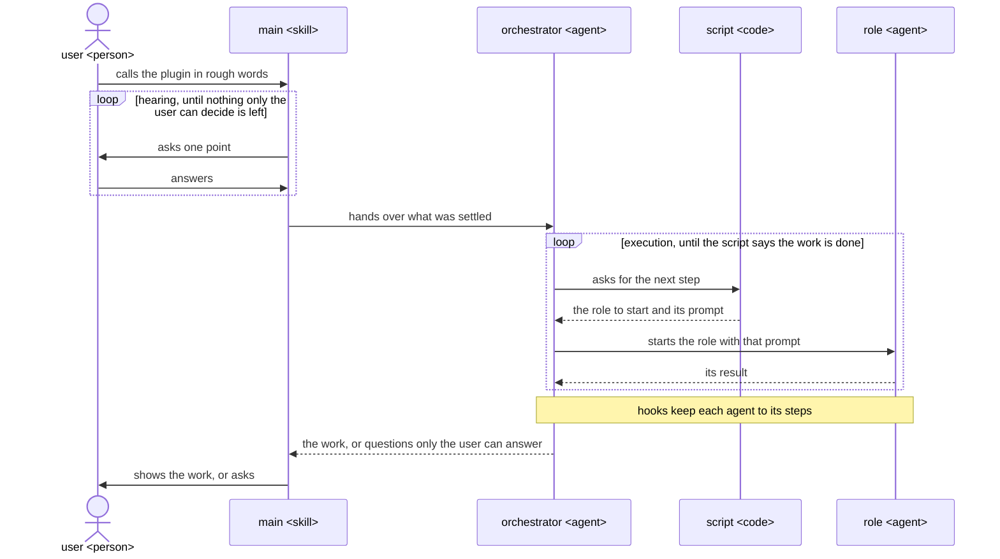

# How a plugin works

A ccpm plugin is called in rough words, asks the user what only they can decide, and has the work
done by agents that each do one job, so the same request gives the same work each time.

- main talks with the user and does no work of its own.

  An agent cannot ask the user, and main's hooks cannot tell which skill it runs, and last the
  whole session once a skill has started.
- Each job is done by an agent made for it.

  An agent starts with its own steps and tools alone, and its hooks know they run in it, so it does
  the job the same way each time.
- The script decides the next step, and the orchestrator does what it prints.

  Code decides the order the same way each time.
- The hooks are in the plugin's `hooks/hooks.json`, each acting only in the agents it names.

  Claude Code reads no hooks from a plugin agent's own file.
