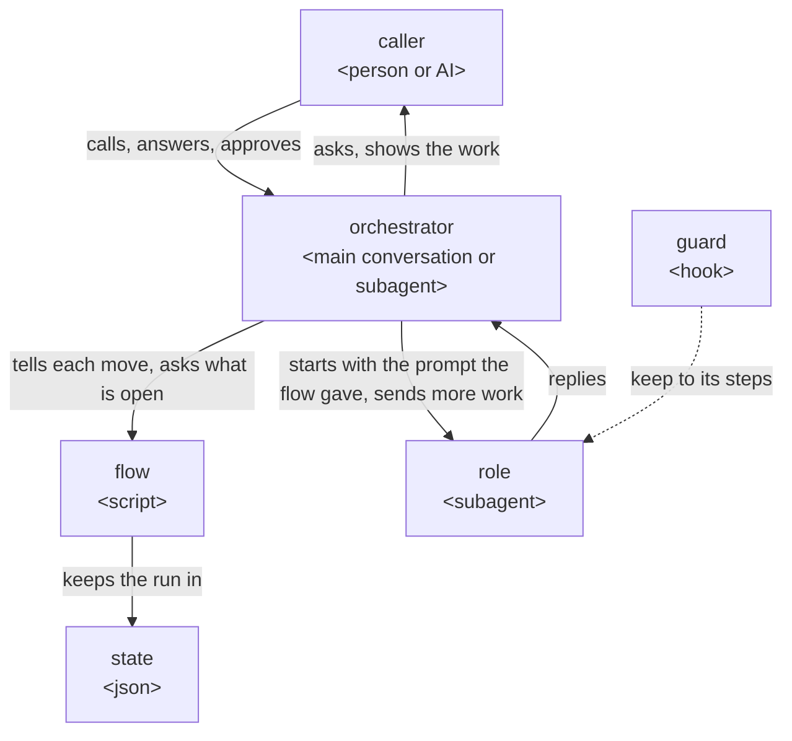
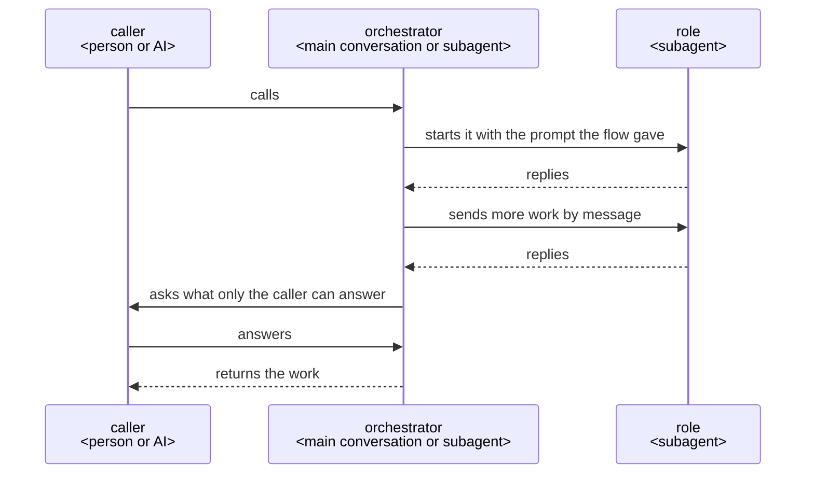

# How a plugin works

This is how a ccpm plugin is built when its work takes several steps, done by several roles that
work with one another, and ends in something made, such as a document or code.

## Who does what

## Why it is so

### The orchestrator holds the whole and decides

The orchestrator talks with the caller, holds everything the run has found, and decides each move:
what to ask, what to have made, when to change the plan or make a work again.

Each move brings facts the next one rests on, and only one that holds the whole can weigh them;
talking with the caller itself, it answers a why and changes its proposal on an objection, which a
go-between that holds nothing cannot. Anthropic's
[Building effective agents](https://www.anthropic.com/engineering/building-effective-agents) has
an orchestrator, where "a central LLM dynamically breaks down tasks, delegates them to worker
LLMs", for "complex tasks where you can’t predict the subtasks needed".

### Where the orchestrator runs

A plugin a person calls runs its orchestrator in the main conversation, started by its skill; a
plugin an AI calls, such as one given what to make as JSON, has its orchestrator as an agent the
calling AI starts.

Only the main conversation can ask the person; a subagent cannot
([subagents](https://code.claude.com/docs/en/sub-agents#available-tools)). A plugin an AI calls asks
that AI, which answers or asks the person in turn.

### Hearing until nothing is left to decide

The orchestrator asks the caller, with its recommendation, each point only they can decide, until
nothing is left. It finds facts itself, and shows the caller, one at a time, each it found that the
work rests on, to confirm.

A request in rough words leaves points open, and one settled before the work is not met as rework
after it; a fact found and not shown is still assumed in the caller's place, and the work starts
only once the caller confirms the understanding is shared
([grilling](https://github.com/mattpocock/skills/blob/main/skills/productivity/grilling/SKILL.md),
[Let Claude interview you](https://code.claude.com/docs/en/best-practices#let-claude-interview-you)).

### The caller approves what is theirs

What the caller decides, and what is hard to undo, such as a merge, goes to the caller to approve; a
commit or a push is not, as it can be undone.

An AI that decides these in the caller's place has them stand behind what they never saw.

### One agent for each job

Each job is done by a role made for it, given only what the job needs.

A role starts in a fresh context with its own prompt and tools
([subagents](https://code.claude.com/docs/en/sub-agents)), so nothing from other work leads it
astray.

### The flow keeps the run

The flow keeps the run in the state, and holds the rules every run keeps, such as making a work
again three times at most or going on only after an approval: told a move that breaks one, it
refuses it. It is kept once, in lane, and each plugin gives only its own rules.

The state is kept in a file, so a run stopped anywhere goes on from its last move in a new
conversation; a conversation ends, is cleared or is compacted, and what lives only in it is lost.
Code holds a rule the same way each time, where the orchestrator, deciding, may not.

### JSON between agents

What agents hand on as data is JSON, read and changed in the part needed with `jq`.

An agent then changes only the part it needs, with a tool it already knows, and leaves the rest as
it was.

### Messages

A role is started with its prompt and replies at its end; more work for a role already started goes
by message ([SendMessage](https://code.claude.com/docs/en/sub-agents#resume-subagents)), and so does
a question from an orchestrator that is a subagent. Roles do not message one another.

What passes between roles goes through the orchestrator and the flow, so the state holds all of it.

### A plugin that uses another

A plugin that has another plugin do a job starts that plugin's orchestrator as one of its roles,
and answers what it asks, or asks its own caller in turn.

A subagent can start subagents down to three layers below the main conversation
([subagents](https://code.claude.com/docs/en/sub-agents#let-subagents-spawn-their-own-subagents)).

### The guard keeps each role to its steps

Each step of a role that is not sure to hold has a hook that notices a drift and tells the role
the step again. The hooks are in the plugin's `hooks/hooks.json`, each acting only in the roles it
names.

A hook runs every time, where an instruction is advice
([best practices](https://code.claude.com/docs/en/best-practices)); Claude Code reads no hooks from
a plugin agent's own file ([subagents](https://code.claude.com/docs/en/sub-agents)). A hook is told
which subagent it runs in, and not which skill runs in the main conversation, where a skill's hooks
last the whole session once it has started
([hooks](https://code.claude.com/docs/en/hooks#hooks-in-skills-and-agents)); so an orchestrator in
the main conversation is held by the flow's rules, and what is hard to undo by GitHub's branch
protection or Claude Code's permission rules.
