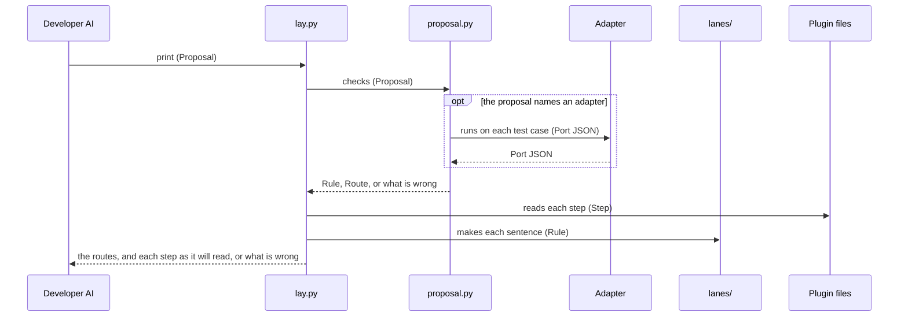
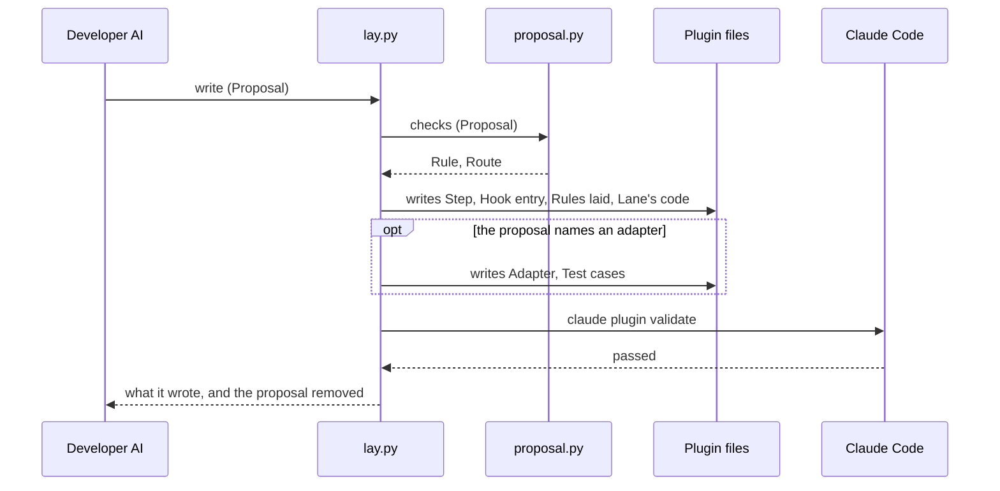
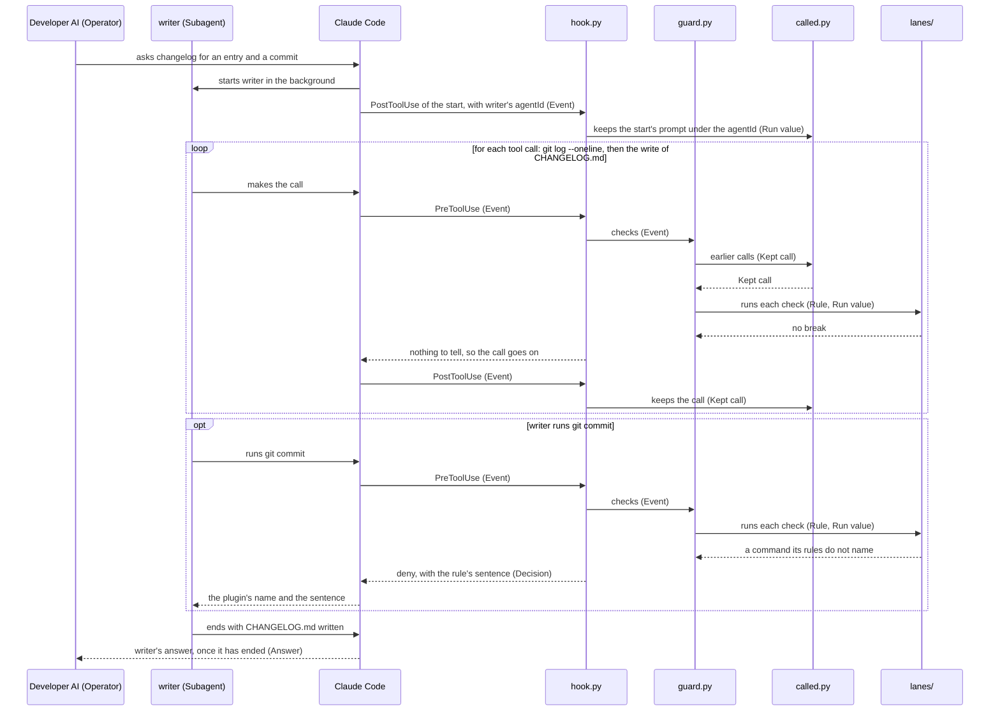
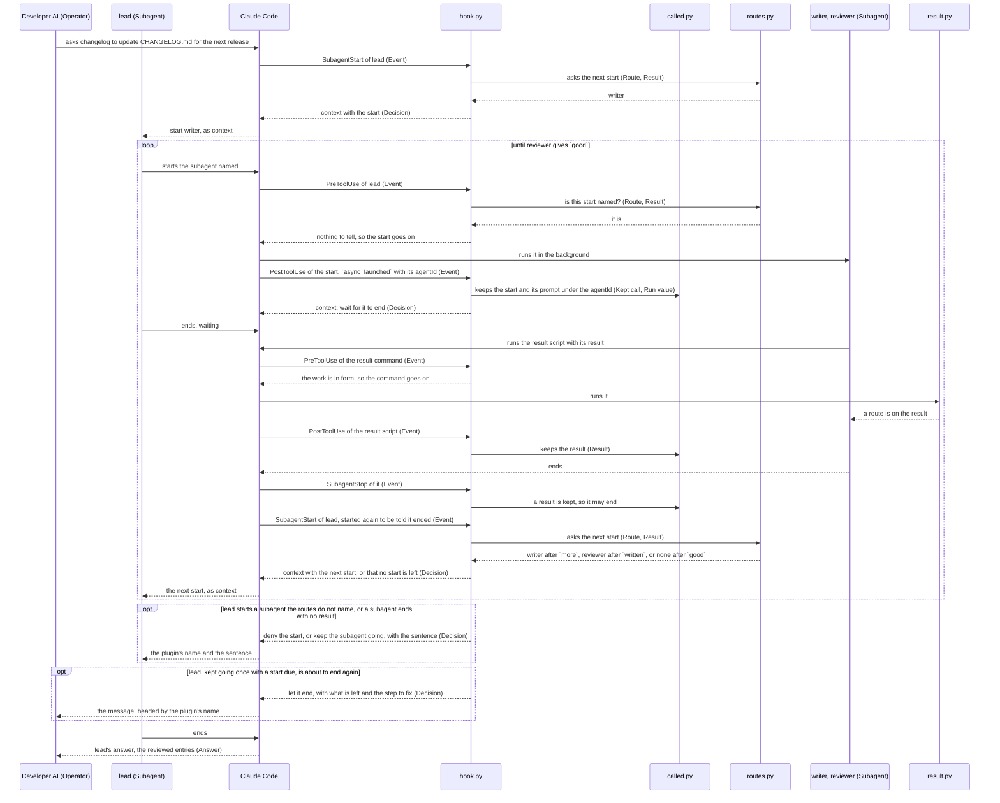
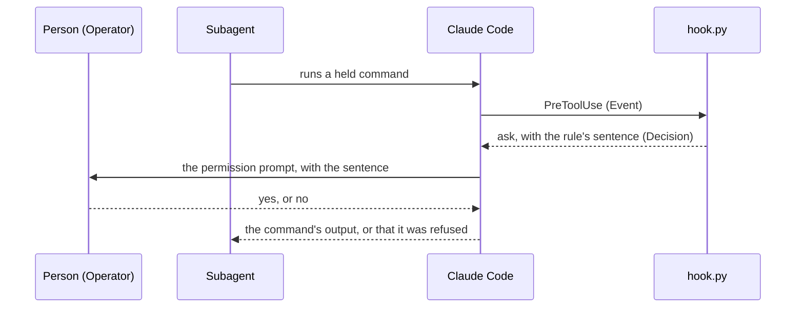

# Lane architecture

`lay.py` turns each rule and route of the developer AI's proposal, a JSON file, into a sentence in a
step and a check of that sentence. It puts the checks into the developer AI's plugin as one script,
the check script, with the result script beside it. Claude Code runs the check script on each hook
event of the plugin. The check script stops each break with the rule's sentence. When a subagent
has run the result script with its result, the check script tells the orchestrator the next
subagent the routes name. What this gives the developer AI is in [Lane's UX](ux.md).

## Principles

Lane follows Principles 2, 6, 8 and 9 of [how a plugin works](../architecture.md#principles).
Principles 1, 3, 4, 5 and 7 are about an orchestrator, its roles and the course of a run, and Lane
has none of these: the developer AI runs `lay.py` itself, and the check script runs inside the
developer AI's plugin. The principles below are what Lane adds.

### The check shows the step again

The check script shows a stopped subagent the sentence of the rule, after the plugin's name.

A subagent whose call is only refused tries another way. A subagent that sees its own step goes
back to it (KR1.1).

### One wording for the step and the check

One function makes the sentence from the rule's type and values, both for the step that `lay.py`
writes and for the message that the check script gives.

The subagent meets the same words in both places, and no change can make them differ.

### What was approved is what runs

`lay.py write` writes from the file that `lay.py print` showed, and the check script takes its rules
and routes only from what `lay.py write` wrote.

A rule copied by hand could be one that no one approved
([The caller approves what is theirs](../architecture.md#the-caller-approves-what-is-theirs)).

### Lane knows no plugin

Each type of rule is one check for every plugin, and the routes are one way of telling the next
start for every plugin. What differs between plugins reaches the check as the rule's values, as a
value given for the run, or through an adapter: the developer AI's script that turns its own text
format into Lane's. No line of Lane names another plugin.

So the developer AI writes no check code (O1) and no script for the order (O2), and a new text
format needs an adapter, not a new type of rule.

### The check judges only what Claude Code documents

The check script judges a subagent from the fields of the hook input that Claude Code documents,
and from runs of the result script. It never judges from what a subagent writes about its work,
from a shell command taken apart, or from Claude Code's record of a session, which Claude Code does
not document. A subagent with rules runs only the commands its rules name, each matched whole, and
reads and writes files with Read, Grep, Write and Edit, whose paths the hook input gives.

An AI that says it followed a step may not have followed it. A reading of a shell string misses
forms no one foresaw, and a reading of an undocumented record breaks when Claude Code changes it
(KR1.1, KR2.1).

### A call that cannot be checked is stopped

When the check script cannot check a tool call or an end of work, it stops it and says why.

- A fault of the plugin or of Claude Code, such as a failing adapter, is told to the subagent and to
  the operator, with who must fix it. The operator is whoever runs the developer AI's plugin, a
  person or an AI. In the UX's scenarios, the developer AI runs `changelog`, so it is the operator.
- A command that its rules do not name is told to the subagent alone, with the commands it may run.

A call let through unchecked could be the break that the rule is there to stop
([No check passes what it did not check](../architecture.md#no-check-passes-what-it-did-not-check)).
The subagent can write its call again, but only the operator can fix a fault.

### Claude Code's own means first

Where Claude Code has a documented means for what a rule needs, the check script answers through
it and builds nothing beside it. A command held for approval is put to the person by Claude Code's
permission prompt. A subagent's part, a file its steps lie in, reaches it whole as context that
Claude Code adds when the subagent starts.

A means of Lane's own beside Claude Code's, such as a search of the person's messages for a word of
approval, reads what Claude Code already settles and drifts from it.

### The plugin needs nothing from Lane

The check script and the result script are kept and run in the developer AI's plugin.

The operator did not choose Lane. A plugin that needed Lane installed would run without checks
wherever Lane is missing.

## User stories

- As the developer AI, I want to run `lay.py print` on my proposal and see each step as it will
  read, with the routes where the proposal gives them, or what is wrong. Carries the `lay.py print`
  step of O1 and of O2.
- As the developer AI, I want to run `lay.py write` on the proposal I approved, and find the
  sentences in my steps and the check script and the result script in my plugin. Carries the
  `lay.py write` step of O1 and of O2.
- As the developer AI, I want the check script to let through each tool call that the rules allow,
  and to stop each break with the rule's sentence. Carries O1 from the run of `changelog` to the end
  of `writer`.
- As the developer AI, I want my subagents to give their results by the result script, and the check
  script to tell my orchestrator each next start the routes name and to stop any other start.
  Carries O2 from the run of `changelog` to the end of `lead`.
- As the developer AI, I want a command I hold for approval put to the person who runs my plugin.
  Off the main path, serves KR1.1.
- As the developer AI, I want to give a rule a value for each run, or read a text format Lane does
  not know through an adapter, my own script, so the rules hold on any plugin. Off the main path,
  serves KR1.1 and KR2.1.
- As the developer AI, I want to run `lay.py up` after Lane is updated, and find my plugin's check
  script and result script at Lane's version. Off the main path, serves KR1.1 and KR2.1.

## Logical view

### Components


- `lay.py` alone writes into the plugin, and only from a proposal that `proposal.py` accepts.
  `lay.py up` brings the plugin's copy of Lane's code up to Lane's version, and writes its hook
  entries again.
- `proposal.py` alone decides whether a proposal can be laid. It holds the proposal to the JSON
  Schema of [the proposal](../../plugins/lane/docs/lanes.md#the-proposal), checks it against the
  plugin's files, and runs each adapter on its test cases.
- `hook.py` alone speaks Claude Code's hook JSON. It acts only on an event whose `agent_type` names
  a subagent with rules, and on any call in the session that gives a run of one its texts: an Agent
  call that comes back with the `agentId` of the run it started, and a SendMessage call's message.
- `guard.py` alone decides which checks run on an event. Each module of `lanes/` alone decides what
  breaks its type of rule.
- `called.py` alone keeps each call of a subagent as it comes back, under the subagent's
  `agent_id`, each result given, and the texts each run was given. `routes.py` alone decides the
  next start from the routes and the results kept. `ports.py` alone reads a text of the plugin,
  such as a list of items to answer, into Port JSON, the JSON in which a check takes it. It reads
  by Lane's own reading, or through the plugin's adapter.
- The check script checks, as a subagent runs its result command, that its work is in the form its
  result needs: each text in its form, each item answered, and the tests run on the files as they
  are. It stops the command with what is missing. Only the hook is given the run's `agent_id`, which
  the calls these checks rest on are kept under, so the result script cannot make them.
- `result.py`, the result script, alone checks that the result is one a route from the subagent is
  on, or `done` where none is. It exits with an error that names the results the subagent may
  give, or with none. It keeps nothing itself: the check script keeps the result from the run's
  hook event.
- Hooks are entries of the plugin's `hooks/hooks.json` and run on every tool call of the plugin, as
  Claude Code reads no hooks from a plugin agent's own file
  ([How a plugin works](../architecture.md#the-guard-tells-each-role-its-steps-again)). `hook.py`
  then acts by `agent_type`.
- A skill is checked where it runs with `context: fork` and `agent: <plugin>:<subagent>`: its tool
  calls then reach the hooks with that `agent_type`. Named by the subagent's bare name, the fork
  runs as `general-purpose`, which no rule names (tried on Claude Code 2.1.316, 2026-11-03).
- `called.py` keeps the calls itself, as the hook input of one event does not hold the calls before
  it, and the record that does is not documented.
- A command a dependency's skill names is matched by the folder alone being free:
  `${dependency:<name>}` in a lane stands for a folder holding the manifest of the plugin of that
  name, which the plugin's own manifest declares in its `dependencies`, and the rest is matched
  whole. Claude Code fills the skill's `${CLAUDE_PLUGIN_ROOT}` with the dependency's install
  folder and gives no hook that folder, so the hook judges it from the files there and from the
  plugin's manifest, both on disk, never from the command taken apart. The name comes from the
  proposal, so Lane names no plugin, and `lay.py print` refuses a name the manifest does not
  declare.
- A value held as a part of a command is put in as one word of the shell, quoted as Python's
  `shlex.quote` quotes it, and the rest of the command is matched whole. The value stands in the
  pattern the command is matched by as its own text, never read again for
  `${CLAUDE_PLUGIN_ROOT}`, `${dependency:<name>}` or another value, so a value cannot add a word
  to the command or stand for anything but itself. Quoting, not refusing a value of other
  characters, lets a run be given any file name, and the subagent is told the command word for
  word where it writes it otherwise. Only a command holds a value as a part, as only a command is
  matched by parts; `lay.py print` refuses one elsewhere, which the check would read as the text
  `{<name>}`.
- A subagent's part, the file its steps lie in, is the one file the entry's body names under
  `prompts/` or `core/roles/`, which [The core apart from Claude Code](../architecture.md#the-core-apart-from-claude-code)
  gives each role's flow. Its name is the role's, not the subagent's, so the part is found by the
  name the body gives, never by the subagent's.
- An adapter is a script that Lane runs, not a module that Lane imports. So `lay.py up` replaces
  Lane's code without touching an adapter.

### Data model


### Sequences

`lay.py print`:



`lay.py write`:



A subagent with rules on a run, `writer` of the UX's O1:



An orchestrator on a run, `lead` of the UX's O2:



A held command on a run:



- A result counts only from a run of the result script that succeeded. Claude Code sends a run that
  exits with an error as PostToolUseFailure, not PostToolUse, so a run whose work is not in form
  gives no result (tried on 2026-11-03).
- The result script is named in the step as `${CLAUDE_PLUGIN_ROOT}/hooks/lane/result.py` with the
  subagent and the result, and Claude Code puts the plugin's folder in its place before the
  subagent reads the step (tried on 2026-11-03). The check script matches the command whole against
  the same path, which Claude Code gives the hook.
- A subagent resumed by SendMessage keeps its `agent_id`, and SubagentStart and SubagentStop come
  again for the resumed run (tried on 2026-11-03). So the calls and results kept under that ID carry
  on across a resume.
- Each subagent with rules runs in the background, as `lay.py print` refuses one whose file does not
  set `background: true`, and the check script stops each call of one whose file no longer does.
  So the conversation that starts it stays free, independent runs go at once, and the Agent call
  comes back at once with the `agentId` of the run. The check script keeps the call's prompt under
  that ID from its PostToolUse, which holds the call's `tool_input` and `tool_response` together,
  so each run is joined to its own values by documented fields alone, however many runs of one
  subagent go at once. A join by the order of the starts would rest on no documented field.
- A run starts a moment before its start comes back: as tried on Claude Code 2.1.317, the run's
  SubagentStart came within 1 ms of the Agent call's PostToolUse, and its first call 3 to 5 seconds
  later. So a call that needs a value waits for the prompt up to 3 seconds, within the hook's 10,
  and is stopped as an error after, as a call that cannot be checked is.
- A start that comes back `completed` comes back once its run has ended, so each call of the run
  that needed a value was stopped after the wait, with the error that names who must fix it. The
  calls that needed none were checked. For the routes, the start counts as it comes back.
- The orchestrator is kept going once while a start is due, as a subagent with no result is,
  and let end when it is about to end again, the operator told what is left and whose step must be
  fixed: the step of the subagent that ended with no result, or the orchestrator's own. A run held
  until a person breaks the loop is no check, and only the plugin's maker can fix the step
  ([A call that cannot be checked is stopped](#a-call-that-cannot-be-checked-is-stopped)). The
  start of a subagent that ended with no result is told as such, so the orchestrator knows why it
  starts it again.
- Only the subagents the routes name in `fan_out` run several at once. A subagent whose steps were
  not made for runs beside one another, such as one writing a file every run writes, would
  otherwise run so with no one having approved it
  ([What was approved is what runs](#what-was-approved-is-what-runs)), and routes naming none need
  no order of results.
- The orchestrator decides how many runs it starts, and Lane counts those whose starts came back.
  Each start is kept with how it joins the starts before it, decided as it comes back: as a further
  run, where runs of its subagent still go and `fan_out` names it, or as a run started again, where
  its subagent is due again after a run with no result. The ends kept say whether a run has ended,
  not when, so whether a start came while the others still ran cannot be read again later.
- The runs joined count once every one has ended. Where they gave different results, the result
  taken is the first of them in the order the routes give in `precedence`, as only the plugin knows
  which of its results outweighs another ([Lane knows no plugin](#lane-knows-no-plugin)). Where no
  order holds them, the result cannot be told, so the orchestrator is told an error the plugin's
  maker must fix ([A call that cannot be checked is stopped](#a-call-that-cannot-be-checked-is-stopped));
  `lay.py print` refuses routes that would meet it. A run started again stands for one that ended
  with no result, so the route is taken once as many runs have given a result as were started
  but those started again.
- A start counts once the started subagent has ended. While a started subagent runs in the
  background, only another start is stopped, so the orchestrator may end and wait. Claude Code
  starts it again once that subagent has ended, in an interactive session. In `claude -p`, Claude
  Code 2.1.317 gives that end to the main conversation instead and does not start the orchestrator
  again (tried on 2026-11-03), so routes run in an interactive session.
- The next start reaches the orchestrator as context that Claude Code adds for it, not from a script
  that it runs, so learning it costs it no call.
- Claude Code puts a held command to the person even under `bypassPermissions`. In `claude -p` no
  one can be asked, and Claude Code refuses the command (tried on 2026-11-03).

## Physical view

### Deployment


- The developer AI installs Lane as [the README](../../plugins/lane/README.md#installation) says,
  and runs `python3 <installPath>/scripts/lay.py`. Claude Code starts the check script through the
  plugin's hook entries. After an update of Lane, the developer AI runs `lay.py up` on its plugin.
- Lane's code uses Python 3.9 and its standard library only, as
  [Python 3.9 and the standard library](../architecture.md#python-39-and-the-standard-library) says,
  so the operator installs nothing for Lane. Each hook's command checks for `python3` in `sh` first,
  because without Python the check script cannot even read the event.
- The kept calls live in the system's temporary folder, as
  [Where a plugin writes its files](../architecture.md#where-a-plugin-writes-its-files) says for
  files used only while a plugin runs. They mean nothing once the session ends.
- In the ccpm marketplace, the plugin's `hooks/lane/` is a link to Lane's code, as
  [Code kept once](../architecture.md#code-kept-once) says. Elsewhere it is a copy, with a `VERSION`
  file that `lay.py up` reads.

### Directory structure

Lane's code, [the lanes](../../plugins/lane/docs/lanes.md) and
[the routes](../../plugins/lane/docs/routes.md) call a rule a lane, and the check script the guard.

Lane's logic lies in `hooks/lane/core/domain/`, not in `core/` at the plugin's root as
[The core apart from Claude Code](../architecture.md#the-core-apart-from-claude-code) has it.
`lay.py` lays `hooks/lane/` into each plugin whole, by one link or one copy, and a core outside it
would need a second one. Lane has no roles, so it has no `core/roles/`.

```text
plugins/lane/
├── .claude-plugin/plugin.json         Lane's manifest and version <JSON>
├── scripts/lay.py                     lay.py <command line · Python 3.9>
├── hooks/lane/                        Lane's code, laid into each plugin
│   ├── hook.py, <event>.py            hook.py <hook entry · Python 3.9>
│   ├── result.py                      result.py <command line · Python 3.9>
│   └── core/domain/                   <modules · Python 3.9>
│       ├── proposal.py                proposal.py
│       ├── layer.py, steps.py, entries.py, placed.py   what lay.py writes: Step, Hook entry, Lane's code
│       ├── guard.py, step.py, done.py, lanes/<type>.py   guard.py, lanes/
│       ├── called.py, routes.py, ports.py   called.py, routes.py, ports.py
│       └── rules.py, schema.py, template.py, forms.py   shared by lay.py, the check script and the result script: Rules laid, Route, the forms an output is held to
└── docs/lanes.md, docs/routes.md, README.md, CHANGELOG.md, images/   for users <Markdown, SVG>

dev/lane/
├── ux.md, architecture.md, images/, README.md   for builders <Markdown, SVG>
├── cosmic-ray.toml                    the mutation testing <TOML>
├── testing.py                         what every plugin's tests stand on <Python 3>
└── tests/
    ├── unit/hooks/lane/core/domain/   unit and property tests, at the path of what each tests, a lane's beside the others <Python 3>
    ├── integration/                   lay.py, the hooks' commands and result.py on real files <Python 3>
    └── e2e/                           the E2E tests, trial_*.py, and their plugins <Python 3>

.lane/<yyyymmdd>-<plugin>/             Proposal, and <plugin>/adapters/ with Adapter and Test cases
<temporary folder>/lane/<yyyymmdd>-<session>/<agent_id>.jsonl   Calls kept, and the texts each run was given
<the plugin>/agents/                   Subagent file, with each Step
<the plugin>/hooks/                    hooks.json (Hook entry), lanes.json (Rules laid, Route), adapters/ (the Adapter that runs, Test cases), lane/ (Lane's code)
```

## Test

Lane is tested as [Test](../architecture.md#test) says. What follows is what Lane adds.

| Deployment unit | Unit | Integration | End-to-end |
|---|---|---|---|
| lay.py process [python3 3.9 or later] | unittest, Cosmic Ray, Hypothesis · ●●● · the proposal checked, steps and hook entries written | unittest, real files, a stand-in `claude` · ●●○ · print, write and up on a plugin | E2E tests · ●●○ · the lanes and the routes laid on a test plugin |
| Hook process [python3 3.9 or later] | unittest, Cosmic Ray, Hypothesis · ●●● · each type of rule, tool calls, the next start | unittest, the hook's command in `sh` · ●●○ · the answer JSON, the Python check | E2E tests · ●●○ · each type of rule and the routes on a run of the test plugin |
| Result process [python3 3.9 or later] | unittest, Cosmic Ray, Hypothesis · ●●● · each result a subagent may give | unittest, real files · ●●○ · the exit and its message | E2E tests · ●●○ · results given on a run of the test plugin |

The adapter processes have no row. An adapter is the developer AI's code, and Lane's running of it
is tested in the hook process's row.

- Unit and integration tests fake Claude Code. Each event is JSON in the fields Claude Code
  documents, and `claude` is a script on `PATH`. They pass as the shared rules say.
- An E2E test runs Claude Code with Opus on copies of Lane and of a test plugin, with a prompt that
  invites a break, and is judged from the session's records. It passes in three runs of three:
  each invited break is stopped with its sentence, each allowed call goes through, and the
  subagents start as the routes say. An AI that goes back to its step once may go around the rule
  the next time. A run counts only where each invited break was tried. One E2E test starts two runs
  of one subagent at once with different values, and passes where each run is held to its own.
  Another loads a stand-in dependency beside the test plugin and passes where the command of its
  skill goes through by the folder it is loaded from, and the same script by another folder or in
  other words is stopped. One has the orchestrator start two runs of one subagent at once, and
  passes where the next start goes through only once both have ended. Another holds a run's value
  inside a command, and passes where the command with the run's own value goes through and the
  command with another value, or with the value as more than one word, is stopped. The
  routes and a held command are tried in an interactive session, as `claude -p` neither starts the
  orchestrator again nor asks anyone. The files are named `trial_*.py`, so unittest finds none of
  them.
- Each process weighs ●●● in unit tests. A failure writes what no one approved, or lets a break
  through in a plugin whose operator never sees Lane.
- Integration and end-to-end tests weigh ●●○. The unit tests hold every behavior, as
  [Unit: code](../architecture.md#unit-code) says. So integration tests check only how
  the code meets `sh`, the files and `claude`, and the E2E tests only how an AI meets the sentences
  and the starts.
