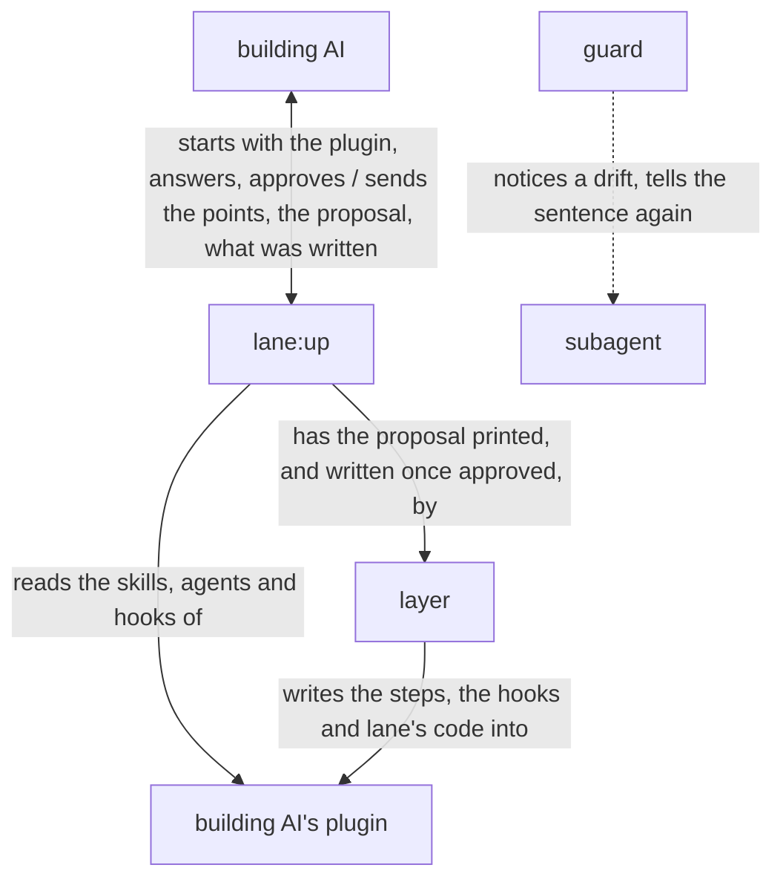

# lane architecture

lane is built on [how a plugin works](../architecture.md), and is itself a plugin of that form:
`lane:up`, the orchestrator the building AI starts, settles with that AI each point its plugin's
files leave open, and has the layer, a script, write the lanes the building AI approves; the guard,
lane's code put in that plugin, notices a subagent's drift from its lanes and tells it the step
again. The building AI, the goal and the key result are in [lane's UX](ux.md).

lane holds the [principles every plugin holds](../architecture.md#principles), named below
Principle 1 to 8, and its own:

1. The AI is made to notice its drift from a step and is told the step again, so it finds its way
   back itself.
2. A lane is a sentence of a step together with the hook that notices a drift from it.
3. Each lane is general and reusable: it holds one kind of check, the same in every plugin it is
   laid in, and takes what differs from plugin to plugin from what its hook gives it.

## User stories

- As the building AI, I want to start `lane:up` on my plugin, answer the points it sends, approve
  the lanes it proposes, and find them written into my plugin with lane's code.
- As the building AI, I want `lane:up`, run where an older copy of lane's code is, to bring the copy
  and the hooks to its own version.
- As the building AI, I want my subagent, when a call drifts from a lane, to be stopped and told the
  lane's sentence headed by my plugin's name, and every call the sentence allows let through.
- As the building AI, I want the hooks, on a machine without Python 3.9 or later, to stop the calls
  they watch, each asking for Python to be installed, and at a subagent's end to say so to whoever
  runs the plugin and let it end.

## Architecture

### Logical view



- The building AI is the caller of [how a plugin works](../architecture.md): it answers the points
  and approves the proposal itself, and no person takes part; its answer is the caller's own action
  that an approval counts from
  ([The caller approves what is theirs](../architecture.md#the-caller-approves-what-is-theirs)).
- The arrows run in this order: `lane:up` reads the plugin, sends the building AI every point open
  at once, and any an answer opens, until none is left open, then the proposal, and only once the
  building AI approves it does the layer write it.

  The lanes are the caller's to decide, so nothing is written into the plugin before the approval
  (Principle 2). The points go at once since an AI, unlike a person, weighs each as well in one
  reply, and each reply more is a wait.
- Run where an older copy of lane's code is, the layer first brings the copy and its hooks to the
  current form with the lanes they hold, before any point is sent.

  Those lanes were approved before, so keeping them asks nothing.
- What the building AI approves is printed and written by the layer from one file.

  So no AI copies it, and what is written is what was approved.
- A lane is proposed only for a sentence of a step whose drift shows in a tool call or in how the
  subagent ends.

  What shows in neither, such as what the subagent weighs, no hook can see.
- A hook holds, for each of its lanes, the step, the lane and what the lane takes; the lane's
  sentence is made from them by the lane's wording in [the lanes](../../lane/docs/lanes.md). The layer
  writes that sentence into the step, and the guard makes the same one when it stops a call.

  So the sentence the subagent is told and the one its step says cannot differ, and no sentence is
  written twice.
- Lanes are laid on subagents alone, and the guard holds each subagent to its own lanes, reading
  what it did before from its own record where a lane rests on it.

  A hook is told which subagent it runs in, and not which skill runs
  ([The guard tells each role its steps again](../architecture.md#the-guard-tells-each-role-its-steps-again)).
- A thing a lane takes is fixed in the step, or given for each run and read from the JSON the
  subagent starts from.

  A subagent's inputs and outputs are most often known only once its run starts, and the JSON it
  starts from is the one place a plugin hands them over, so a lane reads them there, the same way in
  every plugin.
- The guard reads a call in the forms the steps tell and the AI writes, not in every form the shell
  allows.

  What must hold whatever the AI writes is held by GitHub's branch protection, Claude Code's
  sandbox or its permission rules, as a check on a command's text is no security boundary; so the
  guard stays small.

### Physical view

```
lane/                          the plugin, installed by Claude Code
├── agents/up.md               lane:up, the orchestrator <agent>
├── scripts/lay.py             the layer <Python 3>
├── hooks/
│   ├── hooks.json             the lanes on lane:up, laid by the layer
│   └── lane/                  lane's code, the guard, put in each plugin <Python 3>
│       ├── pretooluse.py      the event script for lanes on a tool call
│       ├── subagentstop.py    the event script for lanes on how the subagent ends
│       ├── hook.py            what the event scripts run on: the event read, each check run
│       ├── call.py            a tool call read as one action
│       ├── shell.py           what a shell command reads and writes
│       ├── forms.py           the forms in_form holds an output to
│       ├── schema.py          a JSON Schema, and a value held to it
│       ├── template.py        a Markdown template, and a file held to it
│       ├── step.py            a subagent's step, read from its file
│       ├── record.py          what the subagent did before, from its record
│       ├── started.py         what the subagent started from, for a thing given for each run
│       └── lanes/<lane>.py    one check per lane of the lanes, with its wording
├── docs/lanes.md              each lane, its action and what its hook notices
└── README.md                  what lane gives, its example and installation

${CLAUDE_PLUGIN_DATA}/
└── <plugin>.json              the proposal <JSON>, kept by lane:up until the layer writes it

<plugin>/                      the building AI's plugin, as the layer writes it
├── agents/                    the subagents' steps
└── hooks/
    ├── hooks.json             one entry per subagent and event
    └── lane/                  lane's code
```

- lane runs on Claude Code, python3 3.9 or later, git and jq; the layer checks the plugin with
  `claude plugin validate`.
- The building AI starts `lane:up` as a subagent with the plugin's folder in its prompt, from the
  main conversation or from a subagent; `lane:up` gives the points as its reply and ends its turn,
  and the building AI sends the answers with SendMessage to the agent ID the reply came with, which
  resumes it.

  The Agent tool gives a subagent no name to be messaged by, and a subagent does not know its own
  ID, so it is reached by the ID its reply comes with, from the main conversation and from a
  subagent alike, as tried on Claude Code 2.1.306.
- The proposal is kept in lane's data folder, which Claude Code keeps for the plugin's own files
  across its updates (plugins-reference, Environment variables).
- lane's code goes into `<plugin>/hooks/lane/`: in a plugin of the ccpm marketplace a relative link
  to lane's, which installing copies into the plugin; anywhere else a copy holding a `VERSION` file,
  read from lane's `plugin.json`, by which the next run of `lane:up` tells an older copy.

  lane's version is written once, in its `plugin.json`; a file of its own beside it would be a
  second copy that drifts.
- A lane's hook is one entry of the plugin's `hooks/hooks.json` for one subagent and event, whose
  command gives the guard the subagent and, for each lane, its step, the lane and what it takes; the
  guard acts only where the event's `agent_type` is that subagent.

  Claude Code reads no hooks from a plugin subagent's own file, and a tool event's matcher filters
  by tool, not by agent.
- A subagent's record is the JSONL file Claude Code writes at
  `<transcript_path without .jsonl>/subagents/agent-<agent_id>.jsonl`, the place the hooks
  reference gives as `agent_transcript_path`; its shape is not documented, so the guard's tests
  hold it as Claude Code 2.1.306 writes it.
- Each hook command first checks for Python in the shell, before the guard runs.

  With no Python the guard cannot read the event, and the machine may have nothing else.
- in_form holds an output to a JSON Schema, for JSON or JSONL, or to a Markdown template, read with
  the standard library alone.

  They are the forms a plugin's outputs most often take; a form of a project's own is left to the
  project's script, through test_after.

## Test

lane is tested as [Test](../architecture.md#test) says.
