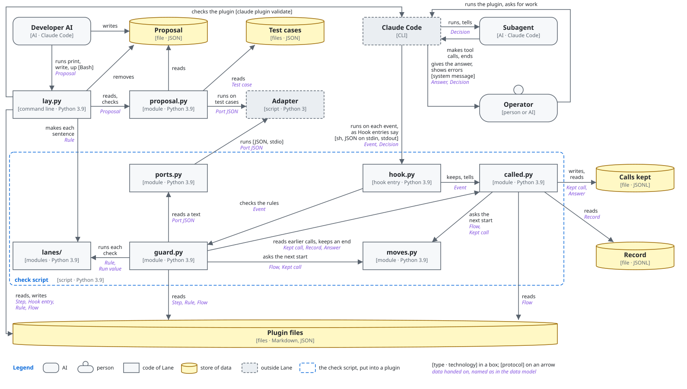
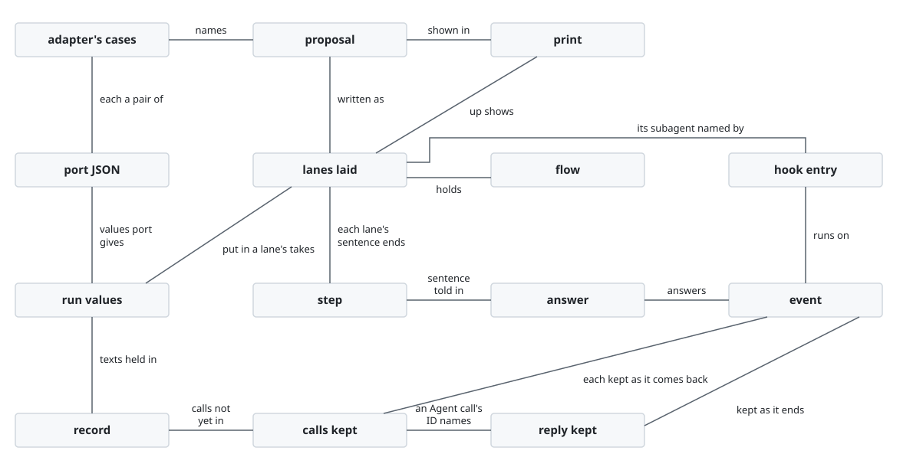
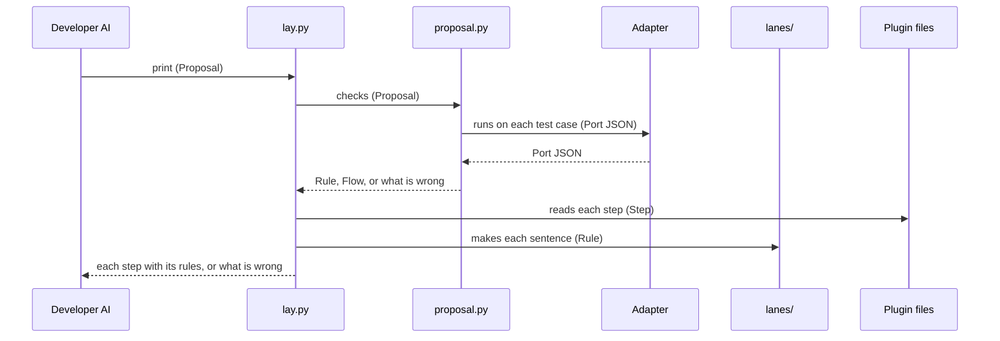
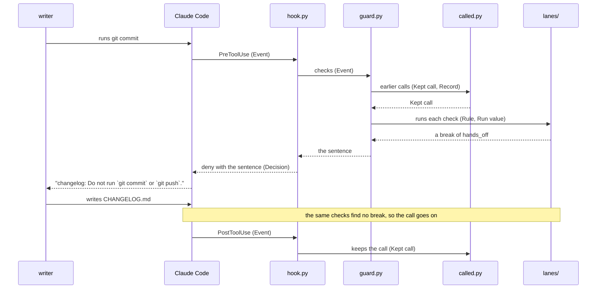
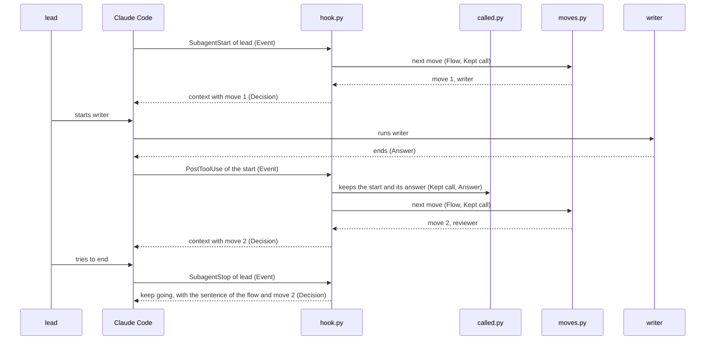

# lane architecture

`lay.py` turns each rule of a proposal into a sentence in a step and a check of that sentence. It
puts the checks into the plugin as one check script. Claude Code runs the check script on each tool
call and end of work of a subagent with rules. The check script stops each break with the sentence,
and tells the orchestrator each move of its flow. The experience this delivers is in [lane's UX](ux.md).

## Principles

lane follows [how a plugin works](../architecture.md#principles), except the principles about an
orchestrator and its roles: lane has neither, as `lay.py` is run by the developer AI and the check
script runs inside other plugins. The code and [the lanes](../../plugins/lane/docs/lanes.md) call a
rule a lane and the check script the guard.

### The check shows the step again

The check script shows a stopped subagent the sentence of the rule, after the plugin's name.

A subagent whose call is only refused tries another way; one that sees its own step goes back to it
(KR1.3).

### One wording for the step and the check

One piece of code makes the sentence in the step and the one in the message, from the rule's type
and values.

The subagent meets the same words in both, and no one can make them differ.

### What was approved is what runs

`lay.py write` writes from the file that `lay.py print` showed, and the check script reads only what
`lay.py write` wrote.

A rule copied by hand could be one that no one approved
([The caller approves what is theirs](../architecture.md#the-caller-approves-what-is-theirs)).

### lane knows no plugin

Each type of rule is one check for every plugin; what differs reaches it as the rule's values, a
value given for the run, or an adapter.

So the developer AI writes no check code (KR1.4, KR2.3), and a new text format needs an adapter, not
a new lane.

### A call that cannot be checked is stopped

When the check script cannot check a call or an end, it stops it. A fault of the plugin or of Claude
Code, such as a failing adapter, is told to the subagent and the operator, the one who runs the
plugin, with who must fix it; a call written in a form lane cannot read, such as a path with `$`,
is told to the subagent alone, with how to write it.

A call let through unchecked could be the break the rule is there to stop
([No check passes what it did not check](../architecture.md#no-check-passes-what-it-did-not-check)).
The subagent can rewrite its call, but only the operator can fix a fault.

### The check reads what the subagent did

The check script judges from the events Claude Code gives its hooks, the subagent's record and the
calls it keeps itself, never from what a subagent writes about its work.

An AI that says it followed a step may not have.

### The plugin needs nothing from lane

The check script is kept and run in the developer AI's plugin.

Whoever runs the plugin did not choose lane; a plugin that needed lane installed would run without
checks where it is missing.

## User stories

- As the developer AI, I want to run `lay.py print` on my proposal and see each step with its rules,
  or what is wrong. Carries O1's and O2's `lay.py print`.
- As the developer AI, I want to run `lay.py write` on the proposal I approved and find the
  sentences in my steps and the check script in my plugin. Carries O1's and O2's `lay.py write`.
- As the developer AI, I want the check script to stop each break of a subagent with rules with the
  rule's sentence, and let through each call the rules allow. Carries O1 from "runs changelog" to
  its end.
- As the developer AI, I want the check script to tell my orchestrator each move of the flow and
  stop its other calls and its end while a move is due. Carries O2 from "runs changelog" to its end.

## Logical view

### Components



- `lay.py` alone writes into the plugin, and only a proposal that `proposal.py` accepts. `lay.py up`
  rewrites the hooks and the check script for the rules the plugin has.
- `proposal.py` alone decides whether a proposal can be written: against the JSON Schema of
  [the proposal](../../plugins/lane/docs/lanes.md#the-proposal), against the plugin, and by running
  each adapter on its test cases.
- `hook.py` alone speaks Claude Code's hook JSON, and acts only in the subagent its hook entry names.
- `guard.py` alone decides which checks run on an event; `lanes/` holds one module for each type of
  rule, which alone decides what breaks it.
- `called.py` alone keeps each call as it comes back; `moves.py` alone decides the next move from
  the flow and the kept calls; `ports.py` alone reads a text of the plugin, directly or through its
  adapter.
- Hooks go on subagents only, not on skills: a hook is not told which skill runs, and a skill's hook
  lasts until the session ends.
- `called.py` keeps calls itself rather than reading only the record, as Claude Code may write a
  call's result after the next call's hooks have run.
- An adapter is a script lane runs, not a module it imports, so `lay.py up` replaces the check script
  without touching an adapter.

### Data model



### Sequences

`lay.py print`:



`lay.py write`:

```mermaid
sequenceDiagram
  participant DA as Developer AI
  participant L as lay.py
  participant P as proposal.py
  participant PF as Plugin files
  participant CC as Claude Code
  DA->>L: write (Proposal)
  L->>P: checks (Proposal)
  P-->>L: Rule, Flow
  L->>PF: writes Step, Hook entry, Rules laid, check script
  L->>CC: claude plugin validate
  CC-->>L: passed
  L-->>DA: what it wrote; the proposal removed
```

A break stopped:



A flow:



- A start counts once the started subagent has ended, in the foreground or the background: in an
  interactive session Claude Code runs subagents in the background by default, and counting only
  foreground starts would hold such a flow at its first move. While a started subagent runs in the
  background, only another start of the flow is stopped, so the orchestrator may end and wait.
- The move is told as context Claude Code adds for the orchestrator, not by a script it runs, so it
  spends no call to learn it.
- An answer sends the work back only when one of its lines is the word the flow names, as a word
  anywhere would count "No more entries" as `more`.

## Physical view

### Deployment


- The developer AI installs lane as [the README](../../plugins/lane/README.md#installation) says and
  runs `python3 <installPath>/scripts/lay.py`; Claude Code starts the check script through the
  plugin's hook entries.
- lane's code uses Python 3.9 and its standard library only, as
  [Python 3.9 and the standard library](../architecture.md#python-39-and-the-standard-library) says,
  so whoever runs the plugin installs nothing for lane. Each hook's command checks for `python3` in
  `sh` first, as without Python the check script cannot even read the event.
- The kept calls live in the system's temporary folder, as
  [Where a plugin writes its files](../architecture.md#where-a-plugin-writes-its-files) says for
  files used only while a plugin runs; they mean nothing once the subagent ends.
- In the ccpm marketplace, `hooks/lane/` is a link to lane's code, as
  [Code kept once](../architecture.md#code-kept-once) says; elsewhere it is a copy with a `VERSION`
  file that `lay.py up` reads.

### Directory structure

```text
plugins/lane/
├── .claude-plugin/plugin.json         lane's manifest and version <JSON>
├── scripts/lay.py, layer.py           lay.py <command line · Python 3.9>
├── scripts/steps.py, entries.py, placed.py   lay.py's writing of Steps, Hook entries, the copy
├── scripts/proposal.py                proposal.py <module · Python 3.9>
├── hooks/lane/                        the check script <Python 3.9>
│   ├── hook.py, <event>.py            hook.py
│   ├── guard.py, step.py, call.py, shell.py, started.py   guard.py
│   ├── lanes/<type>.py                lanes/
│   ├── called.py, record.py           called.py
│   ├── moves.py                       moves.py
│   ├── ports.py                       ports.py
│   └── lanes_json.py, schema.py, forms.py, template.py   forms of the data
└── docs/lanes.md, docs/flow.md, README.md, CHANGELOG.md, *.svg

dev/lane/
├── ux.md, architecture.md, *.svg, README.md
├── tests/                             unit, integration and property tests <Python 3>
└── trials/                            the end-to-end trials <Python 3>

.lane/<yyyymmdd>-<plugin>/             Proposal, and <plugin>/adapters/ with Adapter and Test cases
<temporary folder>/lane/<yyyymmdd>-<session>/<agent>.jsonl   Calls kept
<the plugin>/hooks/                    hooks.json, lanes.json, adapters/ (the copy that runs), lane/
```

## Test

lane is tested by [Test](../architecture.md#test); what follows is what lane adds.

| Deployment unit | Unit | Integration | End-to-end |
|---|---|---|---|
| lay.py process [python3 3.9] | unittest, Cosmic Ray, Hypothesis · ●●● · the proposal checked, steps and hook entries written | unittest, real files, a stand-in `claude` · ●●○ · print, write and up on a plugin | ▨[^1] |
| Hook process [python3 3.9] | unittest, Cosmic Ray, Hypothesis · ●●● · each type of rule, tool calls, records, the next move | unittest, the hook's command in `sh` · ●●○ · the decision JSON, the Python check | ▨[^1] |
| lane with a plugin [Claude Code · Opus] | ▨[^2] | ▨[^2] | trials · ●●○ · the README's walkthrough, each type of rule, the flow |

[^1]: End-to-end tests run on the whole, in the last row.
[^2]: Its units are tested in their own rows.

- Unit and integration tests fake Claude Code: each event is JSON, the record a file in the shape of
  the version `record.py` names, `claude` a script on `PATH`. Pass: all pass.
- End-to-end tests run Claude Code on copies of lane and a plugin, with a prompt that invites a
  break. Pass: in three runs of three, each invited break is stopped with its sentence and each
  allowed call goes through, as an AI that goes back once may go around the rule the next time.
- The lay.py and hook processes weigh ●●●: a failure writes what no one approved, or lets a break
  through, in a plugin whose operator never sees lane.
