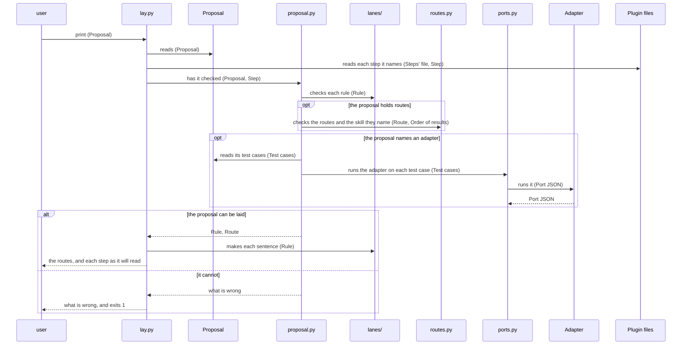
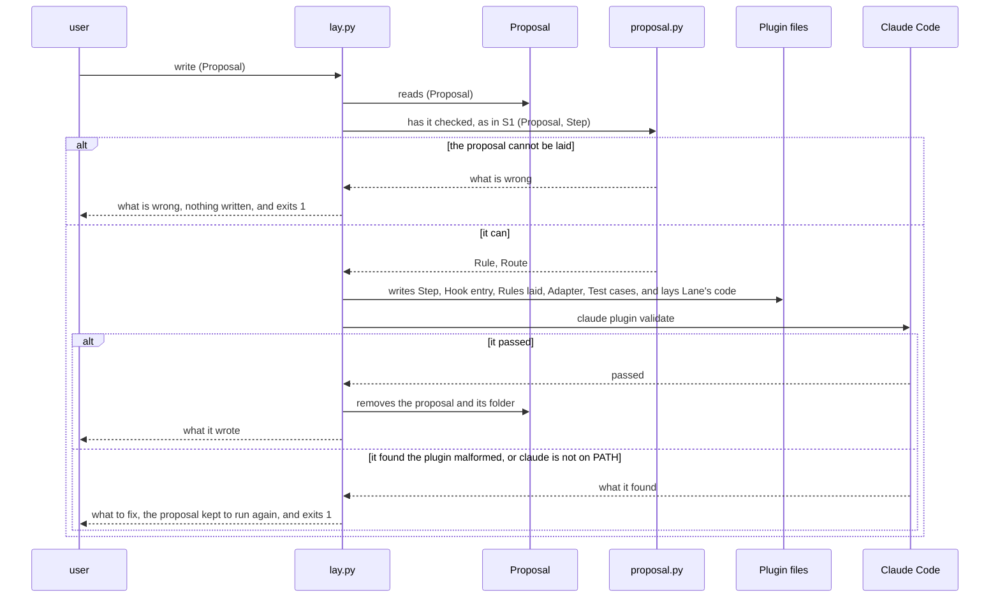
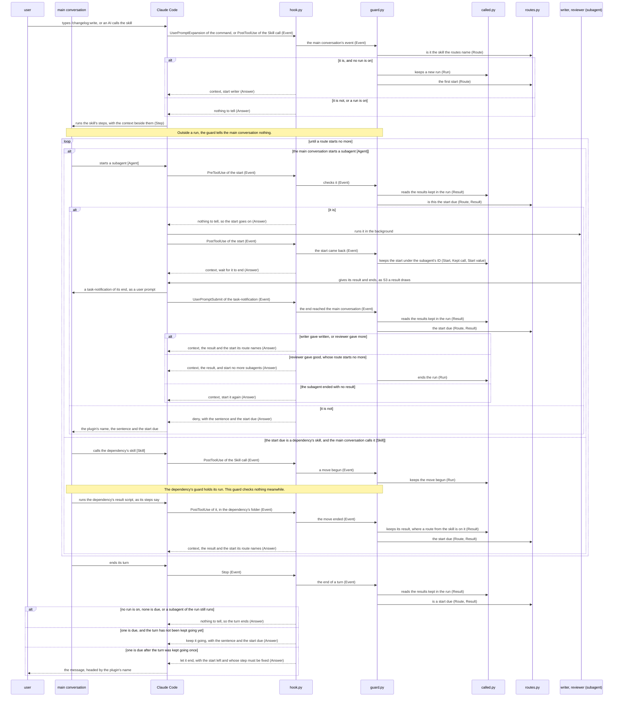
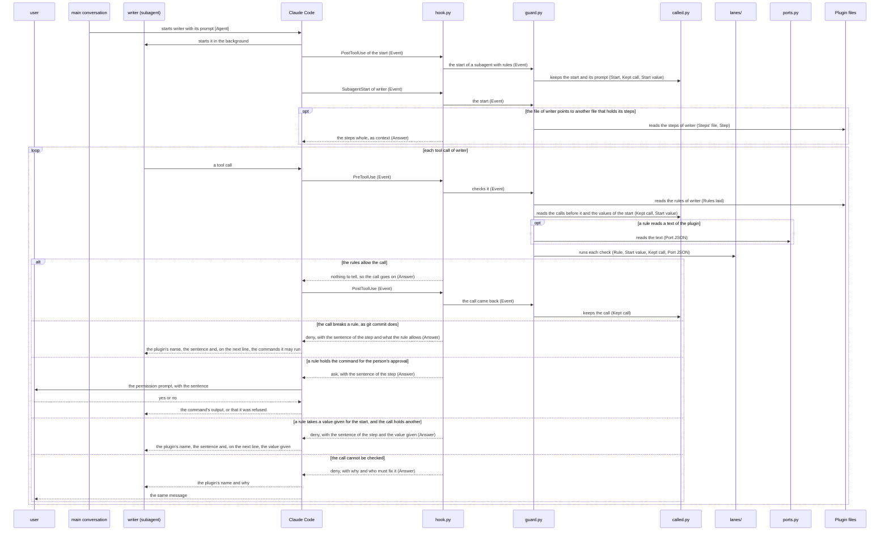
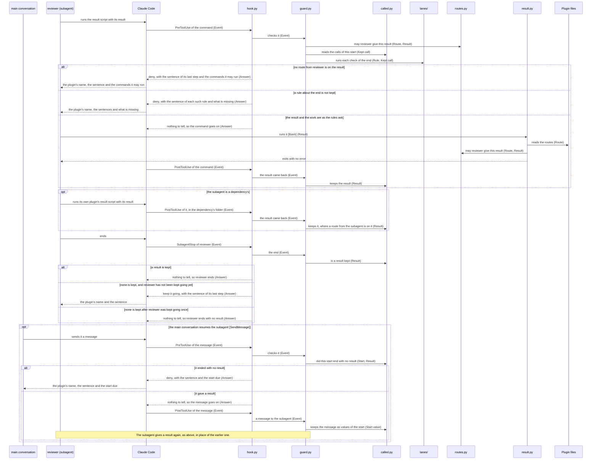
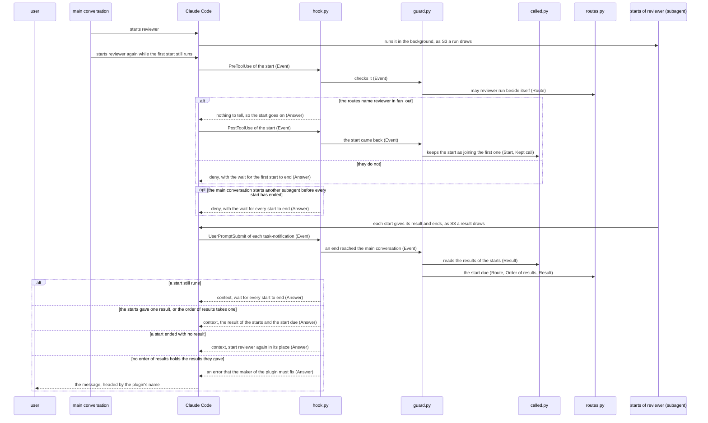
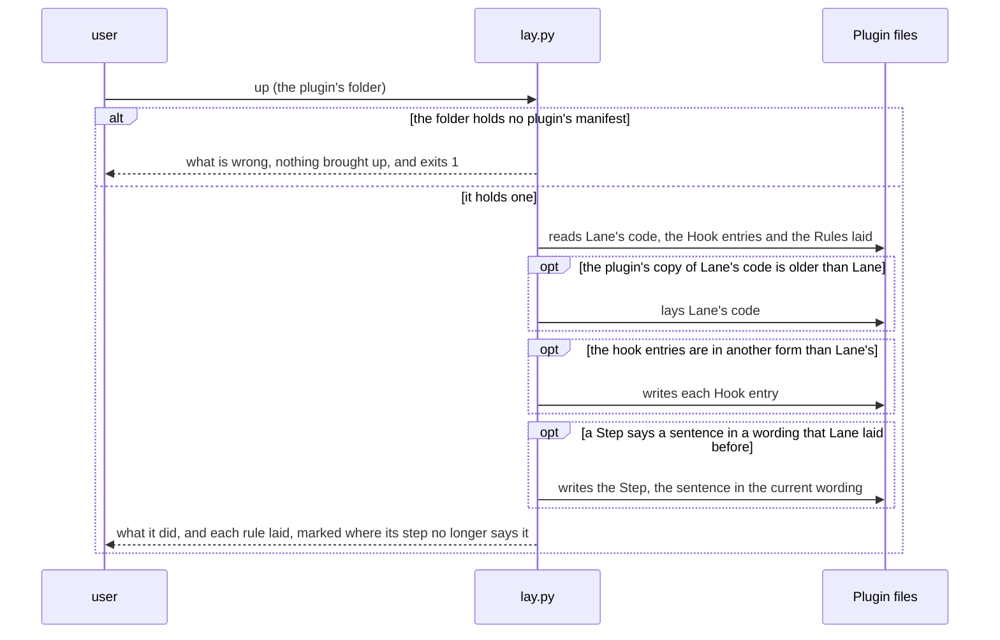

# Lane architecture

This document says how Lane is built to give [its product vision](product-vision.md). The user
writes the rules of their plugin's steps and its routes in a proposal, a JSON file. A rule is a
sentence in a step that a subagent must keep. A route names the subagent that starts next after
another ends with a given result, a word such as `more`. `lay.py`, Lane's command, shows each step
as it will read. Once the user approves, it lays into their plugin each rule's sentence in its step
and one check script, the guard, with the result script beside it. On a run, Claude Code runs the
guard on each hook event of the plugin. The guard stops each call of a subagent that breaks a rule,
and shows the subagent the sentence of its step. The routes start from one skill of the plugin,
which runs in the main conversation. A run lasts from the call of that skill to the route that
starts no more. Through a run, the guard also holds the main conversation to the routes. It tells
the first start as the run begins, and each next start as a subagent's end reaches the
conversation, from the result that the subagent gave by running the result script. It stops any
other start, and keeps the conversation going while a start is due.

Lane's code and its user docs, [the lanes](../../plugins/lane/docs/lanes.md) and
[the routes](../../plugins/lane/docs/routes.md), call a rule a lane.

## Principles

Lane builds on these principles of
[the plugin best practice](../plugin-best-practice.md#principles):

- [What a machine can see of the work](../plugin-best-practice.md#what-a-machine-can-see-of-the-work)
- [No check passes what it did not check](../plugin-best-practice.md#no-check-passes-what-it-did-not-check)
- [The guard tells each role its steps again](../plugin-best-practice.md#the-guard-tells-each-role-its-steps-again)
- [Where a plugin writes its files](../plugin-best-practice.md#where-a-plugin-writes-its-files)
- [Asking for what lies outside the work](../plugin-best-practice.md#asking-for-what-lies-outside-the-work),
  in what the guard tells a subagent about a fault
- [The caller approves what is theirs](../plugin-best-practice.md#the-caller-approves-what-is-theirs)
- [Python 3.9 and the standard library](../plugin-best-practice.md#python-39-and-the-standard-library)
- [Code kept once](../plugin-best-practice.md#code-kept-once)

Lane takes none of the principles for a plugin with an orchestrator and roles. It does not take
[An entry points to its part](../plugin-best-practice.md#an-entry-points-to-its-part),
[Languages](../plugin-best-practice.md#languages) or
[Learning from each run](../plugin-best-practice.md#learning-from-each-run) either. Lane has no
role, skill or agent of its own, and it talks with no person: the user runs `lay.py` themselves,
and the guard runs inside the user's plugin. Lane departs from
[The core apart from Claude Code](../plugin-best-practice.md#the-core-apart-from-claude-code) in
where its core lies, as [Directory structure](#directory-structure) says.

Lane adds these. Each why says how a run of the user's plugin goes wrong without the rule. KR1.1
of the product vision counts the share of runs that go wrong in any such way.

### The check shows the step again

When the guard stops a tool call or an end, it tells the subagent or the main conversation the
sentence of the step that the call breaks, headed by the plugin's name. On the next line, it tells
what the rule allows, such as the commands the subagent may run.

*Why*: a role whose call is only refused makes the call another way, and so breaks its step
(KR1.1). A role that meets the sentence of its own step goes back to the step.

### One wording for the step and the check

`lanes/` alone makes the sentence of a rule, both for the step that `lay.py` writes and for the
message that the guard gives. Beside each wording, it keeps each earlier wording that Lane laid.
`lay.py write` and `lay.py up` put a sentence that a step says in an earlier wording in the current
one, and leave every other word of the step as it was.

*Why*: the role then meets the same words in its step and in each stop, and no change to one place
can make the two differ. A role told two wordings of one rule may keep the other one, and so break
its step (KR1.1). The guard holds a step to the current wording. Once Lane changed a wording, a
plugin laid before would otherwise have every call stopped, though its steps allow it (KR1.1).
Only a wording that Lane laid counts as an earlier one, so the words the user wrote stay as they
are.

### What was approved is what runs

`lay.py write` lays only a proposal that `lay.py print` would show as it is. The guard takes its
rules and routes only from what `lay.py write` wrote, and holds them to the checks that
`lay.py print` makes. Where they no longer pass those checks, it stops each call they are about, as
a call that cannot be checked.

*Why*: the user approves their rules and routes, as
[The caller approves what is theirs](../plugin-best-practice.md#the-caller-approves-what-is-theirs)
says. A rule copied or edited by hand would be one that no one approved. It could stop a move that
the user's steps allow (KR1.1).

### Lane knows no plugin

Each type of rule is one check for every plugin, and the routes are one way of telling the next
start for every plugin. What differs between plugins reaches the guard only in three ways: as a
rule's values, as a value given for one start of a subagent, or through an adapter. An adapter is the user's script
that turns their plugin's own text format into Lane's. No line of Lane names another plugin.

*Why*: the user then writes no check and no code for the order. Where Lane cannot hold a step or
the order, the user writes a check or code of their own, or leaves it unheld (KR1.1). A new text
format needs an adapter, not a new type of rule.

### The check judges only what Claude Code documents

The guard judges a role only from the fields of the hook input that Claude Code documents, and from
the runs of the result script. It never judges from what a role writes about its work, from a shell
command taken apart, or from Claude Code's record of a session.

*Why*: an AI that says it kept a step may not have kept it. A reading of a shell command misses the
forms that no one foresaw. Claude Code does not document its record, so a reading of the record
breaks when Claude Code changes it. Each of these readings would let a role break its step and go
on, or would stop a call that the steps allow (KR1.1).

### A call that cannot be checked is stopped

When the guard cannot check a tool call or an end, it stops it and says why. It tells a fault of the
plugin or of Claude Code to the role and to whoever runs the plugin, with who must fix it.

*Why*: a call let through unchecked could break the step that the rule is there to hold, and the
role would go on (KR1.1), as
[No check passes what it did not check](../plugin-best-practice.md#no-check-passes-what-it-did-not-check)
says. The role can mend its own call, but only whoever runs the plugin can have a fault fixed.

### Claude Code's own means first

Where Claude Code has a documented means for what a rule needs, the guard uses that means and builds
nothing beside it.

*Why*: a means of Lane's own reads again what Claude Code already settles, and drifts from it. It
then stops a call that the steps allow, or lets a role break its step (KR1.1). For example, Claude
Code's permission prompt puts to the person a command that a rule holds for approval. A search of
the person's messages for a word of approval could only guess at the answer.

### The plugin needs nothing from Lane

The guard and the result script lie and run in the user's plugin, never in Lane.

*Why*: whoever runs the user's plugin did not choose Lane. A plugin that needed Lane installed would
run without its checks wherever Lane is missing, so its roles could break their steps and go on
(KR1.1).

### The main conversation is held only while its run lasts

The guard holds the main conversation from the call of the skill the routes name until a route
starts no more. There it stops or keeps going only the starts of subagents, a message that resumes
one, and the end of a turn. It reads the conversation's other events, such as a task-notification,
only to tell it the next start.

*Why*: the same conversation holds the user's own work, outside the run and beside it. A stop of
that work stops a move that the steps allow (KR1.1).

## User stories

- **S1**: As the user, I want to run `lay.py print` on my proposal, and see each step as it will
  read, or what is wrong. Carries the walkthrough's two rules for `writer` and its routes, and the
  steps shown as they will read.
- **S2**: As the user, I want to run `lay.py write` on the proposal I approved, and find the
  sentences in my steps and the guard and the result script in my plugin. Carries the walkthrough's
  `lay.py write`.
- **S3**: As the user, I want to run my plugin, by typing its skill's command or by an AI calling
  the skill, and have its subagents keep their rules and the main conversation start them in the
  order of the routes. Carries the walkthrough's run: `/changelog:write` typed, `writer` stopped as
  it tries `git commit` and shown its step's sentence, `reviewer` giving `more`, `writer` again,
  `reviewer` giving `good`, and the run's end. It also carries, as branches, a command held for the
  person's approval, a value given for each start of a subagent, a result, several starts of one
  subagent at once, a subagent or skill of a dependency, and a subagent resumed to give a later
  result. Without a branch, the user would hold that step or order with code of their own (KR1.1).
- **S4**: As the user, I want to run `lay.py up` on my plugin after Lane is updated, and find my
  plugin's copy of Lane's code at Lane's version, and each sentence in my steps in Lane's current
  wording. Off the walkthrough, serves KR1.1: a fault fixed in Lane reaches a plugin's guard only
  this way, and a step left in an earlier wording would be stopped on every call.

The subagents and the main conversation are not users of Lane. Each is the user's plugin, held for
the user.

## Components


What each decides alone:

- **user**: what is theirs: the rules, the routes and each adapter, and whether to approve the
  steps as they will read.
- **lay.py**: what is written where in the user's plugin. No other component writes there.
  `lay.py up` brings the plugin's copy of Lane's code, its hook entries and the sentences in its
  steps to Lane's version.
- **proposal.py**: whether a proposal can be laid. It holds the proposal to the JSON Schema of
  [the proposal](../../plugins/lane/docs/lanes.md#the-proposal), and checks it against the plugin's
  files.
- **lanes/**: for each type of rule, its sentence, what it is given and what breaks it. Each type
  lies in a module of its own. It also decides whether a rule can be laid at all, a check that
  `proposal.py` makes before laying and `guard.py` makes again on the rules laid.
- **hook.py**: how Claude Code's hook input is read and how the guard's answer is written. No other
  component knows that form. `hook.py` hands on the events of a subagent with rules or named by the
  routes. It also hands on the main conversation's events, told apart by carrying no `agent_type`
  key: the expansion of a typed command and the Skill call, which begin a run; the starts of
  subagents and the messages sent to them; a user prompt, a task-notification among them; and the
  end of a turn.
- **guard.py**: which checks run on an event, whether a run is on, and what the subagent, the main
  conversation and whoever runs the plugin are told.
- **called.py**: what is kept of each run of the skill and of each start of a subagent: the calls
  as they come back, the results, and the texts each start was given. It also decides how several
  starts of one subagent join one another.
- **routes.py**: whether routes can be followed, which results a subagent may give, which start is
  due from the routes and the results kept, and which result several starts at once give together.
  The routes name the skill they start from by its name. `proposal.py` and `guard.py` both hold the
  routes to its check, as with the rules. The guard asks it which results a subagent may give
  before the result script runs. `result.py` asks it again, in case the guard did not check the
  command.
- **ports.py**: how a text of the plugin, such as a list of items to answer, is read into the form
  in which a check takes it. It reads Lane's own form, or runs the plugin's adapter.
- **result.py**: no decision of its own. A subagent gives its result by running it, and it refuses
  a result that `routes.py` says the subagent may not give. It keeps nothing, and reads no text
  through `ports.py`: the guard keeps the result from the hook event of the command, and checks the
  rest of the end before the command runs.

These choices in the components are ones a developer would question. Each says the way it beat,
why, and what it costs.

- **The checks as entries of the plugin's `hooks/hooks.json`, acting by the event's `agent_type`,**
  over hooks in a subagent's or the skill's own file: Claude Code ignores hooks in a plugin agent's
  own file, and a SubagentStop hook in a skill's own file did not fire in a trial, as
  [The guard tells each role its steps again](../plugin-best-practice.md#the-guard-tells-each-role-its-steps-again)
  says, so only these entries hold every role (KR1.1). It costs the guard starting on every tool
  call of the plugin, and returning at once for a call it does not hold.
- **Lane's code put into the plugin** over running it from where Lane is installed: the plugin then
  needs nothing from Lane (KR1.1). It costs a fix in Lane reaching a plugin only once the user runs
  `lay.py up` (S4).
- **A command matched whole** over a command taken apart: a reading of the shell's grammar would let
  a rule name a part of a command, but
  [The check judges only what Claude Code documents](#the-check-judges-only-what-claude-code-documents)
  rules it out (KR1.1). It costs a subagent with rules running only the commands its rules name,
  word for word. It reads and writes files with Read, Grep, Write and Edit, whose paths the hook
  input gives.
- **Each plugin's guard keeping its own record of a session** over one record for both: a start of
  a dependency's subagent that the routes name is held by two guards, its own plugin's and the one
  whose routes start it. Each would write what the other reads, and a copy of Lane's code of another
  version could read the other's lines wrongly (KR1.1). It costs the start, the result and the end
  of such a subagent being kept twice.
- **`called.py` keeping the calls of each start itself** over reading Claude Code's record of the
  session: the guard never reads that record, as
  [The check judges only what Claude Code documents](#the-check-judges-only-what-claude-code-documents)
  says, and the hook input of one event does not hold the calls before it (KR1.1). It costs a write
  on each call that comes back, and no call known that the hooks did not see.
- **The calls kept as JSON Lines, one file for each start,** over one JSON document: each hook then
  appends one line without reading the file, where it would otherwise read and write the whole
  document on each call. It costs a check that needs the calls before it reading the start's whole
  file.
- **A result counted only from a run of the result script** over reading the subagent's reply: a
  reply such as "No more entries" could be read as `more` (KR1.1). It costs each subagent that the
  routes name one more tool call as it ends.
- **An adapter as a script that Lane runs** over a module that Lane imports: `lay.py up` then
  replaces Lane's code without touching an adapter, and a fault in an adapter cannot break the guard
  (KR1.1). It costs a process started within the hook's time for each read through an adapter.
- **Each subagent with rules or named by the routes running in the background** over one that
  runs in the foreground: its start comes back at once with the subagent's ID, so the guard joins
  each start to its own values by documented fields alone (KR1.1). Its end then reaches the main
  conversation as a task-notification, which carries the next start. It costs the subagent's file
  setting `background: true`, which `lay.py print` asks of it.
- **The steps given to a subagent whole, as context that Claude Code adds as it starts,** over a
  rule that has it read its own steps: a subagent could still skip the read (KR1.1). It costs the
  guard reading the steps on each start of a subagent with rules.
- **A later result of a start taking the place of its earlier one** over a start held to its first
  result: a subagent that ends to wait for an answer, with a result whose route starts no one, then
  moves the routes on once resumed. Otherwise the user would write code for that order (KR1.1). It
  costs the guard keeping each subagent's ID and result for the whole run, not only until its
  start counts.
- **Only the subagents that the routes name in `fan_out` running several at once** over any
  subagent beside itself: a subagent whose steps were not made for it, such as one that writes a
  file that each of its starts writes, would then run so with no one having approved it, as
  [What was approved is what runs](#what-was-approved-is-what-runs) says (KR1.1). It costs the user
  naming each such subagent and ordering its results.
- **A run begun at the expansion of the typed command or at the PostToolUse of the Skill call** over
  a user prompt read for the command's words: these are the two ways Claude Code documents a skill
  begun, as
  [The check judges only what Claude Code documents](#the-check-judges-only-what-claude-code-documents)
  asks, while a prompt that quotes the command would match its words and begin no skill (KR1.1).
  It costs a skill followed without being called, such as its text pasted, being no run, and not
  held.
- **Each start told as context that Claude Code adds** over a message of Lane's own: Claude Code
  puts it beside an event that the conversation reads in any case (KR1.1). The first start is told
  on the event that begins the run. Each next one is told on the UserPromptSubmit that a subagent's
  end brings, and on the PostToolUse of a dependency's result script. The PostToolUse of each start
  tells the conversation to wait for that subagent to end. It costs a start that the conversation
  may pass over, so a start not due is stopped with the one due, and the end of a turn is kept
  going.
- **The end of a turn kept going once while a start is due and no subagent of the run still runs,
  then let end with the user told whose step to fix,** over a hold until the start is made: a hold
  with no end would need a person to break it, which is no check. It costs a run whose
  conversation passes the start over twice stopping with the start due, which KR1.1 counts as gone
  wrong.
- **A dependency's skill that a route names counted as one move,** begun by its Skill call and ended
  by the PostToolUse of a run of the dependency's result script in the main conversation, with the
  caller's guard checking nothing meanwhile, over both guards holding the conversation: two guards
  on one conversation would each stop the other's moves, as
  [A plugin that uses another](../plugin-best-practice.md#a-plugin-that-uses-another) says
  (KR1.1). It costs a dependency's skill that ends with no result leaving its move open, so the end
  of a turn is kept going once, as for any start due.

## Data model


- **Run**: one run of the skill the routes name, from its call to the route that starts no more.
  "Run" alone names only this.
- **Start**: one start of a subagent within a Run, known by the ID that Claude Code gives back for
  it. It holds that subagent's Start values, Kept calls and Result.
- **Kept call**: one tool call that the guard kept, such as a start of a subagent or a call of one.
- **Start value**: a value given for one Start, in the prompt that started the subagent or in a
  message sent to it.
- **Port JSON**: a text of the plugin, such as a list of items to answer, read into Lane's form.

The fields of each data lie where the data is built. The user docs give those that the user writes:
[the proposal](../../plugins/lane/docs/lanes.md#the-proposal),
[the routes](../../plugins/lane/docs/routes.md#the-routes) and
[the ports](../../plugins/lane/docs/lanes.md#the-ports).

## Sequences

Each story's steps follow in order. The participants are named as in [Components](#components), and
the data in brackets as in [Data model](#data-model). `changelog` is the walkthrough's plugin: its
skill `write` starts `writer`, and then `reviewer`, which gives `more` or `good`.

### S1: `lay.py print`



### S2: `lay.py write`



### S3: a run, each start told



### S3: a subagent's call held to its rules

`writer` runs here, started as the last section draws.



### S3: a result given

`reviewer` gives its result here. `writer` gives `written` the same way.



How a subagent writes its result command, and what it is told, is in
[How a subagent gives its result](../../plugins/lane/docs/routes.md#how-a-subagent-gives-its-result).

### S3: several starts at once

The main conversation starts `reviewer` several times at once here, as routes that name `reviewer`
in `fan_out` let it.



How the starts join and how their result is taken is in
[Runs at once](../../plugins/lane/docs/routes.md#runs-at-once).

### S4: `lay.py up`



## Deployment


The user installs Lane as [the README](../../plugins/lane/README.md#installation) says, and runs
`python3 <installPath>/scripts/lay.py` on their own computer. Claude Code starts the guard through
the plugin's hook entries, each a command in `sh` that runs `python3`, on the computer of whoever
runs the plugin. After an update of Lane, the user runs `lay.py up` on their plugin.

- **Lane's code on Python 3.9 and its standard library only**, as
  [Python 3.9 and the standard library](../plugin-best-practice.md#python-39-and-the-standard-library)
  says, over a later Python or packages: whoever runs the plugin then installs nothing for Lane
  (KR1.1). Each hook's command checks for `python3` in `sh` first, as the guard cannot even read the
  event without Python. It costs each tool call that a rule is about being stopped where Python is
  missing.
- **The kept calls and the Run in the system's temporary folder**, as
  [Where a plugin writes its files](../plugin-best-practice.md#where-a-plugin-writes-its-files)
  says for files used only while a plugin runs, over a folder in the repository: they mean nothing
  once the session ends. It costs a call that needs its kept calls being one that cannot be checked
  where the system clears that folder during a run.
- **A plugin's `hooks/lane/` as a link to Lane's code in this marketplace**, as
  [Code kept once](../plugin-best-practice.md#code-kept-once) says, over a copy: a fix to the guard
  reaches every plugin here (KR1.1). Elsewhere it is a copy that carries Lane's version, which
  `lay.py up` reads, as a link cannot reach across repositories. It costs a copy keeping Lane's
  code of the day it was laid until `lay.py up` runs.

## Directory structure

```text
plugins/lane/
├── .claude-plugin/plugin.json      Lane's manifest and version
├── scripts/lay.py                  lay.py, and its parts beside it
├── hooks/lane/                     Lane's code, laid into each plugin
│   ├── hook.py                     hook.py
│   ├── result.py                   result.py, the result script
│   └── core/domain/
│       ├── proposal.py             proposal.py
│       ├── guard.py                guard.py
│       ├── lanes/                  lanes/, a module for each type of rule
│       ├── called.py               called.py
│       ├── routes.py               routes.py
│       ├── ports.py                ports.py
│       └── the other modules       code that several components share
└── README.md, docs/, CHANGELOG.md, images/   for Lane's users

dev/lane/
├── product-vision.md, architecture.md, images/   Lane's product vision and architecture
├── README.md, design-tree.md       for Lane's developers
├── cosmic-ray.toml                 the mutation testing
├── testing.py                      the tests' shared code and the double of Claude Code
├── trials/                         the driver that runs a plugin in Claude Code for a trial
└── tests/
    ├── unit/                       unit tests, at the path of what each tests
    ├── architecture/               a test for each path of each sequence
    └── ux/                         the trials of O1, which use the driver, and changelog

.lane/<yyyymmdd>-<plugin>/          Proposal, and each Adapter with its Test cases
<temporary folder>/lane/<yyyymmdd>-<session>-<plugin>/   Run, Start, Kept call, Start value, Result
<the plugin>/skills/                the skill the routes name: a Steps' file, with its Steps
<the plugin>/agents/                each subagent's Steps' file, with its Steps
<the plugin>/hooks/hooks.json       each Hook entry
<the plugin>/hooks/lanes.json       Rules laid: each Rule, Route and Order of results
<the plugin>/hooks/adapters/        each Adapter that runs, and its Test cases
<the plugin>/hooks/lane/            Lane's code
```

- **Code that several components share beside them in `core/domain/`**, each module for one data
  or one form, such as the Rules laid or a Step, over a copy in each component: a copy would be
  fixed in one component and left wrong in another, as
  [Code kept once](../plugin-best-practice.md#code-kept-once) says (KR1.1). A module that only one
  component uses lies in that component. It costs a change to a shared module reaching every
  component that uses it, whose tests must all pass.
- **Lane's core in `hooks/lane/core/domain/`** over `core/` at the plugin's root, where
  [The core apart from Claude Code](../plugin-best-practice.md#the-core-apart-from-claude-code) puts
  it: `lay.py` lays `hooks/lane/` into each plugin whole, by one link or one copy, and a core
  outside it would need a second (KR1.1). It costs Lane's core lying apart from where every other
  plugin keeps its core. Lane has no roles of its own, so it has no `core/roles/`.

## Tests

Lane tests by [Test in the plugin best practice](../plugin-best-practice.md#test), and differs from
it where this section says.


Cosmic Ray and Hypothesis in the figure run the mutation testing and the property-based tests that
[Unit: code](../plugin-best-practice.md#unit-code) asks for. They are the tools that
[the repository's development setup](../README.md#the-property-based-tests-and-the-mutation-testing)
gives every plugin, not a choice of Lane's.

- **The lay.py, hook and result script processes tried FULL at unit and at architecture** over
  HAPPY: a fault in any of them writes into a plugin what no one approved, or lets a break through
  (KR1.1). Only these levels check every case on every push. It costs the
  most tests to keep up as the code changes.
- **The trials SMOKE** over HAPPY: they only confirm in real use what the lower levels have checked,
  and each step of a trial costs a run of the model. It costs a fault that only a real run brings
  out showing once every lower level passes.
- **The double of Claude Code sending the main conversation's events as a trial on Claude Code
  2.1.319 recorded them,** beside the double with the version and the date, over what the hooks
  reference alone says: where the reference says nothing, a double would send what no Claude Code
  sends, and pass a test that the real one fails (KR1.1). It costs a try of the real Claude Code
  again where a new version may act otherwise.
- **The ux trial in `claude -p` as well as in an interactive session** over one of them: Claude
  Code 2.1.319 brings a background subagent's end back to the main conversation in both, so a
  plugin may run either way (KR1.1). It costs each trial run twice.
