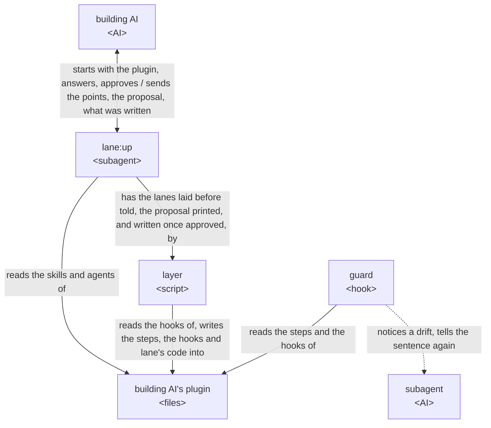

# lane architecture

lane is built on [how a plugin works](../architecture.md), and is itself a plugin of that form:
`lane:up`, the orchestrator the building AI starts, settles with that AI each point its plugin's
files leave open, and has the layer, a script, write the lanes the building AI approves; the guard,
lane's code put in that plugin, notices a subagent's drift from its lanes and tells it the step
again. A lane is a sentence of a step together with the hook that notices a drift from it. The
building AI, the goal and the key result are in [lane's UX](ux.md).

lane holds the [principles every plugin holds](../architecture.md#principles), named below
Principle 1 to 8, and its own, named below lane's Principle 1 and 2:

1. A drift is answered by telling the AI its step again, and the AI finds its way back to it
   itself.
2. Each lane is general and reusable: it holds one kind of check, the same in every plugin it is
   laid in, and takes what differs from plugin to plugin from what its hook gives it.

## User stories

- As the building AI, I want to start `lane:up` on my plugin, answer the points it sends, approve
  the lanes it proposes, and find them written into my plugin with lane's code.
- As the building AI, I want `lane:up`, run where an older copy of lane's code is, to bring the copy
  and the hooks to its own version.
- As the building AI, I want my subagent, when a call drifts from a lane, to be stopped and told the
  lane's sentence headed by my plugin's name, and every call the sentence allows let through.
- As the building AI, I want the hooks, on a machine without Python 3.9 or later, to stop the calls
  they watch, each asking for Python to be installed, and at a subagent's end to say so to whoever
  runs the plugin and let it end.

## Architecture

### Logical view



- The building AI is the caller of [how a plugin works](../architecture.md): it answers the points
  and approves the proposal itself, and no person takes part; its answer is the caller's own action
  that an approval counts from
  ([The caller approves what is theirs](../architecture.md#the-caller-approves-what-is-theirs)).
- The arrows run in the order of the UX's [Laying lanes](ux.md#laying-lanes), the layer writing the
  proposal only once the building AI approves it.

  The lanes are the caller's to decide, so no lane is written into the plugin before the approval
  (Principle 2). The points go at once since an AI, unlike a person, weighs each as well in one
  reply, and each reply more is a wait.
- Run where an older copy of lane's code is, the layer first brings the copy and its hooks to the
  current form with the lanes they hold, before any point is sent.

  Those lanes were approved before, so keeping them asks nothing.
- What the building AI approves is printed and written by the layer from one file.

  So no AI copies it, and what is written is what was approved.
- A lane is proposed only for a sentence of a step whose drift shows in a tool call or in how the
  subagent ends.

  What shows in neither, such as what the subagent weighs, no hook can see.
- The lanes laid in a plugin are kept in one JSON file of it, `hooks/lanes.json`, in the shape of
  the proposal, each with its step, the lane and what the lane takes; a hook names only its
  subagent. The lane's sentence is made from them by the lane's wording in
  [the lanes](../../lane/docs/lanes.md). The layer writes that sentence into the step, and the guard
  makes the same one when it tells the subagent.

  So the sentence the subagent is told and the one its step says cannot differ, and no sentence is
  written twice; the file the building AI approved is the one the guard reads, and a thing taken
  holds any text, a comma among the rest.
- Each boundary lane defines is JSON: the lanes a plugin lays, what an adapter is given and gives
  back, and what the guard answers Claude Code, a decision in Claude Code's JSON output on exit 0.

  Claude Code hands a hook JSON and reads JSON from it, so one form runs through each boundary,
  read and checked one way.
- Lanes are laid on subagents alone, and the guard holds each subagent to its own lanes, reading
  what it did before from its own record where a lane rests on it.

  A hook is told which subagent it runs in, and not which skill runs
  ([The guard tells each role its steps again](../architecture.md#the-guard-tells-each-role-its-steps-again)).
- The guard keeps each call of a subagent lanes are laid in as it comes back, and reads a call kept
  after the subagent's record until the record holds it, the record holding where they differ.

  Claude Code writes the calls of one reply into the record only once the whole reply has ended,
  and runs each call's PostToolUse, or PostToolUseFailure, before the next call's PreToolUse; read
  from the record alone, a call made earlier in the same reply is not seen.
- A thing a lane takes is fixed in the step, or given for each run and read from the JSON the
  subagent starts from.

  A subagent's inputs and outputs are most often known only once its run starts, and the JSON it
  starts from is the one place a plugin hands them over, so a lane reads them there, the same way in
  every plugin.
- A thing given for each run whose value is empty lays nothing on that run.

  The step has nothing to hold the subagent to there, and a lane that stopped it would leave it no
  way back to its step.
- Each lane checks only what [the lanes](../../lane/docs/lanes.md) define it to take, and knows no
  plugin's forms. Where a check reads a plugin's text, it reads it at a port, a point lanes.md
  defines with the JSON it is given and gives back: the values a subagent started from, the items of
  an input, the move a script printed. At each port lane reads one form, the one lanes.md gives;
  a plugin whose text is in another form has an adapter, a command of its own that `lane:up` writes
  with the cases it must give, which the guard runs at that port in place of lane's reading. An
  adapter is part of the proposal: kept beside it, run on its cases and shown in the print, and
  written into the plugin with the lanes once approved.

  So lane holds one check per lane however many forms plugins write in, and a new form is a
  plugin's adapter, never a new version of lane (ports and adapters; a command handed JSON as git's
  textconv is handed a file). A command, not a module lane imports, keeps lane's code free of the
  plugin's and the adapter free of lane's code, so `lay.py up` brings lane's copy up without
  touching it.
- The guard reads a call in the forms the steps tell and the AI writes, not in every form the shell
  allows.

  What must hold whatever the AI writes is held by GitHub's branch protection, Claude Code's
  sandbox or its permission rules, as a check on a command's text is no security boundary; so the
  guard stays small.

### Physical view

```
lane/                          the plugin, installed by Claude Code
├── .claude-plugin/plugin.json lane's manifest, holding its version <JSON>
├── agents/up.md               lane:up, the orchestrator <agent>
├── scripts/                   the layer <Python 3>
│   ├── lay.py                 what lane:up runs: print, write and up
│   ├── proposal.py            the proposal read and checked
│   ├── steps.py               each step as written and as printed
│   ├── entries.py             the entries of the plugin's hooks.json
│   └── placed.py              lane's code placed in the plugin, with its version
├── hooks/
│   ├── hooks.json             the lanes on lane:up, laid by the layer <JSON>
│   └── lane/                  lane's code, the guard, put in each plugin <Python 3>
│       ├── pretooluse.py      the event script for lanes on a tool call
│       ├── subagentstop.py    the event script for lanes on how the subagent ends
│       ├── posttooluse.py     the event script keeping each call as it comes back
│       ├── posttoolusefailure.py  the same, for a call that comes back failed
│       ├── guard.py           the lanes a hook's command lays, run on the event
│       ├── hook.py            what the guard runs on: the event read, each check run
│       ├── hooks_file.py      a hook's command written, hooks.json and lanes.json read
│       ├── ports.py           each port, read in lane's form or by the plugin's adapter
│       ├── call.py            a tool call read as one action
│       ├── shell.py           what a shell command reads and writes
│       ├── forms.py           the forms in_form holds an output to
│       ├── schema.py          a JSON Schema, and a value held to it
│       ├── template.py        a Markdown template, and a file held to it
│       ├── step.py            a subagent's step, read from its file
│       ├── record.py          where Claude Code keeps records, and what a subagent did before
│       ├── called.py          each call of a subagent kept until its record holds it
│       ├── started.py         what the subagent started from, for a thing given for each run
│       ├── lanes/__init__.py  the lanes, and each lane's sentence made from its wording
│       └── lanes/<lane>.py    one check per lane of the lanes, with its wording
├── docs/lanes.md              each lane, its action and what its hook notices <Markdown>
├── README.md                  what lane gives, its example and installation <Markdown>
└── CHANGELOG.md               what changed for its users in each version <Markdown>

${CLAUDE_PLUGIN_DATA}/
├── <plugin>.json              the proposal <JSON>, kept by lane:up until the layer writes it
└── <plugin>/adapters/         the adapters the proposal names, until the layer writes them

<the system's temporary folder>/lane/<yyyymmdd>-<session>/
└── <agent>.jsonl              each call of a subagent lanes are laid in, kept by the guard <JSONL>

<plugin>/                      the building AI's plugin, as the layer writes it
├── agents/                    the subagents' steps
└── hooks/
    ├── hooks.json             one entry per subagent and event
    ├── lanes.json             the lanes laid, as approved <JSON>
    ├── adapters/              the plugin's adapters, written by lane:up
    │   ├── <port>-<name>.py   one adapter <Python 3>
    │   └── <port>-<name>.json the cases it must give <JSON>
    └── lane/                  lane's code
```

- lane runs on Claude Code and python3 3.9 or later; the layer checks the plugin with
  `claude plugin validate`.
- The building AI starts `lane:up` as a subagent with the plugin's folder in its prompt, from the
  main conversation or from a subagent; `lane:up` gives the points as its reply and ends its turn,
  and the building AI sends the answers with SendMessage to the agent ID the reply came with, which
  resumes it.

  The Agent tool gives a subagent no name to be messaged by, and a subagent does not know its own
  ID, so it is reached by the ID its reply comes with, from the main conversation and from a
  subagent alike.
- The proposal is kept in lane's data folder, which Claude Code keeps for the plugin's own files
  across its updates (plugins-reference, Environment variables).
- The calls the guard keeps are in `lane/<yyyymmdd>-<session>/` in the system's temporary folder,
  as [Where a plugin writes its files](../architecture.md#where-a-plugin-writes-its-files) has it.
- lane's code goes into `<plugin>/hooks/lane/`: in a plugin of the ccpm marketplace a relative link
  to lane's, as [Code kept once](../architecture.md#code-kept-once) has it; anywhere else a copy
  holding a `VERSION` file, read from lane's `plugin.json`, by which the next run of `lane:up` tells
  an older copy.

  The version stays in one place, as [The version](../architecture.md#the-version) has it, and the
  copy's `VERSION` is written from it.
- A lane's hook is one entry of the plugin's `hooks/hooks.json` for one subagent and event, whose
  command gives the guard the subagent, whose lanes the guard reads from `hooks/lanes.json`; the
  guard acts only where the event's `agent_type` is that subagent.

  A plugin's hooks are read from its `hooks/hooks.json` alone
  ([The guard tells each role its steps again](../architecture.md#the-guard-tells-each-role-its-steps-again)),
  and a tool event's matcher filters by tool, not by agent.
- An adapter is a Python 3 script run by python3 with its port's JSON on stdin, giving its JSON on
  stdout, within the hook's time; the layer runs it on each of its cases before writing, and the
  guard holds what it gives to its port, a failure or a wrong answer let through and told to whoever
  runs the plugin.

  Python is what lane already needs on the machine; a case is how its port's JSON is checked
  without a run of the plugin, and an adapter that fails is the plugin's fault, which the subagent
  cannot put right.
- Each hook command first checks for Python in the shell, before the guard runs.

  With no Python the guard cannot read the event, and the machine may have nothing else.
- in_form holds an output to a JSON Schema, for JSON or JSONL, or to a Markdown template, read with
  the standard library alone.

  They are the forms a plugin's outputs most often take; a form of a project's own is left to the
  project's script, through test_after.

## Test

lane is tested as [Test](../architecture.md#test) says.

- lane keeps what every plugin's tests and trials stand on: `dev/lane/testing.py`, as
  [Code kept once](../architecture.md#code-kept-once) has it, and `dev/lane/trials/trying.py`,
  which starts Claude Code on copies of plugins and reads the records of the agents it starts.
- The guard's tests hold a subagent's record in the shape the version of Claude Code `record.py`
  names writes it.

  Claude Code does not document the record, so the tests are the one account of its shape.
