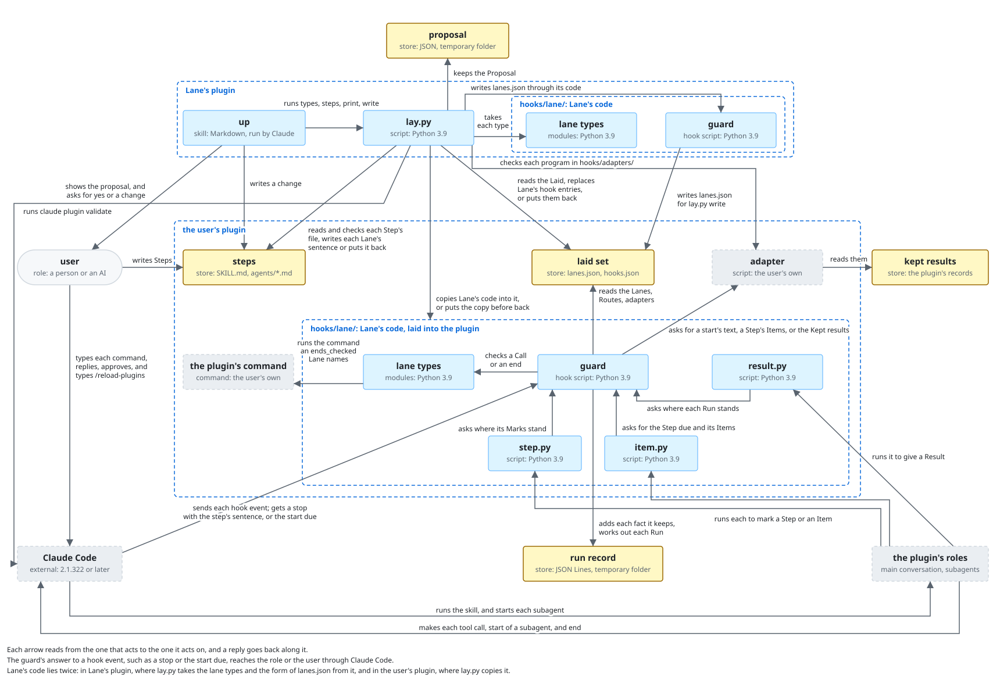
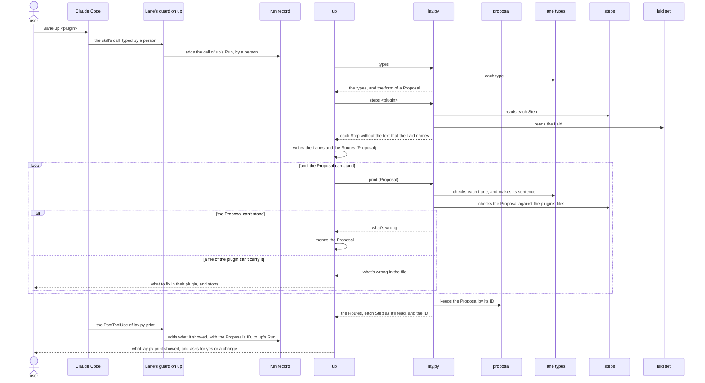
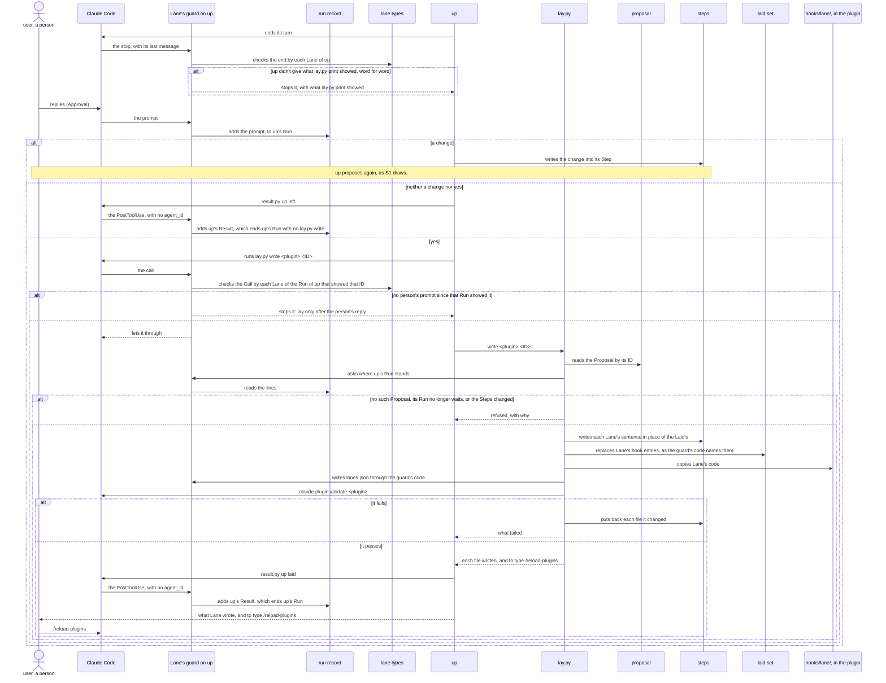
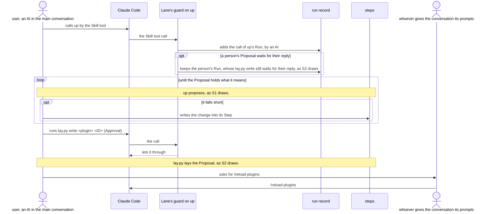
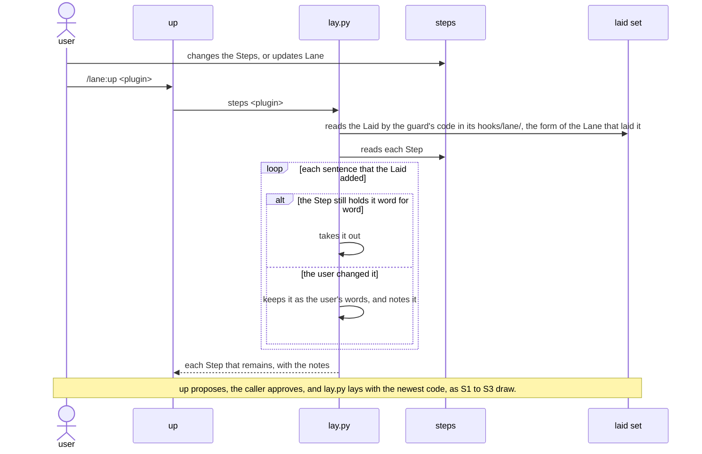
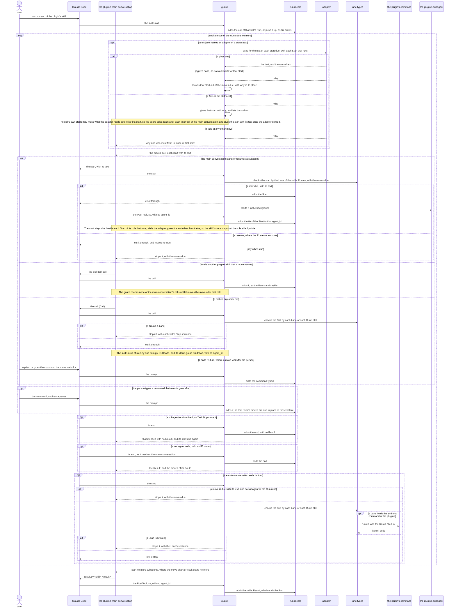
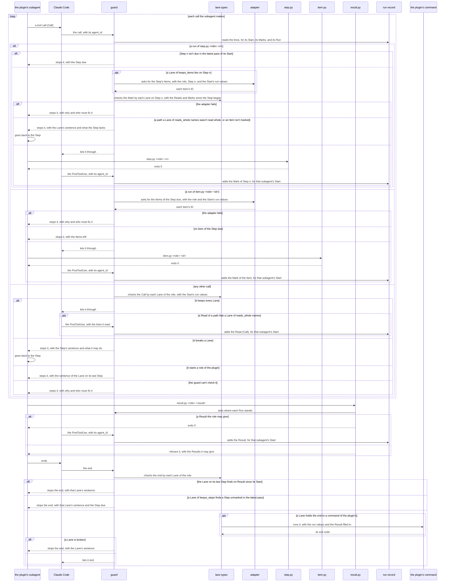
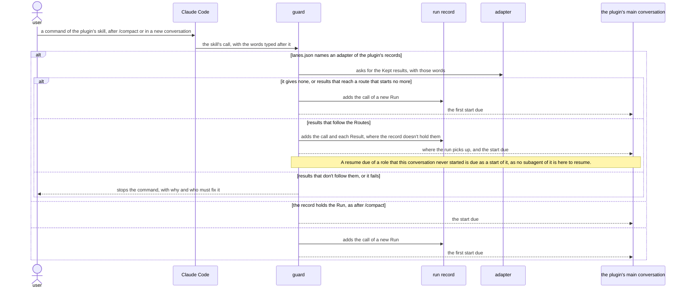

# Lane architecture

## User stories

- S1: the user wants to read what Lane would hold before any change, so that nothing holds their
  plugin unread.
- S2: the user wants to approve the proposal or ask a change, so that Lane lays only what they
  approved.
- S3: the user, as an AI, wants to approve by its own act, so that it waits for no person.
- S4: the user wants the checks to follow their changed steps, so that the checks match the steps
  as written.
- S5: the user wants their plugin's subagents to start in the order they designed, so that results
  move the run.
- S6: the user wants each subagent held to its steps, so that one that leaves a step goes back.
- S7: the user wants a stopped run to go on where it stopped, so that its subagents don't start
  over.

## Solution strategy

Lane turns the user's steps into checks once, and holds every run by them. up proposes them,
`lay.py` lays them on approval, and the laid guard gives each run its step or start due. Lane builds
on [the plugin guide](../plugin-development-guide.md), and every view keeps these rules.

### The steps are the one source

up proposes from the steps alone, without the text the Laid names, and writes each asked change into
the steps.

*Why*: a rule kept apart from the steps is unseen there, and the next `/lane:up` loses it, which
raises KR1.1.

### One type gives the sentence, the check, and the steps it suits

up, `lay.py`, and the guard take each rule's sentence, check, and suited steps from its lane type
alone.

*Why*: a sentence and check made apart drift, so the check stops a role that keeps the sentence,
raising KR1.1.

### Laid only on the caller's own act

`lay.py write` lays only the Proposal its caller approved by their own act, while the steps read as
shown.

*Why*: unread rules stop moves the user meant to allow, raising KR1.1, and an AI kept waiting adds
to KR1.2.

### Lane's part replaced whole

`lay.py write` replaces at once everything the Laid names, and leaves every other part of the plugin
as it stands.

*Why*: a stale rule stops an allowed move, and a lost user hook entry leaves a step unheld,
raising KR1.1.

### A result only from the result script

The guard moves a Run only on a Result that its Start's subagent gave by `result.py`, never by
reply.

*Why*: a reply read as a result starts a role the order doesn't name, which raises KR1.1.

### What no hook shows only from Lane's scripts

The guard checks what hooks show from the calls, and takes the rest only from Lane's scripts.

*Why*: a reply taken for a read or a Step done lets a skipped Step pass, raising KR1.1.

### Only the main conversation starts the roles

The guard lets a start of a role through only from the main conversation, as a Start due.

*Why*: a subagent that starts roles of its own starts roles the order doesn't name, which raises
KR1.1.

### A stop gives the step back

Each stop gives the sentence broken and what to do, or why the guard can't check, and who fixes it.

*Why*: a role that meets only a refusal finds another way to do the step, which raises KR1.1.

### The run kept in a file

Each Run's state comes from the run record and the kept results, worked out by the guard's code
alone.

*Why*: a compacted or new conversation forgets the run, and two parts working it out drift apart,
raising KR1.1.

### The guard checks only the run

The guard checks calls only within a Run, and none during another plugin's run that a move called.

*Why*: a check that reaches the user's work or another plugin's run stops a move no step
forbids, raising KR1.1.

### The laid plugin runs alone

The guard, `result.py`, and lane types need only Python 3.9's standard library and the plugin's
folder, and name no plugin.

*Why*: whoever runs the plugin may lack Lane or have another version, stopping or changing the run,
raising KR1.1.

## Components



- user\
  Writes each step, reads the proposal, and approves it or asks a change.
- up\
  Proposes each step's lane type, each skill's routes, and each missing result's name from the steps.
- lay.py\
  Checks a Proposal, shows how the steps read once laid, and lays it into the plugin.
- lane types\
  Give each rule's sentence, the steps it suits, what it allows, and its check of a call or an end.
- guard\
  Places each hook event in its Run, and gives each start due, each stop, and each approval.
- result.py\
  Takes a result given as a command of its own, only where a Run lets its role give it.
- step.py\
  Gives a Step's Mark as a command of its own, which the guard checks at its call.
- item.py\
  Gives an Item's Mark as a command of its own, which the guard checks at its call.
- adapter\
  Gives each start's text, a Step's Items, and kept results in Lane's form, and names what a call
  picks up.

Strategies:

- A proposal from the steps' sense, by up\
  Only a reading of their sense gives routes to a step that names no subagent, keeping KR1.1 low.
- The approval held by a guard laid on up\
  The main conversation can't approve for a person who typed `/lane:up`, keeping KR1.1 low.
- Each skill as one role whose steps lie in several files\
  No hook event marks where a command's steps end, so only the skill's lanes hold them all, keeping
  KR1.1 low.
- `lay.py print` refusing a Proposal the plugin's files can't carry\
  Route commands the model calls, unnamed adapters, shared steps files, and foreground subagents
  break runs, raising KR1.1.
- An end held to the plugin's own command, which Lane runs\
  A role that leaves its steps skips the checking step too, and only the plugin knows its measure,
  raising KR1.1.
- A sentence left out of a step that already says it\
  A rule said twice takes the role's attention from its step, so the step says each once, keeping KR1.1 low.
- A call kept where one Lane of each lane type allows it, and Lane's scripts by every type\
  Else one Lane stops what another of its type allows, or a role's Result or Mark, raising KR1.1.
- A Step's Mark held only by its own Lanes of reads_whole and keeps_items, laid only with keeps_steps\
  The Marks alone bound a Step, so only there does a Lane see its reads and Items, keeping KR1.1
  low.
- Each Mark checked by the guard at its script's call, which names the subagent\
  The script's environment names no subagent, so only the call's agent_id tells whose Step is due,
  keeping KR1.1 low.
- A Step's Items given by the plugin's adapter, from the role, the Step, and the run values\
  Only the plugin knows each Step's checklist, and Lane names no plugin, keeping KR1.1 low.
- Each event placed by `session_id` and `agent_id`, a Start tied at its Agent call's PostToolUse\
  Only this placing holds each call to its own Start, as [Claude Code's states](claude-code-states.md)
  shows, keeping KR1.1 low.
- The runs of several skills side by side, each held to its own routes\
  A person types another command while a subagent of the first runs, and leaving it unheld raises
  KR1.1.
- Each Result and Mark added by the guard at the PostToolUse of a run of Lane's scripts that gave 0\
  A Bash command carries no `agent_id`, so only the hook event ties each to its subagent, keeping
  KR1.1 low.
- The adapter naming the work a call picks up, from the words typed after the command\
  Only the adapter, run before the guard answers, separates a new request from a pick-up, keeping KR1.1
  low.
- Subagents in the background\
  A foreground subagent's PostToolUse comes only once it ends, so the guard couldn't hold its calls,
  raising KR1.1.
- The guard standing aside while another plugin's called skill runs\
  The other plugin's guard holds the main conversation there, and two guards would stop each other's
  moves, raising KR1.1.

## Data model


- Step\
  One item under `## Steps` of a skill or a subagent, or of the file its body names.
- Lane\
  A rule of one lane type on one step, which the README calls a rule.
- Route\
  The moves of one skill after its start, a Result, a typed command, or another plugin's run it
  called.
- Laid\
  What Lane added to the plugin, kept in a form that a later Lane separates from the user's text.
- Approval\
  The caller's own act that approves one Proposal: a person's reply, or an AI's run of
  `lay.py write`.
- Start\
  One start or resume of a role, made due by a Route, that holds its text and its run values.
- Call\
  One tool call of a role, checked as it comes, and kept only as a Read that reads_whole needs.
- Item\
  One item of a Step's checklist, by the ID that the plugin's adapter gives.
- Mark\
  A role's report of a Step or an Item done, each Mark of Step 1 beginning a new pass.
- Run\
  One run of one skill in one conversation, with each prompt typed in it, until a route starts no
  more.
- Kept results\
  The results of a run that the user's plugin keeps in its own records.

Strategies:

- An append-only run record of only what no later payload gives again\
  Parallel hooks run at once, so a Run written whole loses another's line, raising KR1.1.
- The form of Lanes and Routes, in `lanes.json` and a Proposal, decided by the guard's code\
  A laid plugin runs without `lay.py`, so the laid copy alone decides the form, keeping KR1.1 low.

## Sequences

### S1: a proposal



### S2: a person approves or asks a change



### S3: an AI approves by its own act



### S4: proposed again after the steps or Lane change



### S5: a run in the order the user set



### S6: a subagent held to its steps



### S7: a run picked up



## Deployment


Claude Code runs the laid guard on each hook event of the plugin, from the session's start or after
`/reload-plugins`.

Strategies:

- The person's `/reload-plugins`, which `lay.py write` asks for\
  Hooks load as a session starts or on that command alone, so building goes on unbroken, keeping
  KR1.2 short.
- Lane's code copied into the user's plugin\
  Whoever runs the plugin needs no Lane, and the guard runs the code Lane's tests ran, keeping KR1.1
  low.
- Lane's code on Python 3.9 and its standard library\
  Whoever runs the plugin installs nothing for Lane, keeping KR1.2 short.
- The proposal and the run record in the system's temporary folder\
  Lane writes nothing that the user's repository must keep or ignore, keeping KR1.2 short.
- The adapter and each command that a Lane runs in the hook event's `cwd`\
  A conversation that enters a worktree moves its `cwd` there, so they read the run's checkout,
  keeping KR1.1 low.
- Each lane's path read from the top of its worktree, beside the root\
  Roles may work in worktrees of their own, so a step's path names the file there, keeping KR1.1 low.

## Directory structure

`plugins/lane/` holds what Claude Code installs for the user. `dev/lane/` holds what only Lane's
developers use. `dev/tests/` holds what the developers of Lane and rn share for their tests. In the
user's plugin, Lane writes only the sentences in the steps and the files under `hooks/`. The
system's temporary folder holds what Lane keeps only for a run.

```text
plugins/lane/
├── skills/up/SKILL.md            /lane:up, which runs up's part
├── domain/up.md                  up's part
├── domain/lay/                   lay.py's code, a module for each of its decisions
├── scripts/lay.py                lay.py types, steps, print, and write
├── hooks/
│   ├── hooks.json                starts Lane's own guard on up
│   ├── lanes.json                the lanes and routes that hold up
│   └── lane/                     Lane's code, copied whole into each plugin
│       ├── hook.py               the guard
│       ├── result.py             the result script
│       ├── step.py               the script by which a role marks a Step done
│       ├── item.py               the script by which a role marks an Item of a Step done
│       └── domain/               the guard's code, the form of lanes.json, and lanes/, the lane types
├── CHANGELOG.md                  the changes in each version
└── README.md                     for Lane's users

dev/lane/
├── product-vision.md, architecture.md, images/
├── claude-code-states.md         each state of Claude Code that the guard meets, with its records
└── tests/                        the test cases, in unit/, properties/, prompts/, integration/, e2e/
    └── released/<version>/       the walkthrough's plugin as each released Lane laid it

dev/tests/
├── claude_code.py                the double of Claude Code, its `claude plugin validate` too
├── fresh_imports.py              keeps the plugins' modules out of a case's process, so each script imports the bench's copy
├── opus.py                       runs a prompt on Opus by `claude -p`, and the judge of its runs
├── repo_files.py                 git, the files a case writes, and a block of the README's text
├── scenario.py                   a key result measured by e2e.py until its mean holds, and a fresh home
├── recorded/                     the records of Claude Code that the double gives from
└── recorder/                     what records a state again, and compare.py

<the user's plugin>/
├── skills/<skill>/SKILL.md       a skill's Steps, with Lane's sentences
├── skills/<command>/SKILL.md     the Steps of a command that a skill's Route waits for or goes after
├── agents/<role>.md              a subagent's Steps, with Lane's sentences
├── <the file a body names>       the Steps of the skill or subagent that names it
└── hooks/
    ├── hooks.json                the guard's hook entries, beside the user's own
    ├── lanes.json                the Lanes, the Routes, the adapters, and the Laid
    ├── lane/                     the copy of Lane's code
    └── adapters/                 each adapter, the user's own

<system temporary folder>/
├── lane/<yyyymmdd>-<plugin>/     each Proposal, by its ID
└── <plugin>/<yyyymmdd>-<id>/     the run record of one conversation
```

Strategies:

- The lane types inside `hooks/lane/`, which `lay.py` imports\
  The sentence `lay.py print` shows and the check the guard runs come from one copy, keeping KR1.1
  low.

## Test strategy

Each test case lies in `dev/lane/tests/`, written as Given, When, and Then before anyone builds a part.
`dev/scripts/trace.py` checks that each names an element or a case one level up.

| Check | Test target | Kind | Exit criteria or measure |
|---|---|---|---|
| Lint | Parts | Quality | ruff: 0 findings. |
| Static analysis | Parts | Quality | pyrefly, and pylint's duplicate-code and cyclic-import checks: 0 findings. |
| Complexity analysis | Parts | Quality | complexipy and ruff: per function, McCabe 10, cognitive 15, 6 returns, 12 branches, 5 arguments, 50 statements at most. |
| Unit testing | Parts | Quality | pytest, with the double of Claude Code: every case passes. |
| Unit testing | Parts that hold a prompt | Benchmark | `claude -p` on Opus: each case's results over several runs, up's Lanes and Routes read by code. Runs per case: added until one more changes no case's count. |
| Code coverage | Parts | Quality | coverage: 100% statement (C0) and branch (C1) coverage. |
| Property-based testing | Parts | Quality | hypothesis: 0 counterexamples in reading Steps and Proposals, each lane type's check, and the guard's reading of events. |
| Mutation testing | Parts | Quality | cosmic-ray: 0 surviving mutants. |
| Data compatibility testing | Parts | Quality | pytest: the newest `lay.py` lays again each plugin in `dev/lane/tests/released/`, leaving no earlier sentence, none doubled. |
| Integration testing | Architecture | Quality | pytest, with the double of Claude Code: every case passes, each handoff giving the data the data model names. |
| Contract testing | Architecture | Quality | `dev/tests/recorder/compare.py` on each new Claude Code: each recorded state gives the double's events, with their fields in order. |
| Traceability | Architecture | Quality | `dev/scripts/trace.py`: every element tested, every case naming one level up, each rule's case failing broken. A review: 0 cases that miss what their element says. |
| Scenario testing | Product | Benchmark | `dev/scripts/e2e.py` on the walkthrough with S3 and S4, judged on Opus: key results KR1.1, then KR1.2, over several runs. Runs: added until one more moves no mean by a step. KR1.1 counts a role off its steps, a wrong stop or start, an early stop, or a step left unheld. |
| Installation testing | Product | Quality | `dev/scripts/e2e.py`: Lane installs by the README's commands in a fresh home's shell, and `/lane:up` answers. |
| Configuration testing | Product | Quality | CI's Tests on Python 3.9 and the newest Python: every case passes on each. |
| Conformance and compliance testing | Product | Quality | `claude plugin validate --strict` on each laid plugin: passes. |
