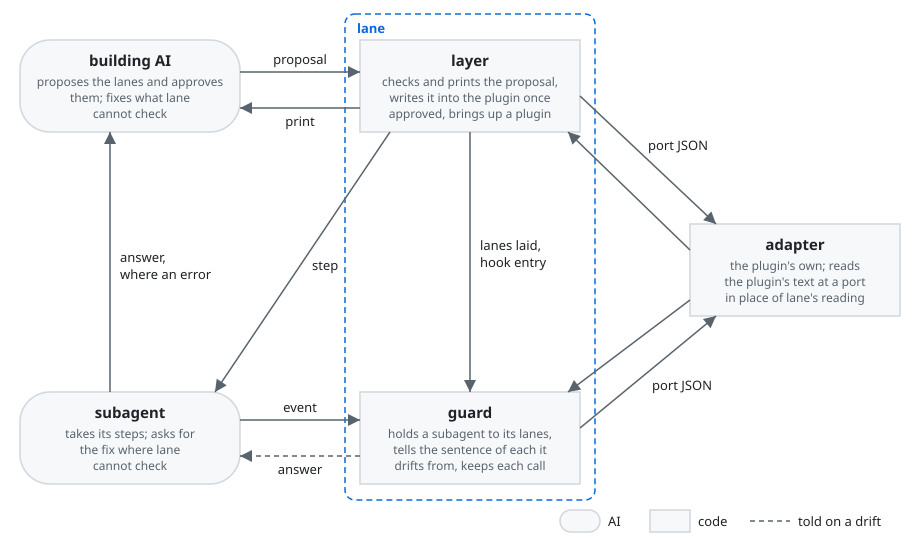
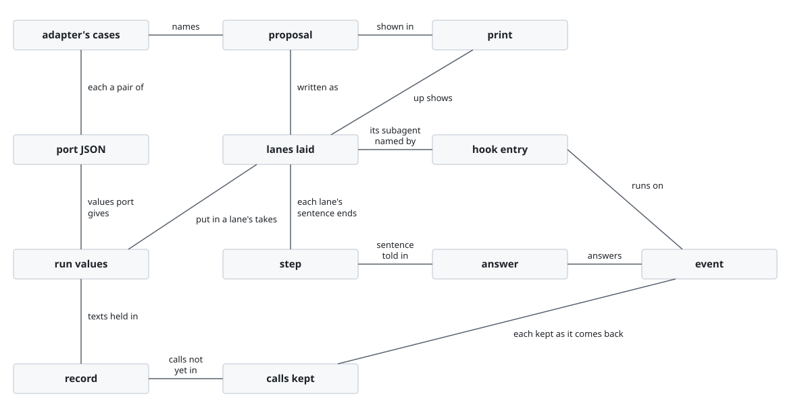
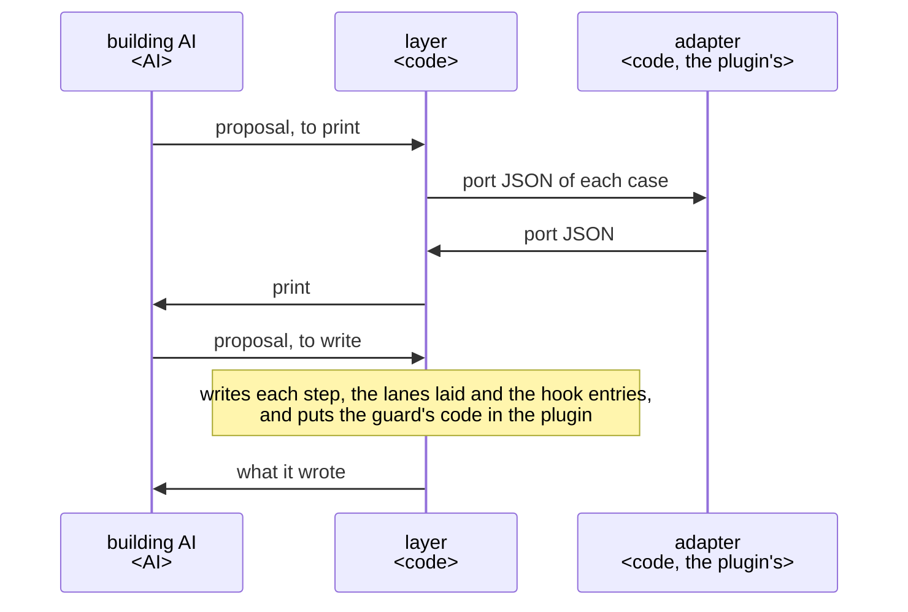
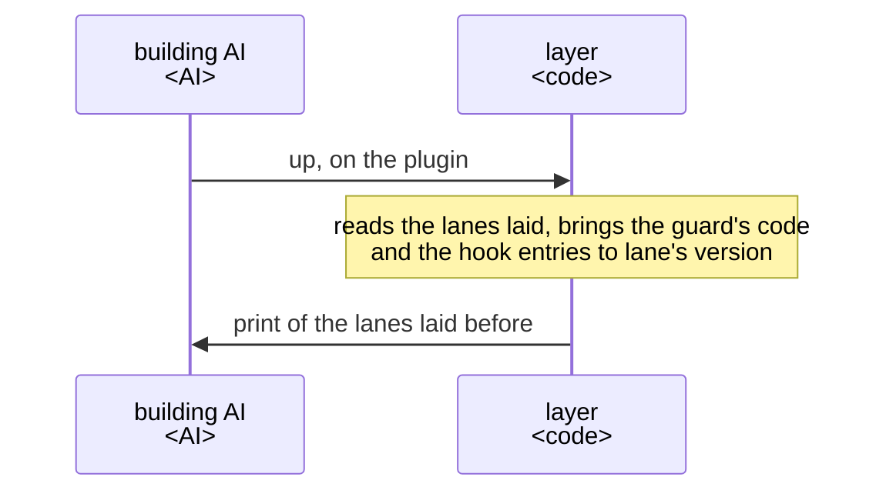
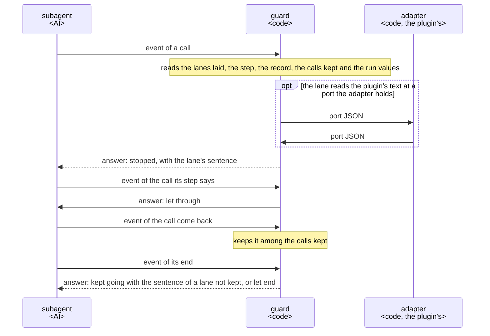
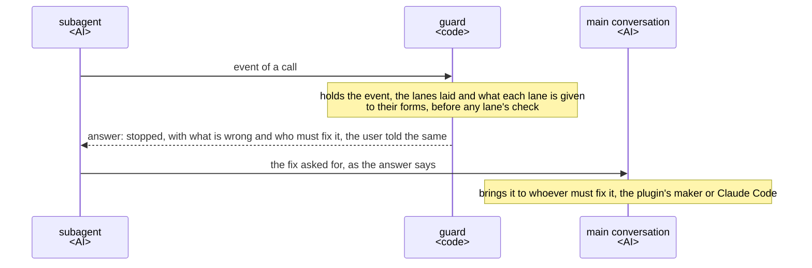
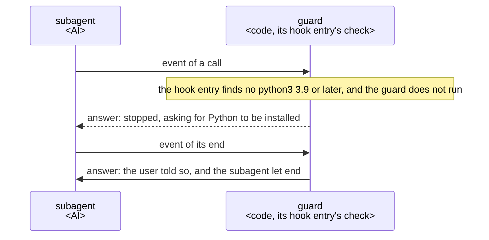
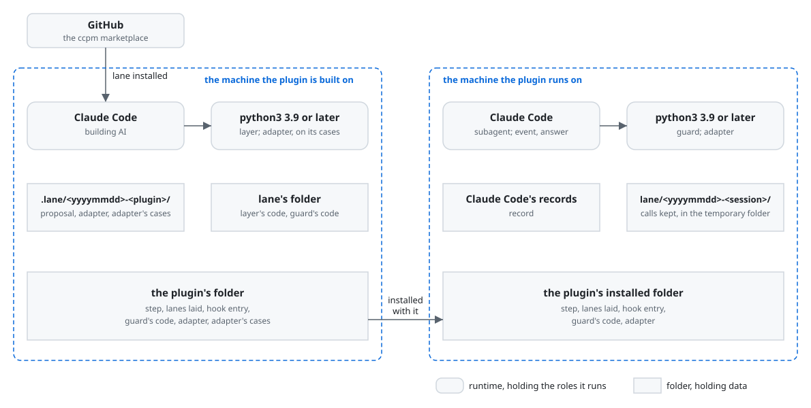

# lane architecture

lane is built on [how a plugin works](../architecture.md) as a part that other plugins are built
with, not as a plugin whose orchestrator and roles do a job for its user. The building AI writes
the lanes it proposes for its plugin in a proposal. lane's layer, a script, prints them and, once
the building AI approves them, writes them into the plugin. lane's guard, code the layer puts in
that plugin, notices a subagent's drift from its lanes and tells it the step again. Each lane holds
one kind of check, the same in every plugin, and takes what differs from plugin to plugin from what
its hook gives it. The building AI, its goal and the key result are in [lane's UX](ux.md).

lane holds the [principles every plugin holds](../architecture.md#principles), named below
Principle 1 to 9, and two of its own, named below lane's Principle 1 and 2:

1. The AI notices its drift from a step and is told the step again, so it finds its way back
   itself.
2. A lane is a sentence of a step together with the hook that notices a drift from it.

## User stories

- As the building AI, I want to write the lanes I propose for my plugin, see them printed as they
  would be laid, and once I approve them find them written into my plugin with lane's code.
- As the building AI, I want `lay.py up`, run where an older copy of lane's code is, to bring the
  copy and the hooks to lane's version with the same lanes, and to tell me each lane laid before.
- As the building AI, I want my subagent, when a call drifts from a lane, to be stopped and told the
  lane's sentence headed by my plugin's name, and every call the sentence allows let through.
- As the building AI, I want a call that lane cannot check stopped, and my subagent and its user
  told what is wrong and who must fix it.
- As the building AI, I want the hooks, on a machine without Python 3.9 or later, to stop the calls
  they watch, each asking for Python to be installed, and at a subagent's end to say so to whoever
  runs the plugin and let it end.

## Architecture

### Logical view

#### Components



- The building AI is the caller of [how a plugin works](../architecture.md). It writes and approves
  the proposal itself, and no person takes part. Its running `lay.py write` on the print it has
  read is the caller's own action, from which an approval counts
  ([The caller approves what is theirs](../architecture.md#the-caller-approves-what-is-theirs)).
- The layer prints and writes what the building AI approves from one file.

  So no AI copies it, and what the layer writes is what the building AI approved.
- The building AI proposes a lane only for a sentence of a step whose drift shows in a tool call
  or in how the subagent ends.

  No hook can see what shows in neither, such as what the subagent weighs.
- The layer lays lanes on subagents alone, and the guard holds each subagent to its own lanes.

  A hook is told which subagent it runs in, and not which skill runs
  ([The guard tells each role its steps again](../architecture.md#the-guard-tells-each-role-its-steps-again)).
- Each lane checks only what [the lanes](../../plugins/lane/docs/lanes.md) define it to take, and
  knows no plugin's forms. Where a check reads a plugin's text, the guard reads it at a port: a
  point lanes.md defines by the port JSON it is given and gives back. At each port lane reads one
  form, the one lanes.md gives. A plugin whose text is in another form has an adapter, a command of
  its own that the building AI writes with the cases it must give. The guard runs the adapter at
  that port in place of lane's reading. An adapter is part of the proposal: the building AI keeps
  it beside the proposal, the layer runs it on its cases and shows it in the print, and the layer
  writes it into the plugin with the lanes once approved.

  So lane holds one check per lane however many forms plugins write in, and a new form is a
  plugin's adapter, never a new version of lane (ports and adapters; a command handed JSON, as git's
  textconv is handed a file). A command, not a module lane imports, keeps lane's code free of the
  plugin's and the adapter free of lane's code, so `lay.py up` brings lane's copy up without
  touching the adapter.
- The guard reads a call in the forms the steps tell and the AI writes, not in every form the shell
  allows. Where a lane holds the files read or written, the guard tells the subagent that a file a
  command names by words it cannot settle, such as `"$f"` or a path after a `cd` it cannot follow,
  is not checked, with how to name it. A hook on a tool call that fails or times out blocks the
  call.

  What must hold whatever the AI writes is held by GitHub's branch protection, Claude Code's
  sandbox or its permission rules, as a check on a command's text is no security boundary; so the
  guard stays small. A check that cannot tell lets through unseen what it was there to stop
  ([No check passes what it did not check](../architecture.md#no-check-passes-what-it-did-not-check)).
  The subagent can put it right by naming the file by its path, so the guard tells it with the
  lane's sentence, as it tells a drift.
- in_form holds an output to a JSON Schema, for JSON or JSONL, or to a Markdown template, and the
  guard reads both with the standard library alone.

  They are the forms a plugin's outputs most often take. A form of a project's own is left to the
  project's script, through test_after.
- Claude Code carries each call of the subagent to the guard as an event, and the guard's answer
  back. Claude Code is no role of lane's, so [Deployment](#deployment) draws it.
- Where the guard cannot check a call, the subagent asks the main conversation for the fix, as the
  guard's answer says, and the main conversation brings it to whoever must fix it. The main
  conversation is no role of lane's, so Components does not draw it.

  Only the main conversation can ask the user
  ([Where the orchestrator runs](../architecture.md#where-the-orchestrator-runs)).

#### Data model



- The layer keeps the lanes laid in a plugin in one JSON file of it, `hooks/lanes.json`, in the
  shape of the proposal: each lane with its step and what it takes. A hook entry names only its
  subagent. The layer makes each lane's sentence from them by the lane's wording in
  [the lanes](../../plugins/lane/docs/lanes.md) and writes it into the step, and the guard makes
  the same sentence when it tells the subagent.

  So the sentence the subagent is told and the one its step says cannot differ, and no one writes a
  sentence twice. The guard reads the file the building AI approved, and a thing taken holds any
  text, a comma among the rest.
- Each boundary lane defines is JSON: the proposal, the lanes laid, the port JSON an adapter is
  given and gives back, and the answer, a decision in Claude Code's JSON output on exit 0.

  Claude Code hands a hook JSON and reads JSON from it, so one form runs through each boundary,
  read and checked one way.
- A thing a lane takes is fixed in the step, or given for each run as a run value. The guard reads
  the run values from the JSON the subagent starts from and from each message sent to it after,
  the later over the earlier.

  A subagent's inputs and outputs are most often known only once its run starts, and a plugin hands
  them over in what the subagent starts from, so a lane reads them there, the same way in every
  plugin. A run's files may grow while the subagent works, as when an answer adds a file. A
  subagent started again for that spends again what it had read, so a message sent to it counts
  too.
- A subagent's steps are those of the part its file has it read first, where its file is its entry
  as [Entries pass the job to their parts](../architecture.md#entries-pass-the-job-to-their-parts)
  has it, and else those of its file. Where a subagent with lanes has an entry that names a part,
  the guard holds it to read the part whole before anything else and tells it the entry's sentence,
  with nothing in the proposal.

  The entry's sentence is the one the subagent reads first, as a lane's is its step's. The guard
  holds every subagent so made to it, so the reading asks the building AI nothing.
- A lane takes a script, file or folder by the name the part uses, as its step says it. The guard
  and the layer read the name as the entry says it stands for.

  Claude Code puts the plugin's folder in for `${CLAUDE_PLUGIN_ROOT}` in the entry's body alone, so
  where a thing lies is the entry's to say, and the sentence the subagent is told stays the step's.
- The guard counts a call as made once it has come back. It keeps each call of a subagent with
  lanes as it comes back, as calls kept, and reads a kept call beside the subagent's record until
  the record holds its result. Where they differ, the record holds.

  Claude Code writes a call into the record as its tool use, at times before the call's PreToolUse
  hook runs, and then its result. For a call of the reply being handed, it writes the result at
  times only after the next call's hooks have run. It runs each call's PostToolUse, or
  PostToolUseFailure, before the next call's PreToolUse. Read from the record alone, the call being
  checked would count as made before itself, and a call made earlier in the same reply would be
  missed.

#### Sequences

Laying lanes:



Bringing up a plugin laid before:



A call that drifts, and a call let through:



A call lane cannot check:



A machine without Python 3.9 or later:



- The layer writes the proposal only once the building AI approves it.

  The lanes are the caller's to decide, so no lane is written into the plugin before the approval
  (Principle 2).
- `lay.py up` tells the building AI each lane laid before, and the building AI keeps one in a
  subagent the proposal gives by putting it in the proposal.

  Those lanes were approved before, so keeping them asks nothing. A subagent the proposal gives has
  its lanes alone, so the layer takes a lane the building AI drops out of its step with its
  sentence.
- The guard holds the event to the form Claude Code hands it and `hooks/lanes.json` to the form
  `lay.py write` writes. Then, before any lane's check runs, it holds what each lane is given to
  that lane's IN, a JSON Schema lanes.md defines: the texts of its places, the run values put in,
  and the record where the lane rests on it. What is not as these say, such as a value not given
  or empty, is an error, not a drift. The guard stops the call, or keeps the subagent going once at
  its end, tells it in the forms lanes.md gives what is wrong and who must fix it, and tells the
  user the same. A lane's check then meets only what it can check.

  A drift is the subagent's to put right by its step. An error is the plugin's, which the subagent
  can only report, and a call let through unchecked would hide it. Checked once at the entry, as an
  application validates its input, each lane's check holds no guard of its own.

### Physical view

#### Deployment



- The building AI runs the layer as `python3 <lane>/scripts/lay.py`, `<lane>` being lane's folder:
  the `installPath` that `claude plugin list --json` gives for lane, or `plugins/lane/` in the ccpm
  repository.

  Claude Code puts a plugin's folder in for `${CLAUDE_PLUGIN_ROOT}` in that plugin's own hooks,
  skills and agents alone, not in what the Bash tool runs (plugins-reference, Environment
  variables), and installs each version in a folder of its own (plugins/loading, Find plugins on
  disk).
- Claude Code starts the guard through the plugin's hooks: each hook entry is one entry of the
  plugin's `hooks/hooks.json` for one subagent and event. Its command gives the guard the subagent,
  whose lanes the guard reads from `hooks/lanes.json`, and the guard acts only where the event's
  `agent_type` is that subagent.

  Claude Code reads a plugin's hooks from its `hooks/hooks.json` alone
  ([The guard tells each role its steps again](../architecture.md#the-guard-tells-each-role-its-steps-again)),
  and a tool event's matcher filters by tool, not by agent.
- Each hook command first checks for Python in the shell, before the guard runs.

  With no Python the guard cannot read the event, and the machine may have nothing else.
- The layer checks the plugin with `claude plugin validate` once it has written it.
- The building AI keeps the proposal and its adapters in `.lane/<yyyymmdd>-<plugin>/` at the root
  of the repository holding the plugin: the nearest folder above it holding `.git`, or the plugin's
  folder where none does. The guard keeps the calls in `lane/<yyyymmdd>-<session>/` in the system's
  temporary folder, as
  [Where a plugin writes its files](../architecture.md#where-a-plugin-writes-its-files) has it.

  The building AI reads and writes the proposal and its adapters with its tools, so they go in the
  folder that may be kept, and the layer removes them, and their folder, once it has written them.
  Only the guard reads the calls kept, and only while a subagent runs.
- The layer puts the guard's code into `<plugin>/hooks/lane/`: in a plugin of the ccpm marketplace
  a relative link to lane's, as [Code kept once](../architecture.md#code-kept-once) has it, and
  anywhere else a copy holding a `VERSION` file, read from lane's `plugin.json`, by which
  `lay.py up` tells an older copy.

  The version stays in one place, as [The version](../architecture.md#the-version) has it, and the
  layer writes the copy's `VERSION` from it.
- An adapter is a Python 3 script that python3 runs with its port JSON on stdin, giving its port
  JSON on stdout within the hook's time. The layer runs it on each of its cases before writing, and
  the guard holds what it gives to its port, a failure or a wrong answer being an error.

  Python is what lane already needs on the machine, and a case checks the port JSON without a run of
  the plugin.
- The layer and the guard run an adapter with `CLAUDE_PLUGIN_ROOT` set to the plugin's folder.

  An adapter that hands its port's text to a part of the plugin, as
  [Entries pass the job to their parts](../architecture.md#entries-pass-the-job-to-their-parts) has
  it, finds the part from there, beside the proposal as in the plugin.
- The two machines are often one, as when the building AI tries its plugin.

#### Directory structure

```text
plugins/lane/                     the plugin, installed by Claude Code
├── .claude-plugin/plugin.json    lane's manifest, holding its version <JSON>
├── scripts/                      the layer <Python 3>
│   └── lay.py                    what the building AI runs: print, write and up
├── hooks/lane/                   the guard, put in each plugin <Python 3>
│   ├── pretooluse.py             the entry for lanes on a tool call
│   ├── subagentstop.py           the entry for lanes on how the subagent ends
│   ├── posttooluse.py            the entry keeping each call as it comes back
│   ├── posttoolusefailure.py     the same, for a call that comes back failed
│   └── lanes/<lane>.py           one check per lane, with its wording
├── docs/lanes.md                 each lane, the proposal's and the ports' JSON Schemas <Markdown>
├── README.md                     what lane gives, a walkthrough and installation <Markdown>
└── CHANGELOG.md                  what changed for its users in each version <Markdown>

<the root of the repository holding the plugin>/.lane/
└── <yyyymmdd>-<plugin>/          the building AI's, until the layer writes them into the plugin
    ├── <plugin>.json             the proposal <JSON>
    └── <plugin>/adapters/        the adapters the proposal names, with their cases

<the system's temporary folder>/lane/
└── <yyyymmdd>-<session>/
    └── <agent>.jsonl             the calls kept of a subagent with lanes <JSONL>

<plugin>/                         the building AI's plugin, as the layer writes it
├── agents/                       the subagents' entries, or their steps
├── prompts/                      the parts the entries name, each with its subagent's steps
└── hooks/
    ├── hooks.json                the hook entries, one per subagent and event <JSON>
    ├── lanes.json                the lanes laid, as approved <JSON>
    ├── adapters/                 the plugin's adapters, written by the layer
    │   ├── <port>-<name>.py      one adapter <Python 3>
    │   └── <port>-<name>.json    the cases it must give <JSON>
    └── lane/                     the guard's code
```

## Test

lane is tested as [Test](../architecture.md#test) says, by those rules alone: unit tests over every
line and branch, mutation testing set in `cosmic-ray.toml`, and property tests in
`tests/properties_*.py`.

- A failure of the guard lets a drift through, or stops a call its step allows, in every subagent
  of every plugin that lays it; a failure of the layer writes a step or a hook the building AI did
  not approve. Either costs the building AI the work lane was there to save, unseen until a run
  goes wrong.
- lane keeps what every plugin's tests and trials stand on: `dev/lane/testing.py`, as
  [Code kept once](../architecture.md#code-kept-once) has it, and `dev/lane/trials/trying.py`,
  which starts Claude Code on copies of plugins and reads the records of the agents it starts.
- The guard's tests hold a subagent's record in the shape that the version of Claude Code named in
  `record.py` writes it.

  Claude Code does not document the record, so the tests are the one account of its shape.
