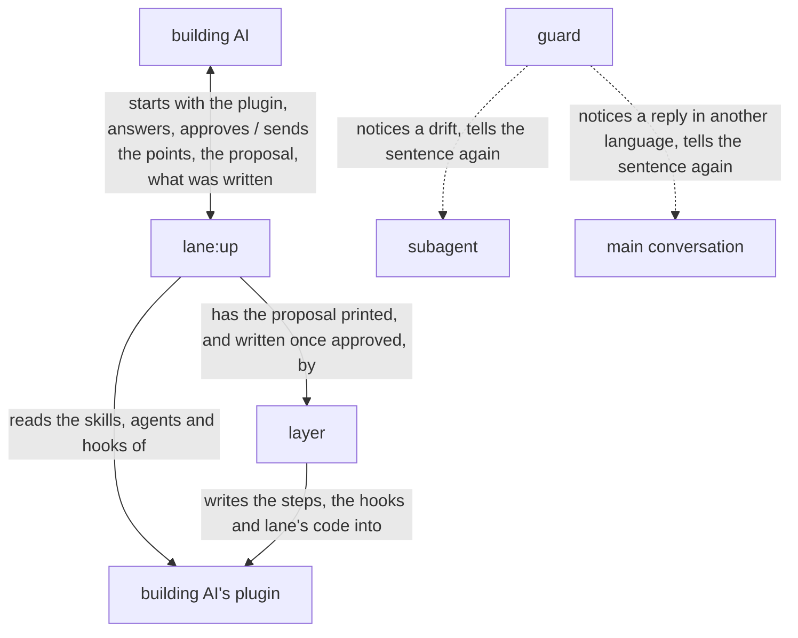

# lane architecture

lane is built on [how a plugin works](../architecture.md), and is itself a plugin of that form:
`lane:up`, the orchestrator the building AI starts, settles with that AI each point its plugin's
files leave open, and has the layer, a script, write the lanes the building AI approves; the guard,
lane's code put in that plugin, notices a drift from a lane, in a subagent or in the reply of the
conversation the plugin's skill runs in, and tells the step's sentence again. The building AI, the
goal and the key result are in [lane's UX](ux.md).

lane holds the [principles every plugin holds](../architecture.md#principles), named below
Principle 1 to 8, and its own:

1. The AI is made to notice its drift from a step and is told the step again, so it finds its way
   back itself.
2. A lane is a sentence of a step together with the hook that notices a drift from it.
3. Each lane is general and reusable: it holds one kind of check, the same in every plugin it is
   laid in, and takes what differs from plugin to plugin from what its hook gives it.

## User stories

- As the building AI, I want to start `lane:up` on my plugin, answer the points it sends, approve
  the lanes it proposes, and find them written into my plugin with lane's code.
- As the building AI, I want `lane:up`, run where an older copy of lane's code is, to bring the copy
  and the hooks to its own version.
- As the building AI, I want my subagent, when a call drifts from a lane, to be stopped and told the
  lane's sentence headed by my plugin's name, and every call the sentence allows let through.
- As the building AI, I want the conversation my plugin's skill runs in, when it ends a reply in
  another language than the one a script of my plugin printed there, to be kept going and told
  reply_in's sentence headed by my plugin's name, with the language, and every other reply let end.
- As the building AI, I want the hooks, on a machine without Python 3.9 or later, to stop the calls
  they watch, each asking for Python to be installed, at a subagent's end to say so to whoever
  runs the plugin and let it end, and at a conversation's reply to let it end unchecked.

## Architecture

### Logical view



- The building AI is the caller of [how a plugin works](../architecture.md): it answers the points
  and approves the proposal itself, and no person takes part; its answer is the caller's own action
  that an approval counts from
  ([The caller approves what is theirs](../architecture.md#the-caller-approves-what-is-theirs)).
- The arrows run in this order: `lane:up` reads the plugin, sends the building AI every point open
  at once, and any an answer opens, until none is left open, then the proposal, and only once the
  building AI approves it does the layer write it.

  The lanes are the caller's to decide, so nothing is written into the plugin before the approval
  (Principle 2). The points go at once since an AI, unlike a person, weighs each as well in one
  reply, and each reply more is a wait.
- Run where an older copy of lane's code is, the layer first brings the copy and its hooks to the
  current form with the lanes they hold, before any point is sent.

  Those lanes were approved before, so keeping them asks nothing.
- What the building AI approves is printed and written by the layer from one file.

  So no AI copies it, and what is written is what was approved.
- A lane is proposed only for a sentence of a step whose drift shows in a tool call, in how the
  subagent ends or in the main conversation's reply.

  What shows in none, such as what the AI weighs, no hook can see.
- A hook holds, for each of its lanes, the step, the lane and what the lane takes; the lane's
  sentence is made from them by the lane's wording in [the lanes](../../lane/docs/lanes.md). The layer
  writes that sentence into the step, and the guard makes the same one when it tells a drift.

  So the sentence the AI is told and the one its step says cannot differ, and no sentence is
  written twice.
- Lanes are laid on subagents, and the guard holds each subagent to its own lanes, reading what it
  did before from its own record where a lane rests on it; on a skill only reply_in is laid, on the
  step whose script first prints the language, and it takes a thing given for each run.

  A hook is told which subagent it runs in, and not which skill runs
  ([The guard tells each role its steps again](../architecture.md#the-guard-tells-each-role-its-steps-again)).
  The language the person chose drifts in the main conversation's reply alone
  ([Languages](../architecture.md#languages)), where a hook is told nothing of the plugin; what the
  plugin's own scripts printed in the conversation is what tells one the plugin runs in, so a lane
  there acts from that step to the conversation's end and suits only a sentence true for all of it,
  as the person's language is.
- A thing a lane takes is fixed in the step, or given for each run and read from the JSON the
  subagent starts from, or, for reply_in, from the JSON the scripts it names printed in the
  conversation.

  A subagent's inputs and outputs are most often known only once its run starts, and the JSON it
  starts from is the one place a plugin hands them over, so a lane reads them there, the same way in
  every plugin; the main conversation starts from no JSON, and its scripts' output is where a plugin
  hands it its run's values.
- reply_in judges a reply by the scripts its prose is written in, not by its words.

  So it holds the same way for every language whose scripts it knows, in every plugin, with no word
  lists; two languages of one script are not told apart.
- The guard reads a call in the forms the steps tell and the AI writes, not in every form the shell
  allows.

  What must hold whatever the AI writes is held by GitHub's branch protection, Claude Code's
  sandbox or its permission rules, as a check on a command's text is no security boundary; so the
  guard stays small.

### Physical view

```
lane/                          the plugin, installed by Claude Code
├── agents/up.md               lane:up, the orchestrator <agent>
├── scripts/lay.py             the layer <Python 3>
├── hooks/
│   ├── hooks.json             the lanes on lane:up, laid by the layer
│   └── lane/                  lane's code, the guard, put in each plugin <Python 3>
│       ├── pretooluse.py      the event script for lanes on a tool call
│       ├── subagentstop.py    the event script for lanes on how the subagent ends
│       ├── stop.py            the event script for reply_in, on the main conversation's reply
│       ├── hook.py            what the event scripts run on: the event read, each check run
│       ├── call.py            a tool call read as one action
│       ├── shell.py           what a shell command reads and writes
│       ├── forms.py           the forms in_form holds an output to
│       ├── schema.py          a JSON Schema, and a value held to it
│       ├── template.py        a Markdown template, and a file held to it
│       ├── step.py            a subagent's or a skill's step, read from its file
│       ├── record.py          what the subagent or the conversation did before, from its record
│       ├── started.py         what the subagent started from, or the conversation's scripts
│       │                      printed, for a thing given for each run
│       └── lanes/<lane>.py    one check per lane of the lanes, with its wording
├── docs/lanes.md              each lane, its action and what its hook notices
└── README.md                  what lane gives, its example and installation

${CLAUDE_PLUGIN_DATA}/
└── <plugin>.json              the proposal <JSON>, kept by lane:up until the layer writes it

<plugin>/                      the building AI's plugin, as the layer writes it
├── agents/                    the subagents' steps
├── skills/<skill>/SKILL.md    a skill's steps, for reply_in
└── hooks/
    ├── hooks.json             one entry per subagent or skill and event
    └── lane/                  lane's code
```

- lane runs on Claude Code, python3 3.9 or later, git and jq; the layer checks the plugin with
  `claude plugin validate`.
- The building AI starts `lane:up` as a subagent with the plugin's folder in its prompt, from the
  main conversation or from a subagent; `lane:up` gives the points as its reply and ends its turn,
  and the building AI sends the answers with SendMessage to the agent ID the reply came with, which
  resumes it.

  The Agent tool gives a subagent no name to be messaged by, and a subagent does not know its own
  ID, so it is reached by the ID its reply comes with, from the main conversation and from a
  subagent alike, as tried on Claude Code 2.1.306.
- The proposal is kept in lane's data folder, which Claude Code keeps for the plugin's own files
  across its updates (plugins-reference, Environment variables).
- lane's code goes into `<plugin>/hooks/lane/`: in a plugin of the ccpm marketplace a relative link
  to lane's, which installing copies into the plugin; anywhere else a copy holding a `VERSION` file,
  read from lane's `plugin.json`, by which the next run of `lane:up` tells an older copy.

  lane's version is written once, in its `plugin.json`; a file of its own beside it would be a
  second copy that drifts.
- A lane's hook is one entry of the plugin's `hooks/hooks.json` for one subagent and event, whose
  command gives the guard the subagent and, for each lane, its step, the lane and what it takes; the
  guard acts only where the event's `agent_type` is that subagent.

  Claude Code reads no hooks from a plugin subagent's own file, and a tool event's matcher filters
  by tool, not by agent.
- reply_in's hook is one `Stop` entry of `hooks/hooks.json` for the skill, with no matcher, whose
  command gives the guard the skill as `<plugin>:<skill>`, its folder's name under `skills/`, and
  the lane; the reply is read from the event's `last_assistant_message`.

  Stop takes no matcher and fires on every reply of the main conversation; the hooks reference says
  to use `last_assistant_message` for the final text of the turn, as the record may not yet hold it.
- A subagent's record is the JSONL file Claude Code writes at
  `<transcript_path without .jsonl>/subagents/agent-<agent_id>.jsonl`, the place the hooks
  reference gives as `agent_transcript_path`, and the main conversation's is at `transcript_path`,
  of the same shape; that shape is not documented, so the guard's tests hold it as Claude Code
  2.1.306 writes it.
- Each hook command first checks for Python in the shell, before the guard runs.

  With no Python the guard cannot read the event, and the machine may have nothing else. On a
  reply the check lets it end saying nothing: Stop fires on every reply of every conversation, and
  without Python a conversation the plugin runs in cannot be told from one it does not, while the
  person sees the reply's language themselves.
- in_form holds an output to a JSON Schema, for JSON or JSONL, or to a Markdown template, read with
  the standard library alone.

  They are the forms a plugin's outputs most often take; a form of a project's own is left to the
  project's script, through test_after.

## Verification

### Units

Each agent is checked on Claude Code's default model, the one users run lane on, and judged from
the records of every conversation and agent the check started. Each unittest below runs in
`dev/lane/tests/`, by [`dev/check.sh`](../check.sh) with lines and branches 100% covered and by
[`dev/mutate.sh`](../mutate.sh) with no mutant surviving.

- The guard: each lane stops a drift from its sentence in the forms the steps tell, tells the
  sentence read from its step, and lets through every call its sentence allows; reply_in tells a
  reply in another language once, and lets end every reply before its language is printed and every
  reply in it.
  - Flow: unittest fed the events, records, and subagent and skill files each lane receives, with
    Hypothesis on how a call is read and on the replies reply_in judges.
- The Python check: it stops the hook with its message where `python3` is missing or older than
  3.9, exiting 2 on a tool call and 1 at a subagent's end, lets an event of another agent and every
  reply of the main conversation through saying nothing, and lets the hook run otherwise.
  - Flow: unittest runs a hook's command with a `PATH` holding no `python3`, one holding a `python3`
    older than 3.9, and the one in use.
- The layer: what it writes is the approved proposal, with every other entry of `hooks/hooks.json`
  as it was but those it wrote for a subagent the plugin no longer has, which it takes out and
  says, and an older copy is brought up with what it keeps unchanged, each lane it cannot keep
  said; it refuses a proposal laying on a skill any lane but reply_in, reply_in on a subagent, or
  reply_in taking nothing given for each run.

  A hook left for a subagent that is gone has nothing to act in, and the building AI would be left
  to edit what only the layer writes.
  - Flow: unittest on a plugin made for each test: a new plugin, one with hooks of its own, one
    with hooks of a subagent or a skill it no longer has, one with an older copy, one in the ccpm
    marketplace.
- `lane:up`: the run goes in the order of the logical view.
  - Flow: on a plugin with one orchestrator skill and one subagent of three steps, with the building
    AI stood in for by answers set beforehand; passes when the records show every open point in one reply,
    each fact found shown to confirm, and the layer run only on the proposal sent back with the
    approval.
  - Content: on the README's `notes` and on a trial plugin whose steps call for every lane;
    passes when each proposed lane is one of the lanes, each step's drift that shows
    in a tool call or in how the subagent ends has its lane, and each skill that talks with a person
    in a language its script prints has reply_in on the step that prints it.

### Acceptance

Each trial runs in `lovaizu/playground`, one at a time, on a branch of its own, and the branch and
whatever it made there are removed after.

- Flow: a stand-in for the building AI starts `lane:up` on the README's `notes`, answers and
  approves; the steps and the hooks are written and `claude plugin validate --strict` passes.
- Laying lanes: the files hold the approved steps and hooks word for word.
  - Read from the files against the proposal in the records.
- Bringing an older copy up: on `notes` with lane's code of an older version, `lane:up` leaves the
  current code and the same lanes in the current form.
  - Read from the files.
- A drift stopped: `changelog-writer`, given a task that invites a commit, is stopped with its lane's
  sentence headed by `notes:`, ends with the changelog written and uncommitted, and none of its
  other calls is stopped.
  - Read from its record.
- Python missing: on `notes` with no `python3` on the `PATH`, `changelog-writer`'s first watched
  call is stopped with the request to install Python 3.9 or later, and on the trial plugin each
  reply of the conversation its skill runs in ends with nothing said.
  - Read from the records.
- Every lane: on the trial plugin, each lane lets through every call of a subagent keeping its
  step, and stops a drift from it with its sentence, the run's value on the next line where it
  takes one, and the subagent goes back to the step.
  - Read from the records, the drift brought about by the run's prompt.
- A reply in another language: on the trial plugin, whose skill's script prints `Japanese`, a
  reply in English after that step is kept going with reply_in's sentence headed by the plugin's
  name and the language on the next line, and the next reply, in Japanese, ends; no reply before
  that step, nor in a conversation the skill has not run in, is held.
  - Read from the main conversation's record, the English brought about by the run's prompt.
- KR1.1: the defects of the UX's KR1.1 met on `notes` and on the trial plugin.
  - Counted from the records of each trial and the files, apart for each kind of defect and each
    lane, so a lane that gives the building AI nothing shows; each version is compared with the one
    before it on the same plugins.

A change is taken when every story is still achieved and KR1.1 does not grow.
