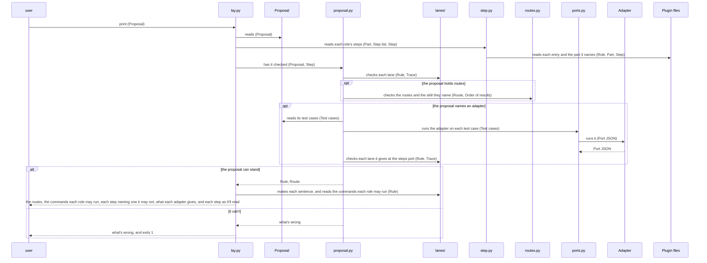
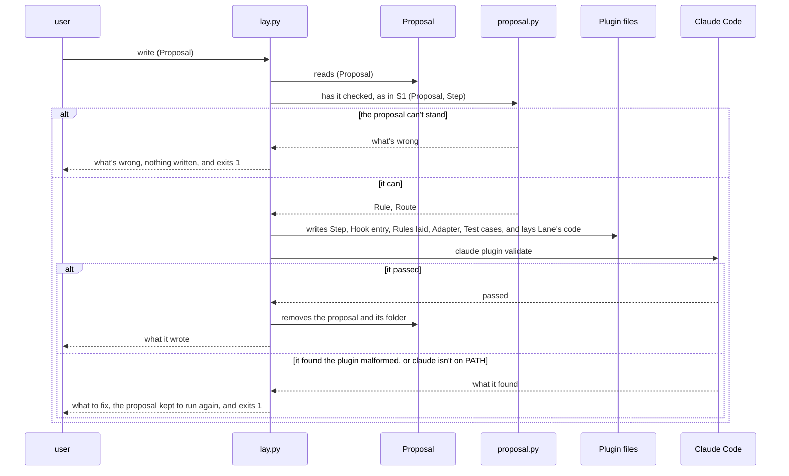
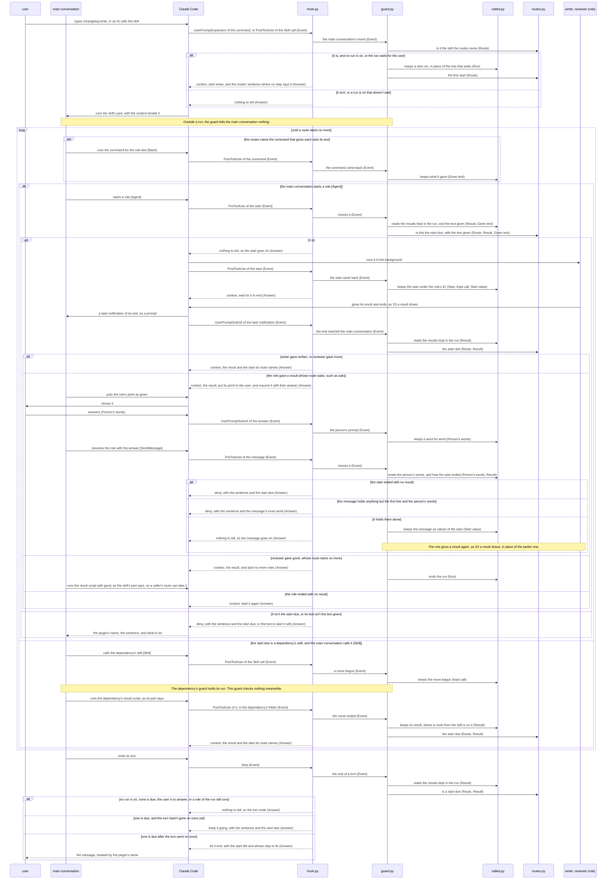
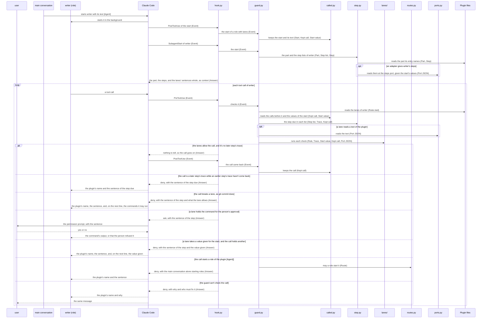
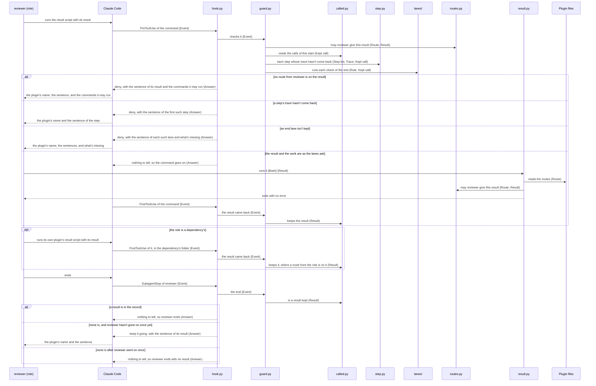
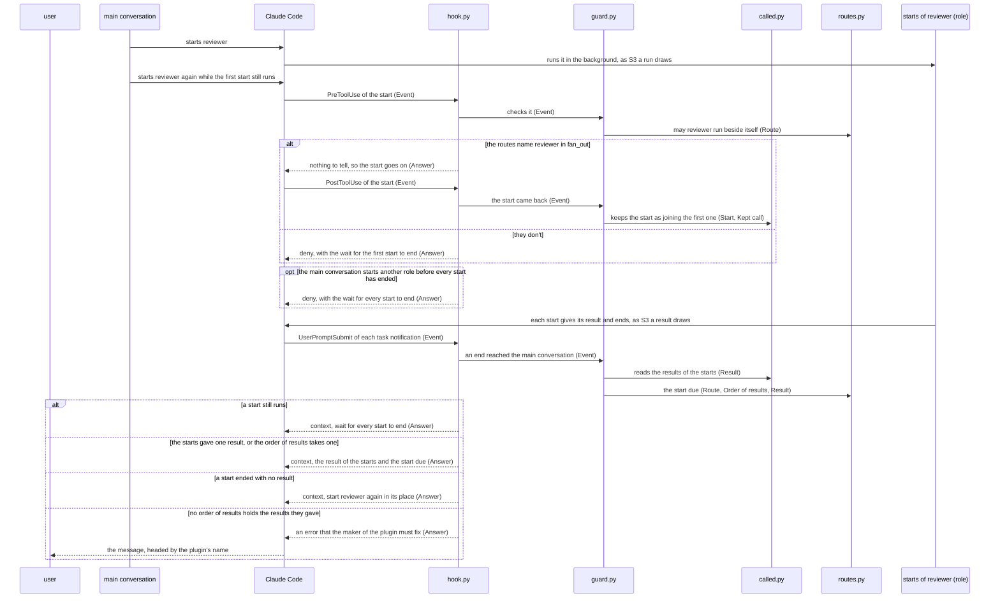
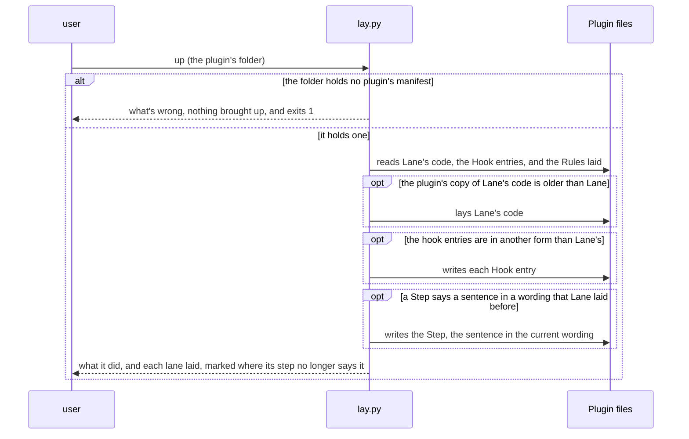

# Lane architecture

This document says how the parts of Lane give [its product vision](product-vision.md). A role is a
subagent of the user's plugin. The plugin's skill runs in the main conversation and starts the
roles, and a route names the skill as it names a role. The user writes the lanes that hold each role's steps and the routes that order the
roles in a proposal, a JSON file. `lay.py`, Lane's command, shows each step as it'll read, and once
the user approves, lays into the plugin each lane's sentence and the guard, Lane's check script,
with the result script beside it. On a run, Claude Code runs the guard on each hook event of the
plugin. The guard holds each role to its steps by what a machine can find of them, never by what the
role wrote: each step's trace, a call such as a command run or a file read, comes in the steps'
order, and each call stays within what the step's lanes allow. It holds the main conversation to
the routes: from the result that a role gives by running the result script, it names the next
start, and it stops any other. Where the routes name a command that gives each start its
text, it lets a start through only with that text, and it lets a resume through only with the
person's own words. Each stop shows the role its step's own sentence again. A text of the plugin in
its own form, such as the steps of its best practices, reaches the guard through the user's
adapter, a script that gives it in Lane's form.

Lane's code and its user docs, [the lanes](../../plugins/lane/docs/lanes.md) and
[the routes](../../plugins/lane/docs/routes.md), call a rule a lane.

## Principles

Lane builds on [the plugin best practice](../../plugins/rn/domain/best-practices/plugin/best-practice.md).
It takes these of its practices as they stand:

- [Q7](../../plugins/rn/domain/best-practices/plugin/best-practice.md#q7), files in a form that a
  script checks
- [Q10](../../plugins/rn/domain/best-practices/plugin/best-practice.md#q10), a pass told apart from
  a check that couldn't run
- [Q11](../../plugins/rn/domain/best-practices/plugin/best-practice.md#q11), a machine checks all
  that it can see
- [Q12](../../plugins/rn/domain/best-practices/plugin/best-practice.md#q12), where a plugin writes
  its files
- [Q13](../../plugins/rn/domain/best-practices/plugin/best-practice.md#q13), Python 3.9 and its
  standard library
- [Q14](../../plugins/rn/domain/best-practices/plugin/best-practice.md#q14), code kept once
- [Q16](../../plugins/rn/domain/best-practices/plugin/best-practice.md#q16), the caller approves
  what's theirs
- [Q18](../../plugins/rn/domain/best-practices/plugin/best-practice.md#q18), in what the guard says
  of a fault: ask for what lies outside the work, and go on
- [Q22](../../plugins/rn/domain/best-practices/plugin/best-practice.md#q22) to
  [Q25](../../plugins/rn/domain/best-practices/plugin/best-practice.md#q25), the tests, the
  manifest, the releases, and the README

Lane is the guard that [Q9](../../plugins/rn/domain/best-practices/plugin/best-practice.md#q9)
names, so it carries out for the user's plugin what
[Q2](../../plugins/rn/domain/best-practices/plugin/best-practice.md#q2),
[Q5](../../plugins/rn/domain/best-practices/plugin/best-practice.md#q5),
[Q6](../../plugins/rn/domain/best-practices/plugin/best-practice.md#q6),
[Q8](../../plugins/rn/domain/best-practices/plugin/best-practice.md#q8), and
[Q15](../../plugins/rn/domain/best-practices/plugin/best-practice.md#q15) ask of a guard. Lane has no
role, skill, or agent of its own, and talks with no person: the user runs `lay.py` themselves, and
the guard runs inside the user's plugin. So Lane takes none of the practices for a plugin's roles,
Q3 to Q6, Q17, and Q19 to Q21. Lane differs from
[Q1](../../plugins/rn/domain/best-practices/plugin/best-practice.md#q1) in where its own knowledge
lies, as [Directory structure](#directory-structure) says.

Lane adds these. Each why says how a run of the user's plugin goes wrong without the rule. KR1.1
of the product vision counts the share of runs that go wrong in any such way.

### A step held by its trace, in its order

A step's trace is the call that shows the step done, such as a command run, a file read to its
end, or a file made, as a lane of the trace kind names it. A role's steps come in step lists, each
in its order: the numbered list of its part, or one list for each intent whose practices the role
carries out. Within a list, the guard stops a call that's a later step's trace while an earlier
step's trace hasn't come back, and stops the role's end while any step's trace hasn't come back.
It gives the role the sentence of the first step not done. A step whose trace not every run makes
carries no trace lane, and steps of two lists have no order between them. The guard never reads
what a file says to judge whether a step went well.

*Why*: a role that skips a step, or does it after the step that rests on it, gives work that the
step was there to make sound, and goes on. A check of the content would judge what only
the work's own reader can judge, and stop a move that the steps allow. A trace that some runs
rightly don't make would stop each of those runs, and the practices of two intents answer two
questions, which no order joins.

### The check shows the step again

When the guard stops a tool call or an end, it gives the role or the main conversation the sentence
of the step that the call breaks, headed by the plugin's name. On the next line, it says what the
lane allows, such as the commands the role may run, or what's missing.

*Why*: a role whose call meets only a refusal makes the call another way, and so breaks its step. A role that meets the sentence of its own step goes back to the step.

### One wording for the step and the check

`lanes/` alone makes the sentence of a lane, both for the step that `lay.py` writes and for the
message that the guard gives. Beside each wording, it keeps each earlier wording that Lane laid.
`lay.py write` and `lay.py up` put a sentence that a step says in an earlier wording in the current
one, and leave every other word of the step as it was. Where the steps come through an adapter or
the part holds no numbered list, `lay.py` writes nothing into them, and the guard gives each
lane's sentence with the part as the role starts.

*Why*: the role then meets the same words in its steps and in each stop, and no change to one place
can make the two differ. A role told two wordings of one rule may keep the other one, and so break
its step. The guard holds a step to the current wording. Once Lane changes a wording, a
plugin laid before would otherwise have every call stopped, though its steps allow it.
Only a wording that Lane laid counts as an earlier one, so the words the user wrote stay unchanged.

### What the user approved is what runs

`lay.py write` lays only a proposal that `lay.py print` would show unchanged. `lay.py print` shows
each step as it'll read, the commands that each role with a run_only lane may run, and each step
that names in backticks a command that its role may not run. It runs each adapter on its test cases
and shows what it gives. The guard takes its lanes and routes only from what `lay.py write` wrote,
and holds them, and what an adapter gives on a run, to the checks of `lanes/` and `routes.py` that
`lay.py print` makes too. Where
they no longer pass those checks, it stops each call they're about, as a call it can't check.

*Why*: the user approves their lanes and routes, as
[Q16](../../plugins/rn/domain/best-practices/plugin/best-practice.md#q16) says. A lane copied or
edited by hand would be one that no one approved, and could stop a move that the user's steps
allow. The guard stops every command that a role's run_only lanes don't name, so that stop
is part of what the user approves. Unshown, they'd first meet the stop on a run. The user approves
an adapter by its test cases, as what it gives on a run comes from the plugin's own files.

### Lane knows no plugin

Each type of lane is one check for every plugin, and the routes are one way of telling the next
start for every plugin. What differs between plugins reaches the guard only as a lane's values, as
a value given for one start of a role, or through an adapter at a port. An adapter is the user's
script that turns their plugin's own text into Lane's form, such as a deliverable's intents read
from a design tree. No line of Lane's code names another plugin.

*Why*: the user then writes no check and no code for the order. Where Lane can't hold a step or
the order, the user writes a check or code of their own, or leaves it unheld. A new text
form needs an adapter, not a new type of lane.

### The check judges only what Claude Code documents

The guard judges a role only from the fields of the hook input that Claude Code documents, and from
the runs of the result script. Where the documentation doesn't say when an event comes, a recorded
try of Claude Code settles it, as [Tests](#tests) says. It never judges from what a role writes about its work, from a shell
command taken apart, or from Claude Code's record of a session.

*Why*: an AI that says it kept a step may not have kept it. A reading of a shell command misses the
forms that no one foresaw. Claude Code doesn't document its record, so a reading of the record
breaks when Claude Code changes it. Each of these readings would let a role break its step and go
on, or would stop a call that the steps allow.

### A call that the guard can't check stops

When the guard can't check a tool call or an end, it stops it and says why. It reports a fault of the
plugin or of Claude Code to the role and to whoever runs the plugin, with who must fix it.

*Why*: a call let through unchecked could break the step that the lane is there to hold, and the
role would go on, as
[Q10](../../plugins/rn/domain/best-practices/plugin/best-practice.md#q10) says. The role can mend
its own call, but only whoever runs the plugin can have a fault fixed.

### Claude Code's own means first

Where Claude Code has a documented means for what a lane needs, the guard uses that means. It
builds nothing beside it.

*Why*: a means of Lane's own reads again what Claude Code already settles, and drifts from it. It
then stops a call that the steps allow, or lets a role break its step. For example, Claude
Code's permission prompt puts to the person a command that a lane holds for approval. A search of
the person's messages for a word of approval could only guess at the answer.

### The plugin needs nothing from Lane

The guard and the result script lie and run in the user's plugin, never in Lane. A link to Lane's
code in the same marketplace counts as lying in the plugin, as installing copies the link's target
into it.

*Why*: whoever runs the user's plugin didn't choose Lane. A plugin that needed Lane installed would
run without its checks wherever Lane is missing, so its roles could break their steps and go on.

### The main conversation passes on only what it's given

The main conversation alone starts each role of the plugin, and the guard stops a start of one from
within a role. Where the routes name the command that gives each start its text, the guard lets a
start through only with the text that the command's last run gave for that role. It lets a resume
through only with the line `The person's answer, word for word:` and the person's messages since
the role's point, as they wrote them. Nothing else goes into either.

*Why*: a role started by another role carries what that role chose to pass on, not what the plugin
gives it, as [Q5](../../plugins/rn/domain/best-practices/plugin/best-practice.md#q5) says. A text
reworded on the way is a start that no one approved, and an answer summed up loses what the person
meant, so the role works from other words than the plugin and the person gave.

### The guard holds the main conversation only while its run lasts

The guard holds the main conversation from the call of the skill that the routes name until a route
starts no more. There it stops or keeps going only the starts of roles, the messages that resume
one, and the end of a turn. It reads the conversation's other events, such as a task notification
or the person's prompt, only to tell it the next start or to keep the person's words. Without a
run's record, as after the system clears its temporary folder, no run is on. Lane holds the order
against drift, not against the person: a turn that ends with a start due goes on once with the
start, and then ends, as a conversation that the person explicitly asked to leave the start out
ends it again.

*Why*: the same conversation holds the user's own work outside the run and beside it too. A stop of
that work stops a move that the steps allow, and a hold that the person can't end overrides a
request they make on purpose.

## User stories

- **S1**: the user wants to run `lay.py print` on their proposal, and see each step as it'll read,
  the commands each role may run, and what each adapter gives, or what's wrong. It carries the
  walkthrough's two lanes for `writer` and its routes, and the steps shown as they'll read.
- **S2**: the user wants to run `lay.py write` on the proposal they approved, and find the sentences
  in their steps, and the guard and the result script in their plugin. It carries the
  walkthrough's `lay.py write`.
- **S3**: the user wants to run their plugin, by typing its skill's command or by an AI calling the
  skill, and have each role do its steps in order within their lanes, and the main conversation
  start the roles in the order of the routes with only what it's given. It carries the
  walkthrough's run: `/changelog:write` typed, `writer` stopped as it tries `git commit` and shown
  its step's sentence, `reviewer` giving `more`, `writer` again, `reviewer` giving `good`, and the
  run's end. As branches, it also carries a step whose trace comes before an earlier one's, steps
  read through an adapter, a command held for the person's approval, a value given for each start,
  a start held to the text that the plugin's command gave, a role resumed with the person's answer,
  a start from within a role, several starts of one role at once, a role or skill of a dependency,
  and a role that ends with no result. Without a branch, the user would hold that step or order with
  code of their own.
- **S4**: the user wants to run `lay.py up` on their plugin after an update of Lane, and find their
  plugin's copy of Lane's code at Lane's version, and each sentence in their steps in Lane's current
  wording. Off the walkthrough, it serves KR1.1: a fault fixed in Lane reaches a plugin's guard only
  this way, and the guard would stop every call of a step left in an earlier wording.

The roles and the main conversation aren't users of Lane. Each is the user's plugin, held for the
user. Whoever runs the plugin, the person who types its command or answers its points, may be the
user or another person. Lane gives them no way of their own: they meet the guard only through the
plugin, as S3 draws, and hear from it only the messages that the plugin's run brings.

## Components


What each decides alone:

- **user**: what's theirs: the lanes, the routes, and each adapter, and whether to approve the
  steps as they'll read.
- **lay.py**: what goes where in the user's plugin. No other component writes there. `lay.py up`
  brings the plugin's copy of Lane's code, its hook entries, and the sentences in its steps to
  Lane's version.
- **proposal.py**: whether `lay.py` can lay a proposal. It holds the proposal to the JSON Schema of
  [the proposal](../../plugins/lane/docs/lanes.md#the-proposal), and checks it against the plugin's
  files.
- **lanes/**: for each type of lane, its sentence, what it takes, what breaks it, whether it's of
  the trace kind, and whether it names the commands a role may run, and the sentences laid from
  the routes. Each type lies in a module of
  its own. It also decides whether a lane can stand at all, a check that `proposal.py` makes before
  laying and `guard.py` makes again on the lanes laid and on what an adapter gives.
- **step.py**: a role's step lists, read from the numbered list of its part or through `ports.py`
  at the steps port, and which step of each list is due: the first whose trace hasn't come back.
  It finds a role's part in the one file under the plugin's `domain/` that the role's entry names,
  or else in the entry itself.
- **hook.py**: how Claude Code's hook input reads and how the guard's answer goes back. No other
  component knows that form. `hook.py` hands on the events of a role with lanes or named by the
  routes, and the main conversation's events, which carry no `agent_type` key.
- **guard.py**: which checks run on an event, whether a run is on, and what the role, the main
  conversation, and whoever runs the plugin hear from it.
- **called.py**: what Lane keeps of each run of the skill and of each start of a role: the calls as
  they come back, the results, the texts each start got, the person's messages while the run waits
  for them, and the text the routes' command gave for each start. It also decides how several
  starts of one role join one another.
- **routes.py**: whether the user's plugin can follow its routes, which results a role may give,
  which start is due from the routes and the results kept, which result several starts at once give
  together, whether a start's text and a resume's message are as the plugin and the person gave
  them, and that only the main conversation starts a role of the plugin. `proposal.py` and `guard.py` both hold the routes to its check, as with the lanes. The guard
  asks it which results a role may give before the result script runs. `result.py` asks it again,
  in case the guard didn't check the command.
- **ports.py**: how a text of the plugin becomes the form in which a check takes it, at the values,
  items, and steps ports. It reads Lane's own form, or runs the plugin's adapter.
- **result.py**: no decision of its own. A role gives its result by running it, and it refuses a
  result that `routes.py` says the role may not give. It keeps nothing, and reads no text through
  `ports.py`: the guard keeps the result from the hook event of the command, and checks the rest of
  the end before the command runs.

These choices in the components are ones a developer would question. Each says the way it beat,
why, and what it costs.

- **The checks as entries of the plugin's `hooks/hooks.json`, acting by the event's `agent_type`,**
  over hooks in a role's or the skill's own file: Claude Code ignores hooks in a plugin agent's own
  file, and a SubagentStop hook in a skill's own file didn't fire in a trial, as
  [Q9](../../plugins/rn/domain/best-practices/plugin/best-practice.md#q9) says, so only these
  entries hold every role. It costs the guard starting on every tool call of the plugin, and
  returning at once for a call it doesn't hold.
- **Lane's code put into the plugin** over running it from where Lane lies installed: the plugin
  then needs nothing from Lane. It costs a fix in Lane reaching a plugin only once the user
  runs `lay.py up`, as S4 does.
- **A step held by its trace** over a step held by what the role wrote: a trace is a call that the
  hook input documents, as
  [The check judges only what Claude Code documents](#the-check-judges-only-what-claude-code-documents)
  asks, while what a role wrote takes a reader to judge. It costs a step that no call shows
  going unheld, which the work's own check, such as an evaluator, must catch.
- **The steps of a plugin's best practices read at the steps port** over steps the proposal names
  one by one: a plugin may make a best practice on a run, such as one made for a new kind of work,
  which no proposal laid before can name, and the adapter reads each step and its trace where the
  plugin keeps them. It costs the user an adapter, and a fault in a best practice's traces
  showing only on a run, as a call the guard can't check.
- **The items of every_item read at the items port, given the start's values,** over items read
  from the input's text alone: a deliverable's intents and the nodes that a change to a tree
  touches lie in a design tree that a plugin's own script reads, such as rn's `tree.py`, for the
  deliverable or the change that the start names. It costs an adapter for each such plugin.
- **A command matched whole** over a command taken apart: a reading of the shell's grammar would let
  a lane name a part of a command, but
  [The check judges only what Claude Code documents](#the-check-judges-only-what-claude-code-documents)
  rules it out. It costs a role with a run_only lane running only the commands its lanes
  name, word for word. It reads and writes files with Read, Grep, Write, and Edit, whose paths the
  hook input gives. A role with no run_only lane runs any command, as no step of it limits them.
- **Each plugin's guard keeping its own record of a session** over one record for both: two guards
  hold a start of a dependency's role that the routes name, its own plugin's and the one whose
  routes start it. Each would write what the other reads, and a copy of Lane's code of another
  version could read the other's lines wrongly. It costs the start, the result, and the end
  of such a role kept twice.
- **`called.py` keeping the calls of each start itself** over reading Claude Code's record of the
  session: the guard never reads that record, as
  [The check judges only what Claude Code documents](#the-check-judges-only-what-claude-code-documents)
  says, and the hook input of one event doesn't hold the calls before it. It costs a write
  on each call that comes back, and no call known that the hooks didn't see.
- **A result counted only from a run of the result script** over reading the role's reply: a reply
  such as "No more entries" could read as `more`. It costs each role that the routes name
  one more tool call as it ends.
- **An adapter as a script that Lane runs** over a module that Lane imports: `lay.py up` then
  replaces Lane's code without touching an adapter, and a fault in an adapter can't break the guard
 . It costs a process started within the hook's time for each read through an adapter.
- **Each role with lanes or named by the routes running in the background** over one that runs in
  the foreground: its start comes back at once with the role's ID, so the guard joins each start to
  its own values by documented fields alone. Its end then reaches the main conversation as a
  task notification, which carries the next start. It costs the role's file setting
  `background: true`, which `lay.py print` asks of it.
- **The part, the steps, and the lanes' sentences given to a role whole, as context that Claude Code
  adds as it starts,** over a lane that has it read its own part: a role could still skip the read
 , and a part that Claude Code adds holds the role's whole part before its first call, as
  [Q2](../../plugins/rn/domain/best-practices/plugin/best-practice.md#q2) asks. It costs the guard
  reading the part, and the steps at their port, on each start of a role with lanes.
- **A later result of a start taking the place of its earlier one** over a start held to its first
  result: a role that ends to wait for an answer, with a result whose route waits, then moves the
  routes on once resumed. Otherwise the user would write code for that order. It costs the
  guard keeping each role's ID and result for the whole run, not only until its start counts.
- **A route that waits for the user, `"waits": true` in place of a `to`,** over a route that ends
  the run, for a result such as `asks` with which a role ends to put a point to the person. The main
  conversation then puts the point to the user and resumes the role with their answer. The run goes
  on with no start due, and the guard lets the turn end, as the user is to answer. A new call of the
  skill meanwhile ends the run and begins another, as the user may choose not to answer, and a run
  that waits would otherwise have no way out. Only such a call, or a route with neither a `to` nor
  `waits`, ends the run, and only that route's `on` is a result the skill gives. Otherwise a plugin
  whose role needs the person, as
  [Q5](../../plugins/rn/domain/best-practices/plugin/best-practice.md#q5) has every such role, would
  end its run at the first point put to the person, and its later starts would go unheld.
  It costs one more key in the routes.
- **Only the roles that the routes name in `fan_out` running several at once** over any role beside
  itself: a role whose steps weren't made for it, such as one that writes a file that each of its
  starts writes, would then run so with no one having approved it, as
  [What the user approved is what runs](#what-the-user-approved-is-what-runs) says. It costs
  the user naming each such role and ordering its results.
- **A run begun at the expansion of the typed command or at the PostToolUse of the Skill call** over
  a prompt read for the command's words: these are the two ways Claude Code documents a skill
  begun, as
  [The check judges only what Claude Code documents](#the-check-judges-only-what-claude-code-documents)
  asks, while a prompt that quotes the command would match its words and begin no skill.
  It costs a skill followed without a call, such as its text pasted, being no run, and unheld.
- **Each start told as context that Claude Code adds** over a message of Lane's own: Claude Code
  puts it beside an event that the conversation reads in any case. The guard names the first
  start on the event that begins the run. It names each next one on the UserPromptSubmit that a
  role's end brings, and on the PostToolUse of a dependency's result script. The PostToolUse of
  each start asks the conversation to wait for that role to end. It costs a start that the
  conversation may pass over, so the guard stops a start not due with the one due, and keeps the
  end of a turn going.
- **The end of a turn kept going once while a start is due and no role of the run still runs, then
  let end with the user told whose step to fix,** over a hold until the start goes through: a hold
  with no end would need a person to break it, which is no check. It costs a run whose conversation
  passes the start over twice stopping with the start due, which KR1.1 counts as gone wrong.
- **A dependency's skill that a route names counted as one move,** which its Skill call begins and
  the PostToolUse of a run of the dependency's result script in the main conversation ends, while the
  caller's guard checks nothing, over both guards holding the conversation: two guards
  on one conversation would each stop the other's moves, as
  [Q15](../../plugins/rn/domain/best-practices/plugin/best-practice.md#q15) says. It costs a
  dependency's skill that ends with no result leaving its move open, so the guard keeps the end of
  a turn going once, as for any start due.
- **The person's messages kept from the event of each prompt while a run waits** over the main
  conversation's own word for what the person said: the hook input of UserPromptSubmit holds the
  prompt as the person wrote it, while the conversation's account of it could sum it up. It
  costs a prompt that isn't an answer, such as a question back to the main conversation, counting
  among the person's words that the role gets.

## Data model


- **Role**: a subagent of the user's plugin, or the skill, as a route names either.
- **Part**: the file that holds a role's steps, its entry itself or the one file under the plugin's
  `domain/` that the entry names.
- **Step list**: steps in their order: the numbered list of a part, or the steps of one intent that
  an adapter gives at the steps port.
- **Trace**: a lane of the trace kind on a step, which names the call that shows the step done.
- **Run**: one run of the skill that the routes name, from its call to the route that starts no
  more. "Run" alone names only this.
- **Start**: one start of a role within a run, known by the ID that Claude Code gives back for it.
- **Kept call**: one tool call that the guard kept, such as a start of a role or a call of one.
- **Start value**: a value given for one start, in the text that started the role or in a message
  sent to it.
- **Given text**: what the command that the routes name gave for one start, the text that the start
  must carry.
- **Person's words**: the person's messages to the main conversation while a run waits for their
  answer.
- **Item**: an ID that a role must answer, such as an intent of a deliverable or a node that a
  change touches.
- **Order of results**: the results, first to last, by which the guard takes one result of several
  starts at once.
- **Port JSON**: a text of the plugin, such as a deliverable's intents, in Lane's form.

The fields of each data lie where the code builds it. The user docs give those that the user writes:
[the proposal](../../plugins/lane/docs/lanes.md#the-proposal),
[the routes](../../plugins/lane/docs/routes.md#the-routes), and
[the ports](../../plugins/lane/docs/lanes.md#the-ports).

## Sequences

Each story's steps follow in order. The participants carry their names in
[Components](#components), and the data in brackets those in [Data model](#data-model). `changelog`
is the walkthrough's plugin: its skill `write` starts `writer`, and then `reviewer`, which gives
`more` or `good`.

### S1: `lay.py print`



### S2: `lay.py write`



- **`claude plugin validate` run by `lay.py write`** over a check of the plugin's form of Lane's
  own, as [Claude Code's own means first](#claude-codes-own-means-first) says: Claude Code loads the
  plugin by the same check. It costs a write that fails where `claude` isn't on PATH.
- **The proposal removed once written** over a proposal kept beside the plugin: the plugin's
  `hooks/lanes.json` then holds the one copy of what the user approved, which no stale proposal
  can contradict. It costs a change to the lanes later starting from a new proposal, which
  `lay.py up` helps write, as it says each lane laid.

### S3: a run that passes on each start as given



### S3: a role's call held to its steps

`writer` runs here, started as the last section draws.



### S3: a result given

`reviewer` gives its result here. `writer` gives `written` the same way.



How a role writes its result command, and what it hears, is in
[How a subagent gives its result](../../plugins/lane/docs/routes.md#how-a-subagent-gives-its-result).

### S3: several starts at once

The main conversation starts `reviewer` several times at once here, as routes that name `reviewer`
in `fan_out` let it.



How the starts join and how the guard takes their result is in
[Runs at once](../../plugins/lane/docs/routes.md#runs-at-once).

### S4: `lay.py up`



## Deployment


The user installs Lane as [the README](../../plugins/lane/README.md#installation) says, and runs
`python3 <installPath>/scripts/lay.py` on their own computer. Claude Code starts the guard through
the plugin's hook entries, each a command in `sh` that runs `python3`, on the computer of whoever
runs the plugin. After an update of Lane, the user runs `lay.py up` on their plugin.

- **Lane's code on Python 3.9 and its standard library only**, as
  [Q13](../../plugins/rn/domain/best-practices/plugin/best-practice.md#q13) says, over a later
  Python or packages: whoever runs the plugin then installs nothing for Lane. Each hook's
  command checks for `python3` in `sh` first, as the guard can't even read the event without
  Python. It costs each tool call that a lane is about stopping where Python is missing.
- **The kept calls and the run in the system's temporary folder**, as
  [Q12](../../plugins/rn/domain/best-practices/plugin/best-practice.md#q12) says for files used only
  while a plugin runs, over a folder in the repository: they mean nothing once the session ends. It
  costs a call that needs its kept calls being one that the guard can't check where the system
  clears that folder during a run.
- **A plugin's `hooks/lane/` as a link to Lane's code in this marketplace**, as
  [Q14](../../plugins/rn/domain/best-practices/plugin/best-practice.md#q14) says, over a copy: a fix
  to the guard reaches every plugin here. Elsewhere it's a copy that carries Lane's
  version, which `lay.py up` reads, as a link can't reach across repositories. It costs a copy
  keeping Lane's code of the day `lay.py` laid it until `lay.py up` runs.

## Directory structure

```text
plugins/lane/
├── .claude-plugin/plugin.json      Lane's manifest and version
├── scripts/lay.py                  lay.py, and its parts beside it
├── hooks/lane/                     Lane's code, laid into each plugin
│   ├── hook.py                     hook.py, with an entry for each event beside it
│   ├── result.py                   result.py, the result script
│   └── domain/
│       ├── proposal.py             proposal.py
│       ├── guard.py                guard.py
│       ├── lanes/                  lanes/, a module for each type of lane
│       ├── step.py                 step.py
│       ├── called.py               called.py
│       ├── routes.py               routes.py
│       ├── ports.py                ports.py
│       └── the other modules       code that several components share
└── README.md, docs/, CHANGELOG.md, images/   for Lane's users

dev/lane/
├── product-vision.md, architecture.md, images/   Lane's product vision and architecture
├── README.md                       for Lane's developers
├── cosmic-ray.toml                 the mutation testing
├── testing.py                      the tests' shared code and the double of Claude Code
├── trials/                         the driver that runs a plugin in Claude Code for a trial
└── tests/
    ├── unit/                       unit tests, at the path of what each tests
    ├── architecture/               a test for each path of each sequence
    └── product-vision/             the trials of O1, which use the driver, and changelog

.lane/<yyyymmdd>-<plugin>/          Proposal, and each Adapter with its Test cases
<temporary folder>/lane/<yyyymmdd>-<session>-<plugin>/   Run, Start, Kept call, Start value,
                                    Result, Given text, Person's words
<the plugin>/skills/<skill>/SKILL.md   the skill the routes name, a Role
<the plugin>/agents/<role>.md       each Role's entry
<the plugin>/domain/<role>.md       each Role's Part, with its Step list where it holds one, where
                                    the entry names it
<the plugin>/hooks/hooks.json       each Hook entry
<the plugin>/hooks/lanes.json       Rules laid: each Rule, Trace, Route, and Order of results
<the plugin>/hooks/adapters/        each Adapter that runs, and its Test cases
<the plugin>/hooks/lane/            Lane's code
```

- **Code that several components share beside them in `domain/`**, with each module for one data
  or one form, such as the Rules laid or a Step, over a copy in each component: a copy would get a fix in
  one component and stay wrong in another, as
  [Q14](../../plugins/rn/domain/best-practices/plugin/best-practice.md#q14) says. A module
  that only one component uses lies in that component. It costs a change to a shared module
  reaching every component that uses it, whose tests must all pass.
- **Lane's own knowledge in `hooks/lane/domain/`** over `domain/` at the plugin's root, where
  [Q1](../../plugins/rn/domain/best-practices/plugin/best-practice.md#q1) puts it: `lay.py` lays
  `hooks/lane/` into each plugin whole, by one link or one copy, and a folder outside it would need
  a second. Under `hooks/lane/`, it takes the name `domain/` that Q1 gives, with no `core/`
  around it, as nothing else lies beside it. It costs Lane's knowledge lying apart from where
  every other plugin keeps its own. Lane has no roles, so `domain/` holds no part.
- **A role's part found under the plugin's `domain/`, or else in its entry,** over any folder that
  the entry names: the plugin best practice's
  [template](../../plugins/rn/domain/best-practices/plugin/template) puts each part there, so
  `step.py` looks in one place, and a plugin with steps in its entry, as the README's walkthrough
  has them, needs no part. It costs a plugin that keeps its parts elsewhere moving them before it
  lays its lanes.

## Tests

Lane tests by [the architecture best practice](../../plugins/turn/core/domain/best-practices/architecture/best-practice.md#q12)
and [the plugin best practice](../../plugins/rn/domain/best-practices/plugin/best-practice.md#q22),
and differs from them where this section says.


Cosmic Ray and Hypothesis in the figure run the mutation testing and the property-based tests that
[the architecture best practice](../../plugins/turn/core/domain/best-practices/architecture/best-practice.md#q12)
asks for. They're the tools that
[the repository's development setup](../README.md#the-property-based-tests-and-the-mutation-testing)
gives every plugin, not a choice of Lane's.

- **The lay.py, hook, and result script processes tried `FULL` at unit and at architecture** over
  `HAPPY`: a fault in any of them writes into a plugin what no one approved, or lets a break
  through. Only these levels check every case on every push. It costs the most tests to
  keep up as the code changes.
- **An adapter of the tests' own at the steps and items ports,** which reads a best practice and a
  design tree of the tests' own, over a real plugin's adapter. Lane knows no plugin, so its tests try
  each port's form, not a plugin's way of filling it. It costs a fault in a plugin's
  adapter showing only in that plugin's own tests.
- **The trials `SMOKE`** over `HAPPY`: they only confirm in real use what the lower levels have
  checked, and each step of a trial costs a run of the model. It costs a fault that only a real run
  brings out showing once every lower level passes.
- **The trial judging the calls of every role of the plugin** over those of the role that the
  intent holds to lanes: a call that a role's own steps ask for and the intent allows is one the
  lanes allow, so its stop went wrong, as KR1.1 counts it. It costs reading each role's record of
  each run.
- **The double of Claude Code sending the main conversation's events as a trial on Claude Code
  2.1.319 recorded them,** beside the double with the version and the date, over what the hooks
  reference alone says: where the reference says nothing, a double would send what no Claude Code
  sends, and pass a test that the real one fails. It costs a try of the real Claude Code
  again where a new version may act otherwise.
- **The trial in `claude -p` as well as in an interactive session** over one of them: Claude Code
  2.1.319 brings a background role's end back to the main conversation in both, so a plugin may run
  either way. It costs each trial run twice.
