# Lane architecture

This document says how Lane is built to give [Lane's UX](ux.md). It is for a developer, a person
or an AI, who builds or changes Lane.

The developer AI writes the rules of its plugin's steps and its routes in a proposal, a JSON file.
A rule is a sentence in a step that a subagent must keep. A route names the subagent that the
orchestrator, the subagent that starts the others, starts next after another one ends with a given
result. Lane turns each rule and route that the developer AI approves into a sentence in a step
and a check of that sentence. `lay.py`, Lane's command, puts the checks into the developer AI's
plugin as one script, the check script, with the result script beside it. On a run, Claude Code
runs the check script on each hook event of the plugin. The check script stops each break with
the sentence of its step. It also tells the orchestrator each next start, from the results that
subagents gave by running the result script.

Lane's code and its user docs, [the lanes](../../plugins/lane/docs/lanes.md) and
[the routes](../../plugins/lane/docs/routes.md), call a rule a lane and the check script the
guard.

## Principles

Lane takes these principles of [the plugin best practice](../plugin-best-practice.md#principles):

- [What a machine can see of the work](../plugin-best-practice.md#what-a-machine-can-see-of-the-work)
- [No check passes what it did not check](../plugin-best-practice.md#no-check-passes-what-it-did-not-check)
- [The guard tells each role its steps again](../plugin-best-practice.md#the-guard-tells-each-role-its-steps-again)
- [Where a plugin writes its files](../plugin-best-practice.md#where-a-plugin-writes-its-files)
- [Asking for what lies outside the work](../plugin-best-practice.md#asking-for-what-lies-outside-the-work),
  in what the check script tells a subagent about a fault
- [The caller approves what is theirs](../plugin-best-practice.md#the-caller-approves-what-is-theirs)
- [Python 3.9 and the standard library](../plugin-best-practice.md#python-39-and-the-standard-library)
- [Code kept once](../plugin-best-practice.md#code-kept-once)

Lane takes none of the principles for a plugin with an orchestrator and roles. It does not take
[An entry points to its part](../plugin-best-practice.md#an-entry-points-to-its-part),
[Languages](../plugin-best-practice.md#languages) or
[Learning from each run](../plugin-best-practice.md#learning-from-each-run) either. Lane has no
role, skill or agent of its own, and it talks with no person: the developer AI runs `lay.py`
itself, and the check script runs inside the developer AI's plugin. Lane departs from
[The core apart from Claude Code](../plugin-best-practice.md#the-core-apart-from-claude-code) in
where its core lies, as [Directory structure](#directory-structure) says.

The principles below are what Lane adds. Each gives its rule, then why.

### The check shows the step again

When the check script stops a tool call or an end of work, it tells the subagent the sentence of
the step that the call breaks, headed by the plugin's name.

*Why*: a subagent whose call is only refused looks for another way, and the UX counts that call
as gone wrong (KR1.1). A subagent that meets the sentence of its own step goes back to the step.

### One wording for the step and the check

`lanes/` alone makes the sentence of a rule, both for the step that `lay.py` writes and for the
message that the check script gives.

*Why*: the subagent then meets the same words in its step and in each stop. No change to one place
can make the two differ.

### What was approved is what runs

`lay.py write` lays only a proposal that `lay.py print` would show as it is. The check script takes
its rules and routes only from what `lay.py write` wrote, and holds them to the checks that
`lay.py print` makes. Where they no longer pass those checks, it stops each call they are about, as
a call that cannot be checked.

*Why*: the developer AI approves its rules and routes, as
[The caller approves what is theirs](../plugin-best-practice.md#the-caller-approves-what-is-theirs)
says. A rule copied or edited by hand would be one that no one approved.

### Lane knows no plugin

Each type of rule is one check for every plugin, and the routes are one way of telling the next
start for every plugin. What differs between plugins reaches the check script only in three ways:
as a rule's values, as a value given for a run, or through an adapter. An adapter is the developer
AI's script that turns its plugin's own text format into Lane's. No line of Lane names another
plugin.

*Why*: the developer AI then writes no check and no code for the order (O1, O2). Where Lane cannot
hold a rule or an order, the developer AI writes its own, and the UX counts that as gone wrong
(KR1.1, KR2.1). A new text format needs an adapter, not a new type of rule.

### The check judges only what Claude Code documents

The check script judges a subagent only from the fields of the hook input that Claude Code
documents, and from the runs of the result script. It never judges from what a subagent writes
about its work, from a shell command taken apart, or from Claude Code's record of a session.

*Why*: an AI that says it kept a step may not have kept it. A reading of a shell command misses the
forms that no one foresaw. Claude Code does not document its record, so a reading of the record
breaks when Claude Code changes it. Each of these readings would let a break through, or stop a
call that the rules allow (KR1.1).

### A call that cannot be checked is stopped

When the check script cannot check a tool call or an end of work, it stops it and says why. It
tells a fault of the plugin or of Claude Code to the subagent and to the operator, with who must
fix it. The operator is whoever runs the developer AI's plugin, a person or an AI.

*Why*: a call let through unchecked could be the break that the rule is there to stop, as
[No check passes what it did not check](../plugin-best-practice.md#no-check-passes-what-it-did-not-check)
says. The subagent can mend its own call, but only the operator can have a fault fixed.

### Claude Code's own means first

Where Claude Code has a documented means for what a rule needs, the check script uses that means
and builds nothing beside it.

*Why*: a means of Lane's own reads again what Claude Code already settles, and drifts from it. For
example, Claude Code's permission prompt puts to the person a command that a rule holds for
approval. A search of the person's messages for a word of approval could only guess at the answer.

### The plugin needs nothing from Lane

The check script and the result script lie and run in the developer AI's plugin, never in Lane.

*Why*: the operator did not choose Lane. A plugin that needed Lane installed would run without its
checks wherever Lane is missing.

## User stories

Each story names its user, the way that user meets Lane, and the steps of
[the UX's scenarios](ux.md#scenarios) that it carries. S3 to S6 have a subagent of `changelog`,
the UX's example plugin, as their user.

- **S1**: As the developer AI, I want to run `lay.py print` on my proposal, and see each step as it
  will read, or what is wrong. Carries the first two steps of O1 and of O2: the rules or the
  routes, and the steps as they will read.
- **S2**: As the developer AI, I want to run `lay.py write` on the proposal I approved, and find
  the sentences in my steps and the check script and the result script in my plugin. Carries the
  next two steps of O1 and of O2: the developer AI approves them, and the steps are written.
- **S3**: As a subagent with rules, such as `writer`, I want each of my tool calls let through where
  my rules allow it, and stopped with the sentence of its step where it breaks one. Carries the
  rest of O1: the start of `writer`, each tool call of its loop, and its end with both rules kept.
- **S4**: As a subagent that gives a result, such as `writer` or `reviewer`, I want to give my
  result by running the result script, and to end once the result counts. Carries the ends of O2:
  `writer` ends with `written`, and `reviewer` ends with `more` or `good`.
- **S5**: As the orchestrator, `lead`, I want to be told each start that the routes name, and to be
  stopped from any other start and from ending while a start is due. Carries the rest of O2: the
  start of `lead`, its starts of `writer` and `reviewer`, and its end with the reviewed entries.
- **S6**: As the orchestrator, I want to start several runs of one subagent at once, and to be told
  the next start once every run has ended. Off the main path, serves KR2.1: without it, the
  developer AI writes its own code for an order that runs subagents at once.
- **S7**: As the developer AI, I want to run `lay.py up` on my plugin after Lane is updated, and
  find my plugin's copy of Lane's code at Lane's version. Off the main path, serves KR1.1 and
  KR2.1: a fault fixed in Lane reaches a plugin's checks only this way.

S3 also carries a rule that needs the person's approval, and a rule that takes a value given for
each run, as branches of its sequence. Without them, the developer AI could not hold such a rule
with Lane (KR1.1).

S5 also carries a route to a subagent of a plugin that the developer AI's plugin depends on, as a
branch of its sequence. The subagent gives its result by its own plugin's result script, as that
plugin names its results. Without it, the developer AI would write code for an order that runs
another plugin's subagent, or copy that subagent's steps into its own plugin (KR2.1).

## Components

The figure shows each role of Lane and each store of data that the stories need. The dashed
frames hold Lane's code, the check script and the result script, which `lay.py` lays into the
developer AI's plugin.

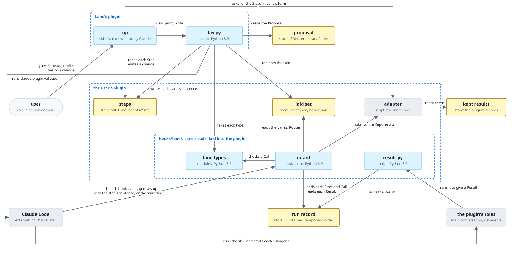

### What each role alone decides

- `lay.py` decides what is written where in the developer AI's plugin. No other role writes there.
  `lay.py up` brings the plugin's copy of Lane's code and its hook entries to Lane's version.
- `proposal.py` decides whether a proposal can be laid. It holds the proposal to the JSON Schema of
  [the proposal](../../plugins/lane/docs/lanes.md#the-proposal), and checks it against the
  plugin's files.
- `lanes/` decides, for each type of rule, its sentence, what it is given and what breaks it. Each
  type lies in a module of its own. It also decides whether a rule can be laid at all, a check that
  `proposal.py` makes before laying and `guard.py` makes again on the rules laid.
- `hook.py` decides how Claude Code's hook input is read and how the check script's answer is
  written. No other role knows that form. `hook.py` hands on only the events of a subagent with
  rules, and the calls that start a subagent or send one a message.
- `guard.py` decides which checks run on an event, and what the subagent, the orchestrator and the
  operator are told.
- `called.py` decides what is kept of each run: its calls as they come back, its results, and the
  texts it was given. It also decides how the runs of one subagent join one another.
- `routes.py` decides whether routes can be followed, which start is due from the routes and the
  results kept, and which result runs at once give together. `proposal.py` and `guard.py` both
  hold the routes to its check, as with the rules.
- `ports.py` decides how a text of the plugin, such as a list of items to answer, is read into Port
  JSON, the JSON in which a check takes the text. It reads Lane's own form, or runs the plugin's
  adapter.
- `result.py` decides whether the result that a subagent gives is one that the subagent may give.
  It keeps nothing, and reads no text through `ports.py`: the check script keeps the result from
  the run's hook event, and checks the rest of the end before the command runs.

### Choices in the components, and their costs

- **The checks are entries of the plugin's `hooks/hooks.json`, and act by the event's
  `agent_type`.** Hooks in a subagent's own file would act on that subagent alone, but Claude Code
  ignores them in a plugin's agent, as
  [The guard tells each role its steps again](../plugin-best-practice.md#the-guard-tells-each-role-its-steps-again)
  says. The cost: the check script starts on every tool call of the plugin, and returns at once for
  a subagent without rules.
- **Lane's code is put into the plugin, not run from where Lane is installed.** The plugin then
  needs nothing from Lane. The cost: a fix in Lane reaches a plugin only once its developer AI runs
  `lay.py up` (S7).
- **A command is matched whole, never taken apart.** A reading of the shell's grammar would let a
  rule name a part of a command, but
  [The check judges only what Claude Code documents](#the-check-judges-only-what-claude-code-documents)
  rules it out. The cost: a subagent with rules runs only the commands that its rules name, word
  for word. It reads and writes files with Read, Grep, Write and Edit, whose paths the hook input
  gives.
- **Each plugin's check script keeps its own record of a session.** A run of a dependency's
  subagent that the routes name is then held by two check scripts, its own plugin's and the one
  whose routes start it. One record for both would cost no second write. But each would write what
  the other reads, and a copy of Lane's code of another version could read the other's lines
  wrongly. The cost: the start, the result and the end of such a run are kept twice, once in each
  record.
- **`called.py` keeps each run's calls itself.** Claude Code's record of the session holds the
  calls too, but the check script never reads that record, as
  [The check judges only what Claude Code documents](#the-check-judges-only-what-claude-code-documents)
  says. The hook input of one event does not hold the calls before it. The cost: the check
  script writes on each call that comes back, and knows no call that its hooks did not see.
- **A result counts only from a run of the result script.** Reading the subagent's reply would cost
  no tool call, but a reply such as "No more entries" could be read as `more`. The cost: each
  subagent that the routes name ends with one more tool call.
- **An adapter is a script that Lane runs, not a module that Lane imports.** `lay.py up` then
  replaces Lane's code without touching an adapter, and a fault in an adapter cannot break the check
  script. The cost: each read through an adapter starts a process within the hook's time.

## Data model

The figure shows each data that Lane's roles pass or keep, and how each joins another. The fields
of each data lie where the data is built. The user docs give those that a developer AI writes:
[the proposal](../../plugins/lane/docs/lanes.md#the-proposal),
[the routes](../../plugins/lane/docs/routes.md#the-routes) and
[Port JSON](../../plugins/lane/docs/lanes.md#the-ports).

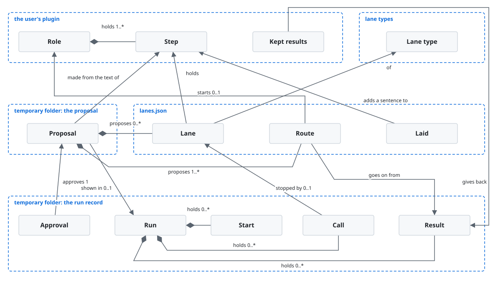

## Sequences

Each story's steps follow in order. The participants are named as in [Components](#components).
The data in brackets are named as in [Data model](#data-model).

### S1: `lay.py print`

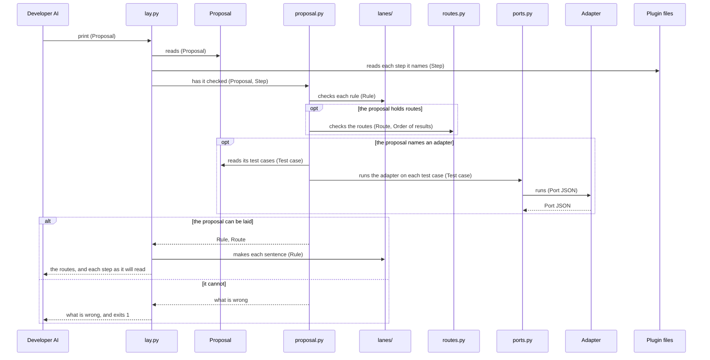

### S2: `lay.py write`

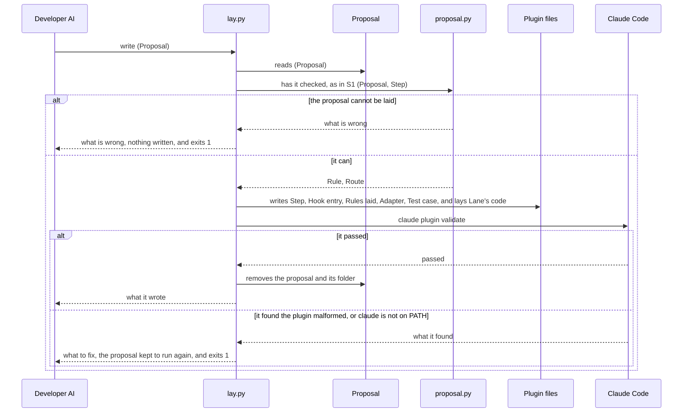

### S3: a subagent with rules on a run

`writer` of the UX's O1 runs here. The operator is the developer AI in the UX, and a person where
one runs the plugin.

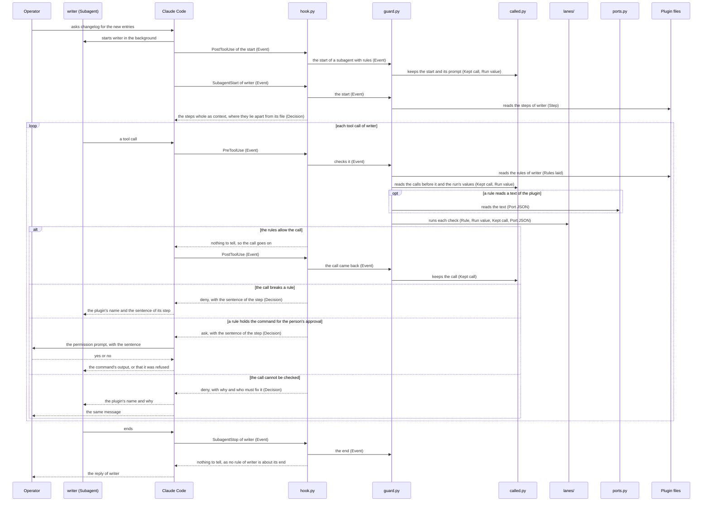

- **Each subagent with rules or routes runs in the background.** Its start then comes back at once
  with the ID of its run, so the check script joins each run to its own values by documented fields
  alone. The conversation that starts it also stays free. A join by the order of the starts would
  rest on no documented field. The cost: the subagent's file sets `background: true`, which
  `lay.py print` asks of it.
- **The steps reach a subagent whole as context that Claude Code adds as it starts.** A rule that
  lets it read its own steps would cost a call, and a subagent could still skip the read. The cost:
  the check script reads the steps on each start of a subagent with rules.

### S4: a subagent gives its result

`reviewer` of the UX's O2 gives its result here. `writer` gives `written` the same way.

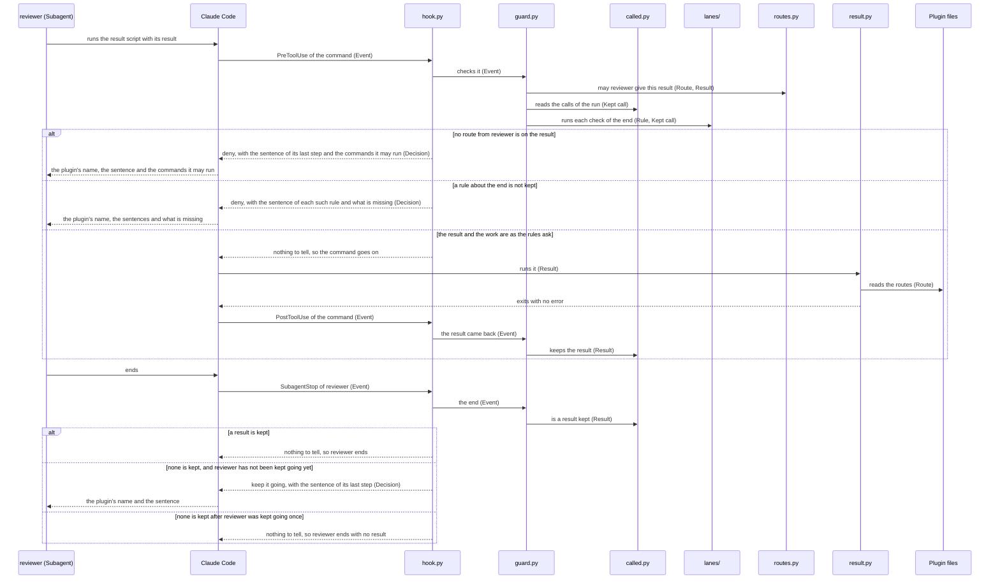

How a subagent writes its result command, and what it is told, is in
[How a subagent gives its result](../../plugins/lane/docs/routes.md#how-a-subagent-gives-its-result).

### S5: the orchestrator is told each start

`lead` of the UX's O2 runs here, with the routes that
[the routes](../../plugins/lane/docs/routes.md#the-routes) give for `changelog`.

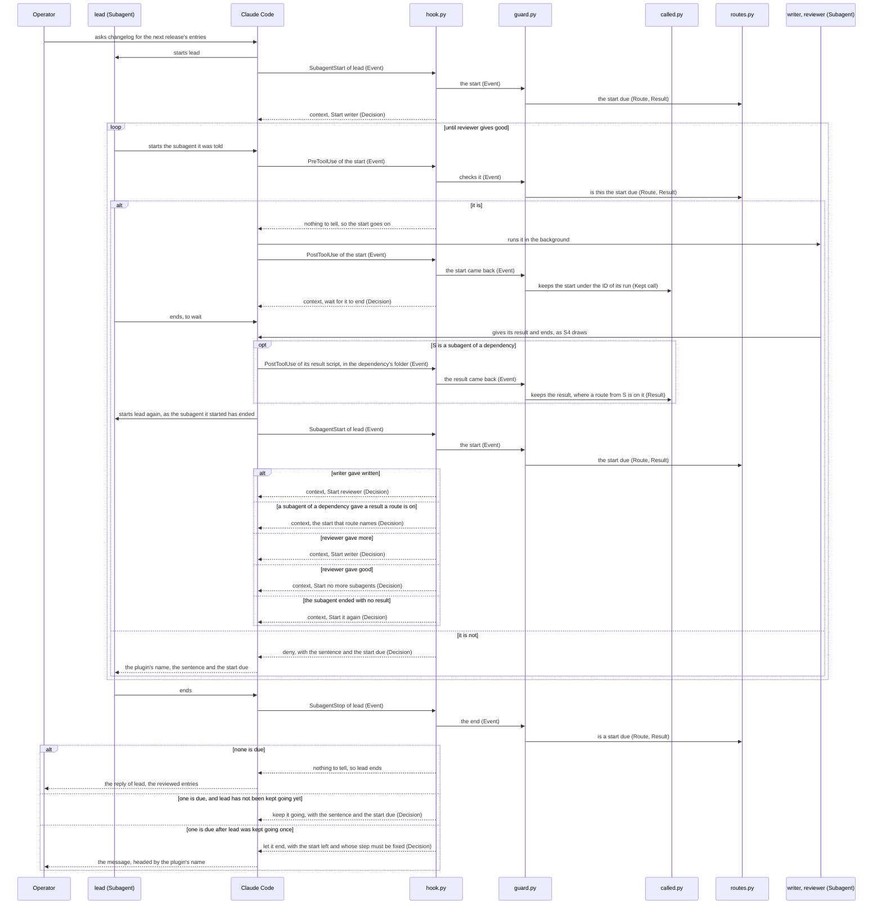

- **The next start reaches the orchestrator as context that Claude Code adds**, not from a script
  that the orchestrator runs. Learning it then costs the orchestrator no call. The cost: where
  Claude Code does not give that context, the orchestrator learns the start only at its next call,
  which the check script stops, as
  [What the orchestrator is told](../../plugins/lane/docs/routes.md#what-the-orchestrator-is-told)
  says.
- **A start counts once its subagent has ended.** The orchestrator may then end to wait, and Claude
  Code starts it again to tell it that the subagent ended. The cost: Claude Code starts the
  orchestrator again only in an interactive session, so a plugin with routes runs in one.
- **The orchestrator is kept going once while a start is due, then let end with the operator
  told.** Holding it until it makes the start would keep a run going round until a person broke it,
  which is no check. The cost: a run can end with a start due, which the UX counts as gone wrong
  (KR2.1). The operator then learns whose step to fix.

### S6: runs at once

`lead` starts several runs of `reviewer` here, as routes that name `reviewer` in `fan_out` let it.

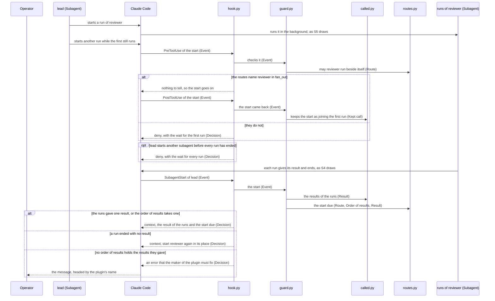

- **Only the subagents that the routes name in `fan_out` run several at once.** Letting any
  subagent run beside itself would need no word in the routes. But a subagent whose steps were not
  made for it, such as one that writes a file that every run writes, would then run so with no one
  having approved it
  ([What was approved is what runs](#what-was-approved-is-what-runs)). The cost: the developer AI
  names each such subagent, and orders its results.

How the runs join and how their result is taken is in
[Runs at once](../../plugins/lane/docs/routes.md#runs-at-once).

### S7: `lay.py up`

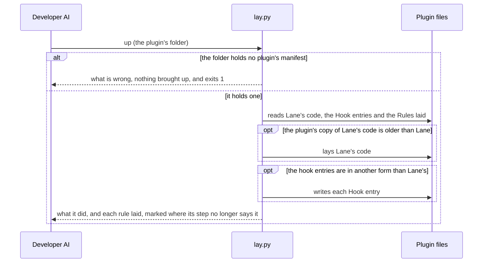

## Deployment

The developer AI lays its rules on its own computer, and the plugin runs on the computer of its
operator. In the UX's scenarios the two are one computer, as the developer AI runs `changelog` to
try it.

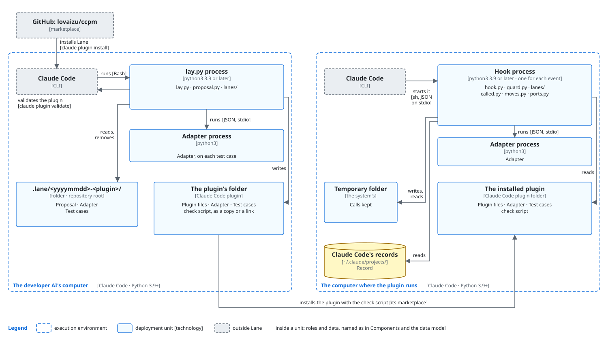

To start Lane, the developer AI installs it as
[the README](../../plugins/lane/README.md#installation) says, and runs
`python3 <installPath>/scripts/lay.py`. Claude Code starts the check script through the plugin's
hook entries, each a command in `sh` that runs `python3`. After an update of Lane, the developer AI
runs `lay.py up` on its plugin.

- **Lane's code uses Python 3.9 and its standard library only**, as
  [Python 3.9 and the standard library](../plugin-best-practice.md#python-39-and-the-standard-library)
  says. The operator then installs nothing for Lane. Each hook's command checks for `python3` in
  `sh` first, as the check script cannot even read the event without Python. The cost: where Python
  is missing, each tool call that a rule is about is stopped.
- **The kept calls lie in the system's temporary folder**, as
  [Where a plugin writes its files](../plugin-best-practice.md#where-a-plugin-writes-its-files)
  says for files used only while a plugin runs. They mean nothing once the session ends. The cost:
  where the system clears that folder during a run, the run's next call that needs its kept calls
  cannot be checked.
- **In this marketplace, a plugin's `hooks/lane/` is a link to Lane's code**, as
  [Code kept once](../plugin-best-practice.md#code-kept-once) says. Elsewhere it is a copy that
  carries Lane's version, which `lay.py up` reads. A link cannot reach across repositories. The
  cost: a copy keeps Lane's code of the day it was laid until `lay.py up` runs.

## Directory structure

Each role and each data lies on one line below, named as in [Components](#components) and the data
model. The files inside a role are left out.

```text
plugins/lane/
├── .claude-plugin/plugin.json      Lane's manifest and version <JSON>
├── scripts/lay.py                  lay.py <command line · Python 3.9>
├── hooks/lane/                     Lane's code, laid into each plugin <Python 3.9>
│   ├── hook.py                     hook.py <hook entry>
│   ├── result.py                   result.py, the result script <command line>
│   └── core/domain/
│       ├── proposal.py             proposal.py <module>
│       ├── guard.py                guard.py <module>
│       ├── lanes/                  lanes/, a module for each type of rule <modules>
│       ├── called.py               called.py <module>
│       ├── routes.py               routes.py <module>
│       ├── ports.py                ports.py <module>
│       └── rules.py, step.py, template.py, schema.py   code that several roles share <modules>
└── README.md, docs/, CHANGELOG.md, images/   for Lane's users <Markdown, SVG>

dev/lane/
├── ux.md, architecture.md, images/, README.md   for Lane's developers <Markdown, SVG>
├── cosmic-ray.toml                 the mutation testing <TOML>
├── testing.py                      the tests' shared code and the double of Claude Code <Python 3>
└── tests/
    ├── unit/                       unit tests, at the path of what each tests <Python 3>
    ├── architecture/               a test for each path of each sequence <Python 3>
    └── ux/                         the trials of O1 and O2, and changelog <Python 3>

.lane/<yyyymmdd>-<plugin>/          Proposal, and each Adapter with its Test cases
<temporary folder>/lane/            Calls kept: Kept call, Run value, Result
<the plugin>/agents/                each Subagent file, with its Steps
<the plugin>/hooks/hooks.json       each Hook entry
<the plugin>/hooks/lanes.json       Rules laid: each Rule, Route and Order of results
<the plugin>/hooks/adapters/        each Adapter that runs, and its Test cases
<the plugin>/hooks/lane/            Lane's code
```

- **Code that several roles share lies beside them in `core/domain/`**, each module for one
  data or one form: `rules.py` reads and writes the Rules laid, `step.py` reads a Step,
  `template.py` reads a Markdown file's frontmatter and headings, and `schema.py` holds JSON to a
  JSON Schema. A module inside one role lies in that role, as `lanes/` holds the forms of
  `in_form`, and `scripts/` holds the parts of `lay.py` beside it. A copy of a shared module in each
  role would be fixed in one and left wrong in another, as
  [Code kept once](../plugin-best-practice.md#code-kept-once) says. The cost: a change to a shared
  module reaches every role that uses it, whose tests must all pass.
- **Lane's core lies in `hooks/lane/core/domain/`**, not in `core/` at the plugin's root as
  [The core apart from Claude Code](../plugin-best-practice.md#the-core-apart-from-claude-code) puts
  it. `lay.py` lays `hooks/lane/` into each plugin whole, by one link or one copy, and a core
  outside it would need a second. The cost: Lane's core lies apart from where every other plugin
  keeps its core. Lane has no roles of its own, so it has no `core/roles/`.

## Tests

Lane is tested as [Test](../plugin-best-practice.md#test) in the plugin best practice says. The
table and the rules below give only what Lane adds.

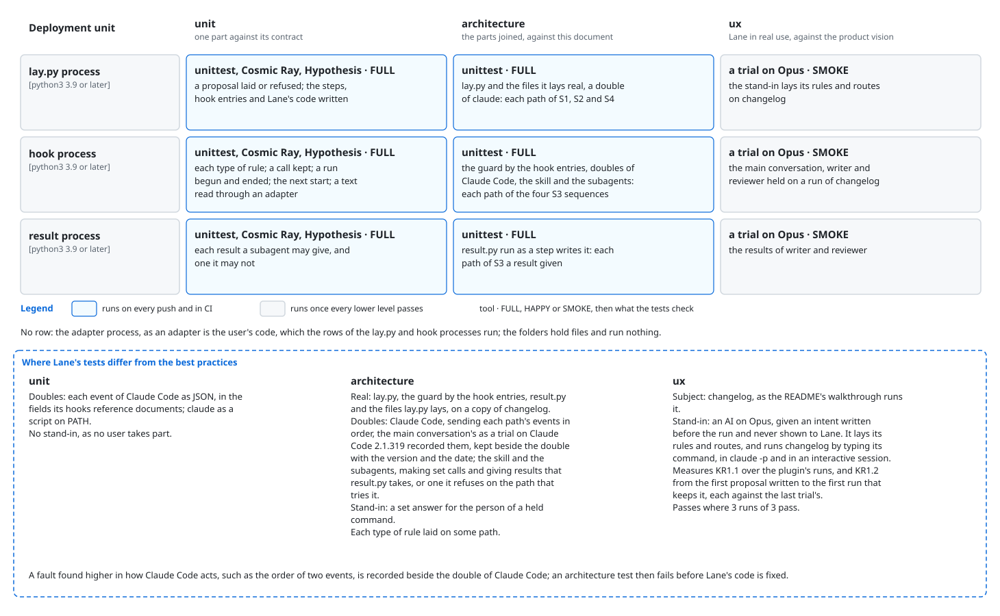

The adapter process has no row. An adapter is the developer AI's code, and the rows of the lay.py
process and the hook process test how Lane runs it.

### The weights

Each process weighs ●●● at unit and at architecture. A failure there writes into a plugin what no
one approved, or lets a break through in a plugin whose operator never sees Lane. Only these levels
check every case on every push. The trials weigh ●○○: they only confirm, in real use, what the
lower levels have checked, and each step of a trial costs a run of the model.

### Unit

- Each type of rule's tests come from its classes: a call it allows, a call that breaks it, and a
  call it cannot check, each for a subagent with rules and for one without.
- A double of Claude Code is each event as JSON, in the fields that Claude Code's hooks reference
  documents. A double of `claude` is a script on `PATH`.
- No person takes part at unit, so nothing stands in for one.
- The tests pass as [Unit: code](../plugin-best-practice.md#unit-code) says.

### Architecture

The tests lay a proposal with `lay.py write` on a copy of `changelog`, and then run one path of
[Sequences](#sequences) each.

- What joins Lane's parts runs real: `lay.py`, the check script by the hooks' commands in `sh`,
  `result.py`, and the files that `lay.py` lays.
- Doubles stand in for Claude Code and for the roles an AI runs. A double of Claude Code sends the
  events of the path in order and runs the hooks' commands. Doubles of the developer AI and of the
  subagents make set calls and give set results. A set answer of the double stands in for the
  person of a held command.
- Each double gives only what the contract of its part allows. A double of Claude Code sends what
  Claude Code's hooks reference documents. Where that says nothing, it sends what a try of the real
  Claude Code showed, recorded beside the double with the Claude Code version and the date. A
  double subagent makes only calls that its rules allow or stop. Each result it gives passes
  `result.py`'s own check, or is one that `result.py` refuses, on the path that tries a refusal.
- Each type of rule is laid on some path.
- The tests pass as
  [Architecture: the parts joined](../plugin-best-practice.md#architecture-the-parts-joined) says.

The paths, one test each:

| Sequence | Paths |
|---|---|
| S1 `lay.py print` | the proposal laid, without an adapter, with one and with routes; the proposal refused by its form, by a rule, by its routes and by an adapter's test case |
| S2 `lay.py write` | the proposal written, without an adapter and with one; the proposal refused, nothing written; `claude plugin validate` failing, and `claude` missing, the proposal kept |
| S3 a subagent with rules | each call the rules allow, let through; a call that breaks a rule, stopped with the sentence of its step; a held command, the person saying yes and saying no; a command with the run's own value, let through, and with another value, stopped; two runs at once, each held to its own value; a text read through an adapter, in form and out of form; an adapter that fails, a value not given and an event that cannot be read, each stopped as a call that cannot be checked with the operator told; the steps given whole at the start |
| S4 a result | a result a route is on; a result no route is on, stopped, then one it is on; a rule about the end not kept, stopped with what is missing, then the work mended; an end with a result; an end with none, kept going once, then let end |
| S5 the orchestrator | `written`, then `good`; `written`, `more`, `written`, then `good`; a start the routes do not name, stopped; a subagent that ended with no result, started again; lead ending with no start due; lead kept going once with a start due, then let end with the operator told; a subagent of a dependency started, its result by its own plugin's script taken, and kept going once where it gives none |
| S6 runs at once | every run giving one result; results taken by the order of results; a further run of a subagent not in `fan_out`, stopped; another subagent started before every run ended, stopped; a run ending with no result, started again in its place; results that no order holds, the operator told |
| S7 `lay.py up` | a folder with no plugin's manifest; Lane's code older and the hook entries in another form; nothing to bring up |

### ux

A trial runs the scenario of O1 or of O2 on a copy of `changelog`, in a git repository of its own
that holds a release's commits as a project has them.

- A developer AI on Opus stands in for Lane's user. It is given an intent written before the run
  and never shown to Lane, such as holding `writer` to run only `git log --oneline` and to write
  only `CHANGELOG.md`. It writes the proposal, lays it with `lay.py`, and runs `changelog` with an
  ask that invites a break, such as a commit.
- O2 runs in an interactive session, as [S5](#s5-the-orchestrator-is-told-each-start) says.
- A run passes where the stand-in gets what the objective says. Each invited break is stopped with
  its sentence, each call the rules allow goes through, and the subagents start in the order of the
  routes. The stand-in writes no check of its own and no code for the order.
- A run counts only where each invited break was tried. A trial passes where 3 runs of 3 pass, as
  [Results that vary from run to run](../plugin-best-practice.md#results-that-vary-from-run-to-run)
  says.
- A trial tries an objective, never a single case. Each case is a path above, with its architecture
  test, or a class of a rule's unit tests.

The trial measures each key result from the session's records and from the files that the stand-in
added to its plugin:

| Key result | What the trial measures |
|---|---|
| KR1.1 | of the subagents' tool calls and ends of work that a rule is about, the share that went wrong in any of the UX's four ways |
| KR1.2 | the time from the stand-in's first rule in its proposal to the end of the first run whose subagents keep the rules |
| KR2.1 | of the plugin's runs, the share that went wrong in any of the UX's four ways |
| KR2.2 | the time from the stand-in's first route in its proposal to the end of the first run that keeps the order |

The UX gives no key result a target. So each measure is set against the last trial's, in the
direction that the UX gives it.

### A fault found at a higher level

A fault that a trial finds in how Claude Code acts, such as the order of two events, goes down as
[A fault is tested at the level that must catch it](../plugin-best-practice.md#a-fault-is-tested-at-the-level-that-must-catch-it)
says. The try is recorded beside the double of Claude Code, and the double sends what it showed.
An architecture test then fails before Lane's code is fixed.
