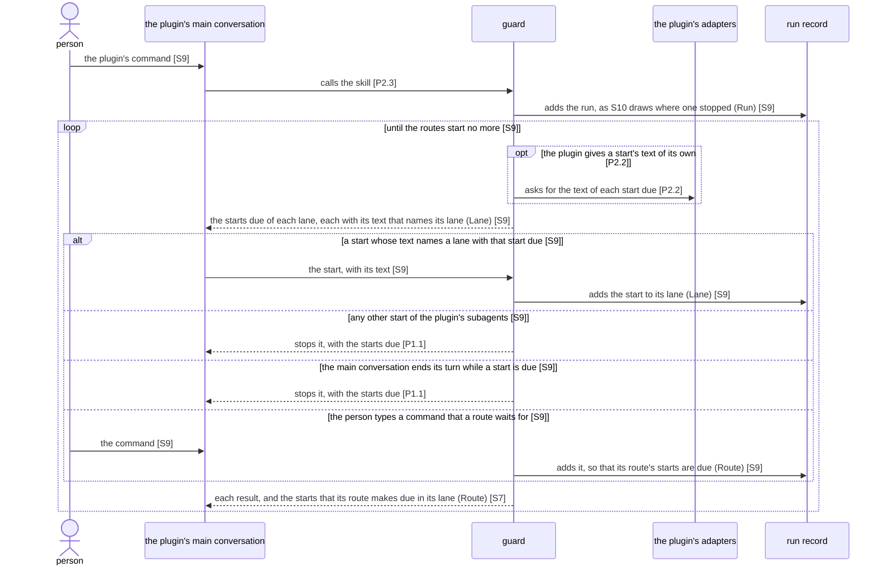
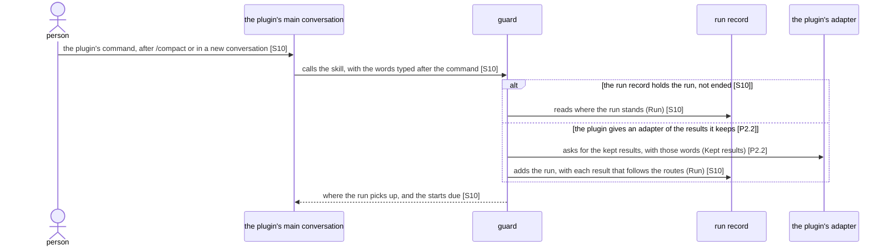

# Lane architecture

## User stories

- S1: a plugin wants its AI to notice when it writes a file that its step doesn't name.
- S2: a plugin wants its AI to notice when it reads a file that its step says never to read.
- S3: a plugin wants its AI to notice when it ends a step without reading whole a file that the
  step asks it to read whole.
- S4: a plugin wants its AI to notice when it runs a command other than those its step names.
- S5: a plugin wants its AI to notice when it skips a step, or ends before each step is done in
  order.
- S6: a plugin wants its AI to notice when it ends a step before each item of the step's checklist
  is done.
- S7: a plugin wants its run to move on only by the result its AI gives, never by what its reply
  says.
- S8: a plugin wants its AI to notice when it ends a step that the plugin's own check doesn't pass.
- S9: a plugin wants its main conversation to start each subagent that its order makes due, and
  only those, with several chains of its order going at once, and not to end its turn while one
  is due.
- S10: a plugin wants a run that stopped to go on where it stopped, after `/compact` or in a new
  conversation.

## Solution strategy

### Principles

Lane gives an AI that leaves a step of its plugin the step's own sentence, so that it notices at
once.

- P1: the AI notices each step it leaves
  - P1.1: when Lane stops a call, it gives the AI the sentence of the step it left and what to do
    instead. Where it can't check a call, it says why and who fixes that.
  - P1.2: a step, an item, a read, or a result counts only from the AI's own call, never from its
    reply.
- P2: any plugin alike
  - P2.1: Lane names no plugin. A plugin gives Lane its rules, in the form Lane defines, in a file
    of its own folder.
  - P2.2: what only the plugin knows, such as a subagent's start text, a step's checklist, or the
    results it keeps, Lane asks of the plugin's adapters. Lane defines what each adapter takes and
    gives.
  - P2.3: Lane checks only a run of a skill of a plugin that gives it rules, from the skill's call
    until its routes end, and leaves other work alone.

### Data model


- Rules\
  What a plugin gives Lane: each step's rules, each of one type with its values, and the routes.
- Route\
  The moves after a role's result, or after a command that the person types, which make starts
  due.
- Run\
  One run of a plugin's skill in a conversation, from its call until its routes start no more,
  with each start, read, mark, and result in it.
- Lane\
  One chain of a run's starts, held to the routes' order, going on beside the run's other chains.
- Kept results\
  The results that a plugin keeps, from which a run goes on in a new conversation.

Strategies:

- Each start that a route after a command makes due opens a lane of its own, and each start that a
  route after a result makes due follows in the result's lane. [S9]\
  Intent: chains of one run go at once, each in its order.
- A route that starts one role several times at once, its lane waiting until each of them has its
  result, and moving on by one result that the plugin's adapter gives from theirs. [S9, P2.2]\
  Intent: a step done by several subagents side by side moves on as one, where the plugin alone
  decides what comes next.
- A run's record that only grows, holding only what no later move gives again. [S10]\
  Intent: moves checked at the same moment lose nothing of one another's.

### Components


- guard (hook)\
  Holds each move of a run to its plugin's rules and order.
- rule types (module)\
  Make each rule's check and the sentence it gives one, so that what the AI reads is what holds.
- reporters (command)\
  Carry a step, an item, or a result done to the guard as the AI's own call.

Strategies:

- The plugin's folder found from the base directory of its skill, which Claude Code writes into
  the conversation once the skill's call ends, as
  [its states](claude-code-states.md#where-the-guard-finds-the-plugin-it-serves) say. [P2.1]\
  Intent: Lane serves a plugin that it never names, as Claude Code gives the folder either way.
- The reporters as commands that Claude Code puts on the AI's path. [P1.2]\
  Intent: a plugin's step names a reporter without knowing where Lane lies.
- A rule of the paths a role writes that names a folder letting through each file under it. [S1]\
  Intent: a deliverable of several files, such as code with its tests, is written whole.
- Each move placed on its run and start by what Claude Code's events carry, as
  [its states](claude-code-states.md) list. [P2.3]\
  Intent: each move is held to the rules of its own start, and to no other run's.
- Each start due given a text that names its lane, which the main conversation passes as the
  start's prompt, and each later move of the subagent placed by the subagent's own ID. [S9]\
  Intent: starts of one role in different lanes never take each other's place.
- Each rule type judging a call, a mark, or an end of its own kind, and the guard stopping each
  that breaks a rule with the step's sentence. [S2, S3, S4, S6]\
  Intent: the check and the sentence that the AI reads change together, in the rule type's own
  module.
- A mark checked for the step due, then for the reads and the items that its rules ask. [S5]\
  Intent: a skipped step, item, or part of a file shows at the step skipped.
- An end checked for its result first, then its steps, then the plugin's own check. [S8]\
  Intent: a stop names the step left, as the plugin's check runs once the result and each step
  hold.

### Sequences

#### S9: starts held to the plugin's order



Strategies:

- A typed command that a route goes after, its starts due in place of those before. [S9]\
  Intent: the person's pause or approval changes the order.

#### S10: a run picked up



### Deployment


A plugin names `lane` among the dependencies of its `plugin.json`, so that Claude Code installs
Lane beside it, and Lane's guard holds each run of the plugin's skills.

Strategies:

- Lane's code on Python 3.9 and its standard library alone. [P2.1]\
  Intent: the guard, started anew on each move, answers fast on each machine that runs a plugin.
- The plugin's adapters and checks run in the folder that the conversation works in. [P2.2]\
  Intent: each reads the run's checkout, in a worktree too.

### Directory structure

```text
plugins/lane/                     what Claude Code installs beside each plugin that depends on it
├── hooks/
│   ├── hooks.json                the guard's entries
│   └── lane/                     the guard, and types/, the rule types
├── bin/                          the reporters
├── docs/rules-and-adapters.md    what Lane takes in and gives out
└── README.md                     for a plugin's author

dev/lane/                         what only Lane's developers use
├── claude-code-states.md         each state of Claude Code that the guard meets, with its records
└── tests/                        the test cases, from unit to integration

<a plugin>/lane/                  what a plugin gives Lane
├── rules.json                    the rules and the routes
└── adapters/                     each adapter
```

## Test strategy

| Check | Test target | Kind | Exit criteria or measure |
|---|---|---|---|
| Lint | Parts | Quality | 0 findings. |
| Static analysis | Parts | Quality | 0 findings of mismatched types, copied code, or import cycles. |
| Complexity analysis | Parts | Quality | Per function, McCabe 10, cognitive 15, 6 returns, 12 branches, 5 arguments, 50 statements at most. |
| Unit testing | Parts | Quality | Every case passes. |
| Code coverage | Parts | Quality | 100% statement (C0) and branch (C1) coverage. |
| Property-based testing | Parts | Quality | 0 counterexamples in reading the rules, each rule type's check, and the guard's placing of moves. |
| Mutation testing | Parts | Quality | 0 surviving mutants. |
| Integration testing | Architecture | Quality | Every case passes, each handoff giving the data the data model names. |
| Contract testing | Architecture | Quality | On each new Claude Code, each recorded state gives the double's events. |
| Traceability | Architecture | Quality | Every element tested, every case naming one level up, and each principle's case failing broken. |
| Configuration testing | Product | Quality | Every case passes on Python 3.9 and on the newest Python. |
| Conformance and compliance testing | Product | Quality | Claude Code's strict check of Lane's plugin passes. |
