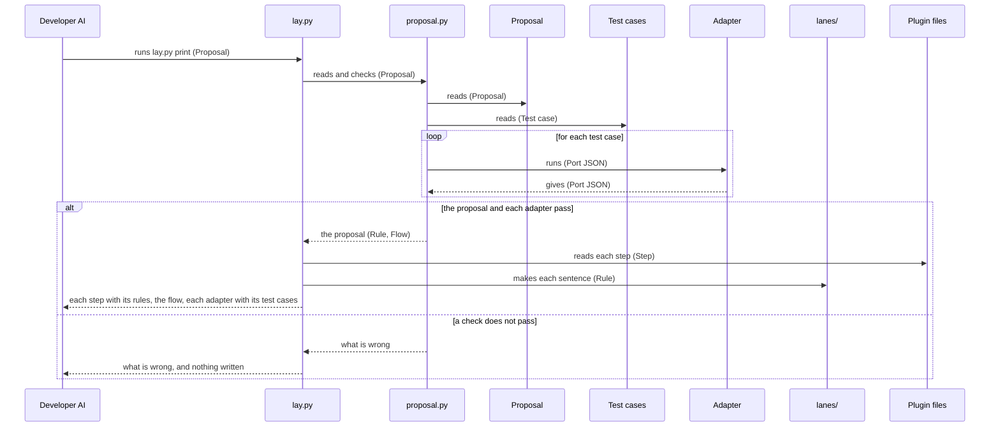
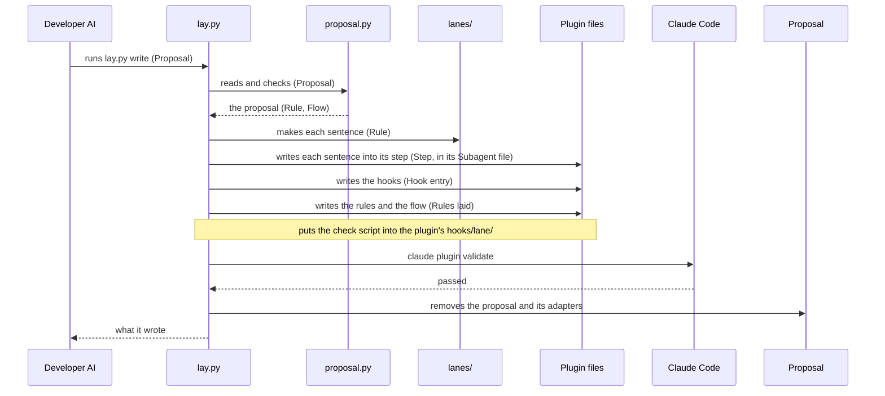
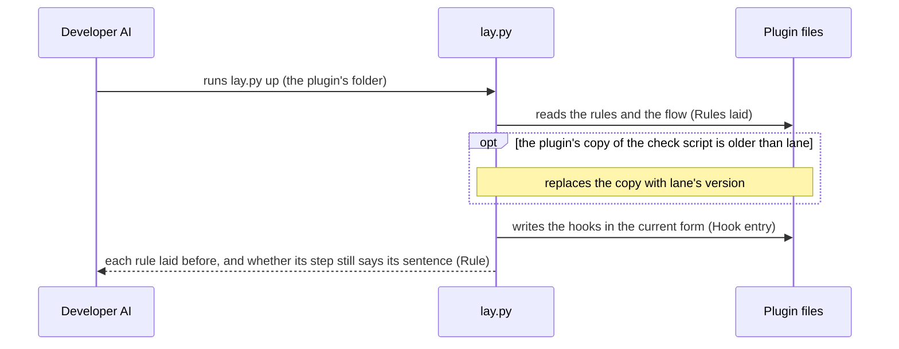
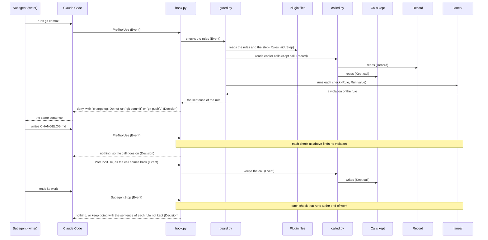
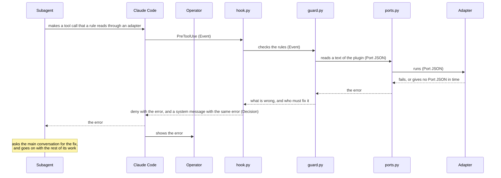
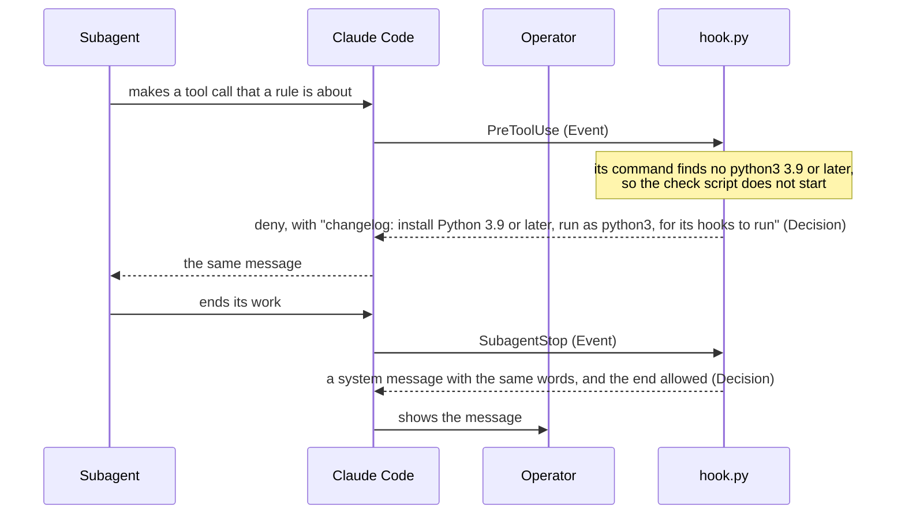
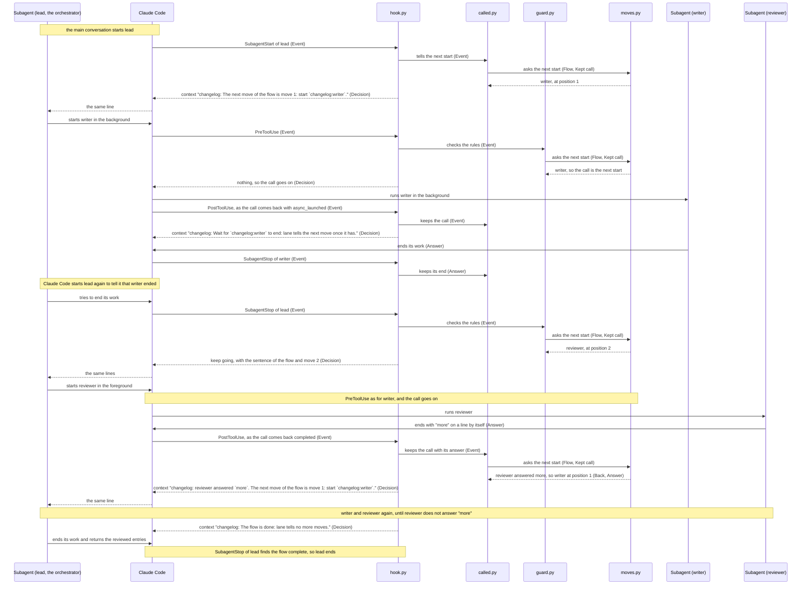

# lane architecture

The lane plugin turns each rule that a developer AI writes in a proposal into two things: a sentence
in a step of the developer AI's plugin, and a check of that sentence. The developer AI is an AI that
builds a Claude Code plugin. The script `lay.py` writes the sentences into the steps, and puts one
check script into the plugin. While the plugin runs, Claude Code runs the check script on each tool
call and each end of work of a subagent that has rules. The check script stops each violation, which
is a tool call or an end of work that does not agree with a rule. Then it shows the subagent the
sentence of the rule again. A flow is the order in which one subagent, the orchestrator, starts the
other subagents. For a flow, the check script tells the orchestrator which subagent to start next,
and stops the orchestrator until it starts that subagent. The experience that this delivers is in
[lane's UX](ux.md).

## Principles

lane follows the principles of [how a plugin works](../architecture.md#principles), with the reasons
under its [Why it is so](../architecture.md#why-it-is-so). That document describes a plugin whose
orchestrator starts roles to make a work. lane has no orchestrator and no roles of its own:
`lay.py` is a script that the developer AI runs, and the check script runs inside other plugins. So
the principles about an orchestrator and its roles, 1, 3, 4, 5, 7 and 9, do not apply to lane. The
principles below are lane's own. The code and
[the documents of the rules](../../plugins/lane/docs/lanes.md) call a rule a "lane" and the check
script "the guard".

### The check shows the step again

When the check script stops a violation, it shows the subagent the sentence of the rule, with the
name of the plugin at the start.

A subagent whose tool call is only refused looks for another way to do the same thing. A subagent
that sees the sentence of its own step goes back to that step (KR1.3). Without the sentence, the
subagent can turn each stopped violation into a new violation.

### One wording for the step and the check

The same code makes the sentence in the step and the sentence in the message, from the type of the
rule and its values.

The subagent then meets the same words in its step and in the message. No one writes a sentence
twice, so the two sentences cannot differ.

### What was approved is what runs

`lay.py write` writes the plugin from the same file that `lay.py print` showed. The check script
reads the rules from the file that `lay.py write` wrote.

The developer AI approves what `lay.py print` shows. If an AI copied the rules by hand, the plugin
could hold a rule that no one approved
([The caller approves what is theirs](../architecture.md#the-caller-approves-what-is-theirs)).

### lane knows no plugin

Each type of rule is one check, the same in every plugin. What differs from plugin to plugin
reaches the check in one of three ways: as the values of the rule, as values that the subagent is
given for each run, or through an adapter.

So the developer AI writes no code for the checks (KR1.4, KR2.3). A plugin that writes a text in a
new format needs a new adapter, not a new version of lane. If a check knew one plugin, each other
plugin would need its own copy of that check.

### An error is not a violation

When the check script cannot check a tool call or an end of work, it stops the tool call or the end
as an error. It tells the subagent and the operator what is wrong and who must fix it.

The subagent can correct a violation by following its step. An error is a fault in the plugin or
in Claude Code, and the subagent can only report it. If the check script allowed a tool call that it
did not check, the error would stay hidden, and the call could be the violation that the rule is
there to stop
([No check passes what it did not check](../architecture.md#no-check-passes-what-it-did-not-check)).

### The check reads what the subagent did

The check script judges from what Claude Code gives its hooks and keeps: the event of each hook,
the record of the subagent, and the tool calls that the check script keeps itself. It reads nothing
that a subagent writes about its own work.

An AI that says that it followed a step may not have followed it. If the check script read the
orchestrator's own report of its starts, an orchestrator could report a start that it never made.

### The plugin needs nothing from lane

The check script is in the developer AI's plugin, and runs from there.

The operator of the plugin did not choose lane, and does not install it. If the check script were
in lane's folder, each computer that runs the plugin would need lane, and a plugin installed without
lane would run with no checks.

## User stories

Each story is one way that the developer AI uses lane, and names the steps of the UX's scenarios
that rest on it.

- As the developer AI, I want to run `lay.py print` on my proposal, and see each step with its
  rules, each adapter run on its test cases, or the errors. Carries O1's loop "runs lay.py print on
  the proposal", and O2's "runs lay.py print on the proposal".
- As the developer AI, I want to run `lay.py write` on the proposal that I approved, and find the
  sentences in my steps and the check script in my plugin. Carries O1's "runs lay.py write on the
  same proposal" and "does not need the lane plugin", and O2's "runs lay.py write on the same
  proposal".
- As the developer AI, I want to run `lay.py up` on my plugin after an update of the lane plugin,
  and get the new check script and a list of the rules that my plugin has. Carries O1's first
  step, "lay.py up changelog".
- As the developer AI, I want the check script to stop each violation of a subagent with rules, and
  to show the subagent the sentence of the rule again. I also want it to allow each tool call that
  the rules allow. Carries O1 from "runs git commit" to "ends with only CHANGELOG.md changed and no
  commit".
- As the developer AI, I want the check script to stop a tool call that it cannot check, and to
  show the failed check, the error and who must fix it to the subagent and to the operator.
  Carries O1's "the check script cannot check a tool call", and the paragraph after O1 about
  Claude Code as the cause.
- As the developer AI, I want the check script, on a computer without Python 3.9 or later, to stop
  each tool call that a rule is about with what to install. I also want it to let the subagent
  end, and to tell the operator. Carries O1's "the computer does not have that runtime".
- As the developer AI, I want the check script to tell my orchestrator which subagent to start next,
  and to stop each other tool call and each end before the flow is complete. Carries O2 from
  "starts lead with the request" to "returns the reviewed entries".

The other steps of the scenarios need no story, because the developer AI or the plugin's own
subagents take them without lane. Examples are the step where the developer AI writes the
proposal, and the step where the subagent asks the main conversation for a fix.

## Logical view

### Components

Each arrow names the data that it hands on. The data model below defines each data.


- `lay.py` alone writes into the developer AI's plugin. `lay.py write` writes the sentences into
  the steps, the hook entries into `hooks/hooks.json`, the rules and the flow into
  `hooks/lanes.json`, and the check script into `hooks/lane/`. It writes only a proposal that
  `proposal.py` accepts, and it removes the proposal and its adapters after
  `claude plugin validate` passes. `lay.py up` writes only the hooks and the check script, for the
  rules that the plugin already has.
- `lay.py` adds hooks to subagents only. A hook is told which subagent it runs in, but not which
  skill runs in the main conversation. A hook in a skill also lasts until the session ends. So
  `lay.py` adds no rule to a skill. A subagent with rules gets a hook on each event that its rules
  are about. For a flow, `lay.py` also adds three kinds of hooks only to read answers: a
  SubagentStart hook on the orchestrator, and on each subagent in the flow a SubagentStop hook and a
  PostToolUse hook on the tool SubagentHandback. A subagent without rules gets no check.
- `proposal.py` alone decides whether a proposal can be written. It checks the proposal against the
  JSON Schema in [the documents of the rules](../../plugins/lane/docs/lanes.md#the-proposal) and
  against the plugin. It also runs each adapter on its test cases. A refused proposal changes
  nothing in the plugin.
- `proposal.py` refuses a flow that names a subagent whose file sets `background: true`. Claude
  Code runs such a subagent in the background however it is started. In `claude -p`, Claude Code
  then does not tell the orchestrator that the subagent ended, so the flow would stop.
- `hook.py` alone reads the event from Claude Code, and writes the decision in Claude Code's JSON
  output. Each hook entry runs `hook.py` through a command that `lay.py` writes, and the command
  first checks in `sh` that `python3` is 3.9 or later. `hook.py` acts only on an event whose
  `agent_type` is the subagent that its command names. It sends a violation to the subagent, and
  an error to the subagent and the operator.
- `guard.py` alone decides which rules run on an event. Before a check runs, `guard.py` checks what
  the check is given against the JSON Schema of that check, so a check meets only what it can
  check. `guard.py` also reads each step, and the part that a subagent's file tells it to read
  first. Until such a subagent has read its part to the end, `guard.py` stops each other tool
  call.
- `lanes/` holds one module for each type of rule: its sentence, the tools and the events that it
  watches, and its check. Only the module of a type decides whether a tool call or an end of work
  is a violation of that type.
- `guard.py` reads shell commands in the plain forms that steps use, not in every form that the
  shell allows. A command can name a file by words that do not settle which file it is, such as a
  path with `$`. `guard.py` cannot check such a tool call, and tells the subagent to name the file
  by its path.
- `called.py` alone keeps each tool call of a subagent with rules as the call comes back, and the
  end of each subagent in a flow. It tells the orchestrator which subagent to start next, when the
  orchestrator starts and when each start comes back.
- `moves.py` alone decides which subagent the orchestrator must start next, from the flow and the
  kept calls.
- `ports.py` alone reads a text of the plugin: in lane's one format, or through the adapter that
  the rule names.
- An adapter is a separate script that lane runs, not a module that lane imports. lane's code and
  the adapter then do not depend on each other, so `lay.py up` replaces the check script without a
  change to an adapter.
- `called.py` keeps each tool call itself, and does not read the record alone. Claude Code writes
  the result of a call into the record, at times only after the hooks of the next call have run.
  From the record alone, the check script would miss a call made earlier in the same reply.

### Data model


- Proposal: the JSON file in which the developer AI writes the rules and the flow that it wants.
- Rule: a rule of one type, such as `write_only`, with its values, on one step.
- Flow: the order of the subagents that the orchestrator starts. A back is an answer that sends
  the work back from one position in that order to an earlier one, such as `more`.
- Adapter and test case: as the UX says. A port JSON is the JSON that an adapter, or lane's own
  reading, is given or gives.
- Subagent file and step: the file of a subagent, or the part that it reads first, and one
  numbered step in it.
- Rules laid: the rules and the flow that `lay.py write` wrote into `hooks/lanes.json`.
- Hook entry: one entry of `hooks/hooks.json`, for one subagent and one event.
- Event and decision: the JSON that Claude Code gives a hook, and the JSON that the hook gives back.
- Record: the file in which Claude Code writes what a subagent did in one run.
- Kept call and answer: a tool call that the check script kept as it came back, and the last
  text with which a subagent ended its work.
- Run value: a value that a subagent is given for one run, such as the path of its output.

### Sequences

One diagram follows for each user story, in the order of the stories.

`lay.py print` on a proposal:



`lay.py write` on the approved proposal:



`lay.py up` on a plugin:



A violation stopped, and a tool call allowed:



A tool call that the check script cannot check:



A computer without Python 3.9 or later:



A flow, with a start in the background:



- A start counts only after the started subagent has ended, in the foreground or in the background.
  In an interactive session, Claude Code runs every subagent in the background by default, and the
  Agent call comes back as the subagent starts. A rule that counted only starts in the foreground
  would hold every such flow at its first start. To avoid that, the operator would need to set
  Claude Code to keep subagents in the foreground.
- While a started subagent runs in the background, the check script stops only another start of a
  subagent in the flow. The next start depends on the answer of that subagent, and the orchestrator
  can do other work meanwhile.
- The check script tells the orchestrator the next start as context that Claude Code adds for it,
  not through a script that the orchestrator runs. The check script already knows the state of the
  flow from the events, so the orchestrator spends no tool call to learn it.
- An answer sends the work back only when one line of it is the text that the flow names. A word
  found anywhere in the answer would count "No more entries need the writer" as "more". A line by
  itself is what a step can ask for, and it rarely occurs by chance.

## Physical view

### Deployment


- The developer AI installs lane as [the README](../../plugins/lane/README.md#installation) says,
  and runs `python3 <installPath>/scripts/lay.py`. In the ccpm repository, `<installPath>` is
  `plugins/lane/`. Claude Code starts the check script through the hooks of the developer AI's
  plugin: each hook entry in `hooks/hooks.json` names one subagent and one event.
- `lay.py` and the check script run on Python 3.9 or later, with the standard library only. The
  check script runs on every computer that runs the developer AI's plugin, and its operator
  installs nothing for lane. `python3` is on most computers that have git, and the standard library
  needs no install, as
  [Python 3.9 and the standard library](../architecture.md#python-39-and-the-standard-library)
  says.
- An adapter is a Python 3 script, which `python3` runs. lane already needs Python on the computer,
  and a test case checks an adapter without a run of the plugin.
- The command of each hook checks for Python in `sh` before the check script starts. Without
  Python, the check script cannot read the event, and the computer may have no other runtime.
- The check script keeps its calls in `lane/<yyyymmdd>-<session>/` in the system's temporary
  folder, as [Where a plugin writes its files](../architecture.md#where-a-plugin-writes-its-files)
  says for files that are used only while the plugin runs. The calls are not the state of a run
  that [Where the course is kept](../architecture.md#where-the-course-is-kept) keeps in a file to
  go on after a stop. A subagent's calls mean nothing after the subagent ends, and the state of a
  run across sessions belongs to each plugin. No agent reads the calls with its tools.
- The developer AI keeps the proposal, its adapters and their test cases in
  `.lane/<yyyymmdd>-<plugin>/` at the root of the repository that holds the plugin. The developer
  AI reads and writes them with its tools, and Claude Code allows that without a question only
  inside the folder where it runs. `lay.py write` removes them after it has written them into the
  plugin.
- In a plugin of the ccpm marketplace, `hooks/lane/` is a relative link to lane's code, as
  [Code kept once](../architecture.md#code-kept-once) says. Elsewhere, it is a copy with a
  `VERSION` file, which `lay.py up` reads to find an older copy. `lay.py` writes `VERSION` from
  lane's `plugin.json`, so the version stays in one place, as
  [The version](../architecture.md#the-version) says.
- The two computers are often one, for example when the developer AI tries its plugin.

### Directory structure

```text
plugins/lane/                          lane, installed by Claude Code
├── .claude-plugin/plugin.json         the manifest, with lane's version <JSON>
├── scripts/lay.py, layer.py           lay.py <command line · Python 3.9>
├── scripts/steps.py                   lay.py's writing of each Step <module · Python 3.9>
├── scripts/entries.py                 lay.py's writing of Hook entries <module · Python 3.9>
├── scripts/placed.py                  lay.py's copy of the check script <module · Python 3.9>
├── scripts/proposal.py                proposal.py <module · Python 3.9>
├── hooks/lane/                        the check script, put into each plugin <Python 3.9>
│   ├── hook.py, <event>.py            hook.py, with one entry for each event <hook entry>
│   ├── guard.py                       guard.py <module>
│   ├── step.py                        guard.py's reading of a Step, used by lay.py too <module>
│   ├── call.py, shell.py              guard.py's reading of a tool call <module>
│   ├── started.py                     guard.py's reading of each Run value <module>
│   ├── lanes/<type>.py                lanes/, one module for each type of rule <module>
│   ├── called.py                      called.py <module>
│   ├── record.py                      called.py's reading of the Record <module>
│   ├── moves.py                       moves.py <module>
│   ├── ports.py                       ports.py <module>
│   ├── lanes_json.py                  the form of Rule and Flow in hooks/lanes.json <module>
│   └── schema.py, forms.py, template.py   JSON Schema and template checks for all above <module>
├── docs/lanes.md, docs/flow.md        each type of rule, the proposal, the flow <Markdown>
└── README.md, CHANGELOG.md, *.svg     for the developer AI <Markdown>

dev/lane/                              what only lane's builders need
├── README.md, ux.md, architecture.md, *.svg   how to run the tests, the UX and this document
├── cosmic-ray.toml                    the mutation testing of lane's code <TOML>
├── testing.py                         what every plugin's tests stand on <Python 3>
├── tests/                             unit, integration and property tests <Python 3>
└── trials/                            the end-to-end trials, and memo/ and notes/ to try <Python 3>
    └── trying.py                      what every plugin's trials stand on <Python 3>

<the root of the repository>/.lane/<yyyymmdd>-<plugin>/
├── <plugin>.json                      Proposal <JSON>
└── <plugin>/adapters/<port>-<name>.py, .json   Adapter <Python 3>, Test cases <JSON>

<the system's temporary folder>/lane/<yyyymmdd>-<session>/
└── <agent>.jsonl                      Calls kept: each Kept call and Answer <JSONL>

<the developer AI's plugin>/
├── agents/, prompts/                  Plugin files: each Step <Markdown>
└── hooks/
    ├── hooks.json                     Plugin files: each Hook entry <JSON>
    ├── lanes.json                     Plugin files: each Rule and the Flow <JSON>
    ├── adapters/<port>-<name>.py, .json   Adapter <Python 3>, Test cases <JSON>
    └── lane/                          the check script, a copy or a link
```

## Test

lane is tested by the project's shared test rules in [Test](../architecture.md#test). What follows
says only what lane adds to them. A weight, from ●○○ to ●●●, says how heavily a unit is tested. A
trial is a run of Claude Code on copies of lane and of a plugin, judged from its records. lane has
no skill and no agent, so it has no trial of a prompt alone.

| Deployment unit | Unit | Integration | End-to-end |
|---|---|---|---|
| lay.py process [python3 3.9 or later] | unittest, Cosmic Ray, Hypothesis · ●●● · the proposal checked, each step and hook entry written, the check script placed | unittest, real files, a stand-in for `claude` · ●●○ · `lay.py print`, `write` and `up` on a plugin, with its adapters run | ▨[^1] |
| Hook process [python3 3.9 or later] | unittest, Cosmic Ray, Hypothesis · ●●● · each type of rule, the reading of tool calls, records and kept calls, the next start | unittest, the hook's command run by `sh` with each kind of `python3` · ●●○ · the decision in Claude Code's JSON, the Python check | ▨[^1] |
| The whole of lane, with a plugin [Claude Code · Opus] | ▨[^2] | ▨[^2] | trials `notes_trial.py` and `memo_trial.py` · ●●○ · the README's walkthrough, each type of rule, the flow, a computer without Python |

[^1]: End-to-end tests run on the whole alone, in the last row.
[^2]: The units that it is made of are tested in their own rows.

- The adapter process has no row. An adapter is the developer AI's code, and its test cases are its
  tests, which `lay.py print` runs.
- The folders have no rows. They hold data, which the tests of the units that write and read the
  data check.
- Unit tests make one module real, with real files in a folder of the test. They fake Claude Code:
  each event is JSON, the record is a file in the shape of the Claude Code version that `record.py`
  names, and `claude` is a script on `PATH`. Pass: as the shared rules set for code.
- Integration tests run `lay.py` as the developer AI runs it, or a hook's entry as Claude Code runs
  it, with real files, a real `sh` and a real `python3`. They fake Claude Code as the unit tests do.
  Pass: all pass.
- End-to-end tests run Claude Code on Opus, with copies of lane and of a plugin, as installing
  makes them, on a small git project made for the trial. The prompt invites a violation. Nothing of
  lane is faked. Pass: in each of three runs, the records show each violation that the case invites
  stopped with its sentence, each tool call that the steps allow let through, and the end of work
  that the case expects. The maintainer then judges, as
  [Acceptance tests: user stories](../architecture.md#acceptance-tests-user-stories) says.
- The lay.py process has the weight ●●●. A failure writes a step or a hook that the developer AI did
  not approve, into a plugin whose operator never sees lane.
- The hook process has the weight ●●●. A failure lets a violation through, or stops a tool call that
  the rules allow, in each subagent with rules of each plugin that has the check script.
- The end-to-end row has the weight ●●○. A trial takes many minutes and many tokens, and the rows
  above find most faults first.
- An end-to-end test passes on three runs of three, not on one. What an AI does varies from run to
  run, and a subagent that goes back to its step once may find another way around the rule in the
  next run.
- The tests hold the record in the shape of one Claude Code version, the one that `record.py`
  names. Claude Code does not document the record, so these tests are the only description of its
  shape.
