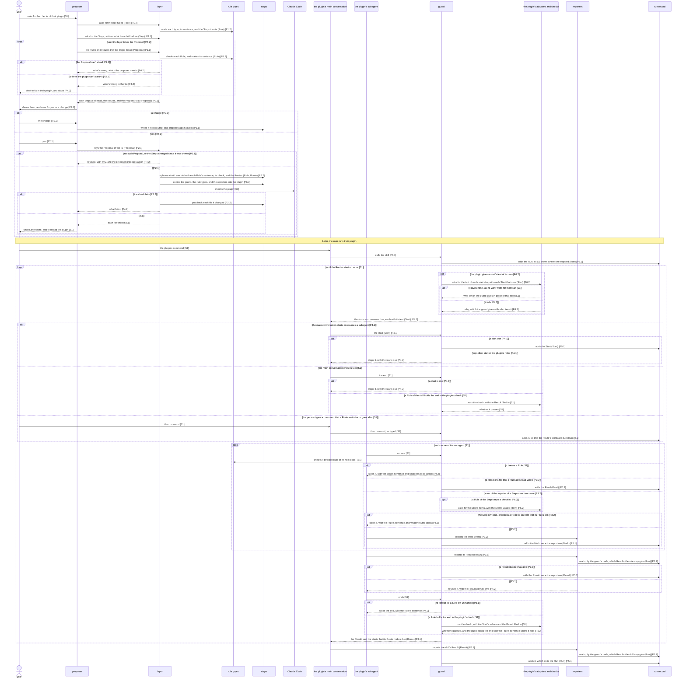
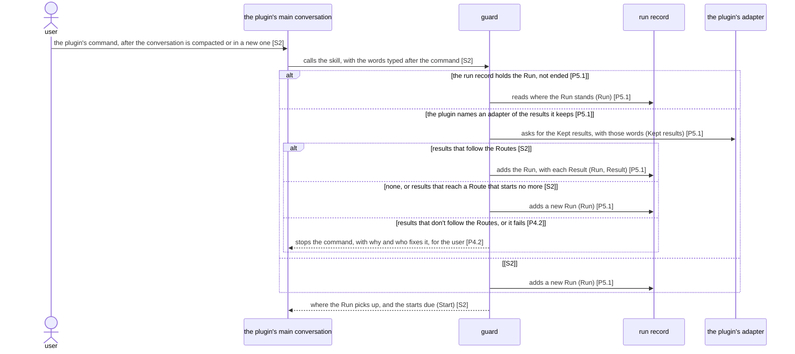

# Lane architecture

## User stories

- S1: the user wants their roles to notice at once when they leave the steps or order, writing no
  check.
- S2: the user wants a run that stopped to go on where it stopped, in the order they designed.

## Solution strategy

### Principles

Lane turns the user's steps into checks once, and judges each move of a run by them.

- P1: the steps as the one source
  - P1.1: a proposal comes from the steps alone, and each change asked goes into the steps.
  - P1.2: each rule's sentence, its check, and the steps it suits come from one definition.
- P2: laid only as the user read it
  - P2.1: only a proposal shown is laid, while the steps read as shown.
  - P2.2: what Lane laid is replaced whole, and every other part of the plugin stays as it stands.
- P3: facts, never a role's claim
  - P3.1: a run moves only on a result that its role reported, never on its reply.
  - P3.2: a step or an item counts as done only from the role's own report, checked as it reports.
- P4: the order the user set
  - P4.1: only the main conversation starts the roles, each as a start due.
  - P4.2: each stop gives the step's sentence and what to do, or why it can't check and who fixes
    it.
- P5: nothing lost on a stop
  - P5.1: each run's state comes from what was kept, worked out by one code alone.
- P6: only the plugin's run
  - P6.1: moves are checked only within a run of the plugin's skill.
  - P6.2: the laid plugin needs only its own folder and what each machine running it has, naming
    no plugin.

### Data model


- Step\
  One numbered item of a role's steps, as the user writes it.
- Rule\
  A check of one type on one step, with its values, such as the plugin's check. It gives the
  sentence that the role gets where it leaves the step.
- Route\
  The moves after a role's result, or after a command that the person types, which make starts and
  resumes due.
- Proposal\
  The rules and routes put to the user, kept by its ID with the steps as they read when shown.
- Item\
  One item of a step's checklist, which only the user's plugin knows.
- Run\
  One run of the plugin's skill in a conversation, from its call until its routes start no more.
  It holds each command typed in it.
- Start\
  One start or resume of a role in a run, with the values that its rules hold it to.
- Read\
  A role's read of the lines of a file that a rule asks read whole.
- Mark\
  A role's report that a step or an item is done.
- Result\
  What a role reports at its end, by which the run moves.
- Kept results\
  The results that the user's plugin keeps, from which a run goes on in a new conversation.

Strategies:

- A run's record that only grows, holding only what no later move gives again. [P5.1]\
  Intent: moves checked at the same moment lose nothing of one another's.

### Components


- proposer (prompt)\
  Turns the user's steps into the rules and routes that the user would lay.
- layer (script)\
  Lays into the plugin only what the user approved, as they read it.
- rule types (module)\
  Make each rule's sentence and its check one, so that what the user reads is what holds.
- guard (hook)\
  Holds each move of a run to the user's steps and order.
- reporters (script)\
  Carry a role's result and each step or item done to the guard as facts.

Strategies:

- A proposal from what the steps mean, by a prompt. [P1.1]\
  Intent: a step that names no subagent still gets its routes.
- Each skill as one role, its steps lying in several files, such as a command a route waits for.
  [S1]\
  Intent: the skill's steps hold across each command of the run, though nothing marks where one
  ends.
- A start's text, a step's checklist, and the kept results asked of the plugin's own adapters.
  [P6.2]\
  Intent: Lane names no plugin, and each plugin gives what it alone knows.
- An end held to the plugin's own check where a step ends on one. [S1]\
  Intent: a role that leaves its steps still meets the check that only the plugin knows.
- A rule's sentence left out of a step that already says it. [P1.2]\
  Intent: the role reads each rule once, and keeps its attention on its step.
- The form of the laid Rules and Routes decided by the guard's code, which the layer writes
  through. [P6.2]\
  Intent: a laid plugin runs by its laid copy alone.
- Each move placed on its run and start by what Claude Code's events carry, as
  [its states](claude-code-states.md) list. [P6.1]\
  Intent: each move is held to the rules of its own start, and to no other run's.

### Sequences

#### S1: a run held to the user's steps and order



Strategies:

- A start judged by the Routes, and any other start stopped with the starts due. [P4.1]\
  Intent: the skill notices at once a start it forgot, or one out of order.
- A typed command that a Route goes after, its starts due in place of those before. [S1]\
  Intent: the person's pause or approval changes the order.
- A Mark checked for the Step due, then for the reads and the Items that its Rules ask. [P3.2]\
  Intent: a skipped step, item, or part of a file shows at the step skipped.
- A role's end checked for its Result first, then its Steps, then the plugin's own check. [P4.2]\
  Intent: a stop names the step left, as the plugin's check runs once the Result and each Step
  hold.

#### S2: a run picked up



Strategies:

- A Run placed by the run record first, then by the plugin's Kept results. [P5.1]\
  Intent: a run goes on in the same conversation and in a new one.

### Deployment


The user installs Lane by [the README](../../plugins/lane/README.md#installation) and lays it by
`/lane:up`, and the reloaded plugin runs the guard.

Strategies:

- Lane's code copied into the user's plugin. [P6.2]\
  Intent: whoever runs the plugin needs no Lane, and the guard runs the code that Lane's tests ran.
- Lane's code on Python 3.9 and its standard library alone. [P6.2]\
  Intent: the guard, started anew on each move, answers fast on each machine that runs the plugin.
- The plugin's adapters and checks run in the folder that the conversation works in. [S1]\
  Intent: each reads the run's checkout, in a worktree too.

### Directory structure

```text
plugins/lane/                     what Claude Code installs for the user
├── skills/up/SKILL.md            /lane:up
├── domain/up.md                  the proposer
├── domain/lay/                   the layer's code
├── scripts/lay.py                runs the layer
├── hooks/lane/                   Lane's code, copied whole into each plugin
│   ├── hook.py                   the guard
│   ├── result.py                 the reporter of a Result
│   ├── step.py                   the reporter of a Step done
│   ├── item.py                   the reporter of an Item done
│   └── domain/                   the guard's code, and lanes/, the rule types
└── README.md                     for Lane's users

dev/lane/                         what only Lane's developers use
├── claude-code-states.md         each state of Claude Code that the guard meets, with its records
└── tests/                        the test cases, from unit to integration

dev/tests/                        what the developers of Lane and rn share for their tests
├── claude_code.py                the double of Claude Code
└── recorded/                     the records of Claude Code that the double gives from

<the user's plugin>/              what Lane writes into, beside the user's own
├── skills/, agents/              the Steps, with the Rules' sentences
└── hooks/
    ├── hooks.json                the guard's entries, beside the user's own
    ├── lanes.json                the Rules, the Routes, and what Lane laid
    ├── lane/                     the copy of Lane's code
    └── adapters/                 each adapter, the user's own

<system temporary folder>/        what Lane keeps only for a run
├── lane/<yyyymmdd>-<plugin>/     each Proposal, by its ID
└── <plugin>/<yyyymmdd>-<id>/     the run record of one conversation
```

Strategies:

- In the user's plugin, only the sentences in the steps and the files under `hooks/` written by
  Lane. [P2.2]\
  Intent: every other part of the plugin stays the user's.
- The rule types inside `hooks/lane/`, which the layer imports. [P1.2]\
  Intent: the sentence that the user reads and the check that the guard runs come from one copy.

## Test strategy

| Check | Test target | Kind | Exit criteria or measure |
|---|---|---|---|
| Lint | Parts | Quality | 0 findings. |
| Static analysis | Parts | Quality | 0 findings of mismatched types, copied code, or import cycles. |
| Complexity analysis | Parts | Quality | Per function, McCabe 10, cognitive 15, 6 returns, 12 branches, 5 arguments, 50 statements at most. |
| Unit testing | Parts | Quality | Every case passes. |
| Unit testing | Parts that hold a prompt | Benchmark | The proposer's Proposal for each case's steps, each case's results over runs added until one more changes no case's count. |
| Code coverage | Parts | Quality | 100% statement (C0) and branch (C1) coverage. |
| Property-based testing | Parts | Quality | 0 counterexamples in reading Steps and Proposals, each rule type's check, and the guard's placing of moves. |
| Mutation testing | Parts | Quality | 0 surviving mutants. |
| Integration testing | Architecture | Quality | Every case passes, each handoff giving the data the data model names. |
| Integration testing | Architecture | Benchmark | KR1.1: the share of the guard's answers that the cases hold right. |
| Contract testing | Architecture | Quality | On each new Claude Code, each recorded state gives the double's events. |
| Traceability | Architecture | Quality | Every element tested, every case naming one level up, and each principle's case failing broken. |
| Configuration testing | Product | Quality | Every case passes on Python 3.9 and on the newest Python. |
| Conformance and compliance testing | Product | Quality | Claude Code's strict check of each laid plugin passes. |
| Performance testing | Architecture | Benchmark | KR1.2: each move's time to the guard's answer. |
