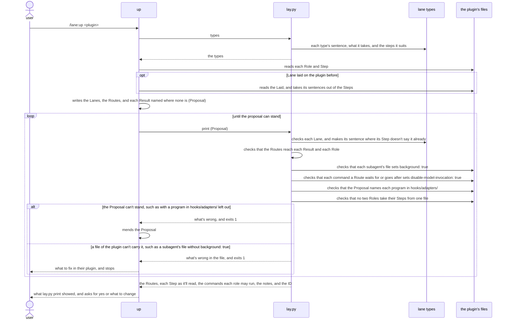
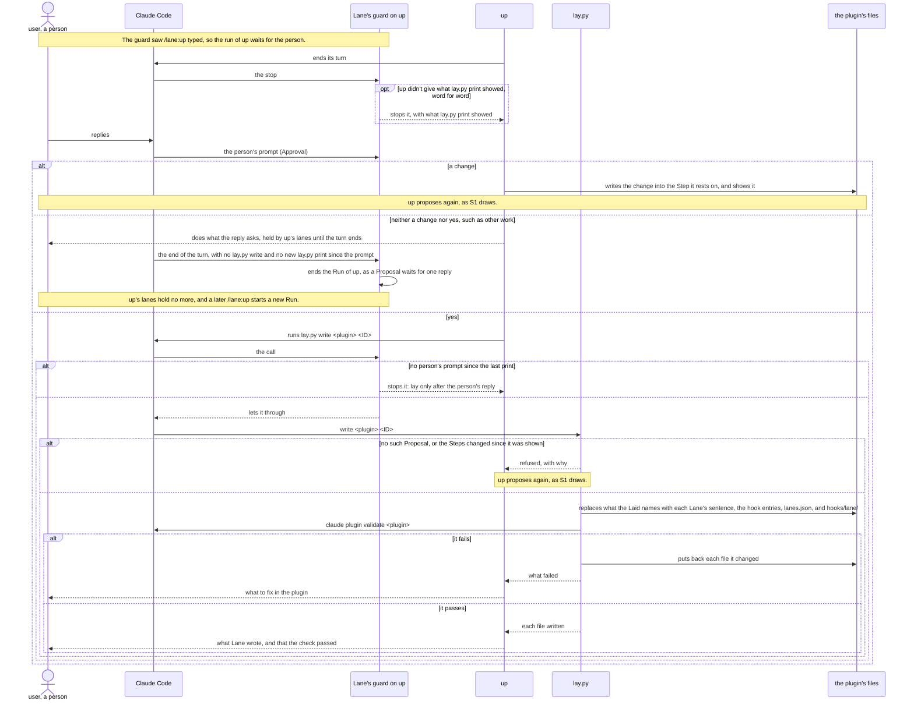
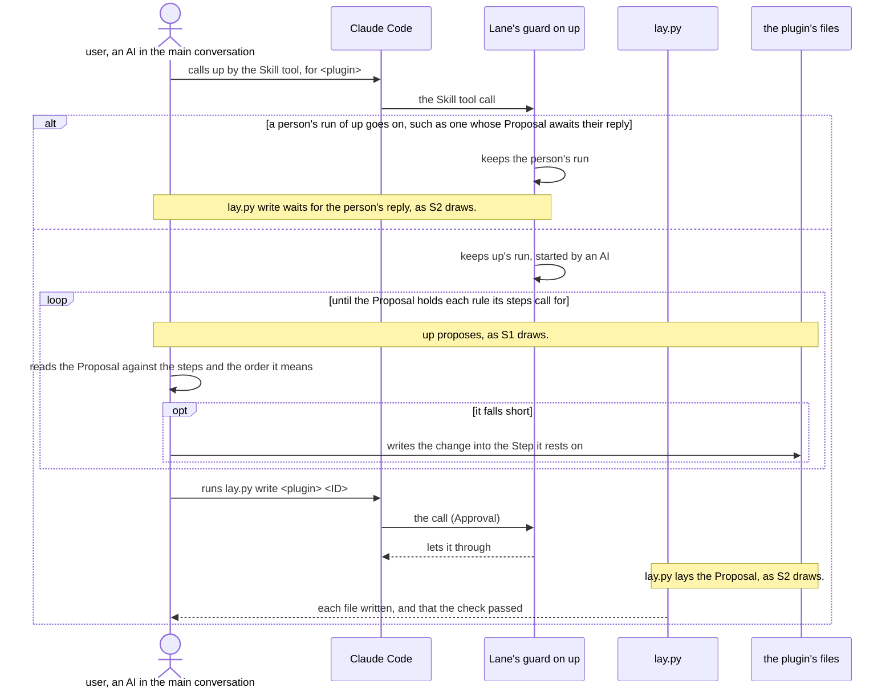
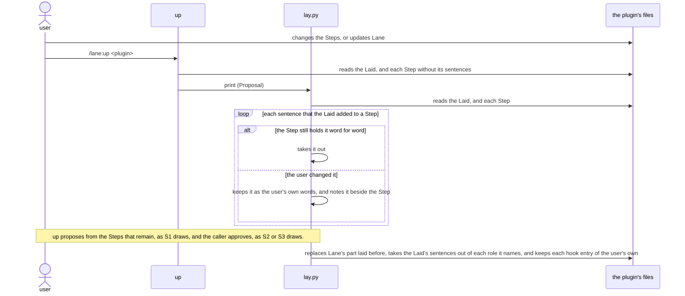
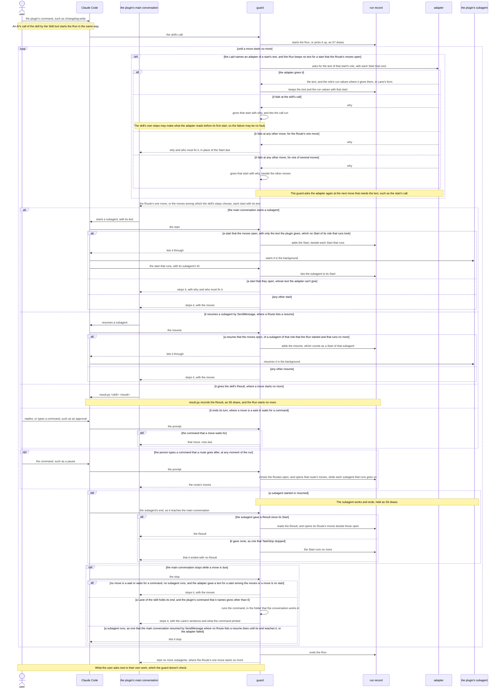
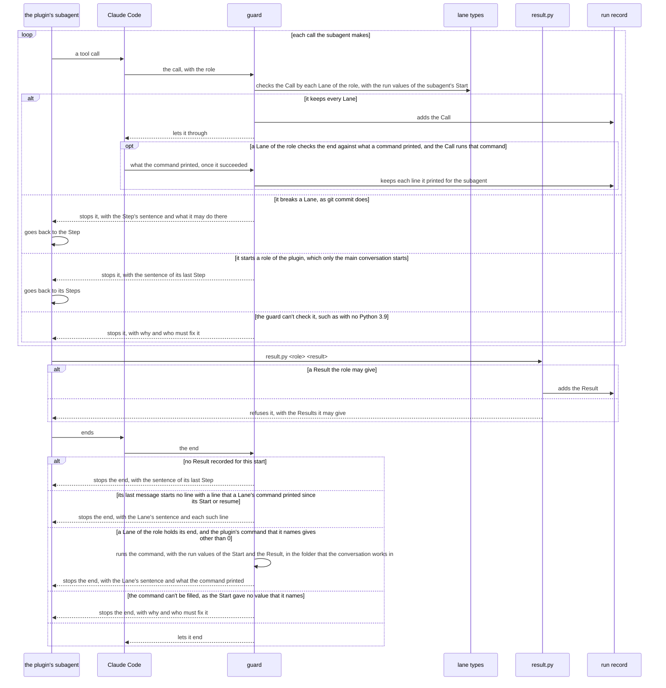
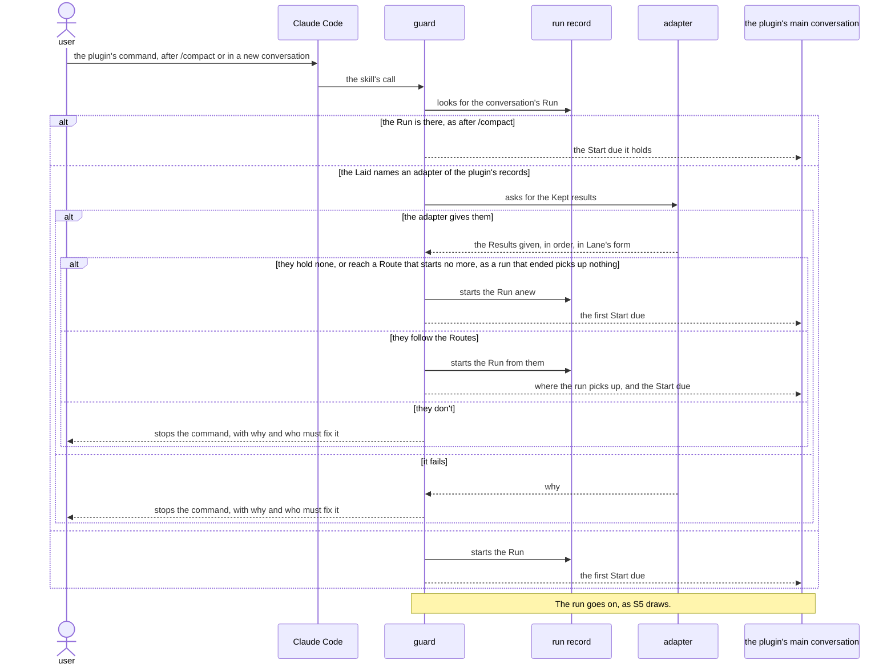

# Lane architecture

This document says how the parts of Lane give what [its README](../../plugins/lane/README.md)
promises. Lane's up reads the user's steps alone and proposes from them the rules and the routes,
each rule of a lane type that gives both the sentence the role reads and the check the guard runs.
Lane lays them into the user's plugin only on the caller's own approval, a person's reply or an
AI's own act. On each run, the guard laid there holds each role to the sentence of its step and
gives the main conversation each start that the routes name, from results that only the result
script records. Each change goes into the steps, so each `/lane:up` proposes from them again and
replaces what it laid before.

## User stories

- S1: the user wants to type `/lane:up <plugin>` and read the proposal, so that they see each step
  as it'll read with its rules, and the order, before anything holds their plugin. It carries the
  walkthrough's `/lane:up changelog`, the routes and lanes shown, the `commands` line, the note
  beside a step that names a command its subagent may not run, and the result `written` that Lane
  names where the steps name none.
- S2: the user wants to reply `yes`, or say what to change, so that Lane lays only what they
  approved. It carries the reply `yes`, each `Wrote` line and `claude plugin validate passed`, and
  `you say what to change, and Lane proposes again`.
- S3: the user, where an AI builds the plugin, wants to call `/lane:up` itself, read the proposal,
  and approve it by its own act, so that it reaches the plugin's first held run without waiting for
  a person. It carries `it reads the proposal and approves it in the same way, with no person's
  reply`.
- S4: the user wants to run `/lane:up <plugin>` again after they change the steps or update Lane, so
  that the checks hold the steps as they now read, with Lane's newest code. It carries `Lane
  proposes from the steps as they now read, in place of what it laid before` and How it works'
  `After an update of Lane, /lane:up brings them to the new version`.
- S5: the user wants to type their plugin's command and have each subagent start in the order they
  set, so that the run goes from result to result with no code of theirs. It carries
  `/changelog:write`, each `Start` line, each `gave` line, a start with only the text the plugin
  gives, starts side by side, each with a text other than those of its role that run, the route
  that waits for a command the person types, the route after a command they type at any moment,
  the moves that a route lists for the
  skill's steps to choose among, `Start no more subagents`, and the work after it that Lane doesn't
  check.
- S6: the user wants each subagent held to its steps on every call, so that a subagent that leaves a
  step goes back to it. It carries the calls that Lane lets through, the stopped `git -C <repo> log --oneline`, and
  the step's sentence and the commands that `writer` may run.
- S7: the user wants a run that stopped to go on where it stopped, after `/compact` or in a new
  conversation, so that its subagents don't start over. It carries How it works' `A run that stops
  starts over`, and the adapter that gives the plugin's records in Lane's form.

## Components


What each decides alone:

- user\
  What each step says, whether the proposal holds what they meant, what to change in it, and
  whether to approve.
- up\
  Which lane type each step takes and what it takes, the routes from the skill's step and the
  results that the steps name, the result named where a subagent's steps name none, and how a
  change the user asks for reads in its step.
- lay.py\
  Whether a proposal can stand against the lane types, the steps, and the plugin's files, how each
  step reads once laid, which text of a step Lane laid before, whether a proposal still matches the
  steps it came from, and which files laying writes or replaces, as one change.
- lane types\
  For each type, such as `run_only` or `write_only`, what it takes, such as the paths that
  `read_never` keeps unread and each part of them, under `!`, that the role may still read, the
  steps it suits, the sentence that the role reads in its step, whether a step's own words already
  say that sentence, and the check of a call against it,
  or of an end: as for `names_printed`, a subagent's end against what the commands it takes
  printed, and, as for `ends_checked`, a subagent's end or the skill's turn's end by a command of
  the plugin's own, which the guard runs with the role's run values and its result filled in.
- guard\
  When a run starts and ends, whether each call, start, and end passes, which start the routes make
  due, what a stopped role or the main conversation reads, whether up gave the person the proposal
  word for word, and whether the act that lays it is the caller's own.
- result.py\
  Whether a result is one that the role may give, and the Result recorded.
- adapter\
  How the plugin's own form of its records, or of a start's text, reads in Lane's form.

The choices made, and why:

- A proposal that up, an AI, makes from the sense of the steps over one that code makes from their
  words\
  The skill's step `Have the entries written and reviewed.` names no subagent, so only a reading of
  its sense gives the routes that the walkthrough shows, and code would leave such a step unheld,
  which raises KR1.1. `lay.py print` checks each proposal against the lane types and the steps, so
  a rule that no check holds never stands. The cost: two runs of `/lane:up` on the same steps may
  word a proposal apart, and the user reads each one.
- Each change the user asks for made in the steps over a change kept beside them\
  The next `/lane:up` reads the change from the steps, so it never drops a change the user made,
  which keeps KR1.1 low. The cost: what the user says to change goes into their step's sentence, and
  they see it there.
- The approval held by a guard that Lane lays on its own up over the instruction in up alone\
  The guard lets `lay.py write` through only after the caller's own act, so the main conversation
  can't approve for a person who typed `/lane:up`, on every run, which keeps KR1.1 low. The cost:
  the guard rests on Claude Code telling a typed `/lane:up` from a call of the Skill tool, which a
  recorded run must show.
- The skill as one role whose Steps lie in several files over a role for each command that the
  person types\
  The main conversation runs the steps of every command in one conversation, and no hook event
  marks where a command's steps end and the skill's go on, so the guard holds it to every Lane of
  the skill on each call, and no command's step goes unheld, which keeps KR1.1 low. The cost: a
  Lane on a command's step holds the main conversation from the Run's start, before the person
  types the command.
- A proposal refused by `lay.py print` where it doesn't fit the plugin's files over one laid as it
  stands\
  A command that a Route waits for or goes after and that the model may call, as its `SKILL.md`
  doesn't set `disable-model-invocation: true`, lets the main conversation make a move in the
  person's place. A program in `hooks/adapters/` that the Proposal doesn't name leaves each start
  without the text that the plugin gives. A file of Steps that two Roles share takes the sentences
  of both, so a role reads another's rule. Each would leave a run that breaks the steps or the
  order, so refusing them keeps KR1.1 low. The cost: before Lane proposes, up mends the Proposal,
  such as by naming the program, or the user mends their file.
- An end held to a command of the plugin's own that the guard runs over a step that has the role
  run it\
  A role that leaves its steps skips the step that checks its work too, and only the plugin knows
  its own measure, such as whether a record holds each step, so the guard runs the plugin's
  command on every end, with the run values of the role's Start and the Result it gave, and holds
  the end until it gives 0, which keeps KR1.1 low. The cost: the command runs at each end, and at
  each end of the skill's turn in a Run, so it must be quick and must hold at any of them, and a
  name in braces that no Start fills, as on the skill, makes `lay.py print` refuse the lane.
- A role that reads nothing of a path still running the commands that its steps name over its
  result's alone\
  The plugin's maker names each such command word for word, and approves it in the proposal, so a
  role that must not read its maker's records can still keep one of its own, which keeps KR1.1 low.
  The cost: a command that a step names may read what `read_never` keeps unread, as the proposal
  shows the maker.
- A sentence left out of a step that already says it over each sentence added to the step it suits\
  A step that holds a sentence word for word, or that names each command of its `ends_checked`
  lane, gives the role the rule already, in the maker's words with its reason, and the sentence
  said again takes the role's attention from the step, so `lay.py` adds it there no more, and the
  role reads each rule once, which keeps KR1.1 low. The cost: a step that says a rule in other
  words, such as `Write nothing outside`, still takes the sentence, as code can't tell that the two
  say one rule, and its maker writes the sentence into the step to say it once. A step that names
  the check for the role to run takes no sentence either, so the role learns that the guard holds
  its end only where the guard stops it.
- Subagents in the background over subagents in the foreground\
  The end of a subagent in the background reaches the main conversation as an event of its own, and
  Claude Code names the subagent as its start runs, so the guard ties each subagent to its Start,
  counts the Start once its subagent ends, and gives the next start beside that end, which keeps
  KR1.1 low. The cost: each subagent's file sets `background: true`, as the README's Requirements
  names, and `lay.py print` refuses a proposal whose subagent's file doesn't.

## Data model


- Step\
  One item of the numbered list under `## Steps` of a skill or a subagent, or of the file in the
  plugin's folder that its body names by `${CLAUDE_PLUGIN_ROOT}/`, as the user wrote it. The
  skill's Steps lie in its own file and that file both, and in the `SKILL.md` of each command that
  a Route waits for or goes after, as the main conversation runs them all.
- Proposal\
  The lanes and the routes proposed from the steps as they read at one time, with its ID, until the
  caller approves it or the steps change.
- Lane\
  A rule on one step of one role, in the file that holds the step, of one lane type. It holds the
  role on every call and every end of the Run, as its type checks them. The README calls it a rule.
- Route\
  The moves after the start of a run, a role's result, or a command the person types: one move,
  or several among which the skill's steps choose by their own judgment. A move starts a role,
  resumes a role's subagent by SendMessage, starts no more, or ends the turn for the person's reply
  with no start due, and each but that wait may wait for a command that the person types. A Run
  holds the moves of the Route after each Result at once, until the skill's steps make them, so
  that they can start side by side the work that rests on none waiting.
- Laid\
  The sentences that Lane added to the steps, by the file they lie in, with the words of each step
  they follow, and the hook entries that are Lane's, so that the next `/lane:up` can take Lane's
  text apart from the user's.
- Approval\
  The caller's own act that approves one Proposal: a person's reply, or an AI's own run of `lay.py
  write`.
- Start\
  One start of a role that a Route makes due, with its text: what the adapter gives for the role,
  such as its run values, or else Lane's words `Carry out your steps`, with the words that the
  person typed after the plugin's command, or that an AI's call of the skill by the Skill tool gives
  as its arguments. The text names no command, as a role given the plugin's command runs it and
  starts roles of its own. The main conversation passes the text word for word, so a role gets
  nothing of the talk that started it. Where the adapter gives the role's run values beside its
  text, the Start keeps them, and each name in braces of the role's lanes that they name stands for
  that value alone, so that the role is held to what it was started for, such as one deliverable.
  A name they don't give stands for any value, as in a plugin with no adapter, or in a lane of the
  skill, whose run no adapter starts. A Start runs beside each other Start that runs until its end
  reaches the main conversation, and Claude Code names the subagent it started as it runs, which
  holds that subagent to the Start's run values while others of its role run. A Start of a role
  with the text of one of its role that runs isn't due, as it would start that work again, so the
  adapter, asked again after each Start and given each Start that runs, decides which work of the
  role waits, as only Lane knows which Starts run. A resume
  that a Route lists counts as a Start of the subagent
  it resumes, which keeps the run values of its first Start, and the Result that the subagent gives
  after it moves the Run as a Start's does. Where no Route lists a resume, a resume is the main
  conversation's talk with a subagent, which moves no Run, so that a plugin whose routes give one
  start each runs as before.
- Run\
  One run of the plugin's skill, from its call to the route that starts no more, with each Start,
  Call, and Result. A run of up ends instead once `lay.py write` lays a Proposal, or once the turn
  on the person's prompt after a Proposal shown ends with no `lay.py write` and no new `lay.py
  print`, as a Proposal waits for one reply.
- Kept results\
  The results of a run that the user's plugin keeps in its own records, which the adapter gives.

## Principles

Lane builds on [the plugin guide](../plugin-development-guide.md), and adds these rules, which every
part keeps.

### The steps are the one source

up proposes the lanes and the routes from the steps alone, with the text that the Laid names taken
out, and puts each change that the user asks for into the steps, never into the proposal or into
`lanes.json`.

*Why*: a rule kept apart from the steps is one the user can't see in them, and the next `/lane:up`
loses it or holds a role to what its steps no longer say, which raises KR1.1.

### One type gives the sentence, the check, and the steps it suits

up, `lay.py`, and the guard take a rule's sentence, its check, and the steps it suits from its lane
type, and from no other place.

*Why*: a sentence and a check made apart drift, so the role keeps the sentence and the check stops
it, and up proposing from a list kept apart would propose a rule that no check holds, which raises
KR1.1.

### Laid only on the caller's own act

`lay.py write` lays only the Proposal that its caller approved by their own act, and only while the
steps read as they did when `lay.py print` showed it. Where a person typed `/lane:up`, the act is
the person's reply after the proposal, and the guard holds the end of up's turn until up gives them
what `lay.py print` showed, word for word. Where an AI called up by the Skill tool, the act is its
own run of `lay.py write`.

*Why*: rules laid that the user never read stop moves they meant to allow, which raises KR1.1, and
an approval that waits for a person who isn't there leaves an AI unable to reach a first run, which
adds to KR1.2.

### Lane's part replaced whole

`lay.py write` replaces at once everything the Laid names, the sentences in the steps, Lane's hook
entries, `lanes.json`, and `hooks/lane/`, and leaves every other part of the plugin as it stands.

*Why*: a rule left from before the steps changed stops a move that the steps now allow, and a hook
entry of the user's own that Lane removed would leave their step unheld, which raises KR1.1.

### A result only from the result script

The guard goes on by the routes only on a Result that `result.py` recorded for the role that ran
it, from the subagent that the Start started, never on what a role wrote in its reply.

*Why*: a reply such as `No more entries` read as `more` starts a role that the order doesn't name,
and a result of another subagent of the same role, read as the Start's, moves the run on a result
that the started role never gave, which raises KR1.1.

### Only the main conversation starts the roles

In a run, the guard lets a start of a role of the plugin through only from the main conversation,
as the Start due. It stops a subagent's start of a role by the Agent tool, and its call of the
plugin's skill by the Skill tool, and gives the subagent the sentence of its last step.

*Why*: a subagent that starts roles of its own starts roles that the order doesn't name, and the
run then holds results that no Start of the routes made, which raises KR1.1.

### A stop gives the step back

Each stop the guard makes gives the role, or the main conversation, the sentence of the step or
the route it breaks, and what it may do instead, such as the commands it may run. Where the guard
can't check a call, it stops it, and says why and who must fix it.

*Why*: a role that meets only a refusal finds another way to do the step, and a call let through
unchecked could break it, which raises KR1.1.

### The run kept in a file

The guard and `result.py` keep each run's starts, calls, and results in the run record, and decide
each move from that record and the plugin's kept results, never from the conversation.

*Why*: a compacted or new conversation forgets where the run stood, so the run stops while the order
names a move, which raises KR1.1.

### The guard checks only the run

The guard checks a call only between the call of the plugin's skill and the end of its Run, and
only for the role whose lanes name it.

*Why*: a check that reaches the user's own work stops a move that no step forbids, which raises
KR1.1.

### The laid plugin runs alone

The laid guard, `result.py`, and the lane types need only Python 3.9, its standard library, and the
plugin's own folder, and no line of Lane's code names a plugin.

*Why*: whoever runs the plugin may have no Lane, or another version of it, and the run would then
stop, or meet checks other than those laid, which raises KR1.1.

## Sequences

### S1: a proposal



### S2: a person approves or asks a change



### S3: an AI approves by its own act



### S4: proposed again after the steps or Lane change



### S5: a run in the order the user set



### S6: a subagent held to its steps



### S7: a run picked up



## Deployment


The user installs Lane as [the README](../../plugins/lane/README.md#installation) says and types
`/lane:up <plugin>` in Claude Code at the root of their repository. From then on, Claude Code starts
the laid guard on each hook event of the user's plugin, wherever it runs.

- Lane's code copied into the user's plugin over hooks that call an installed Lane\
  Whoever runs the plugin needs no Lane, and the guard runs the code that Lane's tests ran until the
  user runs `/lane:up` again, which keeps KR1.1 low. The cost: each plugin carries a copy of Lane's
  code, and an update of Lane reaches it only by `/lane:up`.
- Lane's code on Python 3.9 and its standard library only over a later Python or packages\
  Whoever runs the plugin then installs nothing for Lane, which keeps KR1.2 short. The cost: where
  Python is missing, each call that a rule holds stops.
- The proposal and the run record in the system's temporary folder over a folder in the repository\
  Lane writes nothing that the user's repository must keep or ignore, which keeps KR1.2 short, and
  a run picked up in a new conversation rests on the results the plugin chose to keep. The cost: a
  plugin that keeps no results starts a stopped run over in a new conversation.
- Each adapter, and each command that a Lane runs at an end, run in the folder that the
  conversation works in, each hook event's `cwd`, over the root of the repository,
  `CLAUDE_PROJECT_DIR`\
  A conversation that enters a worktree by EnterWorktree moves its `cwd` there, while
  `CLAUDE_PROJECT_DIR` stays the root, as a recorded run shows, so the adapter reads the records of
  the checkout that the run works on, a role starts with the text of that checkout, and a check of
  the skill's turn, whose Run no Start gives values, finds the records there, which keeps KR1.1
  low. The cost: an adapter or a check that reads a file at the root of the repository finds the
  root itself, such as by git.
- Each path that a lane takes read from the root of the repository and from the top of the git
  worktree that holds the path a call names, over the root alone\
  A plugin may work in a git worktree of its own: its conversation may enter the worktree, or its
  roles may name paths in it from the root, as rn's do. A call's own path names its worktree, where
  an adapter has no path and runs in `cwd`. So a step's `CHANGELOG.md` or `.rn/` names that file in
  the worktree that the role works on, `write_only` lets the role write it there, and `read_never`
  keeps it unread there, which keeps KR1.1 low. The cost: a role may write a file that its step
  names in any git repository that holds it.

## Directory structure

`plugins/lane/` holds what Claude Code installs for the user, and `lay.py write` copies
`hooks/lane/` in it into each plugin. `dev/lane/` holds what only Lane's developers use. In the
user's plugin, Lane writes only the sentences in the steps and the files under `hooks/`.

```text
plugins/lane/
├── skills/up/SKILL.md            /lane:up, which has the main conversation run up's part
├── domain/up.md                  up's part: how it proposes from a plugin's steps
├── domain/proposal.schema.json   the Proposal's form, which up writes to and lay.py print holds
├── scripts/lay.py                lay.py print and lay.py write
├── hooks/
│   ├── hooks.json                starts Lane's own guard on up
│   ├── lanes.json                the lanes and the routes that hold up
│   └── lane/                     Lane's code, copied whole into each plugin
│       ├── hook.py               the guard, which each hook entry runs
│       ├── result.py             the result script
│       └── domain/               the guard's code, with lanes/, one file for each lane type
├── CHANGELOG.md                  the changes in each version
└── README.md                     for Lane's users

dev/lane/
├── product-vision.md, architecture.md, images/
└── tests/                        the test cases, in unit/, properties/, prompts/, integration/,
                                  and e2e/, with the E2E test files that dev/scripts/e2e.py runs

<the user's plugin>/
├── skills/<skill>/SKILL.md       the skill's Steps, with the sentences that Lane laid
├── skills/<command>/SKILL.md     the skill's Steps of the moment when the person types a command
│                                 that a Route waits for or goes after
├── agents/<role>.md              each subagent's Steps, with the sentences that Lane laid
├── <the file a body names>       the Steps of the skill or subagent that names it, such as a part
└── hooks/
    ├── hooks.json                the guard's hook entries, beside the user's own
    ├── lanes.json                the Lanes, the Routes, and the Laid
    ├── lane/                     the copy of Lane's code
    └── adapters/                 each adapter, the user's own

<system temporary folder>/
├── lane/<yyyymmdd>-<plugin>/     the Proposal that lay.py print showed, by its ID
└── <plugin>/<yyyymmdd>-<id>/     the run record of one conversation's run
```

- The lane types inside `hooks/lane/`, which `lay.py` imports, over a copy of their own beside
  `lay.py`\
  The sentence that `lay.py print` shows and the check the guard runs come from one copy, so a
  plugin can't hold a sentence and a check from two versions, which keeps KR1.1 low. The cost:
  `lay.py` reaches into the folder that it copies.

## Test strategy

Lane tests by [the plugin guide](../plugin-development-guide.md#test), in unit tests, integration
tests, and end-to-end (E2E) tests. Its test cases lie in `dev/lane/tests/`, and
`dev/scripts/trace.py` checks that each names an element or a case one level up.

### Unit tests

- Tries: `lay.py`, the lane types, the guard, and `result.py`, each against its contract, and up's
  prompt against what its line in Components and its steps in S1 to S4 ask of it.
- Runs real: the part, with git and the files of a plugin that the test sets up in a temporary
  folder. Up runs alone on Opus, by `/lane:up` in a throwaway copy of a repository that holds such a
  plugin, with `lay.py` real.
- Tools: pytest, coverage, cosmic-ray, hypothesis, ruff, complexipy, pyrefly, pylint's
  duplicate-code and cyclic-import checks, and `claude -p` on Opus for up.
- Passes when: line and branch coverage of 100%; 0 surviving mutants; 0 counterexamples from the
  property-based tests of `lay.py`'s reading of a plugin's Steps and its check of a Proposal against
  the lane types and the steps, each lane type's check of a call against the paths and the commands
  it takes, the guard's reading of each hook event in the form the recorded runs show, and the Run
  written to its file and read back; for each function, McCabe complexity of 10 at most, cognitive
  complexity of 15 at most, and at most 6 returns, 12 branches, 5 arguments, and 50 statements; 0
  findings from pyrefly, ruff, and pylint's checks; and each case of up passing on all of its k = 3
  runs.
- Runs: the code's tests with their coverage and static analysis before each push and on each push
  in CI; mutation testing and the property-based tests in CI over the lines that a push changed on
  each push, and over the whole each night; and up's tests before a change of up is taken.

### Integration tests

- Tries: each path through the sequences of S1 to S7, each principle, where the parts keep it and
  where one breaks it, each decision of each component in Components, each handoff between parts
  with the data it passes, and each kind of data in the data model.
- Runs real: `lay.py`, the guard, `result.py`, the files that `lay.py write` lays in a plugin that
  the test sets up, and an adapter of the test's own. The double of Claude Code in `dev/tests/`
  stands in for Claude Code, and sends each event as the recorded runs in `dev/tests/recorded/`
  show. A test plays the person, up, the main conversation, and each subagent by the calls it makes
  on the double, and up gives only proposals in the form of `proposal.schema.json`, which up's unit
  tests show the real up giving.
- Tools: pytest, the double of Claude Code, `claude plugin validate --strict` on each plugin that
  Lane lays, and `dev/scripts/trace.py`.
- Passes when: every story, principle, component, and kind of data of this document has an
  integration test that names it; every test names an element or a case one level up that exists;
  every unit case names an integration case; each test of a principle fails where its fixture
  `broken` takes out the part that holds the principle, which `trace.py` runs; and each result of a
  double names the recorded run or the page of the documentation that shows it, which `trace.py`
  checks against that source.
- Runs: with the unit tests of the code before each push and on each push in CI.

### E2E tests

- Tries: the key results KR1.1 and KR1.2, by the README's walkthrough at its real size: an AI builds
  a plugin the size of changelog from an intent that Lane never sees, approves its proposal once by
  a person's reply and once by its own act, changes the steps between two runs of `/lane:up`, and
  runs the plugin.
- Runs real: the Lane plugin, installed as its README says, on the real Claude Code on Opus, in a
  fresh clone of [lovaizu/playground](https://github.com/lovaizu/playground). An AI on Opus in the
  user's place holds the intent, and reads only what the screen shows, as `dev/scripts/e2e.py`
  runs it.
- Tools: pytest, `dev/scripts/e2e.py`, and a judge on Opus for each way of KR1.1 that the hook
  events don't show.
- Passes when: the key results, KR1.1, the share of the plugin's runs that go wrong in one of the
  product vision's ways, counted by code from each run's hook events where they show the way and by
  the judge elsewhere, and KR1.2, the time from the first step to the first run that keeps them,
  each taken from the records of every run; a change kept only where it improves a key result and
  leaves none before it worse than in the last runs, as the product vision orders them; the judge
  used only once it's right on each kept record whose answer is known; and 3 runs of the walkthrough
  after each change.
- Runs: once every unit and integration test passes, started by the developer.

- k = 3 runs of each case of up over 1 or 5\
  An up that slips on 3 runs in 10 fails 3 runs of 3 about two times in three, so most proposals
  that would leave a step unheld show before the E2E tests, which keeps KR1.1 low. The cost: each
  change of up waits on 3 runs of each of its cases, and a slip rarer than 1 run in 5 passes them
  more often than not.
- 3 runs of the walkthrough over 1\
  KR1.1 is a share of runs, and one walkthrough holds too few runs to show it move, which keeps a
  change that raised KR1.1 unseen. The cost: each change waits on 3 whole runs on Opus.
- The double of Claude Code sending events as a recorded run of Claude Code 2.1.322 shows over what
  the hooks reference alone says\
  Where the reference says nothing, such as how a typed `/lane:up` differs from a call of the Skill
  tool, a double would send what no Claude Code sends, and pass a test that the real one fails,
  which raises KR1.1. The cost: another recorded run for each new version of Claude Code.
