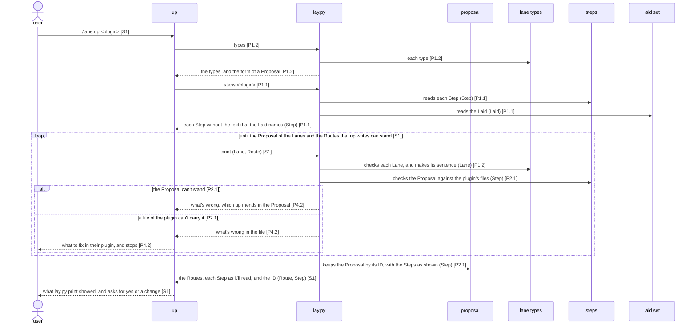
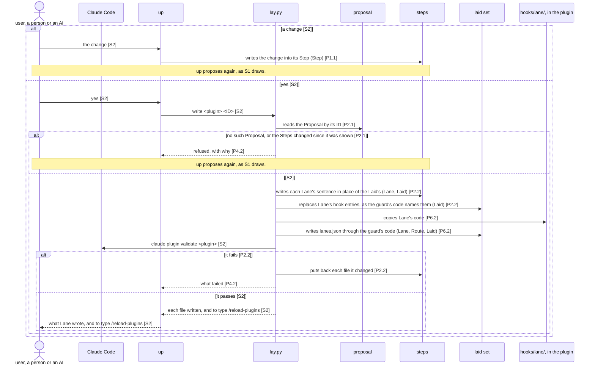
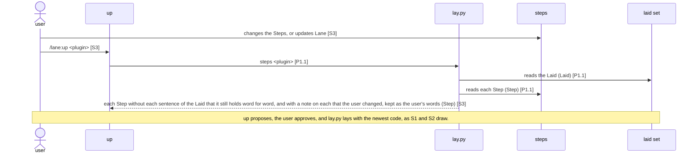
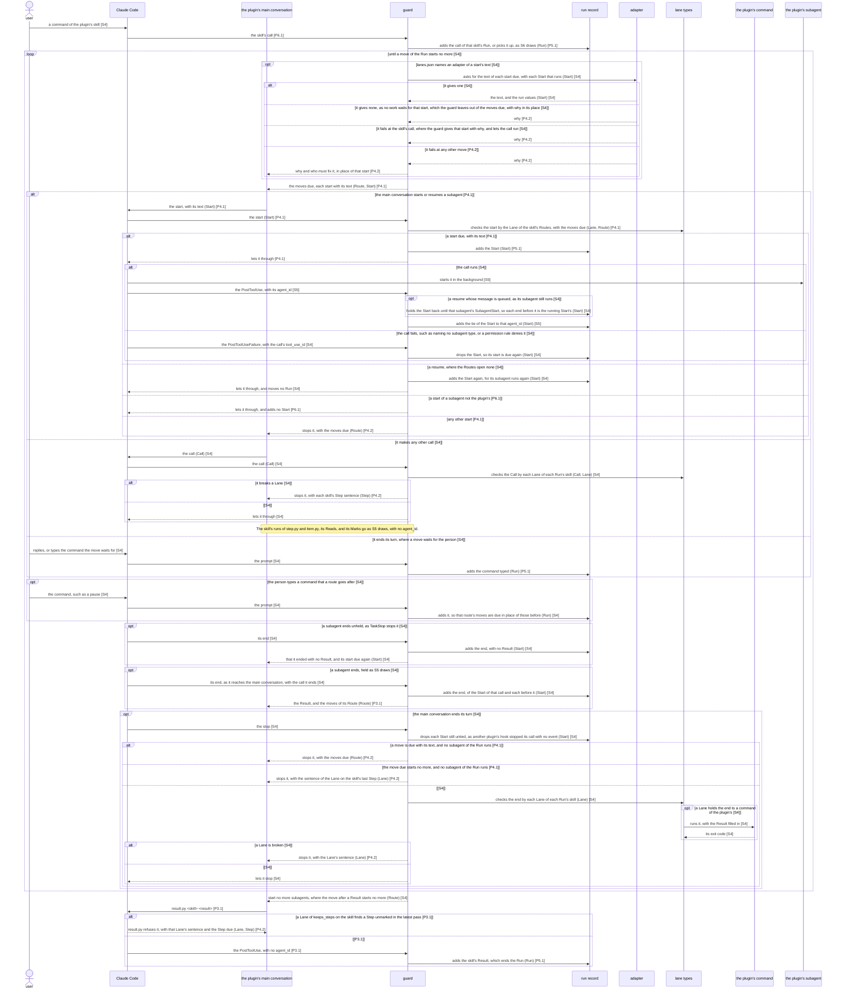
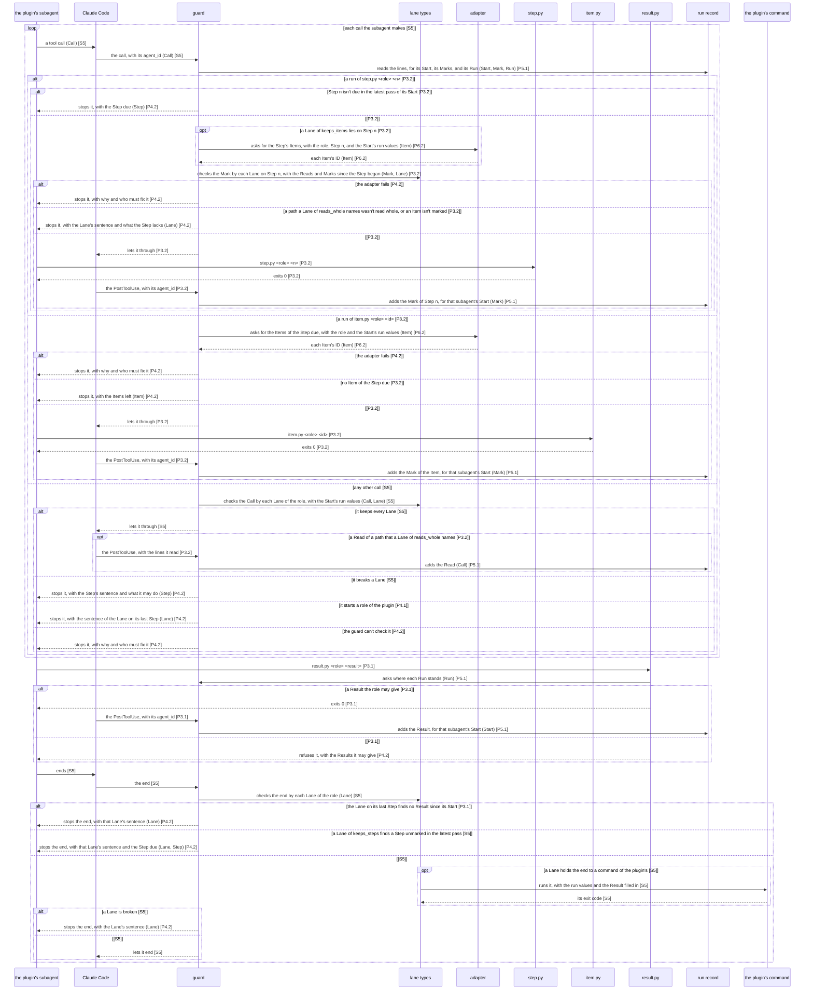
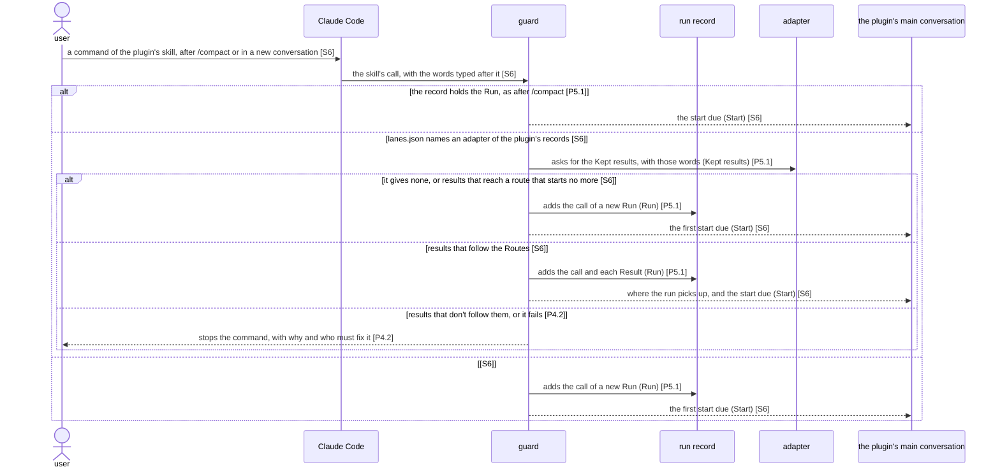

# Lane architecture

## User stories

- S1: the user wants to read what Lane would hold before any change, so that nothing holds their
  plugin unread.
- S2: the user wants to approve the proposal or ask a change, so that Lane lays only what they
  approved.
- S3: the user wants the checks to follow their changed steps, so that the checks match the steps
  as written.
- S4: the user wants a start off their order to get the moves due, so that the role notices.
- S5: the user wants a subagent that leaves a step to get that step, so that it notices at once.
- S6: the user wants a stopped run to go on where it stopped, so that its moves due still follow.

## Solution strategy

### Principles

Lane turns the user's steps into checks once, and judges each hook event by them.

- P1: the steps as the one source
  - P1.1: a proposal comes from the steps alone, and each change asked goes into the steps.
  - P1.2: each rule's sentence, its check, and the steps it suits come from one definition.
- P2: laid only as the user read it
  - P2.1: only a proposal shown is laid, while the steps read as shown.
  - P2.2: what Lane laid is replaced whole, and every other part of the plugin stays as it stands.
- P3: facts, never a role's claim
  - P3.1: a run moves only on a result that its role gave by a script, never by a reply.
  - P3.2: what no hook shows comes only from a script that the role runs.
- P4: the order the user set
  - P4.1: only the main conversation starts the roles, each as a start due.
  - P4.2: each stop gives the step's sentence and what to do, or why it can't check and who fixes
    it.
- P5: nothing lost on a stop
  - P5.1: each run's state comes from files, worked out by one code alone.
- P6: only the plugin's run
  - P6.1: calls are checked only within a run of the plugin's skill.
  - P6.2: the laid plugin needs only its own folder and what each machine running it has, naming
    no plugin.

### Data model


- Step\
  One item under `## Steps` of a skill or a subagent, or of the file its body names.
- Lane\
  A rule of one lane type on one step, which the README calls a rule.
- Route\
  The moves of one skill after its start, a Result, or a typed command.
- Laid\
  What Lane added to the plugin, kept in a form that a later Lane separates from the user's text.
- Start\
  One start or resume of a role, that holds its text and its run values.
- Call\
  One tool call of a role, checked as it comes, and kept only as a Read that reads_whole needs.
- Item\
  One item of a Step's checklist, by the ID that the plugin's adapter gives.
- Mark\
  A role's report of a Step or an Item done, each Mark of Step 1 beginning a new pass.
- Run\
  One run of one skill in one conversation, with each prompt typed in it, until a route starts no
  more.
- Kept results\
  The results of a run that the user's plugin keeps in its own records.

Strategies:

- An append-only run record of only what no later payload gives again. [P5.1]\
  Intent: hooks that run at once lose no line of one another's.
- The form of Lanes and Routes, in `lanes.json` and a Proposal, decided by the guard's code. [P6.2]\
  Intent: a laid plugin runs by its laid copy alone.

### Components


- user (role)\
  Writes each step, reads the proposal, and approves it or asks a change.
- up (skill)\
  Proposes each step's lane type, each skill's routes, and each missing result's name from the steps.
- lay.py (script)\
  Checks a Proposal, shows how the steps read once laid, and lays it into the plugin.
- lane types (modules)\
  Give each rule's sentence, the steps it suits, what it allows, and its check of a call or an end.
- guard (hook script)\
  Places each hook event in its Run, and gives each start due and each stop.
- result.py (script)\
  Takes a result given as a command of its own, only where a Run lets its role give it.
- step.py (script)\
  Gives a Step's Mark as a command of its own, which the guard checks at its call.
- item.py (script)\
  Gives an Item's Mark as a command of its own, which the guard checks at its call.
- adapter (script)\
  Gives each start's text, a Step's Items, and kept results in Lane's form, and names what a call
  picks up.

Strategies:

- A proposal from the steps' sense, by up. [P1.1]\
  Intent: a step that names no subagent still gets its routes.
- Each skill as one role whose steps lie in several files. [S4]\
  Intent: a command's steps hold, though no hook event marks where they end.
- `lay.py print` refusing a Proposal that the plugin's files can't carry. [P2.1]\
  Intent: no file of the plugin that can't carry the Proposal breaks a run.
- An end held to the plugin's own command, which Lane runs. [S5]\
  Intent: a role that leaves its steps still meets the check that only the plugin knows.
- A sentence left out of a step that already says it. [P1.2]\
  Intent: the role reads each rule once, and keeps its attention on its step.
- Each Mark checked by the guard at its script's call, which names the subagent. [P3.2]\
  Intent: each Mark counts for the subagent whose Step is due.
- A Step's Items given by the plugin's adapter, from the role, the Step, and the run values. [P6.2]\
  Intent: each Step's checklist comes from the plugin, which alone knows it.
- Each event placed by `session_id` and `agent_id`, a Start tied at its Agent call's PostToolUse.
  [S5]\
  Intent: each call is held to its own Start, as [Claude Code's states](claude-code-states.md)
  shows.
- Each Result and Mark added by the guard at the PostToolUse of each run of Lane's scripts that
  exits 0. [P3.1]\
  Intent: each Result and Mark counts for the subagent that gave it.
- The adapter naming the work a call picks up, from the words typed after the command. [S6]\
  Intent: a new request is told apart from a pick-up before the guard answers.
- Subagents in the background. [S5]\
  Intent: the guard holds each call of a subagent as it comes.

### Sequences

#### S1: a proposal



#### S2: the user approves or asks a change



#### S3: proposed again after the steps or Lane change



#### S4: a run in the order the user set



Strategies:

- A start judged by the Lane of the Routes, with the adapter of a start's text. [P4.1]\
  Intent: only a start due goes through, and any other start of a role gets the moves due.
- The adapter of a start's text failing at the skill's call, asked again after each later call.
  [S4]\
  Intent: a right move goes on while the skill's own steps make what the adapter reads.
- A start due beside each Start of its role that runs, while the adapter gives another text. [S4]\
  Intent: the skill's steps start one role for several pieces of work at once.
- A resume let through where the Routes open none, moving no Run, its Start running again. [S4]\
  Intent: a resume to answer leaves the order as it stands.
- A start of a subagent not the plugin's let through with no Start. [P6.1]\
  Intent: a helper, such as Explore, runs unstopped.
- The main conversation's call judged by each Lane of each Run's skill. [S4]\
  Intent: each skill's Steps hold while the person types another command as a subagent of the
  first runs.
- A turn's end stopped by a move due while no subagent runs, before any Lane. [P4.1]\
  Intent: the end keeps the order, and a stop that starts no more names the skill's result script.
- A typed command that a Route goes after, its moves due in place of those before. [S4]\
  Intent: the person's pause or approval changes the order.
- An end that ends the Start of the call it names, and each Start of its subagent before it. [S4]\
  Intent: a resume's Result counts, though it comes before the end of the pass before it.
- A Start dropped at its call's PostToolUseFailure, or untied at the turn's end. [S4]\
  Intent: a call that never ran leaves no Run waiting for good.
- A resume queued to a running subagent, its Start held back until that subagent's SubagentStart.
  [S4]\
  Intent: the end of the pass before the resume counts for the Start that runs.
- A subagent that ends with no Result, its start due again. [S4]\
  Intent: a run goes on after TaskStop ends a subagent outside its steps.
- The skill's Result refused by `result.py` while keeps_steps finds a Step unmarked. [P3.1]\
  Intent: a Step left while a turn waits on a subagent shows at the Result.

#### S5: a subagent held to its steps



Strategies:

- A call kept where one Lane of each lane type allows it, and Lane's scripts by every type. [S5]\
  Intent: no Lane stops what another of its type allows, or a role's Result or Mark.
- A Step's Mark checked for the Step due, then by its Lanes of reads_whole and keeps_items. [P3.2]\
  Intent: a Lane sees a Step's Reads and Items within the bounds that the Marks set.
- An Item's Mark checked by keeps_items against the adapter's Items for the Step due. [P6.2]\
  Intent: each Item marked is one of the Step's checklist, which only the plugin knows.
- A subagent's end checked by ends_by_result first, then keeps_steps, then ends_checked. [P4.2]\
  Intent: a stop names the step left, as the plugin's command runs only once the Result and each
  Step hold.
- A subagent's start of a role stopped by the Lane on its last Step. [P4.1]\
  Intent: the subagent gets its own last step back.

#### S6: a run picked up



Strategies:

- The skill's call placed by the run record first, then by the adapter of the plugin's records.
  [P5.1]\
  Intent: a run goes on after `/compact`, and in a new conversation.
- A resume due of a role that this conversation never started, given as its start. [S6]\
  Intent: no right start is stopped for a subagent that isn't here to resume.

### Deployment


Claude Code runs the laid guard on each hook event of the plugin, from the session's start or after
`/reload-plugins`.

Strategies:

- The person's `/reload-plugins`, which `lay.py write` asks for. [S2]\
  Intent: the checks judge from the next prompt.
- Lane's code copied into the user's plugin. [P6.2]\
  Intent: whoever runs the plugin needs no Lane, and the guard runs the code that Lane's tests ran.
- Lane's code on Python 3.9 and its standard library. [P6.2]\
  Intent: the guard, started anew on each hook event, answers fast.
- The adapter and each command that a Lane runs in the hook event's `cwd`. [S4]\
  Intent: each reads the run's checkout, in a worktree too.
- Each lane's path read from the top of its worktree, beside the root. [S5]\
  Intent: a step's path names the file in a role's own worktree.

### Directory structure

```text
plugins/lane/                     what Claude Code installs for the user
├── skills/up/SKILL.md            /lane:up, which runs up's part
├── domain/up.md                  up's part
├── domain/lay/                   lay.py's code, a module for each of its decisions
├── scripts/lay.py                lay.py types, steps, print, and write
├── hooks/lane/                   Lane's code, copied whole into each plugin
│   ├── hook.py                   the guard
│   ├── result.py                 the result script
│   ├── step.py                   the script by which a role marks a Step done
│   ├── item.py                   the script by which a role marks an Item of a Step done
│   └── domain/                   the guard's code, the form of lanes.json, and lanes/, the lane types
├── CHANGELOG.md                  the changes in each version
└── README.md                     for Lane's users

dev/lane/                         what only Lane's developers use
├── claude-code-states.md         each state of Claude Code that the guard meets, with its records
└── tests/                        the test cases, from unit to integration

dev/tests/                        what the developers of Lane and rn share for their tests
├── claude_code.py                the double of Claude Code, its `claude plugin validate` too
├── recorded/                     the records of Claude Code that the double gives from
└── recorder/                     what records a state again, and compare.py

<the user's plugin>/              what Lane writes into, beside the user's own
├── skills/<skill>/SKILL.md       a skill's Steps, with Lane's sentences
├── skills/<command>/SKILL.md     the Steps of a command that a skill's Route waits for or goes after
├── agents/<role>.md              a subagent's Steps, with Lane's sentences
├── <the file a body names>       the Steps of the skill or subagent that names it
└── hooks/
    ├── hooks.json                the guard's hook entries, beside the user's own
    ├── lanes.json                the Lanes, the Routes, the adapters, and the Laid
    ├── lane/                     the copy of Lane's code
    └── adapters/                 each adapter, the user's own

<system temporary folder>/        what Lane keeps only for a run
├── lane/<yyyymmdd>-<plugin>/     each Proposal, by its ID
└── <plugin>/<yyyymmdd>-<id>/     the run record of one conversation
```

Strategies:

- In the user's plugin, only the sentences in the steps and the files under `hooks/` written by
  Lane. [P2.2]\
  Intent: every other part of the plugin stays the user's.
- The lane types inside `hooks/lane/`, which `lay.py` imports. [P1.2]\
  Intent: the sentence that `lay.py print` shows and the check that the guard runs come from one
  copy.

## Test strategy

| Check | Test target | Kind | Exit criteria or measure |
|---|---|---|---|
| Lint | Parts | Quality | 0 findings. |
| Static analysis | Parts | Quality | 0 findings of mismatched types, copied code, or import cycles. |
| Complexity analysis | Parts | Quality | Per function, McCabe 10, cognitive 15, 6 returns, 12 branches, 5 arguments, 50 statements at most. |
| Unit testing | Parts | Quality | Every case passes. |
| Unit testing | Parts that hold a prompt | Benchmark | up's Proposal for each case's steps, each case's results over runs added until one more changes no case's count. |
| Code coverage | Parts | Quality | 100% statement (C0) and branch (C1) coverage. |
| Property-based testing | Parts | Quality | 0 counterexamples in reading Steps and Proposals, each lane type's check, and the guard's reading of events. |
| Mutation testing | Parts | Quality | 0 surviving mutants. |
| Integration testing | Architecture | Quality | Every case passes, each handoff giving its data, with one case for each combination that a sequence's Strategies name. |
| Integration testing | Architecture | Benchmark | KR1.1: the share of the guard's answers that the cases hold right. |
| Contract testing | Architecture | Quality | On each new Claude Code, each recorded state gives the double's events, with their fields in order. |
| Traceability | Architecture | Quality | Every element and every combination tested, every case naming one level up, and each principle's case failing broken. |
| Configuration testing | Product | Quality | Every case passes on Python 3.9 and on the newest Python. |
| Conformance and compliance testing | Product | Quality | Claude Code's strict check of each laid plugin passes. |
| Performance testing | Architecture | Benchmark | KR1.2: each hook event's time to the guard's answer. |
