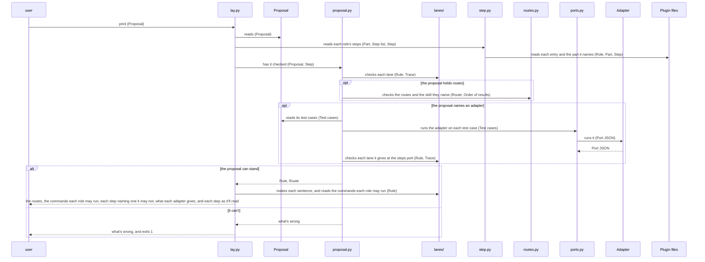
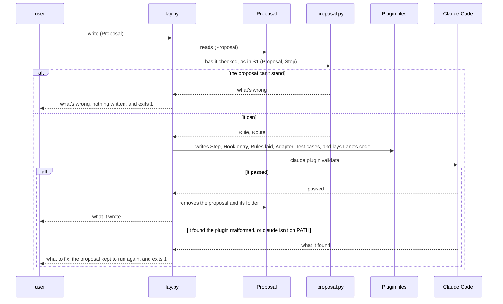
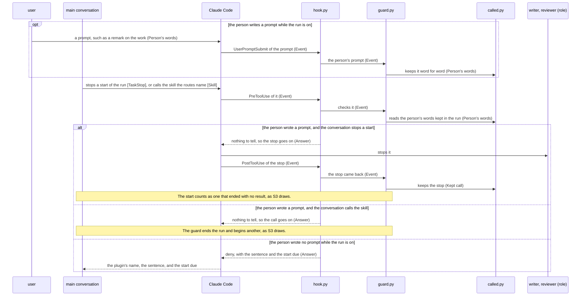
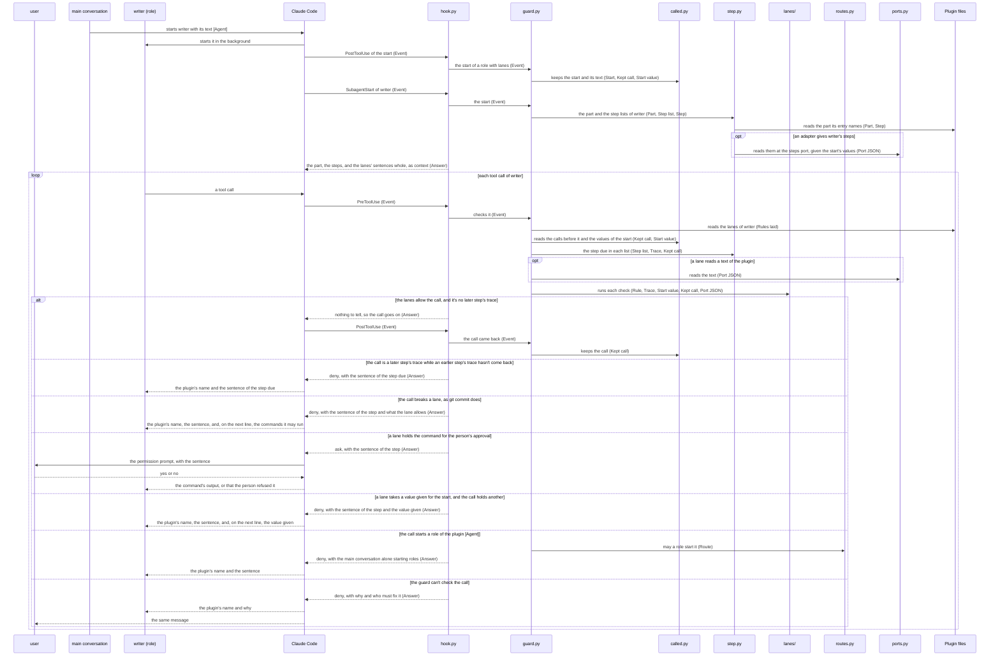
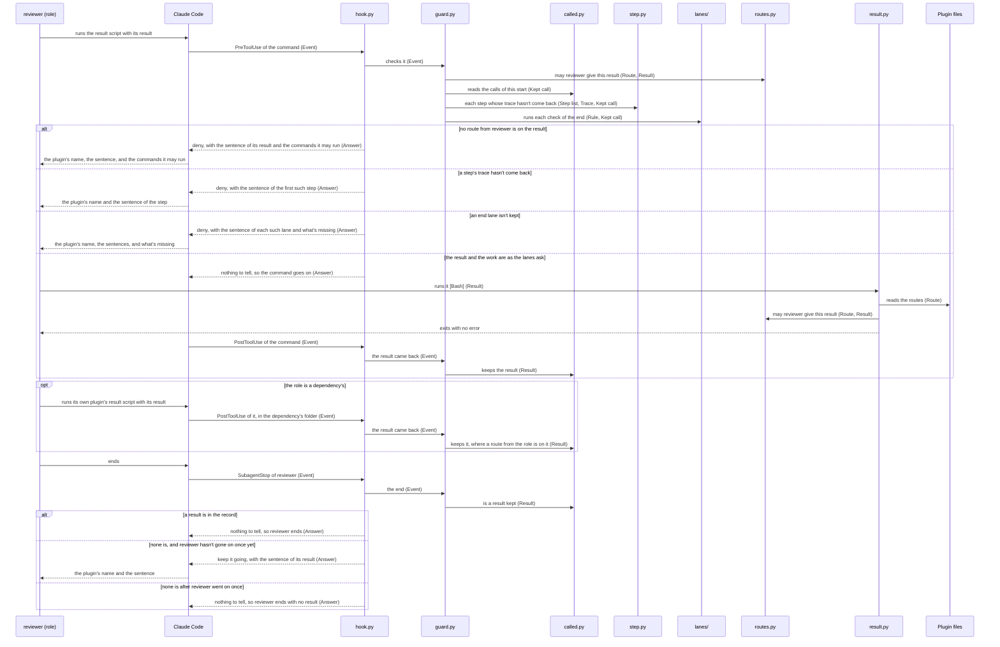
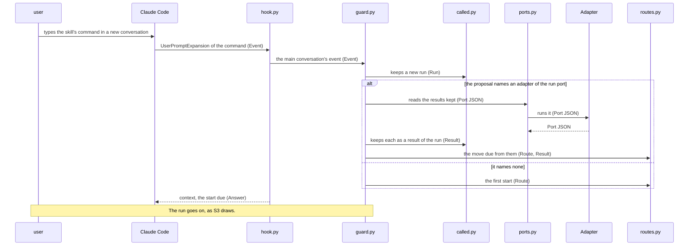
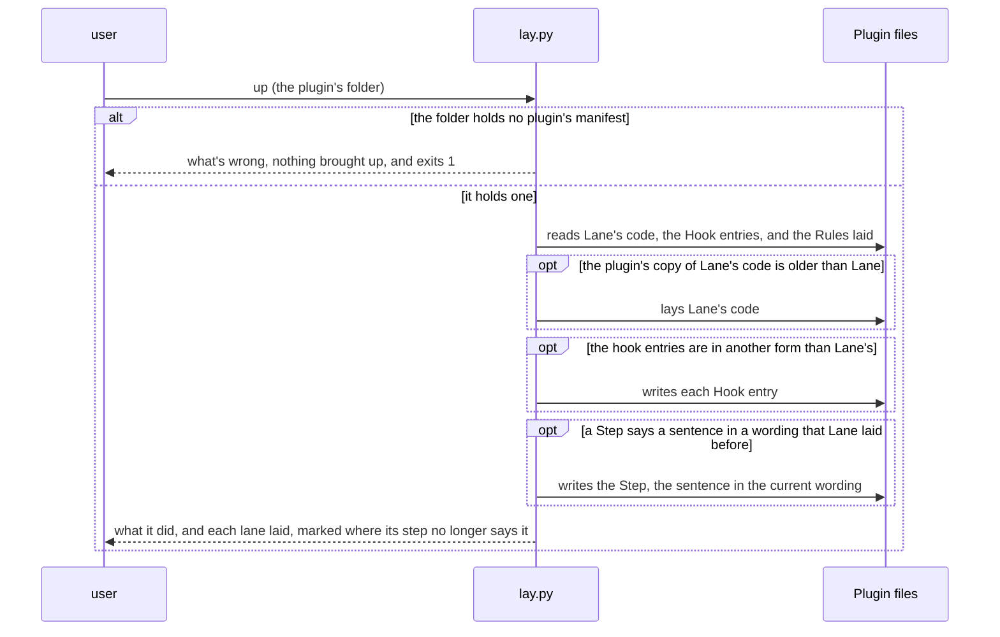

# Lane architecture

This document says how the parts of Lane give what [its README](../../plugins/lane/README.md)
promises. The user writes the steps and the order of their plugin's roles in a proposal, and
`lay.py` lays from it the sentences into their steps and the guard into their plugin. On each hook
event of a run, the guard holds each role to its steps by the calls that show them, and the main
conversation to the routes by the results that the roles give with the result script. Each stop
gives the role or the main conversation its step's own sentence again.

## User stories

- S1: the user wants to run `lay.py print` on their proposal, so that they see each step as it'll
  read, the commands each role may run, and what each adapter gives, or what's wrong, before
  `lay.py` lays anything. It carries the walkthrough's lanes for `writer`, its routes, and the steps shown
  as they'll read.
- S2: the user wants to run `lay.py write` on the proposal they approved, so that the sentences
  stand in their steps and the guard and the result script in their plugin. It carries the
  walkthrough's `lay.py write`.
- S3: the user wants their plugin's main conversation to start the roles in the order of the
  routes, with only the texts the plugin and the person give, so that no code of theirs keeps the
  order. It carries the walkthrough's run from `/changelog:write` to its end, a value given for each
  start, a start held to the text the plugin's command gave, a role resumed with the main
  conversation's grounds and the person's words, a route that waits for the person's command, a
  dependency's skill, and a role that ends with no result.
- S4: the user wants the person who runs their plugin to redirect a run by a prompt, so that the
  person's own request wins over the order. It carries a start stopped, and the skill called again,
  after a prompt.
- S5: the user wants each role to keep its steps in order within their lanes, so that it gives no
  work that a skipped step was there to make sound. It carries `writer` stopped as it tries
  `git commit` and shown its step's sentence, a step whose trace comes before an earlier one's,
  steps read through an adapter, a command held for the person's approval, and a start from within a
  role.
- S6: the user wants each role to give its result by a run of the result script, so that no reply
  of the role's is misread as a result. It carries `reviewer` giving `more` and then `good`.
- S7: the user wants a role that the routes name in `fan_out` to run several times at once, so that
  its starts give one result by the order the user set. It carries several starts of `reviewer`.
- S8: the user wants a run that stopped to go on in a new conversation from the results their
  plugin kept, so that no role starts again from the routes' first move. It carries a call of the
  skill whose adapter gives the results kept.
- S9: the user wants to run `lay.py up` on their plugin after an update of Lane, so that a fault
  fixed in Lane reaches their guard and each step reads in Lane's current wording.

## Components


What each decides alone:

- user\
  The lanes, the routes, each adapter, and whether to approve the steps as they'll read.
- lay.py\
  What goes where in the user's plugin, which no other component writes, and how `lay.py up` brings
  the plugin's copy of Lane's code, its hook entries, and its steps' sentences to Lane's version.
- proposal.py\
  Whether `lay.py` can lay a proposal, by the JSON Schema of
  [the proposal](../../plugins/lane/docs/lanes.md#the-proposal) and the plugin's files.
- lanes/\
  For each type of lane, its sentence, what it takes, what breaks it, whether it's of the trace kind,
  whether it names the commands a role may run, and whether a lane can stand at all.
- step.py\
  A role's step lists, read from the numbered list of its part or at the steps port, and the step
  due in each list.
- hook.py\
  How Claude Code's hook input reads and how the guard's answer goes back.
- guard.py\
  Which checks run on an event, whether a run is on, whether the person has redirected it, and what
  the role, the main conversation, and whoever runs the plugin hear.
- called.py\
  What Lane keeps of each run and each start: the calls, the results, the texts each start got, the
  person's words, and the texts the routes' command gave, and how several starts of one role join.
- routes.py\
  Whether the plugin can follow its routes, which results a role may give, which move is due, which
  result several starts give together, and whether a start's text and a resume's message are as the
  plugin and the person gave them.
- ports.py\
  How a text of the plugin becomes the form a check takes, at the values, items, steps, and run
  ports, by Lane's own form or the plugin's adapter.
- result.py\
  Nothing of its own: it refuses a result that `routes.py` says the role may not give.

The choices made, and why:

- The checks as entries of the plugin's `hooks/hooks.json`, acting by the event's `agent_type`,
  over hooks in a role's or the skill's own file\
  Claude Code ignores hooks in a plugin agent's own file, and a SubagentStop hook in a skill's own
  file didn't fire in a trial, so only these entries hold every role, as KR1.1 counts. The cost: the
  guard starts on every tool call of the plugin, and returns at once for one it doesn't hold.
- Lane's code put into the plugin over running it from where Lane lies installed\
  A plugin that needed Lane installed would run without its checks wherever Lane is missing, as
  KR1.1 counts. The cost: a fix in Lane reaches a plugin only once the user runs `lay.py up`.
- A step held by its trace over a step held by what the role wrote\
  A trace is a call that the hook input documents, while what a role wrote takes a reader to judge,
  as KR1.1 counts. The cost: a step that no call shows goes unheld, and the work's own check must
  catch it.
- The steps of a plugin's best practices read at the steps port over steps that the proposal names
  one by one\
  A plugin may make a best practice on a run, which no proposal laid before can name, so its steps
  would go unheld, as KR1.1 counts. The cost: the user writes an adapter, and a fault in its traces
  shows only on a run.
- The items of every_item read at the items port, given the start's values, over items read from the
  input's text alone\
  A deliverable's intents lie where only the plugin's own script reads them, so the user would write
  that check themselves, as KR1.1 counts. The cost: an adapter for each such plugin.
- read_never beside read_only over read_only alone\
  A role kept from one file would otherwise name each file it may read, and the guard would stop a
  read of a file added later, as KR1.1 counts. The cost: one more type of lane.
- A command matched whole over a command taken apart\
  A reading of the shell's grammar misses forms no one foresaw, and lets a role break its step, as
  KR1.1 counts. The cost: a role with a run_only lane runs only the commands its lanes name, word for
  word.
- Each plugin's guard keeping its own record of a session over one record for both\
  Two guards would each write what the other reads, and a copy of another version could misread the
  other's lines, as KR1.1 counts. The cost: the guard keeps a dependency's role twice.
- `called.py` keeping the calls of each start itself over reading Claude Code's record of the
  session\
  Claude Code doesn't document its record, so a reading of it breaks when Claude Code changes it, as
  KR1.1 counts. The cost: a write on each call that comes back.
- An adapter as a script that Lane runs over a module that Lane imports\
  `lay.py up` then replaces Lane's code without touching an adapter, and a fault in an adapter can't
  break the guard, as KR1.1 counts. The cost: each read through an adapter starts a process within
  the hook's time.
- Each role with lanes or named by the routes running in the background over one in the foreground\
  Its start comes back at once with the role's ID, so the guard joins each start to its own values
  by documented fields alone, as KR1.1 counts. The cost: the role's file sets `background: true`,
  which `lay.py print` asks of it.
- The part, the steps, and the lanes' sentences given whole as context that Claude Code adds as a
  role starts, over a lane that has the role read its own part\
  A role could skip the read, and work without its steps, as KR1.1 counts. The cost: the guard reads
  the part, and the steps at their port, on each start.
- A later result of a start taking the place of its earlier one over a start held to its first
  result\
  A role that ends to wait for an answer moves the routes on once resumed, or the user would write
  code for that order, as KR1.1 counts. The cost: the guard keeps each role's ID and result for the
  whole run.
- A route that waits, `"waits": true` in place of a `to`, over a route that ends the run\
  A plugin whose role puts a point to the person would otherwise end its run at the first point, and
  its later starts would go unheld, as KR1.1 counts. The cost: one more key in the routes.
- A route that waits until the person types a command, `"until"` beside `"waits"` and `to`, over any
  prompt of the person's moving the run on\
  A point that's the person's, such as a sign-off, counts as approved only by their own act, or the
  run would go on past a sign-off the person never gave, as KR1.1 counts. The cost: one more key in
  the routes.
- Only the roles that the routes name in `fan_out` running several at once over any role beside
  itself\
  A role whose steps weren't made for it would run so with no one having approved it, as KR1.1
  counts. The cost: the user names each such role and orders its results.
- A run begun at the expansion of the typed command or at the PostToolUse of the Skill call over a
  prompt read for the command's words\
  A prompt that quotes the command would match its words and begin no skill, as KR1.1 counts. The
  cost: a skill followed without a call goes unheld.
- Each start told as context that Claude Code adds over a message of Lane's own\
  Claude Code puts it beside an event that the conversation reads in any case, so the conversation
  meets each start, as KR1.1 counts. The cost: the conversation may pass over a start, so the guard stops a
  start not due with the one due, and keeps the end of a turn going.
- The end of a turn kept going once while a start is due, then let end with the user told whose step
  to fix, over a hold until the start goes through\
  A hold with no end would need a person to break it, which is no check, as KR1.1 counts. The cost:
  a run whose conversation passes the start over twice stops with the start due.
- A dependency's skill that a route names counted as one move over both guards holding the
  conversation\
  Two guards on one conversation would each stop the other's moves, as KR1.1 counts. The cost: a
  dependency's skill that ends with no result leaves its move open.
- The person's messages kept from the event of each prompt over the main conversation's own word for
  what the person said\
  The hook input holds the prompt as the person wrote it, while the conversation's account could sum
  it up, as KR1.1 counts. The cost: a prompt that isn't an answer also counts among the person's
  words.
- A stop or a new call of the skill let through once the person has written a prompt while the run
  is on, over one let through at any time or only while the run waits\
  A stop at any time drops a start that the routes name, and a redirect only while the run waits
  holds the person to work they've changed, as KR1.1 counts. The cost: any prompt lets the
  conversation stop a start until the run ends.
- The results kept read at the run port at each call of the skill over a run that always starts at the
  routes' first move\
  A plugin that pauses would start its roles again in a new conversation, and the guard would stop
  the move its results make due, as KR1.1 counts. The cost: a plugin that picks runs up writes an
  adapter that gives its results kept.
- `claude plugin validate` run by `lay.py write` over a check of the plugin's form of Lane's own\
  Claude Code loads the plugin by the same check, so a plugin that passes runs, as KR1.2 counts. The
  cost: the write fails where `claude` isn't on PATH.
- The proposal removed once written over a proposal kept beside the plugin\
  The plugin's `hooks/lanes.json` then holds the one copy of what the user approved, which no stale
  proposal can contradict, as KR1.1 counts. The cost: a later change starts from a new proposal.

## Data model


- Rule\
  A lane, which is one rule on a role's steps.
- Role\
  A subagent of the user's plugin, or the skill, as a route names either.
- Part\
  The file that holds a role's steps: its entry, or the one file under the plugin's `domain/` that
  the entry names.
- Step list\
  Steps in their order: the numbered list of a part, or the steps of one intent at the steps port.
- Trace\
  A lane of the trace kind on a step, which names the call that shows the step done.
- Run\
  One run of the skill that the routes name, from its call to the route that starts no more.
- Start\
  One start of a role within a run, known by the ID that Claude Code gives back for it.
- Kept call\
  One tool call that the guard kept.
- Start value\
  A value given for one start, in the text that started the role or in a message sent to it.
- Given text\
  What the command that the routes name gave for one start, the text that the start must carry.
- Person's words\
  The person's messages to the main conversation while a run is on.
- Item\
  An ID that a role must answer, such as an intent of a deliverable.
- Order of results\
  The results, first to last, by which the guard takes one result of several starts at once.
- Port JSON\
  A text of the plugin, such as a deliverable's intents or a run's results kept, in Lane's form.

## Principles

Lane builds on [the plugin best
practice](../../plugins/rn/domain/best-practices/plugin/best-practice.md), and adds these rules,
which every part keeps.

### A step held by its trace, in its order

Within a step list, the guard stops a call that's a later step's trace while an earlier step's trace
hasn't come back, and a role's end while any hasn't, and never reads what a file says.

*Why*: a role that skips a step, or does it after the step that rests on it, gives work the step was
there to make sound, and goes on, as KR1.1 counts.

### The check shows the step again

When the guard stops a call or an end, it gives the role or the main conversation the sentence of
the step that the call breaks, headed by the plugin's name, and what the lane allows.

*Why*: a role whose call meets only a refusal makes the call another way, and breaks its step, as
KR1.1 counts.

### One wording for the step and the check

`lanes/` alone makes a lane's sentence, for both the step that `lay.py` writes and the guard's
message, and keeps each earlier wording that Lane laid.

*Why*: a role told two wordings of one rule may keep the other, and a plugin laid before would have
every call stopped once Lane changes a wording, as KR1.1 counts.

### What the user approved is what runs

The guard takes its lanes and routes only from what `lay.py write` wrote from a proposal that
`lay.py print` showed unchanged, and stops each call they're about where they no longer pass its
checks.

*Why*: a lane that no one approved could stop a move that the user's steps allow, as KR1.1 counts.

### Lane knows no plugin

What differs between plugins reaches the guard only as a lane's values, a value given for a start,
or a port's JSON, and no line of Lane's code names a plugin.

*Why*: where Lane can't hold a step or the order, the user writes a check or code of their own, or
leaves it unheld, as KR1.1 counts.

### The check judges only what Claude Code documents

The guard judges a role only from the documented fields of the hook input and the runs of the result
script, never from what a role writes, a shell command taken apart, or Claude Code's record.

*Why*: each of those readings lets a role break its step and go on, or stops a move the steps allow,
as KR1.1 counts.

### A call that the guard can't check stops

When the guard can't check a call or an end, it stops it, and says why and who must fix it.

*Why*: a call let through unchecked could break the step that the lane holds, and the role would go
on, as KR1.1 counts.

### Claude Code's own means first

Where Claude Code has a documented means for what a lane needs, such as its permission prompt, the
guard uses that means alone.

*Why*: a means of Lane's own reads again what Claude Code settles, and drifts from it, as KR1.1
counts.

### The plugin needs nothing from Lane

The guard and the result script lie and run in the user's plugin, never in Lane.

*Why*: whoever runs the plugin didn't choose Lane, and a plugin that needed it would run unchecked
wherever it's missing, as KR1.1 counts.

### The main conversation passes on only what it's given

The main conversation alone starts each role, with the text that the routes' command gave, and
resumes it with its own grounds and the person's words since the role's point, word for word.

*Why*: a text reworded on the way, or an answer summed up, has the role work from other words than
the plugin and the person gave, as KR1.1 counts.

### The guard holds the main conversation only while its run lasts

The guard holds the main conversation's moves from the call of the skill that the routes name, on
from the results kept where the plugin gives them, until a route starts no more, and lets the person
redirect the run by a prompt.

*Why*: the same conversation holds the person's own work, and a hold they can't end overrides what
they ask on purpose, as KR1.1 counts.

## Sequences

### S1: `lay.py print`



### S2: `lay.py write`



### S3: a run in the order of the routes

```mermaid
sequenceDiagram
  participant U as user
  participant M as main conversation
  participant CC as Claude Code
  participant H as hook.py
  participant G as guard.py
  participant C as called.py
  participant RT as routes.py
  participant S as writer, reviewer (role)
  U->>CC: types /changelog:write, or an AI calls the skill
  CC->>H: UserPromptExpansion of the command, or PostToolUse of the Skill call (Event)
  H->>G: the main conversation's event (Event)
  G->>RT: is it the skill the routes name (Route)
  alt it is
    opt a run is on, which the person redirected, as S4 draws
      G->>C: ends the run (Run)
    end
    G->>C: keeps a new run (Run)
    G->>RT: the first start (Route)
    H-->>CC: context, start writer, and the routes' sentence where no step says it (Answer)
  else it isn't
    H-->>CC: nothing to tell (Answer)
  end
  CC->>M: runs the orchestrator's part, with the context beside it
  Note over M,G: Outside a run, the guard tells the main conversation nothing.
  loop until a route starts no more
    opt the routes name the command that gives each start its text
      M->>CC: runs the command for the role due [Bash]
      CC->>H: PostToolUse of the command (Event)
      H->>G: the command came back (Event)
      G->>C: keeps what it gave (Given text)
    end
    alt the main conversation starts a role [Agent]
      M->>CC: starts a role [Agent]
      CC->>H: PreToolUse of the start (Event)
      H->>G: checks it (Event)
      G->>C: reads the results kept in the run, and the text given (Result, Given text)
      G->>RT: is this the start due, with the text given (Route, Result, Given text)
      alt it is
        H-->>CC: nothing to tell, so the start goes on (Answer)
        CC->>S: runs it in the background
        CC->>H: PostToolUse of the start (Event)
        H->>G: the start came back (Event)
        G->>C: keeps the start under the role's ID (Start, Kept call, Start value)
        H-->>CC: context, wait for it to end (Answer)
        S->>CC: gives its result and ends, as S6 draws
        CC->>M: a task notification of its end, as a prompt
        CC->>H: UserPromptSubmit of the task notification (Event)
        H->>G: the end reached the main conversation (Event)
        G->>C: reads the results kept in the run (Result)
        G->>RT: the start due (Route, Result)
        alt writer gave written, or reviewer gave more
          H-->>CC: context, the result and the start its route names (Answer)
        else the role gave a result whose route waits, such as asks
          H-->>CC: context, the result, put its point to the user in your reply, and resume it with their answer (Answer)
          opt the main conversation puts the point in a dialog [AskUserQuestion]
            CC->>H: PreToolUse of the dialog (Event)
            H->>G: checks it (Event)
            H-->>CC: deny, with the sentence and the point to put in its reply (Answer)
          end
          M->>CC: puts the role's point as given, in its reply
          CC->>U: shows it
          U->>CC: answers (Person's words)
          CC->>H: UserPromptSubmit of the answer (Event)
          H->>G: the person's prompt (Event)
          G->>C: keeps it word for word (Person's words)
          M->>CC: resumes the role with its grounds and the answer [SendMessage]
          CC->>H: PreToolUse of the message (Event)
          H->>G: checks it (Event)
          G->>C: reads the person's words, and how the start ended (Person's words, Result)
          alt the start ended with no result
            H-->>CC: deny, with the sentence and the start due (Answer)
          else the message doesn't open with the grounds' line, or rewords the person's words
            H-->>CC: deny, with the sentence and the form the message must take (Answer)
          else it holds them as given
            G->>C: keeps the message as values of the start (Start value)
            H-->>CC: nothing to tell, so the message goes on (Answer)
            Note over S,G: The role gives a result again, as S6 draws, in place of the earlier one.
          end
        else the role gave a result whose route waits until a command, such as a sign-off
          H-->>CC: context, the result, and wait for the person's command (Answer)
          U->>CC: types the command, or writes another prompt (Person's words)
          CC->>H: UserPromptExpansion of the command, or UserPromptSubmit of the prompt (Event)
          H->>G: the person's prompt (Event)
          alt it's the command that the route waits until
            G->>RT: the start due (Route, Result)
            H-->>CC: context, the start its route names (Answer)
          else it's another prompt
            G->>C: keeps it word for word (Person's words)
            Note over U,G: The person redirects the run, as S4 draws.
          end
        else reviewer gave good, whose route starts no more
          H-->>CC: context, the result, and start no more roles (Answer)
          G->>C: ends the run (Run)
          M->>CC: runs the result script with good, as the orchestrator's part says, so a caller's route can take it
        else the role ended with no result
          H-->>CC: context, start it again (Answer)
        end
      else it isn't the start due, or its text isn't the text given
        H-->>CC: deny, with the sentence and the start due, or the text to start it with (Answer)
        CC-->>M: the plugin's name, the sentence, and what to do
      end
    else the start due is a dependency's skill, and the main conversation calls it [Skill]
      M->>CC: calls the dependency's skill [Skill]
      CC->>H: PostToolUse of the Skill call (Event)
      H->>G: a move begun (Event)
      G->>C: keeps the move begun (Kept call)
      Note over M,G: The dependency's guard holds its run. This guard checks nothing meanwhile.
      M->>CC: runs the dependency's result script, as its part says
      CC->>H: PostToolUse of it, in the dependency's folder (Event)
      H->>G: the move ended (Event)
      G->>C: keeps its result, where a route from the skill is on it (Result)
      G->>RT: the start due (Route, Result)
      H-->>CC: context, the result and the start its route names (Answer)
    end
  end
  M->>CC: ends its turn
  CC->>H: Stop (Event)
  H->>G: the end of a turn (Event)
  G->>C: reads the results kept in the run (Result)
  G->>RT: is a start due (Route, Result)
  alt no run is on, none is due, the user is to answer, or a role of the run still runs
    H-->>CC: nothing to tell, so the turn ends (Answer)
  else one is due, and the turn hasn't gone on once yet
    H-->>CC: keep it going, with the sentence and the start due (Answer)
  else one is due after the turn went on once
    H-->>CC: let it end, with the start left and whose step to fix (Answer)
    CC-->>U: the message, headed by the plugin's name
  end
```



### S4: a run the person redirects



### S5: a role's call held to its steps



### S6: a result given



### S7: several starts at once


### S8: a run picked up



### S9: `lay.py up`



## Deployment


The user installs Lane as [the README](../../plugins/lane/README.md#installation) says and runs
`lay.py` on their own computer, and Claude Code starts the guard through the plugin's hook entries
on the computer of whoever runs the plugin.

- Lane's code on Python 3.9 and its standard library only over a later Python or packages\
  Whoever runs the plugin then installs nothing for Lane, as KR1.2 counts. The cost: where Python is
  missing, each tool call that a lane is about stops.
- The kept calls and the run in the system's temporary folder over a folder in the repository\
  They mean nothing once the session ends, and the plugin keeps what a later run needs, as S8 draws,
  so the repository holds nothing of Lane's, as KR1.2 counts. The cost: where the system clears that
  folder during a run, the guard can't check a call that needs its kept calls.
- A plugin's `hooks/lane/` as a link to Lane's code in this marketplace over a copy\
  A fix to the guard then reaches every plugin here, as KR1.1 counts. Elsewhere it's a copy that
  carries Lane's version, which `lay.py up` reads. The cost: a copy keeps Lane's code of the day
  `lay.py` laid it until `lay.py up` runs.

## Directory structure

`plugins/lane/` holds what the user installs, and `dev/lane/` what only Lane's developers use.
`.lane/` holds the user's proposal in their repository, `lay.py` lays the rest into the user's
plugin, and the guard keeps a run in the system's temporary folder.

```text
plugins/lane/
├── .claude-plugin/plugin.json      Lane's manifest and version
├── scripts/lay.py                  lay.py, and its parts beside it
├── hooks/lane/                     Lane's code, laid into each plugin
│   ├── hook.py                     hook.py, with an entry for each event beside it
│   ├── result.py                   result.py, the result script
│   └── domain/
│       ├── proposal.py             proposal.py
│       ├── guard.py                guard.py
│       ├── lanes/                  lanes/, a module for each type of lane
│       ├── step.py                 step.py
│       ├── called.py               called.py
│       ├── routes.py               routes.py
│       ├── ports.py                ports.py
│       └── the other modules       code that several components share
└── README.md, docs/, CHANGELOG.md, images/   for Lane's users

dev/lane/
├── product-vision.md, architecture.md, images/   Lane's product vision and architecture
├── README.md                       for Lane's developers
├── cosmic-ray.toml                 the mutation testing
├── testing.py                      the tests' shared code and the double of Claude Code
├── trials/                         the driver that runs a plugin in Claude Code for a trial
└── tests/
    ├── unit/                       unit tests, at the path of what each tests
    ├── architecture/               a test for each path of each sequence
    └── product-vision/             the trials of O1, which use the driver, and changelog

.lane/<yyyymmdd>-<plugin>/          Proposal, and each Adapter with its Test cases
<temporary folder>/lane/<yyyymmdd>-<session>-<plugin>/   Run, Start, Kept call, Start value,
                                    Result, Given text, Person's words
<the plugin>/skills/<skill>/SKILL.md   the skill the routes name, a Role
<the plugin>/agents/<role>.md       each Role's entry
<the plugin>/domain/<role>.md       each Role's Part, with its Step list where it holds one, where
                                    the entry names it
<the plugin>/hooks/hooks.json       each Hook entry
<the plugin>/hooks/lanes.json       Rules laid: each Rule, Trace, Route, and Order of results
<the plugin>/hooks/adapters/        each Adapter that runs, and its Test cases
<the plugin>/hooks/lane/            Lane's code
```

- Code that several components share, in modules beside them in `domain/`, over a copy in each
  component\
  A copy would get a fix in one component and stay wrong in another, as KR1.1 counts. The cost: a
  change to a shared module reaches every component that uses it.
- The knowledge of the guard in `hooks/lane/domain/` over `domain/` at the plugin's root\
  `lay.py` lays `hooks/lane/` into each plugin whole, by one link or one copy, and a folder outside
  it would need a second that could fall out of step, as KR1.1 counts. The cost: the guard's
  knowledge lies apart from where every other plugin keeps its own.
- A role's part found under the plugin's `domain/`, or else in its entry, over any folder that the
  entry names\
  The plugin best practice's template puts each part there, so `step.py` looks in one place, and a
  plugin with steps in its entry needs no part, as KR1.2 counts. The cost: a plugin that keeps its
  parts elsewhere moves them before it lays its lanes.

## Tests

Lane tests by the test rules of [the architecture best
practice](../../plugins/rn/domain/best-practices/architecture/best-practice.md) and [the plugin best
practice](../../plugins/rn/domain/best-practices/plugin/best-practice.md), and differs from them
where this section says.


- The lay.py, hook, and result script processes tried `FULL` at unit and at architecture over
  `HAPPY`\
  A fault in any of them writes into a plugin what no one approved, or lets a break through, and only
  these levels check every case on every push, as KR1.1 counts. The cost: the most tests to keep up.
- An adapter of the tests' own at the ports over a real plugin's adapter\
  Lane knows no plugin, so its tests try each port's form, not a plugin's way of filling it, as KR1.1
  counts. The cost: a fault in a plugin's adapter shows only in that plugin's own tests.
- The trials `SMOKE` over `HAPPY`\
  They only confirm in real use what the lower levels checked, and each step costs a run of the
  model, as KR1.2 counts. The cost: a fault that only a real run brings out shows once every lower
  level passes.
- The trial judging the calls of every role of the plugin over those of the role that the intent
  holds to lanes\
  A call that a role's own steps ask for and the intent allows is one the lanes allow, so its stop
  went wrong, as KR1.1 counts. The cost: reading each role's record of each run.
- The double of Claude Code sending the main conversation's events as a trial on Claude Code
  2.1.319 recorded them, over what the hooks reference alone says\
  Where the reference says nothing, a double would send what no Claude Code sends, and pass a test
  that the real one fails, as KR1.1 counts. The cost: another try of the real Claude Code where a new
  version may act otherwise.
- The trial in `claude -p` as well as in an interactive session over one of them\
  Claude Code 2.1.319 brings a background role's end back to the main conversation in both, so a
  plugin may run either way, as KR1.1 counts. The cost: each trial runs twice.
