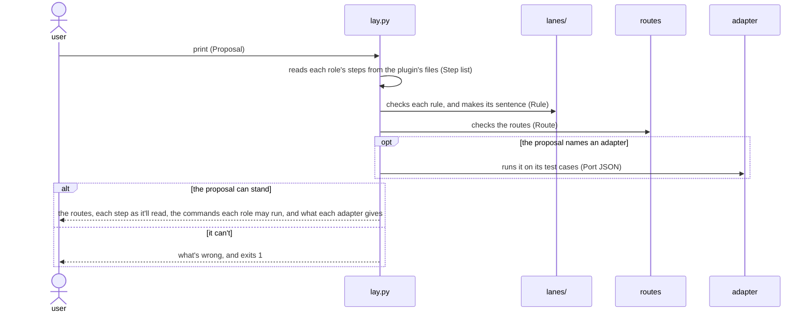
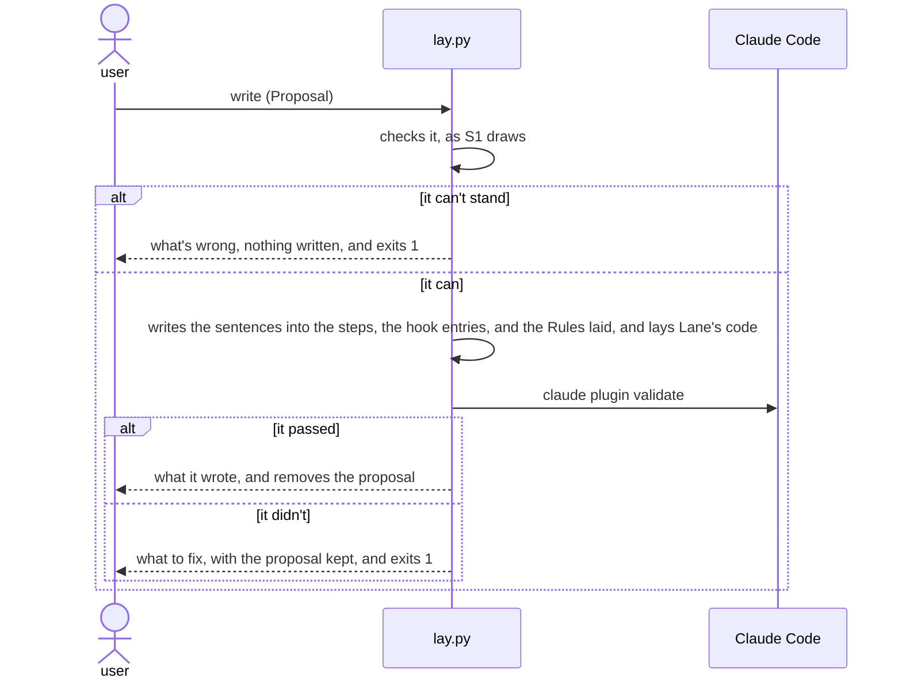
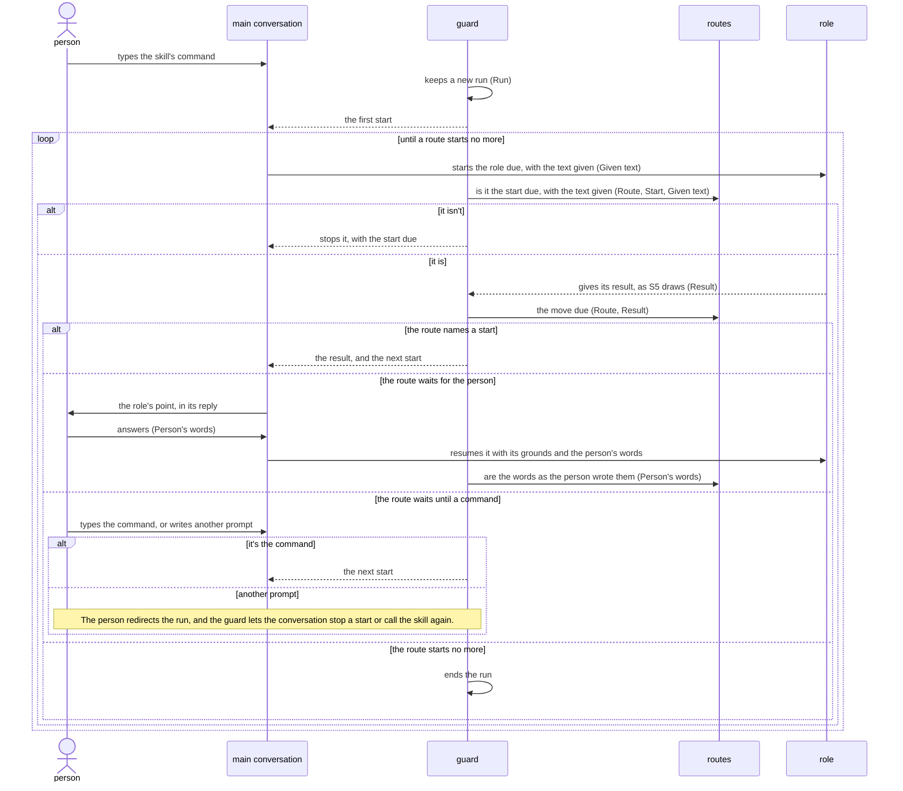
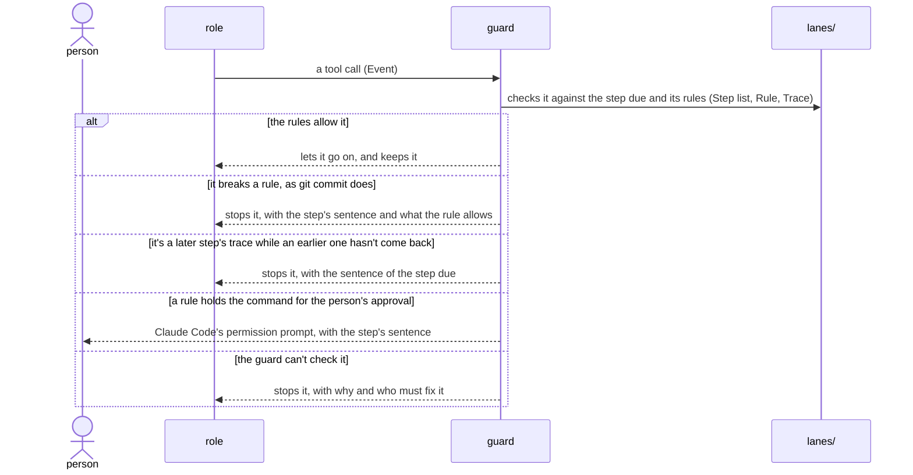
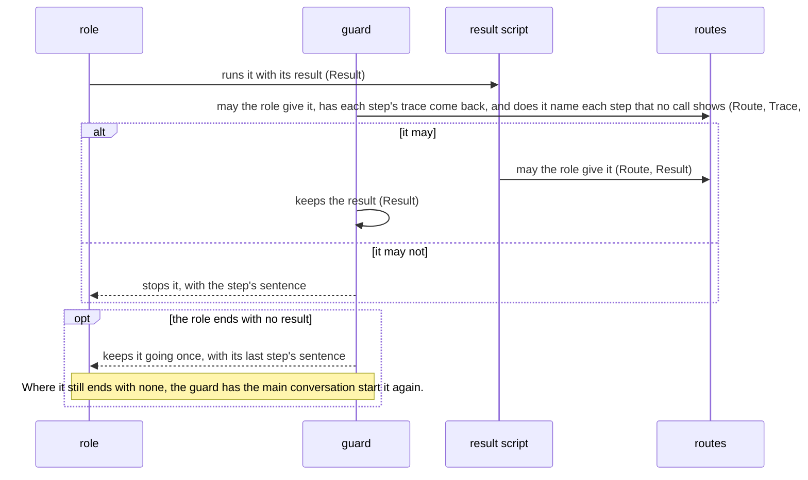
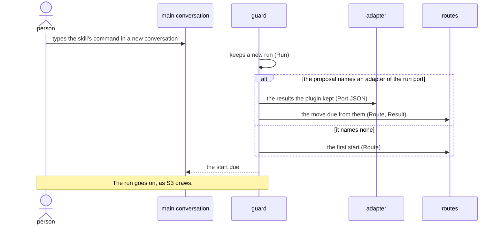
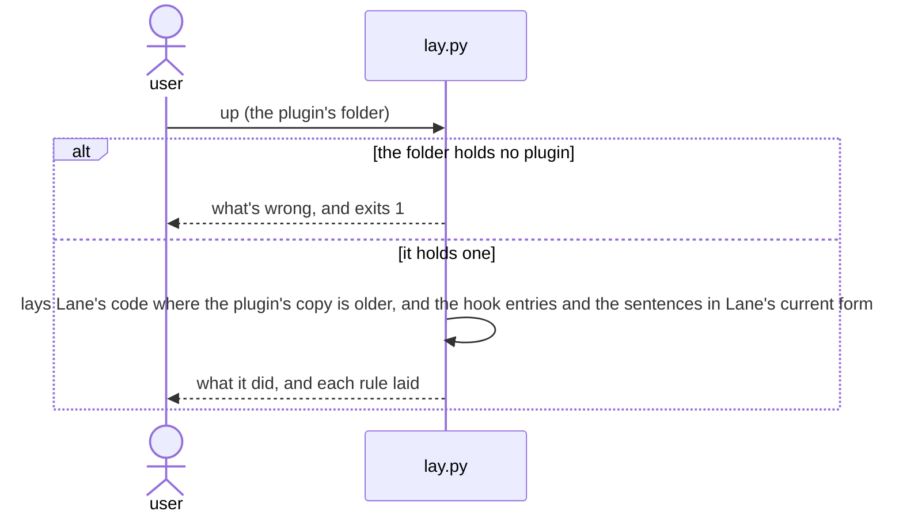

# Lane architecture

This document says how the parts of Lane give what [its README](../../plugins/lane/README.md)
promises. The user approves their rules and routes, and `lay.py` lays from them the steps' sentences
and the guard into the user's plugin. On a run, the guard holds each subagent to its steps by the
calls that show them, and the main conversation to the routes by the results that the result script
gives. Each stop gives the step's own sentence again.

## User stories

- S1: the user wants to run `lay.py print` on their proposal, so that they see their steps as
  they'll read before Lane lays anything. It carries the walkthrough's proposal and `lay.py print`.
- S2: the user wants to run `lay.py write` on the proposal they approved, so that the checks lie in
  their plugin. It carries the walkthrough's `lay.py write`.
- S3: the user wants a run of their plugin to go in the order of their routes, so that no code of
  theirs keeps the order. It carries `/changelog:write`, each start that Lane names, the run's end, a
  start with only the text the plugin gives, a role resumed with the main conversation's grounds
  and the words of the person who uses the plugin, and a route that waits for that person's command.
- S4: the user wants each subagent held to its steps, so that none breaks a step and goes on. It
  carries `writer` stopped at `git commit` and shown the sentence of its step 2.
- S5: the user wants a result to count only from a run of the result script, so that no reply
  passes for one. It carries `written`, `more`, and `good`.
- S6: the user wants a run that stopped to go on from the results their plugin kept, so that its
  subagents don't start over. It carries How it works' run that stops.
- S7: the user wants to run `lay.py up` after an update of Lane, so that the checks in their plugin
  reach the new version. It carries How it works' `lay.py up`.

## Components


What each decides alone:

- user\
  The rules, the routes, each adapter, and whether to approve the steps as they'll read.
- lay.py\
  Whether a proposal can stand, and what goes where in the user's plugin.
- lanes/\
  Each type of rule's sentence and its check.
- routes\
  Which move is due after each result, which result a role may give, and whether a start's text
  and a resume's message are as the plugin and the person gave them.
- guard\
  Which call of a role or of the main conversation goes on, and what each stop says.
- result script\
  Whether a role may give the result it runs the script with.
- adapter\
  How the plugin's own text, such as its steps or the results it kept, reads in Lane's form.

The choices made, and why:

- The checks as entries of the plugin's `hooks/hooks.json` over hooks in a role's own file\
  Claude Code ignores hooks in a plugin agent's own file, so only these entries hold every role, which keeps KR1.1 low. The cost: the guard starts on every tool call of the plugin.
- Lane's code put into the plugin over running it from where Lane lies installed\
  A plugin that needed Lane installed would run unchecked wherever Lane is missing, which raises KR1.1.
  The cost: a fix in Lane reaches a plugin only once the user runs `lay.py up`.
- A command matched whole over a command taken apart\
  A reading of the shell's grammar misses forms that no one foresaw, and lets a role break its step,
  which raises KR1.1. The cost: a role with a run_only rule runs only the commands its rules name.
- Each role that Lane holds running in the background over one in the foreground\
  Its start comes back at once with the role's ID, the one mark of each start. The guard checks each start against the order by that ID, which keeps KR1.1 low. The cost: the role's file sets `background: true`.
- A route that waits until the person types a command over any prompt moving the run on\
  Lane takes a point that's the person's, such as an approval, only from their own act, which keeps KR1.1 low.
  The cost: one more key in the routes.

## Data model


- Rule\
  One rule on a step, which Lane's files call a lane.
- Trace\
  A rule that names the call that shows its step done.
- Run\
  One run of the skill that the routes name, from its call to the route that starts no more.
- Start\
  One start of a role in a run, with each time the main conversation resumes it.
- Event\
  One call of a role or of the main conversation, as Claude Code's hook input gives it.
- Given text\
  The text that the plugin's command gave for one start, which the start must carry.
- Port JSON\
  The plugin's own text in Lane's form, as an adapter gives it.

## Principles

Lane builds on [the plugin best
practice](../../plugins/rn/domain/best-practices/plugin/best-practice.md), and adds these rules,
which every part keeps.

### The check shows the step again

When the guard stops a call, it gives the role or the main conversation the sentence of the step
that the call breaks.

*Why*: a role that meets only a refusal makes the call another way, and breaks its step, which raises
KR1.1.

### A step held by the calls that show it

The guard holds each step that a call shows only by the calls that Claude Code's hook input
documents. It holds each by its trace, in its order. A role's result names each step that no call shows, and
the guard stops a result that leaves one out, with that step's sentence. What an item made stays
with the plugin's own check.

*Why*: a role that says it kept a step may not have kept it, so a call shows each step that one can.
Where none can, the role's own list still finds a step it forgot, and a forgotten step raises
KR1.1.

### A result only from the result script

The guard and the routes take a role's result only from a run of the result script.

*Why*: a reply such as "No more entries" would pass for `more`, which raises KR1.1.

### The main conversation passes on only what it's given

The main conversation alone starts each role, with only the text the plugin gives, and resumes it
with only its own grounds and the person's words as they wrote them.

*Why*: a text reworded on the way has the role work from words that the plugin and the person never
gave, which raises KR1.1.

### One type makes the sentence and the check

`lay.py` and the guard both take a rule's sentence and its check from `lanes/`, and from no other
place.

*Why*: a role told two wordings of one rule may keep the other, which raises KR1.1.

### What the user approved is what runs

The guard takes its rules and routes only from what `lay.py write` wrote from a proposal that
`lay.py print` showed.

*Why*: a rule that no one approved could stop a move that the user's steps allow, which raises KR1.1.

### A run picked up from the plugin's record

At each call of the skill, where the proposal names an adapter of the run port, the guard picks the
run up from the results that the adapter gives.

*Why*: a run that stopped would start its subagents over, which adds to KR1.2.

### The guard holds only the run

The guard holds the main conversation from the call of the skill until a route starts no more, and
lets the person redirect the run by a prompt.

*Why*: the same conversation holds the person's own work. A hold beyond the run would stop that work, which raises KR1.1.

### The plugin needs nothing from Lane

The guard, the result script, and the rules lie in the user's plugin, and no line of Lane's code
names a plugin.

*Why*: whoever runs the plugin didn't choose Lane, so a plugin that needed Lane would run unchecked where Lane is missing, which raises KR1.1. Every plugin builder uses the same Lane, so code that named one plugin would fail the others.

### A call that the guard can't check stops

When the guard can't check a call, it stops it, and says why and who must fix it.

*Why*: a call let through unchecked could break the step that the rule holds, which raises KR1.1.

## Sequences

### S1: `lay.py print`



### S2: `lay.py write`



### S3: a run in the order of the routes



### S4: a role held to its steps



### S5: a result given



### S6: a run picked up



### S7: `lay.py up`



## Deployment


The user installs Lane as [the README](../../plugins/lane/README.md#installation) says and runs
`lay.py` on their own computer, and Claude Code starts the guard through the plugin's hook entries
on the computer of whoever runs the plugin.

- Lane's code on Python 3.9 and its standard library only over a later Python or packages\
  Whoever runs the plugin then installs nothing for Lane, which keeps KR1.2 short. The cost: where Python is
  missing, each call that a rule holds stops.
- The run's record in the system's temporary folder over a folder in the repository\
  The record means nothing once the session ends, and the plugin keeps what a later run needs, as S6 draws. A folder in the repository would leave the user files to clean up, which adds to KR1.2. The cost: where the system clears that folder during a run, the guard
  can't check a call that needs the record.

## Directory structure

`plugins/lane/` holds what the user installs, and `dev/lane/` what only Lane's developers use.
`.lane/` holds the user's proposal in their repository, and `lay.py` lays the rest into the user's
plugin.

```text
plugins/lane/
├── scripts/lay.py                  lay.py
├── hooks/lane/                     Lane's code, laid into each plugin
│   ├── hook.py                     the guard, which each hook entry runs
│   ├── result.py                   the result script
│   └── domain/                     lanes/, the routes, and the guard's other modules
└── README.md, docs/                for Lane's users

dev/lane/
├── product-vision.md, architecture.md, images/
└── tests/                          the unit, architecture, and product vision tests

.lane/<yyyymmdd>-<plugin>/          the Proposal, and each adapter with its test cases
<the plugin>/agents/                each role's Step list, with the sentences that lay.py writes
<the plugin>/hooks/hooks.json       each hook entry
<the plugin>/hooks/lanes.json       the Rules laid and the routes
<the plugin>/hooks/adapters/        each adapter
<the plugin>/hooks/lane/            Lane's code
<temporary folder>/lane/            the run's record
```

## Tests

Lane tests by the test rules of [the architecture best
practice](../../plugins/rn/domain/best-practices/architecture/best-practice.md) and [the plugin best
practice](../../plugins/rn/domain/best-practices/plugin/best-practice.md), and differs from them
where this section says.


- An adapter of the tests' own at each port over a real plugin's adapter\
  Lane knows no plugin, so its tests try each port's form. A form left untried could fail in a user's plugin, which raises KR1.1. The cost: a fault in a
  plugin's adapter shows only in that plugin's own tests.
- The double of Claude Code sending events as a run of Claude Code 2.1.319 recorded them, over what
  the hooks reference alone says\
  Where the reference says nothing, a double would send what no Claude Code sends, and pass a test
  that the real one fails, which raises KR1.1. The cost: another try of the real Claude Code for each
  new version.
