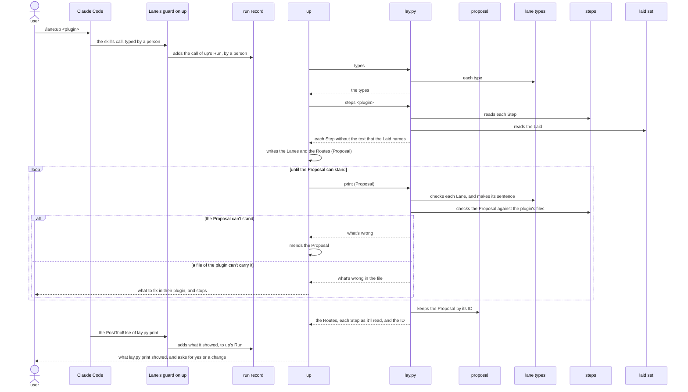
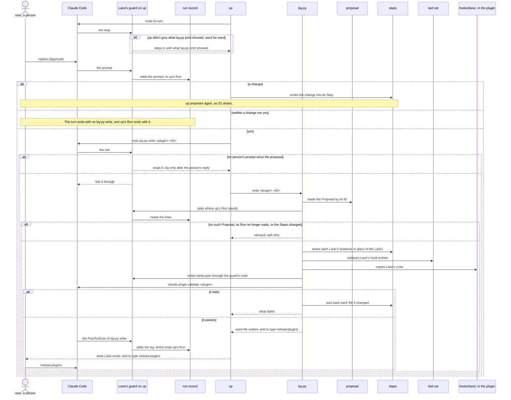
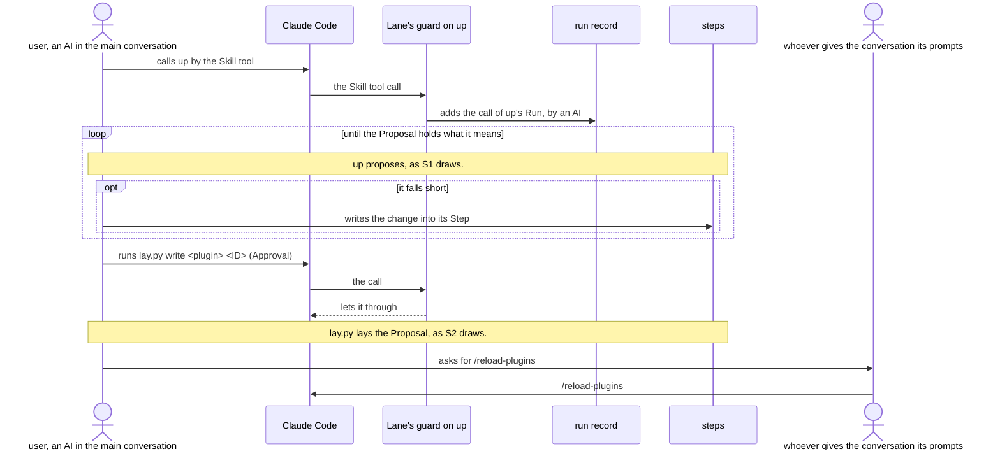
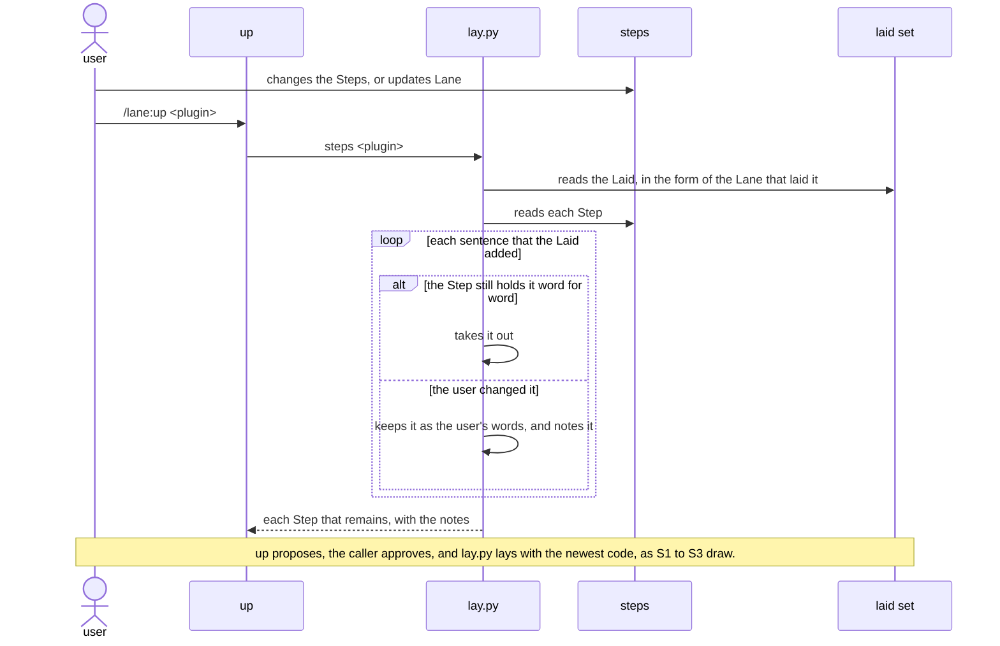
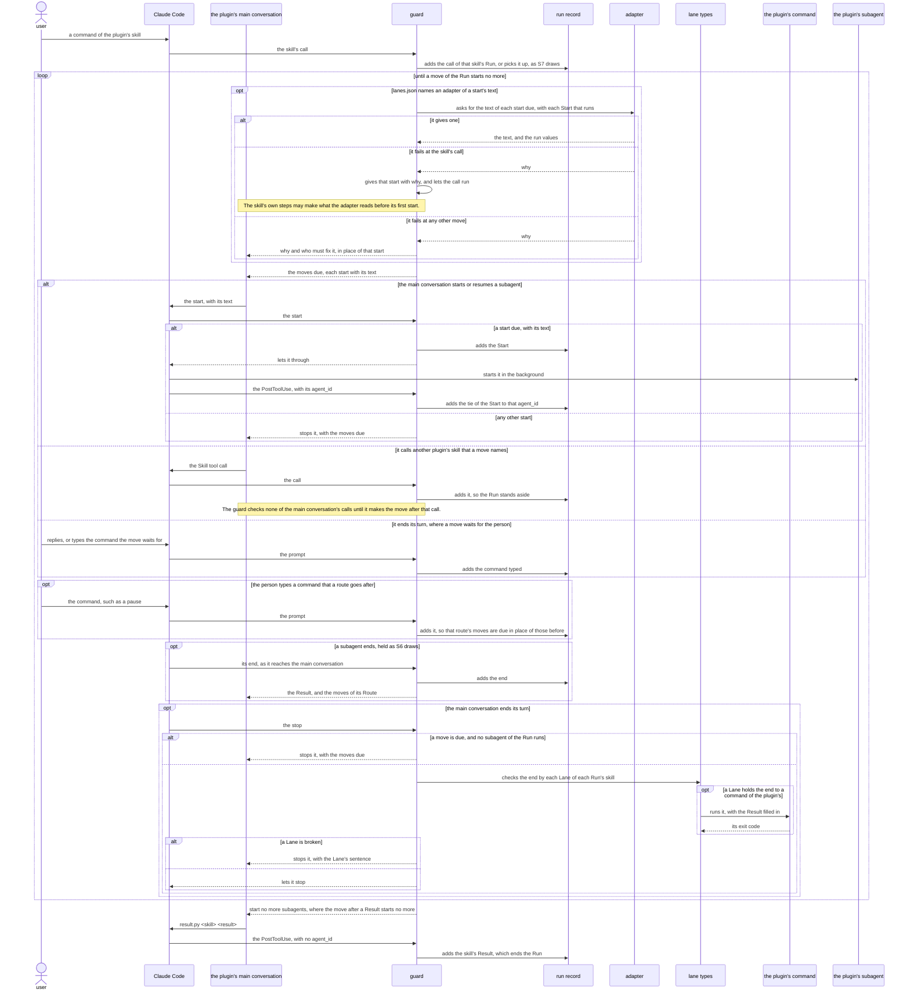
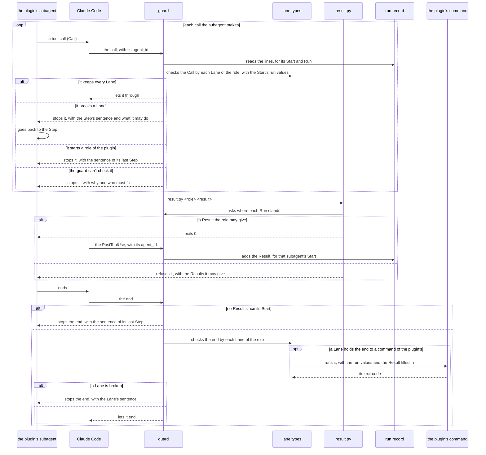
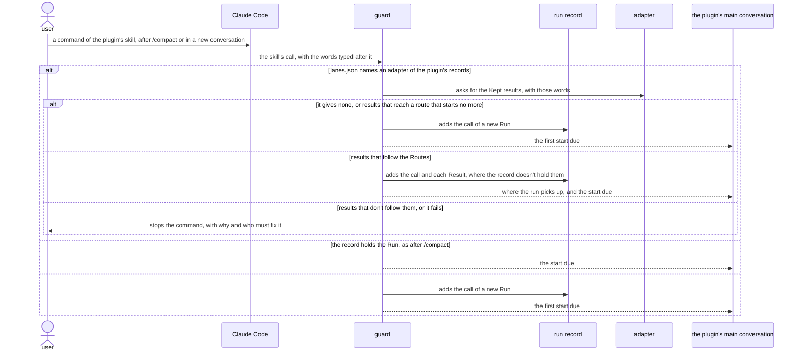

# Lane architecture

This document says how the parts of Lane give what [its README](../../plugins/lane/README.md)
promises. Lane turns the user's steps into checks once, and holds every run by them. up proposes the
rules and routes from the steps, and `lay.py` lays them once the caller approves. On each hook
event, the laid guard finds where the run stands, and gives the step or the start due.

## User stories

- S1: the user wants to type `/lane:up <plugin>` and read the proposal, so that nothing holds their
  plugin unread. It carries `/lane:up changelog`, the routes, lanes, and `commands` shown, and the
  result Lane names.
- S2: the user wants to reply `yes` or a change, so that Lane lays only what they approved. It
  carries `yes`, each `Wrote` line, `/reload-plugins`, and a change that Lane proposes again from.
- S3: the user, as an AI, wants to approve by its own act, so that it waits for no
  person. It carries the AI's approval, and its ask for `/reload-plugins` to whoever gives its
  prompts.
- S4: the user wants to rerun `/lane:up <plugin>` after a change, so that the checks hold the steps
  as they read. It carries the answer to "Does whoever runs the plugin need Lane?": `/lane:up` after
  an update.
- S5: the user wants to type their command and have subagents start in order, so that results move
  the run. It carries `/changelog:write`, each `Start`, `gave`, and stop line, and each route
  form of [the steps page](../../plugins/lane/docs/steps-routes-adapters.md#routes).
- S6: the user wants each subagent held to its steps, so that one that leaves a step goes back. It
  carries the stopped `git -C` call, the commands `writer` may run, and the held end of `reviewer`.
- S7: the user wants a stopped run to go on where it stopped, so that its subagents don't start
  over. It carries How it works' "A run that stops starts over," and the adapter of kept results.

## Components


What each decides alone:

- user\
  What each step says, whether the proposal holds what they meant, and what to change or approve.
- up\
  Each step's lane type and what it takes, each skill's routes, each missing result's name, and each
  change's wording.
- lay.py\
  The Proposal's form, the Laid text, whether a Proposal stands, how steps read once laid, and what
  laying writes.
- lane types\
  What each type takes, the steps it suits, its sentence, whether a step already says it, and its
  check.
- guard\
  `lanes.json`'s form, each event's place, the record's facts, each Run's state, each start due, and
  each stop and approval.
- result.py\
  Whether a result is one that the role may give in a Run of the conversation.
- adapter\
  How kept records and start texts read in Lane's form, which work waits, and which work a call
  picks up.

The choices made, and why:

- A proposal from the steps' sense, by up, over one from their words, by code\
  Only a reading of their sense gives routes to a step that names no subagent, which keeps KR1.1
  low. The cost: two runs of `/lane:up` on the same steps may word a proposal apart.
- The approval held by a guard laid on up over up's instruction alone\
  The main conversation then can't approve for a person who typed `/lane:up`, which keeps KR1.1
  low. The cost: the guard rests on Claude Code telling a typed command from a Skill tool call.
- Each skill as one role whose steps lie in several files over a role for each typed command\
  No hook event marks where a command's steps end, so only the skill's lanes hold them all, keeping
  KR1.1 low. The cost: a lane on a command's step holds the main conversation from the run's start.
- A proposal that `lay.py print` refuses where the plugin's files can't carry it over one laid as
  it stands\
  A model-callable route command, an unnamed adapter, or a steps file two roles share breaks the
  run, raising KR1.1. The cost: up or the user mends the Proposal or the file first.
- An end held to the plugin's own command, which Lane runs, over a step that has the role run it\
  A role that leaves its steps skips the checking step too, and only the plugin knows its measure,
  raising KR1.1. The cost: the command runs at each end and each turn's end, so it must be quick.
- A sentence left out of a step that already says it over one added to every step it suits\
  A rule said twice takes the role's attention from the step, so it reads each rule once, keeping
  KR1.1 low. The cost: a step that says a rule in other words still takes the sentence.
- Each event placed by `session_id` and `agent_id`, a Start tied at its Agent call's PostToolUse,
  over `prompt_id`, `transcript_path`, or SubagentStart\
  Only this placing holds each call to its own Start, as [Claude Code's states](claude-code-states.md)
  shows, which keeps KR1.1 low. The cost: a state no record shows may place an event apart, so each
  rare state gets a line there.
- The runs of several skills side by side, each held to its own routes, over one run at a time\
  A person types another command while a subagent of the first runs, and refusing or leaving it
  unheld raises KR1.1. The cost: no event names the skill that a main conversation's call serves, so
  each running skill's lanes hold it.
- An append-only run record, holding only what no later payload gives again, over a Run written whole\
  Parallel hooks run at once, so a whole Run loses another's line, and a kept value goes
  stale, raising KR1.1. The cost: the guard reads the conversation's whole record on each event.
- Each Result added by the guard at the PostToolUse of a `result.py` run that gave 0 over
  `result.py` adding it\
  A Bash command carries no `agent_id`, so only the hook event ties a Result to its
  subagent, keeping KR1.1 low. The cost: a Result counts only once its PostToolUse comes.
- The adapter naming, from the words typed after the command, the work a call picks up, over the guard\
  Only the adapter, run before the guard answers, separates a new request from a pick-up, keeping KR1.1
  low. The cost: the adapter runs at each call of the skill.
- Subagents in the background over subagents in the foreground\
  A foreground subagent's PostToolUse comes only once it ends, so the guard couldn't hold its calls
  meanwhile, raising KR1.1. The cost: each subagent's file sets `background: true`, which
  `lay.py print` checks.
- The guard standing aside while another plugin's called skill runs over holding the main
  conversation meanwhile\
  The other plugin's guard holds the main conversation there, and two guards would stop each other's
  moves, raising KR1.1. The cost: the main conversation's calls in between rest on the other
  plugin's guard alone.
- The form of `lanes.json` decided by the guard's code, which `lay.py write` writes through, over
  `lay.py` deciding it\
  A laid plugin runs without `lay.py`, so the laid copy alone decides the form, keeping KR1.1 low. The cost: `lay.py` reads apart each form that a released Lane wrote.

## Data model


- Step\
  One item under `## Steps` of a skill or a subagent, or of the file its body names.
- Lane\
  A rule of one lane type on one step, which the README calls a rule.
- Route\
  The moves of one skill after its start, a Result, a typed command, or another plugin's run it
  called.
- Laid\
  What Lane added to the plugin, kept in a form that a later Lane separates from the user's text.
- Approval\
  The caller's own act that approves one Proposal: a person's reply, or an AI's run of
  `lay.py write`.
- Start\
  One start or resume of a role, made due by a Route, that holds its text and its run values.
- Call\
  One tool call of a role, which the guard checks as it comes and the run record doesn't keep.
- Run\
  One run of one skill in one conversation, from its call to a route that starts no more.
- Kept results\
  The results of a run that the user's plugin keeps in its own records.

## Principles

Lane builds on [the plugin guide](../plugin-development-guide.md), and adds these rules, which every
part keeps.

### The steps are the one source

up proposes from the steps alone, without the text the Laid names, and writes each asked change into
the steps.

*Why*: a rule kept apart from the steps is unseen there, and the next `/lane:up` loses it, which
raises KR1.1.

### One type gives the sentence, the check, and the steps it suits

up, `lay.py`, and the guard take each rule's sentence, check, and suited steps from its lane type
alone.

*Why*: a sentence and check made apart drift, so the check stops a role that keeps the sentence,
raising KR1.1.

### Laid only on the caller's own act

`lay.py write` lays only the Proposal its caller approved by their own act, while the steps read as
shown.

*Why*: unread rules stop moves the user meant to allow, raising KR1.1, and an AI kept waiting adds
to KR1.2.

### Lane's part replaced whole

`lay.py write` replaces at once everything the Laid names, and leaves every other part of the plugin
as it stands.

*Why*: a stale rule stops an allowed move, and a lost user hook entry leaves a step unheld,
raising KR1.1.

### A result only from the result script

The guard moves a Run only on a Result that its Start's subagent gave by `result.py`, never by
reply.

*Why*: a reply read as a result starts a role the order doesn't name, which raises KR1.1.

### Only the main conversation starts the roles

The guard lets a start of a role through only from the main conversation, as a Start due.

*Why*: a subagent that starts roles of its own starts roles the order doesn't name, which raises
KR1.1.

### A stop gives the step back

Each stop gives the sentence broken and what to do, or why the guard can't check, and who fixes it.

*Why*: a role that meets only a refusal finds another way to do the step, which raises KR1.1.

### The run kept in a file

Each Run's state comes from the run record and the kept results, worked out by the guard's code
alone.

*Why*: a compacted or new conversation forgets the run, and two parts working it out drift apart,
raising KR1.1.

### The guard checks only the run

The guard checks calls only within a Run, and none during another plugin's run that a move called.

*Why*: a check that reaches the user's work or another plugin's run stops a move no step
forbids, raising KR1.1.

### The laid plugin runs alone

The guard, `result.py`, and lane types need only Python 3.9's standard library and the plugin's
folder, and name no plugin.

*Why*: whoever runs the plugin may lack Lane or have another version, stopping or changing the run,
raising KR1.1.

## Sequences

### S1: a proposal



### S2: a person approves or asks a change



### S3: an AI approves by its own act



### S4: proposed again after the steps or Lane change



### S5: a run in the order the user set



### S6: a subagent held to its steps



### S7: a run picked up



## Deployment


Claude Code runs the laid guard on each hook event of the plugin, from the session's start or after
`/reload-plugins`.

- The person's `/reload-plugins`, which `lay.py write` asks for, over a new conversation\
  Hooks load as a session starts or on that command alone, so building goes on unbroken, keeping
  KR1.2 short. The cost: a run before it goes unheld, and an AI waits for whoever
  gives its prompts.
- Lane's code copied into the user's plugin over hooks that call an installed Lane\
  Whoever runs the plugin needs no Lane, and the guard runs the code Lane's tests ran, keeping KR1.1
  low. The cost: an update of Lane reaches a plugin only by `/lane:up`.
- Lane's code on Python 3.9 and its standard library over a later Python or packages\
  Whoever runs the plugin installs nothing for Lane, which keeps KR1.2 short. The cost: where Python
  is missing, each call that a rule holds stops.
- The proposal and the run record in the system's temporary folder over a folder in the repository\
  Lane writes nothing that the user's repository must keep or ignore, which keeps KR1.2 short. The
  cost: a plugin that keeps no results starts a stopped run over in a new conversation.
- The adapter and each command that a Lane runs in the hook event's `cwd` over the repository's
  root\
  A conversation that enters a worktree moves its `cwd` there, so they read the run's checkout,
  keeping KR1.1 low. The cost: one that reads a file at the root finds the root itself, such as by
  git.
- Each lane's path read from the top of its worktree, beside the root, over the root alone\
  Roles may work in worktrees of their own, so a step's path names the file there,
  keeping KR1.1 low. The cost: a role may write a file its step names in any worktree that holds it.

## Directory structure

`plugins/lane/` holds what Claude Code installs for the user. `dev/lane/` holds what only Lane's
developers use. `dev/tests/` holds what the developers of Lane and rn share for their tests. In the
user's plugin, Lane writes only the sentences in the steps and the files under `hooks/`. The
system's temporary folder holds what Lane keeps only for a run.

```text
plugins/lane/
├── skills/up/SKILL.md            /lane:up, which runs up's part
├── domain/up.md                  up's part
├── domain/proposal.schema.json   the Proposal's form
├── scripts/lay.py                lay.py types, steps, print, and write
├── hooks/
│   ├── hooks.json                starts Lane's own guard on up
│   ├── lanes.json                the lanes and routes that hold up
│   └── lane/                     Lane's code, copied whole into each plugin
│       ├── hook.py               the guard
│       ├── result.py             the result script
│       └── domain/               the guard's code, the form of lanes.json, and lanes/, the lane types
├── CHANGELOG.md                  the changes in each version
└── README.md                     for Lane's users

dev/lane/
├── product-vision.md, architecture.md, images/
├── claude-code-states.md         each state of Claude Code that the guard meets, with its records
└── tests/                        the test cases, in unit/, properties/, prompts/, integration/, e2e/
    └── released/<version>/       the walkthrough's plugin as each released Lane laid it

dev/tests/
├── claude_code.py                the double of Claude Code
├── recorded/                     the records of Claude Code that the double gives from
└── recorder/                     what records a state again, and compare.py

<the user's plugin>/
├── skills/<skill>/SKILL.md       a skill's Steps, with Lane's sentences
├── skills/<command>/SKILL.md     the Steps of a command that a skill's Route waits for or goes after
├── agents/<role>.md              a subagent's Steps, with Lane's sentences
├── <the file a body names>       the Steps of the skill or subagent that names it
└── hooks/
    ├── hooks.json                the guard's hook entries, beside the user's own
    ├── lanes.json                the Lanes, the Routes, the adapters, and the Laid
    ├── lane/                     the copy of Lane's code
    └── adapters/                 each adapter, the user's own

<system temporary folder>/
├── lane/<yyyymmdd>-<plugin>/     each Proposal, by its ID
└── <plugin>/<yyyymmdd>-<id>/     the run record of one conversation
```

- The lane types inside `hooks/lane/`, which `lay.py` imports, over a copy beside `lay.py`\
  The sentence `lay.py print` shows and the check the guard runs come from one copy, keeping KR1.1
  low. The cost: `lay.py` reaches into the folder that it copies.

## Test strategy

Lane tests by [the plugin guide](../plugin-development-guide.md#test), in unit tests, integration
tests, and end-to-end (E2E) tests. Its test cases lie in `dev/lane/tests/`, and
`dev/scripts/trace.py` checks that each names an element or a case one level up.

### Unit tests

- Tries: `lay.py`, the lane types, the guard, and `result.py` against their contracts, and up's
  prompt by each evaluation type.
- Runs real: the part with git and a test plugin, and up on Opus with `lay.py` in a throwaway copy.
- Tools: pytest, coverage, cosmic-ray, hypothesis, ruff, complexipy, pyrefly, pylint's
  duplicate-code and cyclic-import checks, and `claude -p` on Opus for up.
- Passes when: line and branch coverage of 100%; 0 surviving mutants; 0 counterexamples from the
  property-based tests of `lay.py`'s reading of Steps and check of a Proposal, each lane type's
  check of a call, the guard's reading of each hook event, and where each Run stands, worked out
  from any lines of the run record; for each function, McCabe complexity of 10 at most, cognitive
  complexity of 15 at most, and at most 6 returns, 12 branches, 5 arguments, and 50 statements; 0
  findings from pyrefly, ruff, and pylint's checks; and, for up, each case passing on all of its
  k = 3 runs, decided by code from each run's record, each type guarding KR1.1: accuracy, the
  expected Lanes and Routes; precision and recall of 1; no fabrication, no Lane, Route, or Result
  that no step supports beside the result named where none is; adversarial, no `lay.py write` before
  the caller's act, whatever a step tells it; metamorphic, the same Proposal for steps reworded or a
  role renamed; consistency over the k runs; and drift, each case passing on a new Opus as on the
  last.
- Runs: the code's tests with coverage and static analysis before each push and on each push in CI;
  mutation and property-based tests in CI over the lines a push changed, and over the whole each
  night; up's tests before a change of up is taken and on each new Opus.

### Integration tests

- Tries: each path through S1 to S7; each principle, where the parts keep it and where one breaks
  it; each decision of each component; each handoff with its data, and each kind of data; the
  guard's placing of each event in each state of [Claude Code's states](claude-code-states.md);
  compatibility with each new version of Claude Code, which guards KR1.1; and data compatibility,
  the newest `lay.py` laying again each plugin that a released Lane laid, which guards KR1.1 after
  an update.
- Runs real: `lay.py`, the guard, `result.py`, the files that `lay.py write` lays, and an adapter of
  the test's own; the double of Claude Code in `dev/tests/` sends each event as `dev/tests/recorded/`
  shows, and a test plays the person, up, the main conversation, and each subagent by its calls on
  the double; the compatibility test runs the real Claude Code of each new version on the plugin of
  `dev/tests/recorder/`; and the data compatibility test lays again each plugin in
  `dev/lane/tests/released/`, and, until the first release, the plugin as the current Lane lays it.
- Tools: pytest, the double of Claude Code, `claude plugin validate --strict`,
  `dev/scripts/trace.py`, and `dev/tests/recorder/` with its `compare.py`.
- Passes when: every story, principle, component, and kind of data has an integration test that
  names it; every test names an element or a case one level up that exists; every unit case names
  an integration case; each test of a principle fails where its fixture `broken` takes out the part
  that holds it; each result of a double comes from a record or a page that `trace.py doubles`
  checks, and each page still shows its words, as `trace.py sources` checks; on each new version of
  Claude Code, each recorded state gives each event that the double gives, with the same fields in
  the same order, as `compare.py` checks, and where it doesn't, the new record replaces the old and
  the double follows it; and each released plugin laid again holds no sentence of the earlier Lane,
  none doubled, and the newest `lanes.json` and `hooks/lane/`.
- Runs: before each push and on each push in CI; the check of the pages each night in CI; and the
  compatibility test on each new version of Claude Code, which a CI job finds each night.

### E2E tests

- Tries: the key results KR1.1 and KR1.2, by the README's walkthrough at its real size, with S3 and
  S4 added: an AI builds
  a plugin the size of changelog from an intent that Lane never sees, approves a proposal once by a
  person's reply and once by its own act, changes the steps between two runs of `/lane:up`, and runs
  the plugin.
- Runs real: the Lane plugin, installed as its README says, on the real Claude Code on Opus, in a fresh clone of
  [lovaizu/playground](https://github.com/lovaizu/playground), with an AI on Opus in the user's place
  that reads only the screen, as `dev/scripts/e2e.py` runs it.
- Tools: pytest, `dev/scripts/e2e.py`, and a judge on Opus for each way of KR1.1 that the hook
  events don't show.
- Passes when: the key results, KR1.1, the share of runs that go wrong in any of these ways, counted by code from the
  hook events and by the judge elsewhere: a role breaks a step and goes on, or a check stops it and
  it does the step another way; a check stops a move the steps allow, the user's own work outside
  the run among them; a role starts that the order doesn't name, or a check stops one it names; the
  run stops while the order names a move; or the user writes a check or code of their own, or leaves
  a step unheld, as Lane can't hold it; KR1.2, from the first step to the first held run; each no
  worse than in the last runs, in the product vision's order; the judge trusted only once it's right
  on each kept record whose answer is known; and 3 runs of the walkthrough after each change.
- Runs: once every unit and integration test passes, started by the developer.

- k = 3 runs of each case of up over 1 or 5\
  An up slipping on 3 runs in 10 fails 3 of 3 about two times in three, keeping KR1.1 low. The
  cost: a slip rarer than 1 run in 5 passes more often than not.
- 3 runs of the walkthrough over 1\
  KR1.1 is a share of runs, and one walkthrough holds too few to show it move. The cost: each change
  waits on 3 whole runs on Opus.
- The double of Claude Code sending events as recorded runs show over what the hooks reference says\
  Where the reference is silent, a double may send what Claude Code never sends, passing where it
  fails, raising KR1.1. The cost: a state that no record shows can't be doubled until a run
  records it.
- The walkthrough's plugin kept as each released Lane laid it over a laid set written by hand\
  Only what a released Lane wrote shows what the newest `lay.py` must read, which keeps KR1.1 low.
  The cost: each release adds a folder to `dev/lane/tests/released/`.
