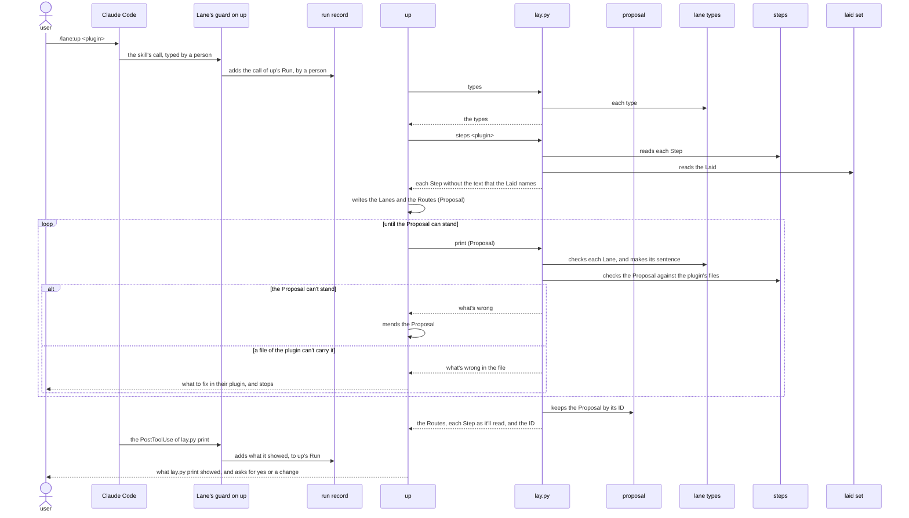
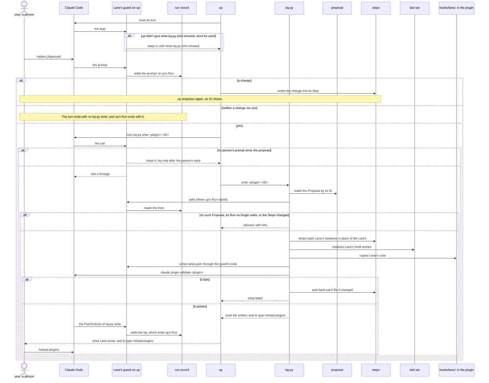
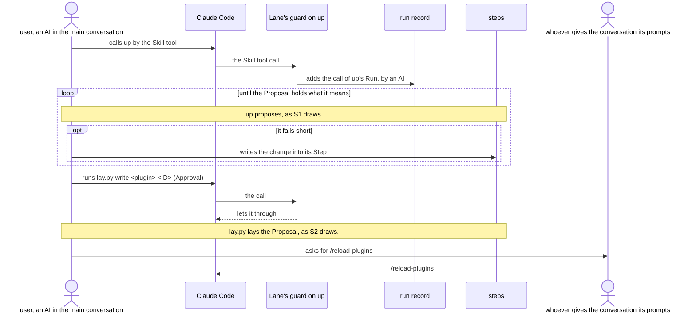
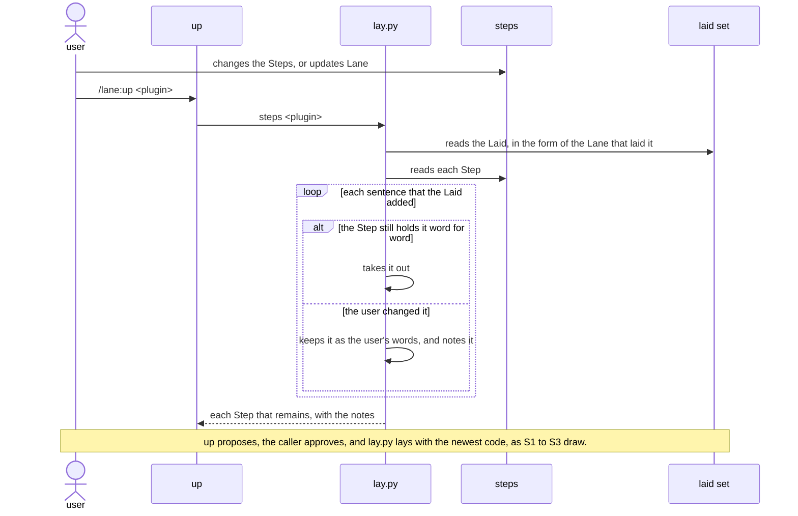
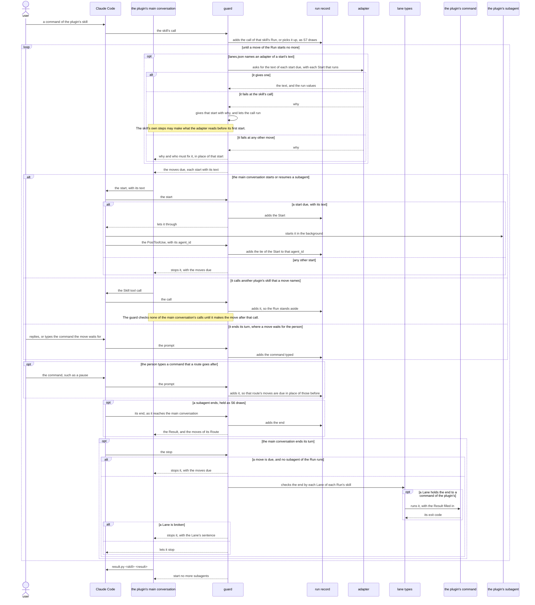
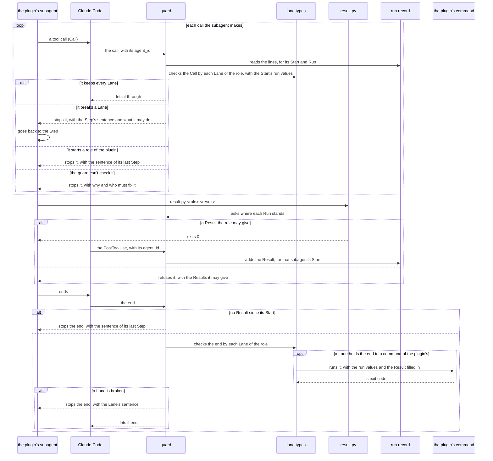
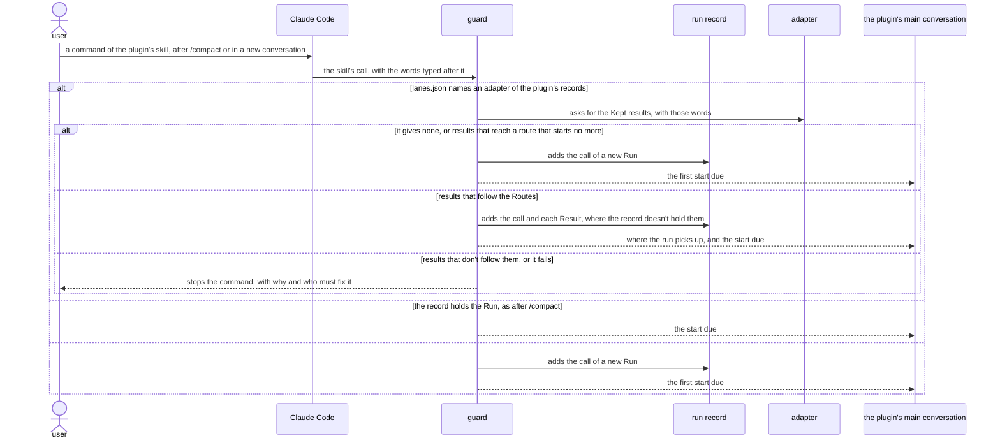

# Lane architecture

This document says how the parts of Lane give what [its README](../../plugins/lane/README.md)
promises. Lane turns the user's steps into checks once, and holds every run by them: up proposes
the rules and the routes from the steps, and `lay.py` lays them into the plugin once the caller
approves. On each hook event of a run, the laid guard works out where the run stands from what it
recorded, and gives a role that leaves a step that step's sentence, and the main conversation the
start that the routes name next.

## User stories

- S1: the user wants to type `/lane:up <plugin>` and read the proposal, so that they see each step
  as it'll read with its rules, and the order, before anything holds their plugin. It carries the
  walkthrough's `/lane:up changelog`, the routes and lanes shown, the `commands` line, and the
  result `written` that Lane names where the steps name none.
- S2: the user wants to reply `yes`, or say what to change, so that Lane lays only what they
  approved. It carries the reply `yes`, each `Wrote` line, `claude plugin validate passed`, the
  person's `/reload-plugins`, and a change that Lane proposes again from.
- S3: the user, where an AI builds the plugin, wants to approve the proposal by its own act, so
  that it lays the rules without waiting for a person, and reaches the first held run once whoever
  gives the conversation its prompts types `/reload-plugins`. It carries the AI's approval and its
  ask for `/reload-plugins`.
- S4: the user wants to run `/lane:up <plugin>` again after they change the steps or update Lane,
  so that the checks hold the steps as they now read, with Lane's newest code. It carries the
  second `/lane:up changelog` and How it works' `After an update of Lane`.
- S5: the user wants to type their plugin's command and have each subagent start in the order they
  set, so that the run goes from result to result with no code of theirs. It carries
  `/changelog:write`, each `Start` and `gave` line, starts side by side, a route that waits for or
  goes after a command the person types, the moves a route lists for the skill to choose among, the
  runs of several skills of the plugin in one conversation, a move that calls another plugin's
  skill, and `Start no more subagents`.
- S6: the user wants each subagent held to its steps on every call, so that a subagent that leaves
  a step goes back to it. It carries the stopped `git -C <repo> log --oneline`, the step's sentence
  with the commands `writer` may run, and the held end of `reviewer`.
- S7: the user wants a run that stopped to go on where it stopped, after `/compact` or in a new
  conversation, so that its subagents don't start over. It carries How it works' `A run that stops
  starts over` and the adapter of the plugin's kept results.

## Components


What each decides alone:

- user\
  What each step says, whether the proposal holds what they meant, what to change, and whether to
  approve.
- up\
  Which lane type each step takes and what it takes, the routes of each skill, the result named
  where a subagent's steps name none, and how a change the user asks for reads in its step.
- lay.py\
  The form of the Proposal, which text of a step Lane laid before, whether a Proposal can stand
  against the lane types, the steps, and the plugin's files, how each step reads once laid, whether
  a Proposal can still be laid, and which files laying writes or replaces, as one change.
- lane types\
  For each type, such as `run_only`, what it takes, the steps it suits, the sentence the role reads,
  whether a step already says it, and the check of a call or an end against it.
- guard\
  The form of `lanes.json`, which Run, Start, and role each hook event belongs to, which facts the
  run record keeps, where each Run stands, whether each call, start, and end passes, which start
  the routes make due, what a stopped role reads, and whether an approval is the caller's own act.
- result.py\
  Whether a result is one that the role may give in a Run of the conversation.
- adapter\
  How the plugin's records and a start's text read in Lane's form, which work of a role waits, and,
  from the words typed after the command, which kept work a call picks up.

The choices made, and why:

- A proposal that up, an AI, makes from the sense of the steps over one that code makes from their
  words\
  A step such as `Have the entries written and reviewed.` names no subagent, so only a reading of
  its sense gives its routes, and code would leave such a step unheld, which raises KR1.1. The
  cost: two runs of `/lane:up` on the same steps may word a proposal apart, and the user reads each.
- The approval held by a guard that Lane lays on its own up over the instruction in up alone\
  The main conversation then can't approve for a person who typed `/lane:up`, on any run, which
  keeps KR1.1 low. The cost: the guard rests on Claude Code telling a typed command from a call of
  the Skill tool, which a recorded run shows.
- Each skill as one role whose steps lie in several files over a role for each command the person
  types\
  No hook event marks where a command's steps end and the skill's go on, so only the skill's lanes
  held on each call leave no command's step unheld, which keeps KR1.1 low. The cost: a lane on a
  command's step holds the main conversation from the run's start.
- A proposal refused by `lay.py print` where the plugin's files can't carry it over one laid as it
  stands\
  A command of a route that the model may call, a program in `hooks/adapters/` that the Proposal
  doesn't name, or a file of steps that two roles share would each leave a run that breaks the steps
  or the order, which raises KR1.1. The cost: up or the user mends the Proposal or the file first.
- An end held to a command of the plugin's own that Lane runs at the end over a step that has the
  role run it\
  A role that leaves its steps skips the step that checks its work too, and only the plugin knows
  its own measure, which raises KR1.1. The cost: the command runs at each end and each end of the
  skill's turn, so it must be quick.
- A sentence left out of a step that already says it over each sentence added to every step it
  suits\
  A rule said twice takes the role's attention from the step, so it reads each rule once, in the
  maker's words, which keeps KR1.1 low. The cost: a step that says a rule in other words still
  takes the sentence, as code can't tell that the two say one rule.
- Each hook event placed by its `session_id` and `agent_id`, each Start tied to its subagent at the
  PostToolUse of its Agent call, over its `prompt_id`, its `transcript_path`, or the SubagentStart\
  A `prompt_id` changes while a subagent runs, a `transcript_path` moves as the conversation enters
  a worktree, and a SubagentStart names no Agent call, as
  [Claude Code's states](claude-code-states.md) shows, so only this placing holds each call to its
  own Start, which keeps KR1.1 low. The cost: a state that no record shows may place an event
  apart, so each rare state gets one line there that names what Lane does.
- The runs of several skills of one plugin side by side in one conversation, each held to its own
  routes, over one run at a time\
  A person types another command while a subagent of the first runs, and a plugin whose second
  command Lane refuses or leaves unheld doesn't run as designed, which raises KR1.1. The cost: no
  event says which skill a call of the main conversation serves, so the lanes of each skill whose
  run goes on hold it, joined as one role's.
- The run record as lines that each hook adds and never rewrites, holding only what no later
  payload gives again, over a Run written whole\
  The hooks of parallel subagents run at once, so a Run written whole loses another's line, and a
  value worked out and kept goes stale, which raises KR1.1. The cost: the guard reads the
  conversation's whole record on each event.
- Each Result added by the guard at the PostToolUse of a run of `result.py` that gave 0 over
  `result.py` adding it\
  Claude Code gives a Bash command no `agent_id`, as a recorded run shows, so only the hook event
  ties a Result to the subagent that gave it, and a Result tied to no Start would move the wrong
  run, which raises KR1.1. The cost: a Result counts only once its PostToolUse comes.
- The adapter given the words typed after the command to name which kept work a call picks up over
  the guard deciding it from the run record\
  A plugin whose command takes a request must tell a new request from a run to pick up, and no part
  of the plugin runs before the guard answers the call, which raises KR1.1 otherwise. The cost:
  the adapter runs at each call of the skill.
- Subagents in the background over subagents in the foreground\
  The PostToolUse that names a foreground subagent comes only once it ends, so the guard couldn't
  hold its calls to its Start meanwhile, which raises KR1.1. The cost: each subagent's file sets
  `background: true`, which `lay.py print` checks.
- The guard standing aside from a call of another plugin's skill that a move names, until the main
  conversation makes the move after it, over holding the main conversation to its own lanes
  meanwhile\
  The other plugin's guard holds the main conversation there, and two guards at once would each
  stop the other's moves, which raises KR1.1. The cost: the main conversation's calls in between
  rest on the other plugin's guard alone.
- The form of `lanes.json` decided by the guard's code, which `lay.py write` writes through, over
  `lay.py` deciding it\
  A laid plugin runs with no `lay.py`, so the form written and the form read must come from the one
  copy laid, which keeps KR1.1 low. The cost: `lay.py` reads apart each form that a released Lane
  wrote.

## Data model


- Step\
  One item under `## Steps` of a skill or a subagent, or of the file its body names.
- Lane\
  A rule of one lane type on one step. The README calls it a rule.
- Route\
  The moves of one skill after its start, a Result, a command the person types, or another
  plugin's run that a move called.
- Laid\
  What Lane added to the plugin, in the form of the Lane that laid it, so that a later Lane takes
  it apart from the user's text.
- Approval\
  The caller's own act that approves one Proposal: a person's reply, or an AI's run of
  `lay.py write`.
- Start\
  One start or resume of a role that a Route made due. It holds the text and the run values that
  the adapter gives it.
- Call\
  One tool call of a role, which the guard checks as it comes and the run record doesn't keep.
- Run\
  One run of one skill in one conversation, from its call to the route that starts no more, which
  the guard works out from the run record on each event.
- Kept results\
  The results of a run that the user's plugin keeps in its own records.

## Principles

Lane builds on [the plugin guide](../plugin-development-guide.md), and adds these rules, which every
part keeps.

### The steps are the one source

up proposes from the steps alone, as `lay.py steps` gives them without the text that the Laid
names, and writes each change the user asks for into the steps.

*Why*: a rule kept apart from the steps is one the user can't see in them, and the next `/lane:up`
loses it or holds a role to what its steps no longer say, which raises KR1.1.

### One type gives the sentence, the check, and the steps it suits

up, `lay.py`, and the guard take a rule's sentence, its check, and the steps it suits from its lane
type alone.

*Why*: a sentence and a check made apart drift, so the role keeps the sentence and the check stops
it, which raises KR1.1.

### Laid only on the caller's own act

`lay.py write` lays only the Proposal that its caller approved by their own act, while the steps
read as they did when it was shown.

*Why*: rules laid that the user never read stop moves they meant to allow, which raises KR1.1, and
an AI that had to wait for a person to approve what it read adds to KR1.2.

### Lane's part replaced whole

`lay.py write` replaces at once everything the Laid names, and leaves every other part of the
plugin as it stands.

*Why*: a rule left from before stops a move the steps now allow, and a hook entry of the user's own
removed leaves their step unheld, which raises KR1.1.

### A result only from the result script

The guard moves a Run only on a Result that a run of `result.py` gave, from the subagent that its
Start started, never on a role's reply.

*Why*: a reply read as a result starts a role the order doesn't name, which raises KR1.1.

### Only the main conversation starts the roles

The guard lets a start of a role through only from the main conversation, as a Start due.

*Why*: a subagent that starts roles of its own starts roles the order doesn't name, which raises
KR1.1.

### A stop gives the step back

Each stop the guard makes gives the sentence of the step or route it breaks and what may be done
instead, and a call that the guard can't check is stopped with why and who must fix it.

*Why*: a role that meets only a refusal finds another way to do the step, which raises KR1.1.

### The run kept in a file

The guard's code alone works out where each Run stands, from the run record and the plugin's kept
results, never from the conversation, and `result.py` and `lay.py` ask it.

*Why*: a compacted or new conversation forgets where the run stood, and two parts that each work it
out drift apart, so one lets through what the other stops, which raises KR1.1.

### The guard checks only the run

The guard checks a call only within a Run of a skill of the plugin, and none while the main
conversation follows another plugin's run that a move called.

*Why*: a check that reaches the user's own work, or another plugin's run, stops a move that no step
forbids, which raises KR1.1.

### The laid plugin runs alone

The laid guard, `result.py`, and the lane types need only Python 3.9, its standard library, and the
plugin's own folder, and no line of Lane's code names a plugin.

*Why*: whoever runs the plugin may have no Lane, or another version, and the run would stop or meet
other checks, which raises KR1.1.

## Sequences

### S1: a proposal



### S2: a person approves or asks a change



### S3: an AI approves by its own act



### S4: proposed again after the steps or Lane change



### S5: a run in the order the user set



### S6: a subagent held to its steps



### S7: a run picked up



## Deployment


The user installs Lane as [the README](../../plugins/lane/README.md#installation) says, and Claude
Code runs the laid guard on each hook event of the user's plugin from the session's start, or from
the prompt after `/reload-plugins` in the session that laid it.

- The person's `/reload-plugins`, which `lay.py write` asks for, over a new conversation\
  Claude Code loads a plugin's hooks only as a session starts or on that command, as a recorded run
  shows, so one command reaches the first held run in the conversation that built the plugin, which
  keeps KR1.2 short. The cost: no hook runs on `/reload-plugins`, so a run before it goes unheld,
  and an AI waits for whoever gives its conversation the prompts.
- Lane's code copied into the user's plugin over hooks that call an installed Lane\
  Whoever runs the plugin needs no Lane, and the guard runs the code that Lane's tests ran, which
  keeps KR1.1 low. The cost: an update of Lane reaches a plugin only by `/lane:up`.
- Lane's code on Python 3.9 and its standard library over a later Python or packages\
  Whoever runs the plugin installs nothing for Lane, which keeps KR1.2 short. The cost: where
  Python is missing, each call that a rule holds stops.
- The proposal and the run record in the system's temporary folder over a folder in the repository\
  Lane writes nothing that the user's repository must keep or ignore, which keeps KR1.2 short. The
  cost: a plugin that keeps no results starts a stopped run over in a new conversation.
- The adapter and each command that a Lane runs run in the hook event's `cwd` over the root of the
  repository\
  A conversation that enters a worktree moves its `cwd` there, as a recorded run shows, so they
  read the checkout that the run works on, which keeps KR1.1 low. The cost: one that reads a file
  at the root finds the root itself, such as by git.
- Each path that a lane takes read from the top of the git worktree that holds the path a call
  names, beside the root, over the root alone\
  A plugin's roles may work in a worktree of their own, as rn's do, so a step's path names the file
  in the worktree the role works on, which keeps KR1.1 low. The cost: a role may write a file that
  its step names in any worktree that holds it.

## Directory structure

`plugins/lane/` holds what Claude Code installs for the user, `dev/lane/` what only Lane's
developers use, and `dev/tests/` what the developers of Lane and rn share for their tests. In the
user's plugin, Lane writes only the sentences in the steps and the files under `hooks/`.

```text
plugins/lane/
├── skills/up/SKILL.md            /lane:up, which runs up's part
├── domain/up.md                  up's part
├── domain/proposal.schema.json   the Proposal's form
├── scripts/lay.py                lay.py types, steps, print, and write
├── hooks/
│   ├── hooks.json                starts Lane's own guard on up
│   ├── lanes.json                the lanes and routes that hold up
│   └── lane/                     Lane's code, copied whole into each plugin
│       ├── hook.py               the guard
│       ├── result.py             the result script
│       └── domain/               the guard's code, the form of lanes.json, and lanes/, the lane types
├── CHANGELOG.md                  the changes in each version
└── README.md                     for Lane's users

dev/lane/
├── product-vision.md, architecture.md, images/
├── claude-code-states.md         each state of Claude Code that the guard meets, with its records
└── tests/                        the test cases, in unit/, properties/, prompts/, integration/, e2e/
    └── released/<version>/       the walkthrough's plugin as each released Lane laid it

dev/tests/
├── claude_code.py                the double of Claude Code
├── recorded/                     the records of Claude Code that the double gives from
└── recorder/                     what records a state again, and compare.py

<the user's plugin>/
├── skills/<skill>/SKILL.md       a skill's Steps, with Lane's sentences
├── skills/<command>/SKILL.md     the Steps of a command that a skill's Route waits for or goes after
├── agents/<role>.md              a subagent's Steps, with Lane's sentences
├── <the file a body names>       the Steps of the skill or subagent that names it
└── hooks/
    ├── hooks.json                the guard's hook entries, beside the user's own
    ├── lanes.json                the Lanes, the Routes, the adapters, and the Laid
    ├── lane/                     the copy of Lane's code
    └── adapters/                 each adapter, the user's own

<system temporary folder>/
├── lane/<yyyymmdd>-<plugin>/     each Proposal, by its ID
└── <plugin>/<yyyymmdd>-<id>/     the run record of one conversation
```

- The lane types inside `hooks/lane/`, which `lay.py` imports, over a copy beside `lay.py`\
  The sentence that `lay.py print` shows and the check the guard runs come from one copy, which
  keeps KR1.1 low. The cost: `lay.py` reaches into the folder that it copies.

## Test strategy

Lane tests by [the plugin guide](../plugin-development-guide.md#test), in unit tests, integration
tests, and end-to-end (E2E) tests. Its test cases lie in `dev/lane/tests/`, and
`dev/scripts/trace.py` checks that each names an element or a case one level up.

### Unit tests

- Tries: `lay.py`, the lane types, the guard, and `result.py`, each against its contract, and up's
  prompt against its line in Components and its steps in S1 to S4, by each type of a prompt's
  evaluation: accuracy, fabrication, precision and recall, consistency over repeated runs,
  adversarial testing, metamorphic testing, and drift testing, each of which guards KR1.1.
- Runs real: the part, with git and a plugin that the test sets up in a temporary folder; up on
  Opus by `/lane:up` in a throwaway copy of a repository, with `lay.py` real.
- Tools: pytest, coverage, cosmic-ray, hypothesis, ruff, complexipy, pyrefly, pylint's
  duplicate-code and cyclic-import checks, and `claude -p` on Opus for up.
- Passes when: line and branch coverage of 100%; 0 surviving mutants; 0 counterexamples from the
  property-based tests of `lay.py`'s reading of Steps and check of a Proposal, each lane type's
  check of a call, the guard's reading of each hook event, and where each Run stands, worked out
  from any lines of the run record; for each function, McCabe complexity of 10 at most, cognitive
  complexity of 15 at most, and at most 6 returns, 12 branches, 5 arguments, and 50 statements; 0
  findings from pyrefly, ruff, and pylint's checks; and, for up, each case passing on all of its
  k = 3 runs, decided by code from each run's record: accuracy, the expected Lanes and Routes;
  precision and recall of 1; no fabrication, no Lane, Route, or Result that no step supports beside
  the result named where none is; adversarial, no `lay.py write` before the caller's act, whatever
  a step tells it; metamorphic, the same Proposal for steps reworded or a role renamed; and drift,
  each case passing on a new Opus as on the last.
- Runs: the code's tests with coverage and static analysis before each push and on each push in
  CI; mutation and property-based tests in CI over the lines a push changed, and over the whole
  each night; up's tests before a change of up is taken and on each new Opus.

### Integration tests

- Tries: each path through S1 to S7, each principle, where the parts keep it and where one breaks
  it, each decision of each component, each handoff with its data, and each kind of data, the
  guard's placing of each event in each state of [Claude Code's states](claude-code-states.md)
  among them; the compatibility with each new version of Claude Code, which guards KR1.1; and data
  compatibility, the newest `lay.py` laying again each plugin that a released Lane laid, which
  guards KR1.1 after an update.
- Runs real: `lay.py`, the guard, `result.py`, the files that `lay.py write` lays, and an adapter
  of the test's own. The double of Claude Code in `dev/tests/` sends each event as the records in
  `dev/tests/recorded/` show, and a test plays the person, up, the main conversation, and each
  subagent by its calls on the double. The compatibility test runs the real Claude Code of each new
  version on the plugin of `dev/tests/recorder/`. The data compatibility test lays again each plugin
  in `dev/lane/tests/released/`, and, until the first release, the plugin as the current Lane lays
  it.
- Tools: pytest, the double of Claude Code, `claude plugin validate --strict`,
  `dev/scripts/trace.py`, and `dev/tests/recorder/` with its `compare.py`.
- Passes when: every story, principle, component, and kind of data has an integration test that
  names it; every test names an element or a case one level up that exists; every unit case names
  an integration case; each test of a principle fails where its fixture `broken` takes out the part
  that holds it; each result of a double comes from a record or a page that `trace.py doubles`
  checks, and each page still shows its words, as `trace.py sources` checks; on each new version of
  Claude Code, each recorded state gives each event that the double gives, with the same fields in
  the same order, as `compare.py` checks, and where it doesn't, the new record replaces the old and
  the double follows it; and each released plugin laid again holds no sentence of the earlier Lane,
  none doubled, and the newest `lanes.json` and `hooks/lane/`.
- Runs: before each push and on each push in CI; the check of the pages each night in CI; and the
  compatibility test on each new version of Claude Code, which a CI job finds each night.

### E2E tests

- Tries: the key results KR1.1 and KR1.2, by the README's walkthrough at its real size: an AI builds a plugin the
  size of changelog from an intent that Lane never sees, approves a proposal once by a person's
  reply and once by its own act, changes the steps between two runs of `/lane:up`, and runs the
  plugin.
- Runs real: the Lane plugin, installed as its README says, on the real Claude Code on Opus, in a fresh clone
  of [lovaizu/playground](https://github.com/lovaizu/playground), with an AI on Opus in the user's
  place that reads only the screen, as `dev/scripts/e2e.py` runs it.
- Tools: pytest, `dev/scripts/e2e.py`, and a judge on Opus for each way of KR1.1 that the hook
  events don't show.
- Passes when: the key results, KR1.1, counted by code from the hook events and by the judge elsewhere, and KR1.2,
  from the first step to the first held run, each no worse than in the last runs, in the product
  vision's order; the judge trusted only once it's right on each kept record whose answer is known;
  and 3 runs of the walkthrough after each change.
- Runs: once every unit and integration test passes, started by the developer.

- k = 3 runs of each case of up over 1 or 5\
  An up that slips on 3 runs in 10 fails 3 of 3 about two times in three, so most proposals that
  would leave a step unheld show before the E2E tests, which keeps KR1.1 low. The cost: a slip
  rarer than 1 run in 5 passes more often than not.
- 3 runs of the walkthrough over 1\
  KR1.1 is a share of runs, and one walkthrough holds too few to show it move. The cost: each change
  waits on 3 whole runs on Opus.
- The double of Claude Code sending events as recorded runs show over what the hooks reference
  says\
  Where the reference says nothing, a double would send what no Claude Code sends, and pass a test
  that the real one fails, which raises KR1.1. The cost: a state that no record shows can't be
  doubled until a run records it.
- The walkthrough's plugin kept as each released Lane laid it over a laid set written by hand\
  Only what a released Lane wrote shows what the newest `lay.py` must read, which keeps KR1.1 low.
  The cost: each release adds a folder to `dev/lane/tests/released/`.
