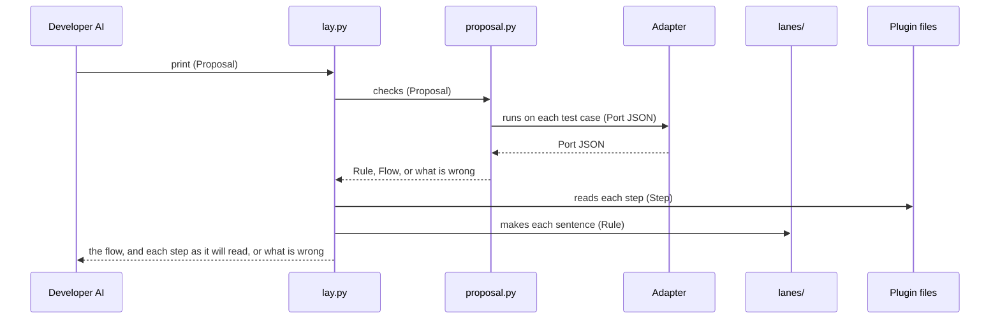
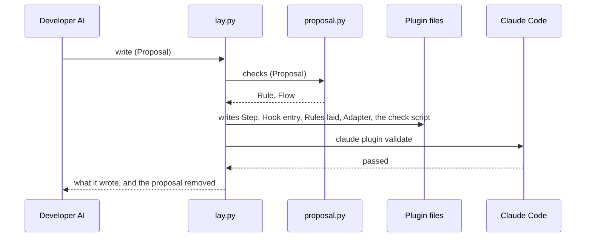
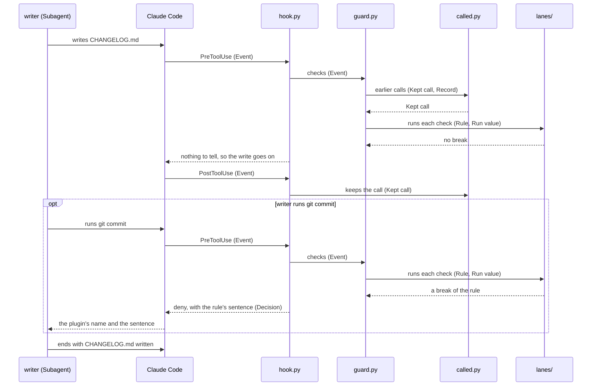
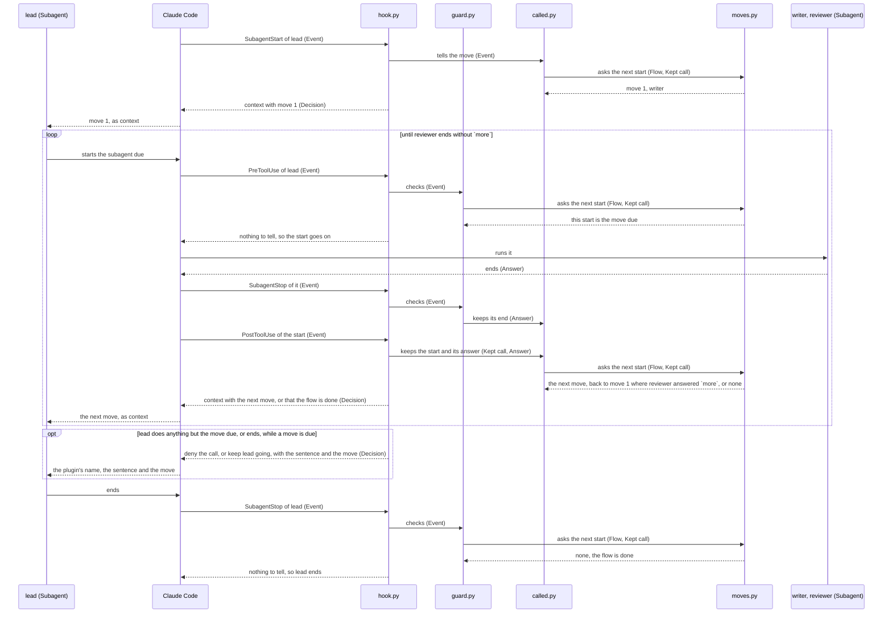

# Lane architecture

`lay.py` turns each rule and the flow of the developer AI's proposal, a JSON file, into a sentence
in a step and a check of that sentence. It puts the checks into the developer AI's plugin as one
script, the check script. Claude Code runs the check script on each tool call and each end of work
of a subagent with rules. The check script stops each break with the rule's sentence, and tells the
orchestrator each move of the flow, the next subagent it must start. What this gives the developer AI
is in [Lane's UX](ux.md).

## Principles

Lane follows Principles 2, 6, 8 and 9 of [how a plugin works](../architecture.md#principles).
Principles 1, 3, 4, 5 and 7 are about an orchestrator, its roles and the course of a run, and Lane
has none of these: the developer AI runs `lay.py` itself, and the check script runs inside the
developer AI's plugin. The principles below are what Lane adds.

### The check shows the step again

The check script shows a stopped subagent the sentence of the rule, after the plugin's name.

A subagent whose call is only refused tries another way. A subagent that sees its own step goes
back to it (KR1.3).

### One wording for the step and the check

One function makes the sentence from the rule's type and values, both for the step that `lay.py`
writes and for the message that the check script gives.

The subagent meets the same words in both places, and no change can make them differ.

### What was approved is what runs

`lay.py write` writes from the file that `lay.py print` showed, and the check script takes its rules
and the flow only from what `lay.py write` wrote.

A rule copied by hand could be one that no one approved
([The caller approves what is theirs](../architecture.md#the-caller-approves-what-is-theirs)).

### Lane knows no plugin

Each type of rule is one check for every plugin. What differs between plugins reaches the check as
the rule's values, as a value given for the run, or through an adapter: the developer AI's script
that turns its own text format into Lane's. No line of Lane names
another plugin.

So the developer AI writes no check code (KR1.4, KR2.3), and a new text format needs an adapter, not
a new type of rule.

### A call that cannot be checked is stopped

When the check script cannot check a tool call or an end of work, it stops it and says why.

- A fault of the plugin or of Claude Code, such as a failing adapter, is told to the subagent and to
  the operator, with who must fix it. The operator is whoever runs the developer AI's plugin, a
  person or an AI. In the UX's scenarios, the developer AI runs `changelog`, so it is the operator.
- A call written in a form that Lane cannot read, such as a path with `$`, is told to the subagent
  alone, with how to write it.

A call let through unchecked could be the break that the rule is there to stop
([No check passes what it did not check](../architecture.md#no-check-passes-what-it-did-not-check)).
The subagent can write its call again, but only the operator can fix a fault.

### The check reads what the subagent did

The check script judges from the events that Claude Code gives its hooks, from the subagent's
record, the file in which Claude Code writes what the subagent did, and from the calls it keeps
itself. It never judges from what a subagent writes about its work.

An AI that says it followed a step may not have followed it.

### The plugin needs nothing from Lane

The check script is kept and run in the developer AI's plugin.

The operator did not choose Lane. A plugin that needed Lane installed would run without checks
wherever Lane is missing.

## User stories

- As the developer AI, I want to run `lay.py print` on my proposal and see each step as it will
  read, with the flow where the proposal gives one, or what is wrong. Carries the `lay.py print`
  step of O1 and of O2.
- As the developer AI, I want to run `lay.py write` on the proposal I approved, and find the
  sentences in my steps and the check script in my plugin. Carries the `lay.py write` step of O1 and
  of O2.
- As the developer AI, I want the check script to let through each tool call that the rules allow,
  and to stop each break with the rule's sentence. Carries O1 from the run of `changelog` to the end
  of `writer`.
- As the developer AI, I want the check script to tell my orchestrator each move of the flow, and to
  hold it to the move due, the one it must take now. Carries O2 from the run of `changelog` to the
  end of `lead`.

## Logical view

### Components


- `lay.py` alone writes into the plugin, and only from a proposal that `proposal.py` accepts.
  `lay.py up` brings the plugin's copy of the check script up to Lane's version, and writes its hook
  entries again.
- `proposal.py` alone decides whether a proposal can be laid. It holds the proposal to the JSON
  Schema of [the proposal](../../plugins/lane/docs/lanes.md#the-proposal), checks it against the
  plugin's files, and runs each adapter on its test cases.
- `hook.py` alone speaks Claude Code's hook JSON. It acts only in the subagent that its hook entry
  names.
- `guard.py` alone decides which checks run on an event. Each module of `lanes/` alone decides what
  breaks its type of rule.
- `guard.py` also holds a subagent whose file has it read another file first, its part, to read that
  part whole before anything else, as
  [A subagent's part](../../plugins/lane/docs/lanes.md#a-subagents-part) says.
- `called.py` alone keeps each call as it comes back, and the end of each subagent of the flow.
  `moves.py` alone decides the move due from the flow and the kept calls. `ports.py` alone reads a
  text of the plugin, by Lane's own reading or through the plugin's adapter.
- Hooks go on subagents only, not on skills, for the reasons that
  [How a plugin works](../architecture.md#the-guard-tells-each-role-its-steps-again) gives.
- `called.py` keeps the calls itself rather than read only the record, because Claude Code may write
  a call's result into the record only after the next call's hooks have run.
- An adapter is a script that Lane runs, not a module that Lane imports. So `lay.py up` replaces the
  check script without touching an adapter.

### Data model


### Sequences

`lay.py print`:



`lay.py write`:



A subagent with rules on a run, `writer` of the UX's O1:



An orchestrator on a run, `lead` of the UX's O2:



- A start counts once the started subagent has ended, in the foreground or the background. In an
  interactive session, Claude Code runs subagents in the background by default, and counting only
  foreground starts would hold such a flow at its first move. While a started subagent runs in the
  background, only another start of the flow is stopped, so the orchestrator may end and wait.
- The move reaches the orchestrator as context that Claude Code adds for it, not from a script that
  it runs, so learning the move costs it no call.
- An answer sends the work back only where one of its lines is the word that the flow names. A word
  found anywhere in the answer would count "No more entries" as `more`.

## Physical view

### Deployment


- The developer AI installs Lane as [the README](../../plugins/lane/README.md#installation) says,
  and runs `python3 <installPath>/scripts/lay.py`. Claude Code starts the check script through the
  plugin's hook entries. After an update of Lane, the developer AI runs `lay.py up` on its plugin.
- Lane's code uses Python 3.9 and its standard library only, as
  [Python 3.9 and the standard library](../architecture.md#python-39-and-the-standard-library) says,
  so the operator installs nothing for Lane. Each hook's command checks for `python3` in `sh` first,
  because without Python the check script cannot even read the event.
- The kept calls live in the system's temporary folder, as
  [Where a plugin writes its files](../architecture.md#where-a-plugin-writes-its-files) says for
  files used only while a plugin runs. They mean nothing once the subagent ends.
- The check script reads the record of a subagent as the Claude Code version in
  [the README's Requirements](../../plugins/lane/README.md#requirements) writes it. Claude Code
  does not document the record, so Lane's code and its tests name one version.
- In the ccpm marketplace, the plugin's `hooks/lane/` is a link to Lane's code, as
  [Code kept once](../architecture.md#code-kept-once) says. Elsewhere it is a copy, with a `VERSION`
  file that `lay.py up` reads.

### Directory structure

Lane's code, [the lanes](../../plugins/lane/docs/lanes.md) and
[the flow](../../plugins/lane/docs/flow.md) call a rule a lane, and the check script the guard. The
code also calls the developer AI the building AI, and the code behind `lay.py` the layer.

```text
plugins/lane/
├── .claude-plugin/plugin.json         Lane's manifest and version <JSON>
├── scripts/lay.py, layer.py           lay.py <command line · Python 3.9>
├── scripts/steps.py, entries.py, placed.py   lay.py: Step, Hook entry, the check script put in <Python 3.9>
├── scripts/proposal.py                proposal.py <module · Python 3.9>
├── hooks/lane/                        the check script <Python 3.9>
│   ├── hook.py, <event>.py            hook.py <hook entry · Python 3.9>
│   ├── guard.py, step.py, call.py, shell.py, started.py   guard.py <module · Python 3.9>
│   ├── lanes/<type>.py                lanes/ <modules · Python 3.9>
│   ├── called.py, record.py           called.py <module · Python 3.9>
│   ├── moves.py                       moves.py <module · Python 3.9>
│   ├── ports.py                       ports.py <module · Python 3.9>
│   └── lanes_json.py, schema.py, forms.py, template.py   Rules laid, Flow, and the forms <Python 3.9>
└── docs/lanes.md, docs/flow.md, README.md, CHANGELOG.md, how-it-works.svg   for users <Markdown, SVG>

dev/lane/
├── ux.md, architecture.md, *.svg, README.md   for builders <Markdown, SVG>
├── cosmic-ray.toml                    the mutation testing <TOML>
├── testing.py                         what every plugin's tests stand on <Python 3>
├── tests/                             unit, integration and property tests <Python 3>
└── trials/                            the end-to-end trials and their plugins <Python 3>

.lane/<yyyymmdd>-<plugin>/             Proposal, and <plugin>/adapters/ with Adapter and Test cases
<temporary folder>/lane/<yyyymmdd>-<session>/<agent>.jsonl   Calls kept
<the plugin>/hooks/                    hooks.json, lanes.json, adapters/ (the Adapter that runs), lane/
```

## Test

Lane is tested as [Test](../architecture.md#test) says. What follows is what Lane adds.

| Deployment unit | Unit | Integration | End-to-end |
|---|---|---|---|
| lay.py process [python3 3.9 or later] | unittest, Cosmic Ray, Hypothesis · ●●● · the proposal checked, steps and hook entries written | unittest, real files, a stand-in `claude` · ●●○ · print, write and up on a plugin | trials · ●●○ · the lanes and the flow laid on a trial plugin |
| Hook process [python3 3.9 or later] | unittest, Cosmic Ray, Hypothesis · ●●● · each type of rule, tool calls, records, the move due | unittest, the hook's command in `sh` · ●●○ · the answer JSON, the Python check | trials · ●●○ · each type of rule and the flow on a run of the trial plugin |

The adapter processes have no row. An adapter is the developer AI's code, and Lane's running of it
is tested in the hook process's row.

- Unit and integration tests fake Claude Code. Each event is JSON, the record is a file in the shape
  that the version in the README's Requirements writes, and `claude` is a script on `PATH`. They
  pass as the shared rules say.
- End-to-end tests are the trials. A trial runs Claude Code with Opus on copies of Lane and of a
  trial plugin, with a prompt that invites a break, and is judged from the session's records. It
  passes in three runs of three: each invited break is stopped with its sentence, each allowed call
  goes through, and the flow's moves come in order. An AI that goes back to its step once may go
  around the rule the next time.
- Both processes weigh ●●● in unit tests. A failure writes what no one approved, or lets a break
  through in a plugin whose operator never sees Lane.
