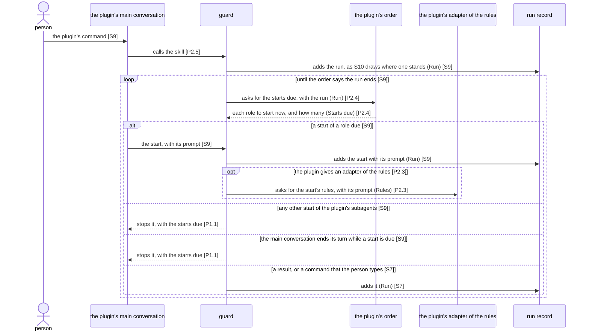
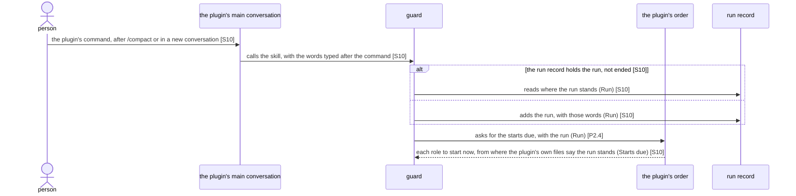
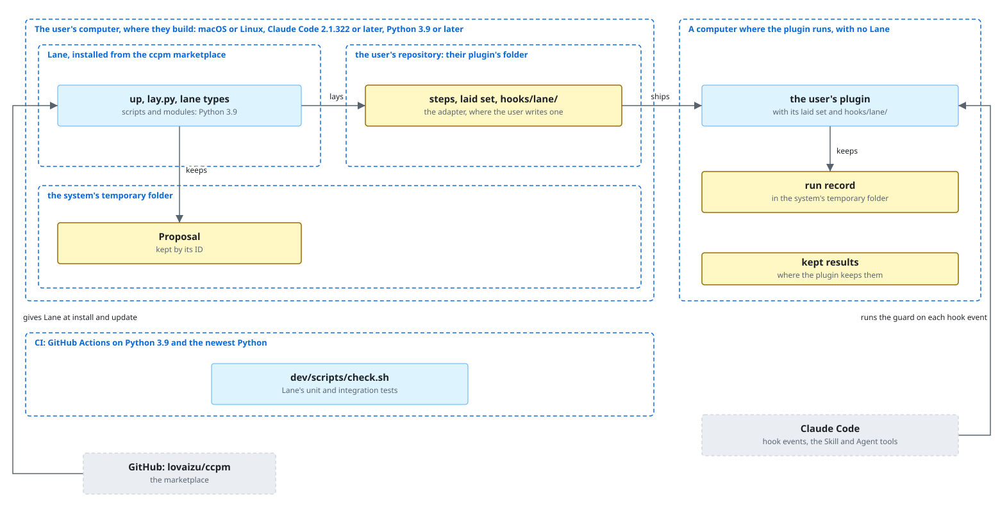

# Lane architecture

## User stories

- S1: a plugin wants its AI to notice when it writes a file that its step doesn't name.
- S2: a plugin wants its AI to notice when it reads a file that its step says never to read.
- S3: a plugin wants its AI to notice when it ends a step before reading whole a file it names.
- S4: a plugin wants its AI to notice when it runs a command other than those its step names.
- S5: a plugin wants its AI to notice when it skips a step, or ends with a step undone.
- S6: a plugin wants its AI to notice when it ends a step with an item of its checklist undone.
- S7: a plugin wants its run to move on by the result its AI gives, never by its reply.
- S8: a plugin wants its AI to notice when it ends a step that the plugin's own check doesn't pass.
- S9: a plugin wants its main conversation to start only the subagents due, ending no turn while one
  is due.
- S10: a plugin wants a stopped run to go on where it stopped, after `/compact` or in a new
  conversation.

## Solution strategy

### Principles

Lane gives an AI that leaves its plugin's step the step's own sentence, so that it notices at once.

- P1: the AI notices each step it leaves
  - P1.1: a call that Lane stops gets the step's sentence and what to do, or why Lane can't check it.
  - P1.2: a step, item, read, or result counts only from the AI's own call, never its reply.
- P2: one way for any plugin, applied by adapters alone
  - P2.1: each thing Lane can make an AI notice is one rule type, which a plugin's author picks.
  - P2.2: Lane defines what it takes in and gives out, holds every check, and names no plugin.
  - P2.3: a plugin gives its steps and order in a file where fixed, and by adapters where decided
    later.
  - P2.4: the plugin's order says which subagents start when, and Lane holds the AI to it.
  - P2.5: Lane checks only runs of a plugin that gives it rules, and leaves other work alone.

### Data model


- Rules\
  What a plugin gives Lane: each step's rules, fixed for a role or given per start, and any routes.
- Route\
  A fixed order: the roles to start after a role's result, or after a command that the person
  types.
- Run\
  One run of a plugin's skill in a conversation, from its call until its order ends it. It holds
  each command, start with its prompt, read, mark, and result.
- Starts due\
  What the plugin's order gives for a run: each role to start now and how many, or the run's end.

Strategies:

- The starts due asked of the plugin's order at each move, with the run as it stands. [P2.4]\
  Intent: Lane holds the AI to an order that the plugin fixes or decides as it runs, without
  deciding it.
- Each start kept with its prompt, which the plugin's adapters are given. [P2.3]\
  Intent: the plugin tells its starts of one role apart by what it wrote for each.
- A step's rules given per start by the plugin's adapter, where its file fixes none for the role.
  [P2.3]\
  Intent: a role that makes another deliverable at each start is held to that deliverable's rules.
- A run's end given by the plugin's order, not by the run having no start due. [S9]\
  Intent: a run that waits, such as for the person's answer, goes on.
- A run with no order held to its skill's steps alone, ending at the turn's end they let through.
  [P2.5]\
  Intent: a skill with steps and no subagents takes Lane with its rules alone.
- A run's record that only grows, holding only what no later move gives again. [S10]\
  Intent: moves checked at the same moment lose nothing of one another's.
- A run's record kept for its conversation alone, a new one going on from the plugin's files.
  [S10]\
  Intent: what a run has done past its conversation lies only where the plugin keeps it.

### Components


- guard (hook)\
  Holds each move of a run to its plugin's rules and to the starts due.
- rule types (module)\
  Make each rule's check and the sentence it gives one, so that what the AI reads is what holds.
- reporters (command)\
  Carry a step, an item, or a result done to the guard as the AI's own call.
- route adapter (module)\
  Gives the starts due of a plugin that fixes its order, from its routes.

Strategies:

- The plugin's folder found from its skill's base directory in the conversation, as
  [its states](claude-code-states.md#where-the-guard-finds-the-plugin-it-serves) say. [P2.2]\
  Intent: Lane serves a plugin that it never names, as Claude Code gives the folder either way.
- The plugin's adapter of the starts due, run on its own, else Lane's route adapter inside the
  guard. [P2.3]\
  Intent: a fixed order needs no code of the plugin's, and a decided one gives only its answer.
- The reporters as commands that Claude Code puts on the AI's path. [P1.2]\
  Intent: a plugin's step names a reporter without knowing where Lane lies.
- A rule of the paths a role writes that names a folder letting through each file under it. [S1]\
  Intent: a deliverable of several files, such as code with its tests, is written whole.
- Each move placed on its run and start by what Claude Code's events carry, as
  [its states](claude-code-states.md) list. [P2.5]\
  Intent: each move is held to the rules of its own start, and to no other run's.
- Each rule type judging its own call, mark, or end, and the guard stopping a breach with its
  sentence. [P2.1, S2, S3, S4, S6]\
  Intent: the check and the sentence that the AI reads change together, in the rule type's own
  module.
- A result that a step's rules name as ending the start, letting the start end at that step.
  [S5, S7]\
  Intent: a role that can't go on, such as on the person's point, ends with its result.
- A mark checked for the step due, then for the reads and the items that its rules ask. [S5]\
  Intent: a skipped step, item, or part of a file shows at the step skipped.
- An end checked for its result, its steps, the plugin's check, and, for a turn, the starts due.
  [S5, S8, S9]\
  Intent: a stop names the step left, as the plugin's check runs once the result and each step
  hold.

### Sequences

#### S9: starts held to the plugin's order



#### S10: a run picked up



### Deployment



A plugin names `lane` among its `plugin.json` dependencies, so that Claude Code installs Lane beside
it.

Strategies:

- Lane's code on Python 3.9 and its standard library alone. [P2.2]\
  Intent: the guard, started anew on each move, answers fast on each machine that runs a plugin.
- The plugin's adapters and checks run in the folder that the conversation works in. [P2.3]\
  Intent: each reads the run's checkout, in a worktree too.

### Directory structure

```text
plugins/lane/                     what Claude Code installs beside each plugin that depends on it
├── hooks/
│   ├── hooks.json                the guard's entries
│   └── lane/                     the guard, the route adapter, and rule_types/
├── bin/                          the reporters
├── docs/rules-and-adapters.md    what Lane takes in and gives out
└── README.md                     for a plugin's author

dev/lane/                         what only Lane's developers use
├── claude-code-states.md         each state of Claude Code that the guard meets, with its records
└── tests/                        the test cases, from unit to integration

<a plugin>/lane/                  what a plugin gives Lane
├── rules.json                    the rules, and the routes of a fixed order
└── adapters/                     each adapter: the starts due of an order decided as it runs, and
                                  the rules of each start
```

## Test strategy

| Check | Test target | Kind | When | Exit criteria or measure |
|---|---|---|---|---|
| Lint | Parts | Quality | During the work | 0 findings. |
| Static analysis | Parts | Quality | During the work | 0 findings of mismatched types, copied code, or import cycles. |
| Complexity analysis | Parts | Quality | During the work | Per function, McCabe 10, cognitive 15, 6 returns, 12 branches, 5 arguments, 50 statements at most. |
| Unit testing | Parts | Quality | During the work | Every case passes. |
| Code coverage | Parts | Quality | During the work | 100% statement (C0) and branch (C1) coverage. |
| Property-based testing | Parts | Quality | Apart from the work | 0 counterexamples in reading the rules, each rule type's check, and the guard's placing of moves. |
| Mutation testing | Parts | Quality | Apart from the work | 0 surviving mutants. |
| Integration testing | Architecture | Quality | During the work | Every case passes, each handoff giving the data the data model names. |
| Contract testing | Architecture | Quality | Apart from the work | On each new Claude Code, each recorded state gives the double's events. |
| Traceability | Architecture | Quality | During the work | Every element tested, every case naming one level up, and each principle's case failing broken. |
| Configuration testing | Product | Quality | During the work | Every case passes on Python 3.9 and on the newest Python. |
| Conformance and compliance testing | Product | Quality | During the work | Claude Code's strict check of Lane's plugin passes. |
