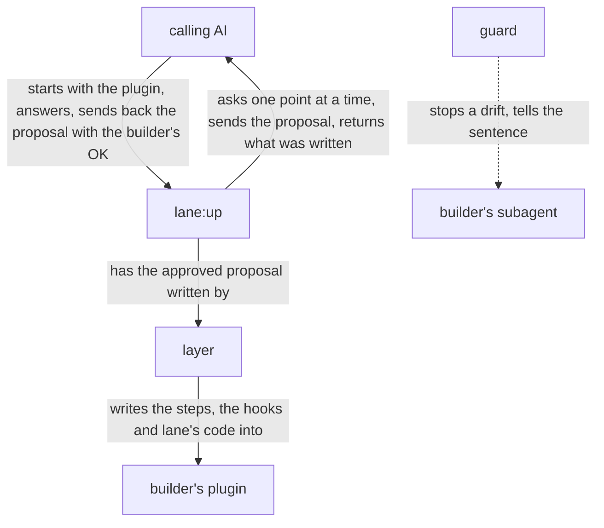

# lane design

lane is built on [how a plugin works](../architecture.md), and is itself a plugin of that form:
`lane:up`, the orchestrator an AI starts, hears the builder through that AI, proposes, and has the
layer, a script, write what the builder approved. What lane writes into the builder's plugin is
lane's code, the guard, which notices a subagent's drift from its lanes and tells it the step
again. The goal and the key result are in
[lane's UX](ux.md).

## User stories

- As the builder, I want to ask Claude to lay lanes on my plugin, answer one point at a time,
  choose OK on the lanes proposed, and find them written into my plugin with lane's code.
- As the builder, I want `lane:up`, run where an older copy of lane's code is, to bring the copy
  and the hooks to its own version.
- As the builder, I want my subagent, when a call drifts from a lane, to be stopped and told the
  lane's sentence headed by my plugin's name, and every call the sentence allows let through.
- As the builder, I want the hooks, on a machine without Python 3.9 or later, to stop the calls
  they watch, each asking for Python to be installed.

## Architecture

### Logical view



- The calling AI starts `lane:up` with the plugin and the name to message it by.
- On a plugin whose copy of lane's code is older than lane's, the layer first brings the copy and
  each hook to the current form, keeping what they say, and the run then goes on as any other.

  Bringing a copy up asks the builder nothing, since everything it keeps was approved before.
- `lane:up` reads the plugin's skills, agents and hooks, and sends the calling AI, one at a time,
  each point the files leave open, a question with its recommendation, and each fact it found with
  where it found it; the calling AI puts each to the builder and sends the answer back. The hearing
  is done when no point is left open.

  A fact found is shown as a point too, since the proposal rests on it, and a fact the builder reads
  otherwise is assumed in their place (dev/architecture.md, Hearing until nothing is left to
  decide).
- With every point settled, `lane:up` keeps its proposal in a file, has the layer print it, and
  sends the calling AI that print: for each subagent step, the lanes it would lay, each under its
  action, with the step as it would read and its hooks. The calling AI asks the builder for the OK;
  a change the builder asks goes back to `lane:up`, which changes the file and sends it again.

  A lane is proposed only for a sentence of a step whose drift shows in a tool call; what shows in
  no call, such as what the subagent weighs, has no lane, since no hook can see it.
- Only once the calling AI sends back the builder's OK does `lane:up` have the layer write the
  proposal from the same file word for word into the plugin, with lane's code, and check that the
  plugin loads.

  What the builder approved is printed and written by a script from one file, so no AI copies it.
  For lane the caller is the calling AI, and its answer is the caller's own action that an approval
  counts from (dev/architecture.md, The caller approves what is theirs).
- In a subagent with lanes, the guard reads each tool call as one action, begin, read, write, run,
  test, hand on, wait or end, a command that writes a file being a write of it too, reads it
  against that subagent's lanes alone, and on a drift stops the call and tells the subagent
  `<plugin>: <sentence>`.

  A lane on the order of steps, such as reading an input whole before writing, is held from what
  the subagent has done since it started.
- A hook holds, for each of its lanes, the step, the lane and what the lane takes; the lane's
  sentence is made from them, by the lane's wording in [Lanes](../../lane/README.md#lanes) with
  what it takes put in. The layer writes that sentence into the step, and the guard makes the
  same one when it stops a call.

  So the sentence the subagent is told and the one its step says cannot differ, and no sentence is
  written twice.
- Where the step a hook holds no longer has the lane's sentence, word for word with a line break
  read as a space, the guard stops the call and says to have `lane:up` run again.

  The builder has changed the step since the lane was laid, and a lane kept on a sentence that is
  gone holds the subagent to what its step no longer says.
- Where lane's code cannot run on the machine, each hook stops every call it watches, saying what
  to install.

  Letting the call through would leave it unkept with no one told.

### Physical view

```
lane/                          the plugin, installed by Claude Code
├── agents/up.md               lane:up, the orchestrator <agent>
├── scripts/lay.py             the layer <Python 3>
├── hooks/
│   ├── hooks.json             the lanes on lane:up
│   └── lane/                  lane's code, put in each plugin <Python 3>
│       ├── pretooluse.py      the event script for lanes on a tool call
│       ├── subagentstop.py    the event script for lanes on how the subagent ends
│       ├── hook.py            what the event scripts run on: the event read, each check run
│       ├── call.py            a tool call read as one action
│       ├── shell.py           what a shell command reads and writes
│       ├── step.py            a subagent's step, read from its file
│       ├── record.py          what the subagent did before, from its record
│       └── lanes/<lane>.py    one check per lane
└── README.md                  its Lanes: each lane, its action and what its hook notices
```

- lane runs on Claude Code, python3 3.9 or later, git and jq; the layer checks the plugin with
  `claude plugin validate`.
- The calling AI starts `lane:up` as a subagent, naming in its prompt the agent `lane:up` messages:
  `main` from the main conversation, its own name from a subagent. `lane:up` sends each point with
  SendMessage and ends its turn, and the answer, sent back the same way, resumes it.

  SendMessage reaches an agent by its name or ID, and a subagent may message the agent that started
  it (sub-agents, Resume subagents).
- The proposal is a JSON file in lane's data folder, `${CLAUDE_PLUGIN_DATA}/<plugin>.json`, which
  `lane:up`'s steps name, as Claude Code puts the folder in where an agent's Markdown names it; the
  layer removes it once written. Claude Code keeps that folder for the plugin's own files across
  its updates (plugins-reference, Environment variables).
- In the builder's plugin, the layer writes:

  ```
  <plugin>/
  ├── agents/                      the subagents' steps
  └── hooks/
      ├── hooks.json               one entry per subagent and event
      └── lane/                    lane's code
  ```
- lane's code goes into `<plugin>/hooks/lane/`: in a plugin of the ccpm marketplace a relative link
  to lane's, which installing copies into the plugin; anywhere else a copy, brought up by the next
  run of `lane:up`. Into a copy alone the layer writes `VERSION`, one line holding the version it
  reads from lane's `plugin.json`, by which the next run tells an older copy.

  lane's version is written once, in its `plugin.json`; a file of its own beside it would be a
  second copy that drifts.
- The guard holds each call to the 12 lanes of the README's Lanes, one file each in `lanes/`
  holding the lane's check and its wording: start_with, read_only, read_whole, write_only,
  in_form, hands_off, test_after, as_printed, follow_next, wait_for, end_when and every_item; a
  test holds that table to the wordings in `lanes/`.
- A lane's hook is one entry of the plugin's `hooks/hooks.json` for one subagent and event; its
  matcher is the tools that subagent's lanes watch, and its command gives the guard the subagent and,
  for each lane, its step, the lane and what the lane takes.

  ```json
  {"matcher": "Bash|Write|Edit",
   "hooks": [{"type": "command", "timeout": 10, "command":
     "<the Python check>; exec python3 \"${CLAUDE_PLUGIN_ROOT}/hooks/lane/pretooluse.py\" notes:changelog-writer 3:write_only:CHANGELOG.md '3:hands_off:git commit,git push'"}]}
  ```

  The layer leaves every other entry of the file as it was. Claude Code reads no hooks from a
  plugin subagent's own file, so the hooks are here.
- The guard acts only where the event's `agent_type` is the subagent its command names.

  A tool event's matcher filters by tool, not by agent.
- The guard reads a call in the forms the steps tell and the AI writes, not in every form the shell
  allows.

  A step that says `git commit` is held against `git commit`, `git -C notes commit` or
  `cd notes && git commit`, but not against `g=git; $g commit`. What must hold whatever the AI
  writes is held by GitHub's branch protection, Claude Code's sandbox or its permission rules, as a
  check on a command's text is no security boundary; so the guard stays small.
- A subagent's record is the JSONL file Claude Code writes at
  `<transcript_path without .jsonl>/subagents/agent-<agent_id>.jsonl`, from the tool event's
  `transcript_path` and `agent_id`, as Claude Code 2.1.306 writes it; neither the place nor the
  shape is documented, so the guard's tests hold both. The calls of one reply are written there
  once their hooks have run, so a lane on the order of steps reads the replies before.
- Each hook command first runs the Python check, which exits 2 with this message where `python3` is
  missing or older than 3.9.

  ```sh
  python3 -c "import sys; sys.exit(sys.version_info < (3, 9))" 2>/dev/null || { echo "notes: install Python 3.9 or later, run as python3, for its hooks to run" >&2; exit 2; }
  ```
- `lane:up` is held by lanes of its own: it reads only the plugin's skills, agents, hooks and
  manifest, and writes nothing but through the layer.
- rn and turn take lane's code by the same link, and their hooks run on its `hook.py` and
  `shell.py`; `common/` and `dev/common/` go.

  Code more than one ccpm plugin needs is kept once, in the plugin whose job it is, and what their
  tests share, such as a repository made once and copied for each test, in `dev/lane/testing.py`,
  which rn's and turn's tests import, as their code takes lane's and `dev/check.sh` fails on a copy.

## Verification

### Units

Each agent is checked on Claude Code's default model, the one users run lane on, and judged from
the records of every conversation and agent the check started. Each unittest below runs in
`dev/lane/tests/`, by [`dev/check.sh`](../check.sh) with lines and branches 100% covered and by
[`dev/mutate.sh`](../mutate.sh) with no mutant surviving.

- The guard: each lane stops a drift from its sentence in the forms the steps tell, tells the
  sentence read from its step, and lets through every call its sentence allows.
  - Flow: unittest fed the events, records and subagent files each lane receives, with Hypothesis on
    how a call is read.
- The Python check: it stops the hook with exit 2 and its message where `python3` is missing or
  older than 3.9, and lets it run otherwise.
  - Flow: unittest runs a hook's command with a `PATH` holding no `python3`, one holding a `python3`
    older than 3.9, and the one in use.
- The layer: what it writes is the approved proposal, with every other entry of `hooks/hooks.json`
  as it was, and an older copy is brought up with what it keeps unchanged.
  - Flow: unittest on a plugin made for each test: a new plugin, one with hooks of its own, one
    with an older copy, one in the ccpm marketplace.
- `lane:up`: the run goes in the order of the logical view.
  - Flow: on a plugin with one orchestrator skill and one subagent of three steps, with the calling
    AI stood in for by answers set beforehand; passes when the records show one point per message,
    each fact found shown to confirm, and the layer run only on the proposal sent back with the OK.
  - Content: on the README's `notes` and on turn; passes when each proposed lane is one of
    the README's Lanes, and each step's drift that shows in a tool call has its lane.

### Acceptance

Each trial runs in `lovaizu/playground`, one at a time, on a branch of its own, and the branch and
whatever it made there are removed after.

- Flow: a stand-in for the calling AI starts `lane:up` on the README's `notes`, answers and gives
  the OK; the steps and the hooks are written and `claude plugin validate --strict` passes.
- Laying lanes: the files hold the approved steps and hooks word for word.
  - Read from the files against the proposal in the records.
- Bringing an older copy up: on `notes` with lane's code of an older version, `lane:up` leaves the
  current code and the same lanes in the current form.
  - Read from the files.
- A drift stopped: `changelog-writer`, given a task that invites a commit, is stopped with its lane's
  sentence headed by `notes:`, ends with the changelog written and uncommitted, and none of its
  other calls is stopped.
  - Read from its record.
- Python missing: on `notes` with no `python3` on the `PATH`, `changelog-writer`'s first watched
  call is stopped with the request to install Python 3.9 or later.
  - Read from the records.
- KR1.1: the defects of the UX's KR1.1 met on `notes` and on turn.
  - Counted from the records of each trial and the files, apart for each kind of defect and each
    lane, so a lane that gives the builder nothing shows; each version is compared with the one
    before it on the same plugins.

A change is taken when every story is still achieved and KR1.1 does not grow.
