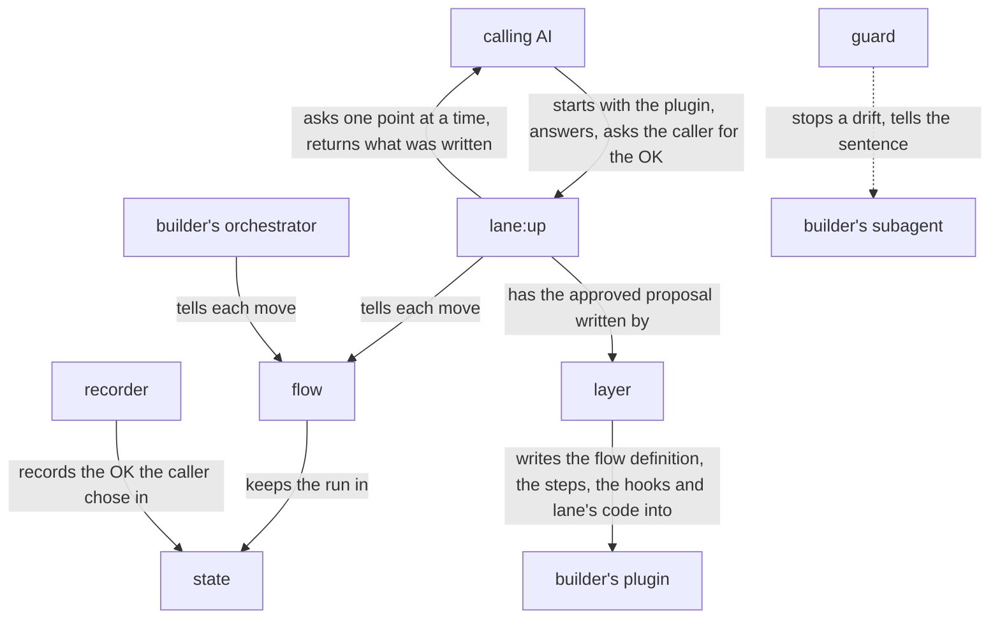

# lane design

lane is built on [how a plugin works](../architecture.md), and is itself a plugin of that form:
`lane:up`, the orchestrator an AI starts, hears the builder through that AI, proposes, and has the
layer, a script, write what the builder approved. What lane writes into the builder's plugin is
three things of lane's code: the flow, which holds the plugin's orchestrator to its course; the
recorder, which records the OK the caller chose; and the guard, which keeps each subagent to its
lanes. The goal and the key result are in [lane's UX](ux.md).

## User stories

- As the builder, I want to ask Claude to lay lanes on my plugin, answer one point at a time,
  choose OK on the flow, the orchestrator's steps and the lanes proposed, and find them written into
  my plugin with lane's code.
- As the builder, I want `lane:up`, run where an older copy of lane's code is, to bring the copy,
  the flow definition's form and the hooks to its own version.
- As the builder, I want my orchestrator, when it tells the flow a move my plugin's rules forbid, to
  be refused with the rule's sentence headed by my plugin's name, and every move they allow let
  through.
- As the builder, I want the flow to go past an approval only once the caller has chosen OK from
  Claude Code's question.
- As the builder, I want my subagent, when a call drifts from a lane, to be stopped and told the
  lane's sentence headed by my plugin's name, and every call the sentence allows let through.
- As the builder, I want a run of my plugin stopped anywhere to go on from its last move in a new
  conversation.
- As the builder, I want the flow and the hooks, on a machine without Python 3.9 or later, to stop
  the run at its first move and the calls they watch, each asking for Python to be installed.

## Architecture

### Logical view



- The calling AI starts `lane:up` with the plugin and the name to message it by; `lane:up` tells the flow its first move, naming
  the run's work folder, and the flow starts a run there, or goes on with the one it finds.

  A run is kept in its work folder in the user's repository, so it goes on from another
  conversation or machine; a conversation ends, is cleared or is compacted, and what lives only in
  it is lost.
- On a plugin whose copy of lane's code is older than lane's, the layer first brings the copy, each
  flow definition and each hook to the current form, keeping what they say, and the run then goes
  on as any other.

  Bringing a copy up asks the builder nothing, since everything it keeps was approved before.
- `lane:up` reads the plugin's skills, agents and hooks, and sends the calling AI, one at a time,
  each point the files leave open, a question with its recommendation, and each fact it found with
  where it found it; the calling AI puts each to the builder and sends the answer back. Each point
  and answer goes into the plan, and the hearing is done when no point is left open.

  A fact found is shown as a point too, since the proposal rests on it, and a fact the builder reads
  otherwise is assumed in their place (dev/architecture.md, Hearing until nothing is left to
  decide).
- With every point settled, `lane:up` proposes the flow definition, the orchestrator's steps that
  tell the flow each move, and for each subagent step the lanes it would lay, each under its action,
  with the step as it would read and its hooks. The calling AI asks the builder for the OK with the
  question the flow gives; a change the builder asks goes back to `lane:up`.

  A lane is proposed only for a sentence of a step whose drift shows in a tool call; what shows in
  no call, such as what the subagent weighs, has no lane, since no hook can see it.
- Once the recorder holds the builder's OK, the flow lets `lane:up` have the layer write the
  approved proposal word for word into the plugin, with lane's code, and check that the plugin
  loads.

  What the builder approved is written by a script, so no AI copies it.
- In a run of the builder's plugin, its orchestrator tells the flow each move before it makes it:
  starting a job, a change to the plan with its reason, an approval asked, going on. The flow holds
  the move to the definition and the state: in order, within the count of makings again, past an
  approval only with its OK. It records the move and says what is open next, or refuses it with
  `<plugin>: <sentence>`, the sentence of the step the move breaks.

  The flow judges only the moves it is told; nothing calls it for the orchestrator. A check in the
  main conversation cannot tell the run's moves from other work there: AI-DLC's hooks that try
  (core/hooks/aidlc-continue-workflow.ts, aidlc-plan-approval-guard.ts) take every move as the
  run's while one is open. turn's twelve recorded runs told turn.py before each of their 90 role
  moves.
- The plan is data in the state, which the orchestrator changes as facts come in; the flow keeps
  each change with its reason, and a change to what a gate approved opens that gate again.

  The course and its rules stay fixed while the plan follows what the run finds.
- At an approval, the flow gives the question; the orchestrator asks it, or, where it is a
  subagent, sends it to the calling AI, whose main conversation asks it with AskUserQuestion. The
  recorder refuses the question when an answer is already filled in, and records the answer the
  caller chose in the run's state; told to go on, the flow goes on only when the state holds OK for
  its question. The recorder also refuses a tool call that writes a run's state, which only the flow
  and the recorder write.

  Only the main conversation can ask a person (dev/architecture.md, Where the orchestrator runs).
  An AI that sets its own approval passes every check that rests on it; cc-sdd's does.
- In a subagent with lanes, the guard reads each tool call as one action, begin, read, write, run,
  test, hand on, wait or end, holds it to that subagent's lanes alone, and stops a drift with
  `<plugin>: <sentence>`.

  A lane on the order of steps, such as reading an input whole before writing, is held from what
  the subagent has done since it started.
- A hook holds, for each of its lanes, the step, the lane and what the lane takes; the lane's
  sentence is made from them, by the lane's wording in `lanes.md` with what it takes put in. The
  layer writes that sentence into the step, and the guard makes the same one when it stops a call.

  So the sentence the subagent is told and the one its step says cannot differ, and no sentence is
  written twice.
- Where the step a hook holds no longer has the lane's sentence, word for word with a line break
  read as a space, the guard stops the call and says to have `lane:up` run again.

  The builder has changed the step since the lane was laid, and a lane kept on a sentence that is
  gone holds the subagent to what its step no longer says.
- Where lane's code cannot run on the machine, the flow refuses the first move and each hook stops
  every call it watches, saying what to install.

  Letting the run or the call through would leave it unkept with no one told.

### Physical view

```
lane/                          the plugin, installed by Claude Code
├── agents/up.md               lane:up, the orchestrator <agent>
├── flows/up.json              lane:up's flow definition
├── scripts/lay.py             the layer <Python 3>
├── hooks/
│   ├── hooks.json             the recorder and the lanes on lane:up
│   └── lane/                  lane's code, put in each plugin <Python 3>
│       ├── VERSION
│       ├── flow.py            the flow
│       ├── pretooluse.py      the event script for the recorder's refusal and lanes on a tool call
│       ├── posttooluse.py     the event script for the recorder's record
│       ├── subagentstop.py    the event script for lanes on how the subagent ends
│       ├── hook.py            what the event scripts run on: the event read, each check run
│       ├── call.py            a tool call read as one action
│       ├── shell.py           what a shell command reads and writes
│       ├── record.py          what the subagent did before, from its record
│       └── lanes/<lane>.py    one check per lane
├── lanes.md                   each lane, under its action, and what its hook notices
└── flow.md                    each key of a flow definition and what it does
```

- lane runs on Claude Code, python3 3.9 or later, git and jq; the layer checks the plugin with
  `claude plugin validate`.
- The calling AI starts `lane:up` as a subagent, naming in its prompt the agent `lane:up` messages:
  `main` from the main conversation, its own name from a subagent. `lane:up` sends each point with
  SendMessage, and the answer comes back the same way.

  SendMessage reaches an agent by its name or ID, and a subagent may message the agent that started
  it (sub-agents, Resume subagents).
- In the builder's plugin, the layer writes:

  ```
  <plugin>/
  ├── flows/<orchestrator>.json    the flow definition, one per orchestrator, named after its skill or agent
  ├── skills/ or agents/           the orchestrator's steps and the subagents' steps
  └── hooks/
      ├── hooks.json               the recorder's entries and one entry per subagent and event
      └── lane/                    lane's code
  ```
- lane's code goes into `<plugin>/hooks/lane/`: in a plugin of the ccpm marketplace a relative link
  to lane's, which installing copies into the plugin; anywhere else a copy with its `VERSION`,
  brought up by the next run of `lane:up`.
- A flow definition gives the plugin's course in the keys lane defines, with the values the plugin
  gives; `flow.md` gives each key to the builder, and a test holds it to `flow.py`.

  ```json
  {"phases": [{"name": "changelog", "type": "write"}],
   "types": {"write": {"again": 3, "steps": [
     {"move": "changelog-writer"},
     {"gate": "Commit CHANGELOG.md?"},
     {"move": "commit", "say": "Commit `CHANGELOG.md` only after the caller's OK on it."}]}}}
  ```

  A phase has `name`; `each`, a `jq` path to the plan's items its type runs on one by one; `type`;
  `gate`, the question asked before the run leaves the phase; and `done_when`, a `jq` condition on
  the state. A type is a named list of steps, each a move the orchestrator tells, a role's job by
  the agent's name or one of its own such as `commit`, or a gate; `again` is the most times one item
  goes back to the first step, when the caller's answer at a gate is not OK. `say` is the sentence
  the flow refuses a move with, where a move breaks that step.
- The orchestrator's steps tell the flow by running it with Bash:

  ```sh
  python3 "${CLAUDE_PLUGIN_ROOT}/hooks/lane/flow.py" "${CLAUDE_PLUGIN_ROOT}/flows/changelog.json" <work folder> <move> [<argument>]
  ```

  A Bash call gets none of the plugin's variables, while Claude Code puts `${CLAUDE_PLUGIN_ROOT}` in
  where a skill's or agent's Markdown names it (plugins-reference, Where each variable resolves);
  so the step carries the path, and the flow reads the plugin's name from its
  `.claude-plugin/plugin.json`. `${CLAUDE_PLUGIN_ROOT}` changes on each update, so nothing is
  written there.
- The flow prints, as JSON, what is open next: the phase, the item, the step, and for a role's job
  the prompt to start it with; for a refusal it prints `<plugin>: <sentence>` and exits 2.
- A run's state is `state.json` in its work folder, which the orchestrator names on its first move,
  such as rn's `.rn/<case>/`; `lane:up`'s is `.lane/<plugin>/` at the top of the repository the
  plugin is in. The state holds the definition's name, where the run stands, the plan, each plan
  change with its reason, the count of makings again for each item, and each approval taken.
- At a gate, the flow gives the question as `<plugin>: <gate> (<work folder>)` with the options
  `OK` and `Change`, and goes on only when the state holds `OK` for that exact question, recorded
  after the flow gave it.

  The work folder in the question tells the recorder whose state to write and keeps two runs
  asking the same gate apart; a run gone on in a new conversation asks again.
- The recorder is entries of the plugin's `hooks/hooks.json`, acting on questions headed by the
  plugin's name: PreToolUse on `AskUserQuestion` refuses a call whose `answers` is filled, and
  PostToolUse records the chosen label in the state of the work folder the question names.
  PreToolUse on `Write`, `Edit` and `Bash` refuses a call that writes a run's `state.json`, read in
  the forms the AI writes, as the guard reads a call.

  `answers` is an input Claude Code never sets itself, given only by a hook to answer in the
  person's place (hooks, AskUserQuestion). AskUserQuestion is in the main conversation alone, and a
  plugin's hooks act there whichever orchestrator asks. AI-DLC refuses the AI's own writes to its
  run state in the same way (core/hooks/aidlc-state-transition-guard.ts). What PostToolUse's
  `tool_response` holds for AskUserQuestion is not documented, so its shape is taken from a real
  run and held by the recorder's tests.
- The guard holds each call to the 12 lanes of `lanes.md`, one file each in `lanes/` holding the
  lane's check and its wording: start_with, read_only, read_whole, write_only, in_form, hands_off,
  test_after, as_printed, follow_next, wait_for, end_when and every_item; a test holds `lanes.md` to
  the wordings in `lanes/`.
- A lane's hook is one entry of the plugin's `hooks/hooks.json` for one subagent and event; its
  matcher is the tools that subagent's lanes watch, and its command gives the guard the subagent and,
  for each lane, its step, the lane and what the lane takes.

  ```json
  {"matcher": "Bash|Write|Edit",
   "hooks": [{"type": "command", "timeout": 10, "command":
     "<the Python check>; exec python3 \"${CLAUDE_PLUGIN_ROOT}/hooks/lane/pretooluse.py\" notes:changelog-writer 3:write_only:CHANGELOG.md '3:hands_off:git commit,git push'"}]}
  ```

  The layer leaves every other entry of the file as it was. Claude Code reads no hooks from a
  plugin subagent's own file, so the hooks are here.
- The guard acts only where the event's `agent_type` is the subagent its command names.

  A tool event's matcher filters by tool, not by agent.
- The guard reads a call in the forms the steps tell and the AI writes, not in every form the shell
  allows.

  A step that says `git commit` is held against `git commit`, `git -C notes commit` or
  `cd notes && git commit`, but not against `g=git; $g commit`. What must hold whatever the AI
  writes is held by GitHub's branch protection, Claude Code's sandbox or its permission rules, as a
  check on a command's text is no security boundary; so the guard stays small.
- A subagent's record is the JSONL file Claude Code writes at the event's `agent_transcript_path`,
  which is not a documented shape, so the guard's tests hold its shape.
- Each hook command and each call of the flow first runs the Python check, which exits 2 with this
  message where `python3` is missing or older than 3.9; the orchestrator's steps stop the run on it.

  ```sh
  python3 -c "import sys; sys.exit(sys.version_info < (3, 9))" 2>/dev/null || { echo "notes: install Python 3.9 or later, run as python3, for its flow and hooks to run" >&2; exit 2; }
  ```
- `lane:up` is held by lanes of its own: it reads only the plugin's skills, agents, hooks and
  manifest, and writes nothing but through the flow and the layer.
- rn and turn take lane's code by the same link, and their hooks run on its `hook.py` and
  `shell.py`; `common/` and `dev/common/` go.

  Code more than one ccpm plugin needs is kept once, in the plugin whose job it is, and what their
  tests share, such as a repository made once and copied for each test, in `dev/lane/testing.py`,
  which rn's and turn's tests import, as their code takes lane's and `dev/check.sh` fails on a copy.

## Verification

### Units

Each agent is checked on Claude Code's default model, the one users run lane on, and judged from
the records of every conversation and agent the check started. Each unittest below runs in
`dev/lane/tests/`, by [`dev/check.sh`](../check.sh) with lines and branches 100% covered and by
[`dev/mutate.sh`](../mutate.sh) with no mutant surviving.

- The flow: each move the definition allows goes through and says what is open next, each it
  forbids is refused with its step's sentence, and a run goes on from its state.
  - Flow: unittest on the README's `notes` definition and on one with `each`, `done_when`, a phase
    `gate` and `again`, fed every move in and out of order, plan changes before and after a gate,
    and answer records of OK, of `Change`, for another question and from before the question; with
    Hypothesis on sequences of moves, none of which goes past a gate without its OK.
- The recorder: it refuses a question with `answers` filled and a call that writes a run's state,
  lets the rest through, and records the chosen label in the state the question names.
  - Flow: unittest fed AskUserQuestion's PreToolUse and PostToolUse events and `Write`, `Edit` and
    `Bash` calls on a state, PostToolUse in the shape taken from one interactive run of Claude Code
    in which the question was answered on its screen, kept beside the tests.
- The guard: each lane stops a drift from its sentence in the forms the steps tell, tells the
  sentence read from its step, and lets through every call its sentence allows.
  - Flow: unittest fed the events, records and subagent files each lane receives, with Hypothesis on
    how a call is read.
- The Python check: it stops the hook or the flow with exit 2 and its message where `python3` is
  missing or older than 3.9, and lets it run otherwise.
  - Flow: unittest runs a hook's command and a call of the flow with a `PATH` holding no `python3`,
    one holding a `python3` older than 3.9, and the one in use.
- The layer: what it writes is the approved proposal, with every other entry of `hooks/hooks.json`
  as it was, and an older copy is brought up with what it keeps unchanged.
  - Flow: unittest on a plugin made for each test: a new plugin, one with hooks of its own, one
    with an older copy, one in the ccpm marketplace.
- `lane:up`: the run goes in the order of the logical view.
  - Flow: on a plugin with one orchestrator skill and one subagent of three steps, with the calling
    AI stood in for by answers set beforehand; passes when the records show one point per message,
    each fact found shown to confirm, the flow told each move, and the layer run only after the OK.
  - Content: on the README's `notes` and on turn; passes when the flow definition holds the course
    the plugin's skill gives, each proposed lane is one of `lanes.md`, and each step's drift that
    shows in a tool call has its lane.

### Acceptance

Each trial runs in `lovaizu/playground`, one at a time, on a branch of its own, and the branch and
whatever it made there are removed after.

- Flow: a stand-in for the calling AI starts `lane:up` on the README's `notes`, answers and gives
  the OK; the flow definition, the steps and the hooks are written and `claude plugin validate
  --strict` passes.
- Laying lanes: the files hold the approved flow definition, steps and hooks word for word.
  - Read from the files against the proposal in the records.
- Bringing an older copy up: on `notes` with lane's code of an older version, `lane:up` leaves the
  current code and the same flow and lanes in the current form.
  - Read from the files.
- A move refused: `/notes:changelog`'s orchestrator, told to commit before the OK, is refused with
  the `say` of its `commit` step headed by `notes:`, and commits only after the OK.
  - Read from its record and git.
- An approval: the flow goes past the gate after `OK` is chosen, and refuses to on an answer given
  in plain words, filled in by an AI or written into the state.
  - Read from the records and `state.json`; the stand-in for the person answers through a hook of
    the trial's own settings, as Claude Code lets a hook answer AskUserQuestion (hooks,
    AskUserQuestion).
- A drift stopped: `changelog-writer`, given a task that invites a commit, is stopped with its lane's
  sentence headed by `notes:`, ends with the changelog written and uncommitted, and none of its
  other calls is stopped.
  - Read from its record.
- Going on: `/notes:changelog` stopped after the job and run in a new conversation goes on at the
  gate.
  - Read from the records and `state.json`.
- Python missing: on `notes` with no `python3` on the `PATH`, the first move is refused and
  `changelog-writer`'s first watched call stopped, each with the request to install Python 3.9 or
  later.
  - Read from the records.
- KR1.1: the defects of the UX's KR1.1 met on `notes` and on turn.
  - Counted from the records of each trial and the files, apart for each kind of defect and each
    lane, so a lane that gives the builder nothing shows; each version is compared with the one
    before it on the same plugins.

A change is taken when every story is still achieved and KR1.1 does not grow.
