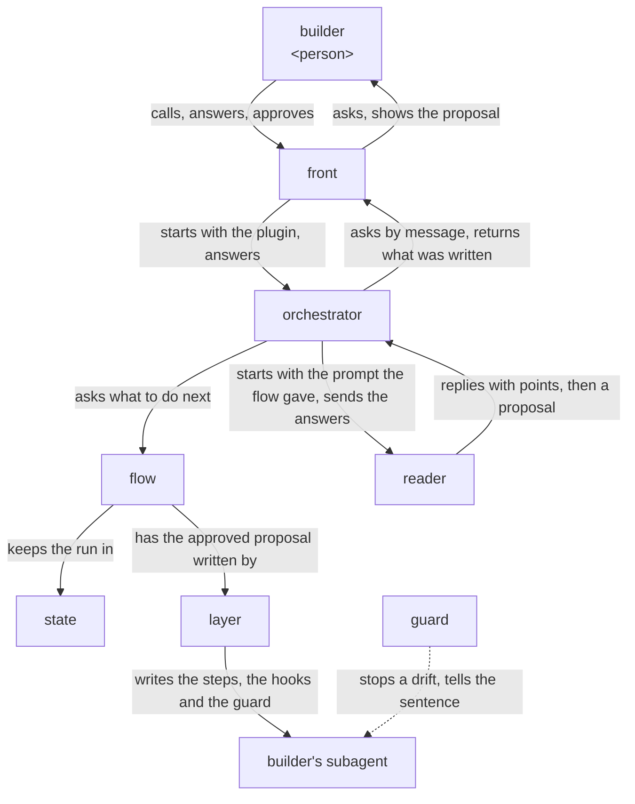

# lane design

lane is built on [how a plugin works](../architecture.md). `/lane:up` is a front that only talks;
an orchestrator that does what lane's flow prints, the flow keeping the run in a state; one role,
the reader, that reads the builder's subagents and proposes the lanes; and the layer, which writes
what the builder approved. What the layer lays into the builder's plugin is the guard, lane's code
that keeps each subagent there to its lanes. The goal and the key result are in
[lane's UX](ux.md).

## User stories

- As the builder, I want to type `/lane:up`, answer one point at a time, approve the lanes proposed,
  and find the steps and the hooks written into my plugin.
- As the builder, I want `/lane:up`, run where an older copy of lane's code is, to bring the copy
  and the hooks to its own version.
- As the builder, I want my subagent, when a call drifts from a lane, to be stopped and told the
  lane's sentence headed by my plugin's name, and every call the sentence allows let through.
- As the builder, I want the hooks, on a machine without Python 3.9 or later, to stop the calls they
  watch and say to install it.

## Architecture

### Logical view



- The front starts the orchestrator with the plugin the builder is in, and the flow starts a run
  in the state, or goes on with the one there for that plugin.
- On a plugin whose guard is older than lane's, the flow first has the layer replace it and write
  each hook again in the current form, keeping each lane, and the run then goes on as any other.

  Bringing a copy up asks the builder nothing, since every lane it keeps was approved before.
- The reader reads the plugin's subagents, offers first those changed last, and replies with
  the points the files leave open, each a question with its recommendation or a fact it found with
  where it found it.

  A fact found is shown as a point too, since the proposal rests on it, and a fact the builder
  reads otherwise is assumed in their place.
- The orchestrator sends each point to the front by message, the front puts it to the builder and
  sends back the answer, one point at a time, and the flow keeps each answer in the state.
- With every point settled, the reader proposes, for each step, the lanes it would lay, each under
  its action, with the step as it would read and the hooks; the front shows the proposal, and a
  change the builder asks goes back to the reader.

  A lane is proposed for each sentence of a step whose drift shows in a tool call; what shows in
  no call, such as what the subagent weighs, has no lane, since no hook can see it. The builder
  drops a lane they do not want from the proposal.
- On the builder's OK, the layer writes each step into its subagent's file and its hooks into the
  plugin, from the approved proposal alone and word for word, puts the guard in the plugin, and
  checks that the plugin loads.
- A hook keeps one subagent, and holds, for each of its lanes, the step, the lane and what the lane
  takes; the lane's sentence is made from them, by the lane's wording in `lanes.md` with what it
  takes put in, and the layer writes that sentence into the step.

  The guard makes the same sentence when it stops a call, so the sentence the subagent is told and
  the one its step says cannot differ, and the hook holds no sentence of its own.
- Where the guard cannot run on the machine, each hook stops every call it watches and says what
  to install.

  Letting the call through would leave the subagent unkept with no one told.
- While the builder's subagent works, the guard reads each tool call as one action, begin, read,
  write, run, test, hand on, wait or end, holds it to that subagent's lanes alone, and stops a drift
  with `<plugin>: <sentence>`.

  A lane on the order of steps, such as reading an input whole before writing, is held from what
  the subagent has done since it started.
- Where the step a hook holds no longer has the lane's sentence, word for word with a line break
  read as a space, the guard stops the call and says to run `/lane:up` again.

  The builder has changed the step since the lane was laid, and a lane kept on a sentence that is
  gone would hold the subagent to what its step no longer says.

### Physical view

```
lane/                          the plugin, installed by Claude Code
├── skills/up/SKILL.md         the front <skill>
├── agents/
│   ├── orchestrator.md        <agent>
│   └── reader.md              <agent>
├── scripts/lane.py            the flow and the layer <Python 3>
├── hooks/
│   ├── hooks.json             the hooks keeping lane's own orchestrator and reader
│   └── lane/                  the guard, laid into each plugin <Python 3>
│       ├── VERSION
│       ├── pretooluse.py      the event script for lanes on a tool call
│       ├── subagentstop.py    the event script for lanes on how the subagent ends
│       ├── hook.py            what both event scripts run on: the event read, each check run
│       ├── call.py            a tool call read as one action
│       ├── shell.py           what a shell command reads and writes
│       ├── record.py          what the subagent did before, from its record
│       └── lanes/<lane>.py    one check per lane
└── lanes.md                   each lane, under its action, and what its hook notices
```

- lane runs on Claude Code, python3 3.9 or later, git and jq; the reader finds the subagents
  changed last from git, and the layer checks the plugin with `claude plugin validate`.
- The state is a JSON file per plugin in `${CLAUDE_PLUGIN_DATA}/runs/`, which Claude Code keeps
  across lane's updates, so a run stopped anywhere goes on with `/lane:up` in a new conversation.
- The reader replies in JSON, first its points, then its proposal; the flow keeps each reply in
  the state and prints what the orchestrator sends next.

  ```json
  {"points": [{"question": "Who commits CHANGELOG.md?", "recommended": "you, after reading it"},
              {"fact": "step 3 writes CHANGELOG.md", "where": "agents/changelog-writer.md:12"}]}
  {"proposal": [{"step": 3, "text": "3. Write the new entries ...",
                 "lanes": [{"action": "run", "lane": "hands_off", "takes": "git commit,git push"}]}]}
  ```
- The guard holds each call to the 12 lanes of `lanes.md`, one file each in `lanes/` holding the
  lane's check and its wording: start_with, read_only, read_whole, write_only, in_form, hands_off,
  test_after, as_printed, follow_next, wait_for, end_when and every_item; a test holds `lanes.md`
  to the wordings in `lanes/`.
- Each hook first runs the Python check, which exits 2 with this message where `python3` is
  missing or older than 3.9.

  ```sh
  python3 -c "import sys; sys.exit(sys.version_info < (3, 9))" 2>/dev/null || { echo "notes: install Python 3.9 or later, run as python3, for its hooks to run" >&2; exit 2; }
  ```
- A hook is one entry of the plugin's `hooks/hooks.json` for one subagent and event; its matcher
  is the tools that subagent's lanes watch, and its command gives the guard the subagent's name
  and, for each lane, its step, the lane and what the lane takes.

  ```json
  {"matcher": "Bash|Write|Edit",
   "hooks": [{"type": "command", "timeout": 10, "command":
     "<the Python check>; exec python3 \"${CLAUDE_PLUGIN_ROOT}/hooks/lane/pretooluse.py\" changelog-writer 3:write_only:CHANGELOG.md '3:hands_off:git commit,git push'"}]}
  ```

  The layer leaves every other entry of the file as it was. Claude Code reads no hooks from a
  plugin subagent's own file, so the hooks are here.
- The guard acts only where the event's `agent_type` is `<plugin>:<subagent>`, the subagent its
  command names.

  A tool event's matcher filters by tool, not by agent.
- The guard reads a call in the forms the steps tell and the AI writes, not in every form the
  shell allows.

  A step that says `git commit` is held against `git commit`, `git -C notes commit` or
  `cd notes && git commit`, but not against `g=git; $g commit`. What must hold whatever the AI
  writes is held where it holds, by GitHub's branch protection, Claude Code's sandbox or its
  permission rules, as a check on a command's text is no security boundary; so the guard stays
  small.
- A subagent's record is the JSONL file Claude Code writes at the event's
  `agent_transcript_path`, which is not a documented shape, so the guard's tests hold its shape.
- The guard goes into `<plugin>/hooks/lane/`: in a plugin of the ccpm marketplace a relative link
  to lane's, which installing copies into the plugin; anywhere else a copy with its `VERSION`.
- rn and turn take the guard by the same link, for `hook.py` and `shell.py`, which their own hooks
  run on.

  Code more than one ccpm plugin needs is kept once, in the plugin whose job it is, and what their
  tests share, such as a repository made once and copied for each test, in `dev/lane/testing.py`,
  which rn's and turn's tests import, as their code takes lane's.
- lane's orchestrator and reader are kept by lanes of their own: the reader reads only the plugin's
  skills, agents and hooks and writes nothing, and the orchestrator starts and messages only what
  the flow printed.

## Verification

### Units

Each agent is checked on Claude Code's default model, the one users run lane on, and judged from
the records of every conversation and agent the check started.

- The guard: each lane stops a drift from its sentence in the forms the steps tell, tells the
  sentence read from its step, and lets through every call its sentence allows.
  - Flow: unittest in `dev/lane/tests/`, fed the events, records and subagent files each lane
    receives, with Hypothesis on how a call is read, run by [`dev/check.sh`](../check.sh) with lines
    and branches 100% covered and by [`dev/mutate.sh`](../mutate.sh) with no mutant surviving.
- The Python check: it stops the call with exit 2 and its message where `python3` is missing or
  older than 3.9, and lets the guard run otherwise.
  - Flow: unittest in `dev/lane/tests/` runs a hook's command with a `PATH` holding no
    `python3`, one holding a `python3` older than 3.9, and the one in use.
- `lane.py`, the flow and the layer: the run goes in the order of the logical view, and what is
  written is the approved proposal, with every other entry of `hooks/hooks.json` as it was.
  - Flow: unittest in `dev/lane/tests/` on a plugin made for each test: a new plugin, one with
    hooks of its own, one with an older copy, one in the ccpm marketplace; held to the same bars by
    `dev/check.sh` and `dev/mutate.sh`.
- lane's own hooks: each stops the orchestrator or the reader on a drift from its lane and lets the
  rest through.
  - Flow: unittest in `dev/lane/tests/` feeds `hooks/hooks.json`'s entries the events of
    `lane:orchestrator` and `lane:reader`, held to the same bars.
- The front and the orchestrator: the run goes in the order of the logical view.
  - Flow: on a plugin with one subagent of three steps, with the builder stood in for by answers
    set beforehand and the reader by replies set beforehand; passes when the records show one
    point per message, each fact found shown to confirm, and the layer run only after the OK.
- The reader: it reads only the plugin's skills, agents and hooks, offers those changed last
  first, and replies with every point before its proposal.
  - Flow: on the same plugin, with the orchestrator's answers set beforehand; passes when its
    record shows these.
  - Content: on the README's `notes` plugin and on turn's agents; passes when each proposed lane is
    one of `lanes.md` and each step's drift that shows in a tool call has its lane.

### Acceptance

Each trial runs in `lovaizu/playground`, one at a time, on a branch of its own, and the branch and
whatever it made there are removed after.

- Flow: a stand-in for the builder types `/lane:up` on the README's `notes` plugin, answers and
  says OK; the step and the hooks are written and `claude plugin validate --strict` passes.
- Writing the lanes: the files hold the approved steps and hooks word for word.
  - Read from the files against the proposal in the records.
- A drift stopped: `changelog-writer`, given a task that invites a commit, is stopped with its
  lane's sentence headed by `notes:`, and ends with the changelog written and uncommitted, and none
  of its other calls is stopped.
  - Read from its record.
- Bringing an older copy up: on the same plugin with the guard of an older version, `/lane:up`
  leaves the current guard and the same lanes in the current form.
  - Read from the files.
- Python missing: on the same plugin with no `python3` on the `PATH`, `changelog-writer`'s first
  watched call is stopped with the request to install Python 3.9 or later.
  - Read from its record.
- KR1.1: the defects of the UX's KR1.1 met on the README's plugin and on turn's agents.
  - Counted from the records of each trial and the files, apart for each kind of defect and each
    lane, so a lane that gives the builder nothing shows; each version is compared with the one
    before it on the same plugins.

A change is taken when every story is still achieved and KR1.1 does not grow.
