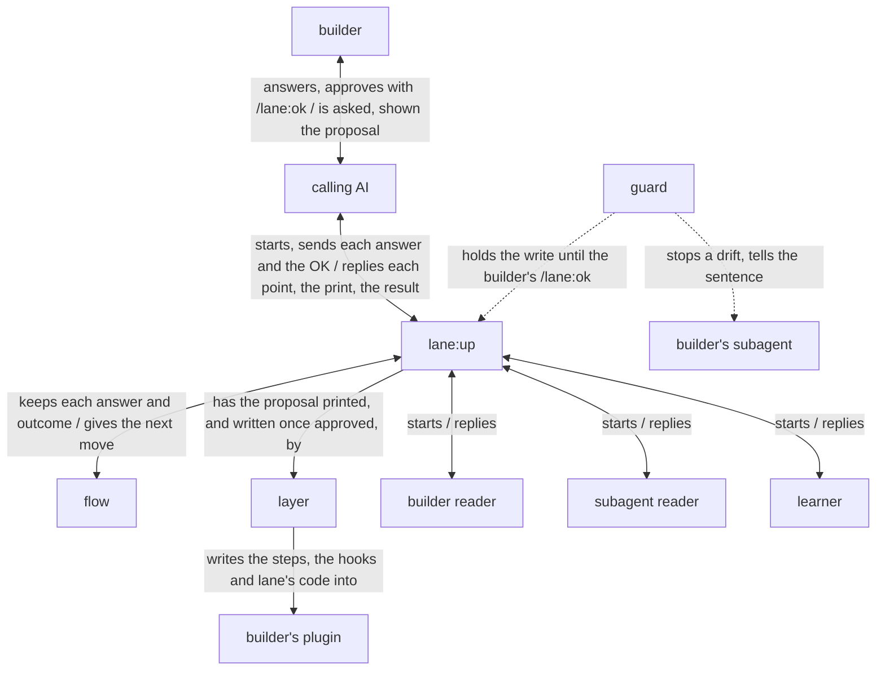

# lane design

lane is built on [how a plugin works](../architecture.md), and is itself a plugin of that form:
`lane:up`, the orchestrator an AI starts, walks a course its flow, a script, keeps: it hears the
builder through that AI, proposes, has the proposal read by AIs that did not make it, and, once the
builder approves it with a command of their own, has the layer, a script, write it. What lane
writes into the builder's plugin is lane's code, the guard, which notices a subagent's drift from
its lanes and tells it the step again. The goal and the key result are in [lane's UX](ux.md).

lane holds the [principles every plugin holds](../architecture.md#principles), and its own:

1. The AI is made to notice its drift from a step and is told the step again, so it finds its way
   back itself.
2. A lane is a sentence of a step together with the hook that notices a drift from it.

## User stories

- As the builder, I want to ask Claude to lay lanes on my plugin, answer one point at a time,
  approve the lanes proposed by typing `/lane:ok`, and find them written into my plugin with lane's
  code.
- As the builder, I want `lane:up`, started again on my plugin after a run stopped, to go on from
  the last answer I gave.
- As the builder, I want `lane:up`, run where an older copy of lane's code is, to bring the copy
  and the hooks to its own version.
- As the builder, I want my subagent, when a call drifts from a lane, to be stopped and told the
  lane's sentence headed by my plugin's name, and every call the sentence allows let through.
- As the builder, I want to be told when a step I changed no longer says a lane's sentence, while
  my subagent goes on.
- As the builder, I want the hooks, on a machine without Python 3.9 or later, to stop the calls
  they watch, each asking for Python to be installed, and at a subagent's end to tell me so and
  let it end.
- As the builder, I want, after each run of `lane:up`, the lessons on how it went, and to choose
  where each goes.

## Architecture

### Logical view



- The calling AI starts `lane:up` with the plugin's folder as JSON, and `lane:up` first runs the
  flow, which gives it the run's state and then each next move, which `lane:up` takes.

  `lane:up`'s course, hearing, proposing, having the proposal read, approved and written, and
  learning from the run, is the same on every run, so a script keeps it and `lane:up` cannot go on
  without it (every plugin's principle 6). Started from JSON, `lane:up` has the run's values its
  own lanes take.
- On a plugin whose copy of lane's code is older than lane's, the layer first brings the copy and
  each hook to the current form, keeping what they say, and the run then goes on as any other.

  Bringing a copy up asks the builder nothing of what it keeps, as all of it was approved before. A
  lane the current version no longer lays, or lays taking other things, is left out of its hook
  and put to the builder as a point, to lay again or leave out: kept in the hook, the guard could
  not read the command and would let every call it watches through, and left out unsaid, a lane the
  builder approved would be gone with no one told.
- `lane:up` reads the plugin's skills, agents and hooks, and gives the calling AI, one reply at a
  time, each point the files leave open, a question with its recommendation, and each fact it found
  with where it found it; the calling AI puts each to the builder and sends the answer back. The
  hearing is done when no point is left open.

  A fact found is shown as a point too, since the proposal rests on it, and a fact the builder reads
  otherwise is assumed in their place (dev/architecture.md, Hearing until nothing is left to
  decide).
- `lane:up` keeps each answer in the state as it is given, before its next move; started again on
  a plugin whose state is there, it goes on from the first point not yet answered.

  A run stopped anywhere then goes on from there, and no answer is asked twice (every plugin's
  principle 6).
- With every point settled, `lane:up` keeps its proposal in the state and has the layer print it:
  for each subagent step, the lanes it would lay, each under its action, with the step as it would
  read and its hooks.

  A lane is proposed only for a sentence of a step whose drift shows in a tool call; what shows in
  no call, such as what the subagent weighs, has no lane, since no hook can see it.
- Before the builder sees a print, the builder reader reads it in the builder's place, with their
  plugin beside it, and the subagent reader reads each subagent's file as it would read with its
  lanes, in that subagent's place on a run; each is started anew, given no verdict but its own,
  and gives its findings to `lane:up`, which changes the proposal by those it finds hold and has
  the new print read again, three times at most; a finding still left goes to the builder with the
  print, as a point for them to decide.

  `lane:up` finds the lanes it meant; a reader that did not make them finds what the print and the
  steps give (every plugin's principle 4): the builder reader, a lane that keeps no sentence of its
  step or stops a call the step needs; the subagent reader, a step whose sentences cannot all be
  kept at once.
- `lane:up` hands on the print as its reply, and the calling AI shows it to the builder; a change
  the builder asks goes back to `lane:up`, which changes the proposal and has the print made and
  read again.
- The builder approves the print by typing `/lane:ok`, lane's command that no AI can call; the AI
  that showed the print sends the OK on to `lane:up`, which has the layer write the proposal as
  last printed into the plugin, with lane's code, and check that the plugin loads. The guard holds
  that write until the builder has typed `/lane:ok` since `lane:up` last handed on the print, and
  the layer writes only a proposal unchanged since its print. Where the builder wants no lanes at
  all, nothing is written.

  An OK an AI sends may be its own, and the builder would stand behind lanes they never approved;
  the builder's typing is theirs alone (dev/architecture.md, The caller approves what is theirs).
  What the builder approved is printed and written by a script from one file, so no AI copies it.
- Once the run has written or the builder has declined, `lane:up` has the learner read the records
  of every agent of the run, and puts each lesson to the builder through the calling AI, as
  [Learning from each run](../architecture.md#learning-from-each-run) says; the run then ends.
- In a subagent with lanes, the guard reads each tool call as one action, begin, read, write, run,
  test, hand on, wait or end, a command that writes a file being a write of it too, reads it
  against that subagent's lanes alone, and on a drift stops the call and tells the subagent
  `<plugin>: <sentence>`.

  A lane on the order of steps, such as reading an input whole before writing, is held from what
  the subagent has done since it started.
- A lane on how the subagent ends, test_after, end_when, every_item, or as_printed on its last
  reply, is held as it is about to end, from what it has done since it started and its last reply;
  on a drift the guard keeps it going with `<plugin>: <sentence>`. Told once, a subagent that
  answers in words alone, with no call since, is let end.

  It is told, not trapped: a subagent that cannot keep the lane would otherwise be kept going for
  good, and its reply would never reach the one who started it.
- A hook holds, for each of its lanes, the step, the lane and what the lane takes; the lane's
  sentence is made from them, by the lane's wording in [Lanes](../../lane/README.md#lanes) with
  every thing the lane takes put in. The layer writes that sentence into the step, and the guard
  makes the same one when it stops a call.

  So the sentence the subagent is told and the one its step says cannot differ, no sentence is
  written twice, and a lane holds only what its sentence says (lane's principle 2).
- A thing a lane takes is fixed in the step, such as `CHANGELOG.md`, or given for each run, written
  `{<name>}`, such as `{work}`: the value under that name in the JSON the subagent starts from, its
  prompt where it is a JSON object, and each JSON object a script laid by start_with prints, the
  later over the earlier. A list stands for each of its texts. The guard puts the run's value in
  before the lane's check, and tells the sentence as the step says it, with the value on the next
  line; until the subagent has been given the value, the lane lets every call through.

  A subagent's inputs and outputs are most often known only once its run starts, as a writer
  writes the files its run names; the JSON a subagent starts from is the one
  place a plugin hands them over, so a lane reads them there, the same way in every plugin.
- Laying again, the layer takes out of each step the sentence of each lane the subagent's hook held
  there before and the new proposal no longer lays, the rest of the step as it was; its print shows
  each step so.

  A sentence left behind would hold the subagent to what no hook keeps, beside the one that
  replaced it.
- Where the step a hook holds no longer has the lane's sentence, word for word with a line break
  read as a space, the guard lets the call through and tells the builder that the step no longer
  says it, and that `lane:up` run again lays the lanes to the steps.

  A lane is its sentence with its hook (lane's principle 2), so with the sentence gone there is no
  lane to hold. The step is the builder's and changed by them, and only they can have `lane:up`
  run (every plugin's principle 2); a subagent stopped could not put it right, and its work would
  be left for the builder to finish (every plugin's principle 7).
- Where lane's code cannot run on the machine, each hook stops every call it watches in its
  subagent, saying what to install; a hook at a subagent's end says it to the user and lets the
  subagent end.

  Letting the call through would leave it unkept with no one told; a subagent cannot install
  Python, and kept going it would only be asked again.

### Physical view

```
lane/                          the plugin, installed by Claude Code
├── agents/
│   ├── up.md                  lane:up, the orchestrator <agent>
│   ├── builder-reader.md      the builder reader <agent>
│   ├── subagent-reader.md     the subagent reader <agent>
│   └── learner.md             the learner <agent>
├── skills/ok/SKILL.md         /lane:ok, the builder's approval <skill>
├── scripts/lay.py             the layer and the flow <Python 3>
├── hooks/
│   ├── hooks.json             the lanes on lane's agents
│   └── lane/                  lane's code, put in each plugin <Python 3>
│       ├── pretooluse.py      the event script for lanes on a tool call
│       ├── subagentstop.py    the event script for lanes on how the subagent ends
│       ├── hook.py            what the event scripts run on: the event read, each check run
│       ├── call.py            a tool call read as one action
│       ├── shell.py           what a shell command reads and writes
│       ├── forms.py           the forms in_form holds an output to
│       ├── schema.py          a JSON Schema, and a value held to it
│       ├── template.py        a Markdown template, and a file held to it
│       ├── step.py            a subagent's step, read from its file
│       ├── record.py          what the subagent did before, from its record
│       ├── started.py         what the subagent started from, for a thing given for each run
│       └── lanes/<lane>.py    one check per lane
└── README.md                  its Lanes: each lane, its action and what its hook notices
```

- `lane:up` runs on Claude Code, python3 3.9 or later and jq, and the guard on python3 3.9 or
  later; the layer checks the plugin with `claude plugin validate`.
- The calling AI starts `lane:up` as a subagent with the prompt `{"plugin": "<folder, absolute>"}`.
  `lane:up` gives each point as its reply and ends its turn; the reply reaches the calling AI with
  `lane:up`'s agent ID, and the calling AI sends the answer to that ID with SendMessage, which
  resumes it.

  The Agent tool gives a subagent no name to be messaged by, and a subagent does not know its own
  ID, so it is reached by the ID its reply comes with, from the main conversation and from a
  subagent alike, as tried on Claude Code 2.1.306.
- The flow is `lay.py next` on the plugin's folder: it prints, first, `{"state": "<path>"}`, and
  then the next move, one tool call as a JSON line where the move is one, such as running the
  layer or starting a reader, and in words where it is `lane:up`'s own, such as giving the next
  point.
- The run's state is a JSON file in lane's data folder, `${CLAUDE_PLUGIN_DATA}/<plugin>.json`,
  holding each point with its answer as given, the proposal, each reader's findings, and what the
  layer printed and wrote. `lane:up` changes its part with `jq`, and the layer and the flow theirs;
  the flow removes the file once the run ends. Claude Code keeps that folder for the plugin's own
  files across its updates (plugins-reference, Environment variables).
- `/lane:ok` is `skills/ok/SKILL.md` with `disable-model-invocation: true`, whose steps send the OK
  on to whom the print came from. Claude Code refuses the Skill tool for it, so it runs only from
  the builder's typing, which the main conversation's record holds as the builder's own message.
- In the builder's plugin, the layer writes:

  ```
  <plugin>/
  ├── agents/                      the subagents' steps
  └── hooks/
      ├── hooks.json               one entry per subagent and event
      └── lane/                    lane's code
  ```
- lane's code goes into `<plugin>/hooks/lane/`: in a plugin of the ccpm marketplace a relative link
  to lane's, which installing copies into the plugin; anywhere else a copy, brought up by the next
  run of `lane:up`. Into a copy alone the layer writes `VERSION`, one line holding the version it
  reads from lane's `plugin.json`, by which the next run tells an older copy.

  lane's version is written once, in its `plugin.json`; a file of its own beside it would be a
  second copy that drifts.
- The guard holds each call to the 12 lanes of the README's Lanes, one file each in `lanes/`
  holding the lane's check and its wording: start_with, read_only, read_whole, write_only,
  in_form, hands_off, test_after, as_printed, follow_next, wait_for, end_when and every_item; a
  test holds that table to the wordings in `lanes/`.
- A lane's hook is one entry of the plugin's `hooks/hooks.json` for one subagent and event; its
  matcher is the tools that subagent's lanes watch, or at SubagentStop the subagent, and its command
  gives the guard the subagent and, for each lane, its step, the lane and what the lane takes. At
  SubagentStop the guard keeps the subagent going by exiting 2 with the sentence, which Claude
  Code gives it as its next instruction.

  ```json
  {"matcher": "Bash|Write|Edit",
   "hooks": [{"type": "command", "timeout": 10, "command":
     "<the Python check>; exec python3 \"${CLAUDE_PLUGIN_ROOT}/hooks/lane/pretooluse.py\" notes:changelog-writer 3:write_only:CHANGELOG.md '3:hands_off:git commit,git push'"}]}
  ```

  The layer leaves every other entry of the file as it was. Claude Code reads no hooks from a
  plugin subagent's own file, so the hooks are here.
- The guard acts only where the event's `agent_type` is the subagent its command names.

  A tool event's matcher filters by tool, not by agent.
- The guard tells the builder of a step that no longer says its lane's sentence by the hook's
  `systemMessage`, which Claude Code shows the user, and lets the call through.
- The guard reads a call in the forms the steps tell and the AI writes, not in every form the shell
  allows.

  A step that says `git commit` is held against `git commit`, `git -C notes commit` or
  `cd notes && git commit`, but not against `g=git; $g commit`. What must hold whatever the AI
  writes is held by GitHub's branch protection, Claude Code's sandbox or its permission rules, as a
  check on a command's text is no security boundary; so the guard stays small.

  A script or command a lane takes is read as the step writes it, such as
  `python3 "${CLAUDE_PLUGIN_ROOT}/scripts/prepare.py" given`, by the same reading as a call's words:
  python3 or sh before it left out, and its path in the plugin matched by the end of the call's.
  lane:up takes it from the step word for word.
- in_form's `<form>` is a file of the plugin, named in the step as
  `${CLAUDE_PLUGIN_ROOT}/<path in the plugin>`: a JSON Schema, in the keywords Anthropic's
  structured outputs accept, for JSON or JSONL, or a Markdown template, for its frontmatter keys and
  headings. The layer refuses a schema with any other keyword. A form of a project's own is left to
  the project's script, through test_after.

  They are the forms a plugin's outputs most often take, read with the standard library alone, and
  a keyword read past would let through, unseen, what the builder meant to stop. Claude Code puts
  the plugin's folder in for `${CLAUDE_PLUGIN_ROOT}`, so the subagent finds the form wherever the
  plugin is installed and does not take it for where to write. read_only lets the same subagent
  read the form, for the reason [Lanes](../../lane/README.md#lanes) gives; the guard finds the
  subagent's in_form lanes in `hooks/hooks.json`, as it finds the scripts its start_with runs, since
  a lane's check is given only what that lane takes.
- The guard holds a write of the output to its form before it is made, by Write's content or by
  Edit's result, and stops a command writing the output, as its text cannot be read before it runs.
  After the sentence it tells the first point the text is out by.

  One point at a time is what the subagent puts right; the sentence first keeps it on its step.
- The end lanes count only what this run did: test_after a run of the test after the last change to
  the output, ending with the test's own exit; end_when an output this run wrote that is there;
  every_item each item of the input that begins with an ID, answered by that ID in the last reply or
  in a file written this run.

  A failure hidden by a command after the test, a file left from an earlier run, or an item with no
  ID to tell its answer by would let the subagent end with its work undone.
- as_printed and follow_next hold every other hand-on or call once their command has printed, until
  the print is handed on word for word, or the move it prints, one tool call as a JSON line, is
  made. A hand-on is an Agent call's prompt, a SendMessage's message or the subagent's reply.

  `lane:up` gives the builder its proposal as its reply. The move printed as the tool call itself
  is a form general to any plugin.
- wait_for holds its commands until the approval reaches the subagent after it last asked: an
  approval that is a command, such as `/lane:ok`, only as the person typed it, read from the main
  conversation's record at the event's `transcript_path`; any other, as a message, by SendMessage
  or by a reply that ended its turn.

  A command with `disable-model-invocation: true` reaches the record only by the person's typing,
  so an approval the person must give cannot come from an AI (every plugin's principle 2).
- A subagent's record is the JSONL file Claude Code writes at
  `<transcript_path without .jsonl>/subagents/agent-<agent_id>.jsonl`, from the tool event's
  `transcript_path` and `agent_id`, as Claude Code 2.1.306 writes it; neither the place nor the
  shape is documented, so the guard's tests hold both, as they hold how the main conversation's
  record shows a command the person typed. The calls of one reply are written there once their
  hooks have run, so a lane on the order of steps reads the replies before. A reply that ended the
  turn is the entry whose `stop_reason` is `end_turn`; one a stop hook kept going reached no one
  and is left out, as is a call a hook stopped, which never ran.

  So a call sent in the same reply as the move a lane waits on is held once, and passes when sent
  again.
- At SubagentStop the guard reads the last reply from the event, and from the record whether the
  subagent has answered in words alone since it was told, as the event shows only that a stop hook
  has kept it going once.
- Each hook command first runs the Python check, which, where `python3` is missing or older than
  3.9, writes `notes: install Python 3.9 or later, run as python3, for its hooks to run` and exits
  2 on a tool call and 1 at a subagent's end, on an event of its subagent alone, found in the
  event's text by the shell.

  A tool event's matcher tells tools apart, not agents, and with no Python the guard cannot read the
  event; the shell's own words read it, as the machine may have nothing else.
- `lane:up` is held by lanes of its own, laid by the layer: start_with and follow_next on the flow,
  write_only on `{state}`, as_printed on handing on the layer's print, and wait_for on the layer's
  write until `/lane:ok`; lane's other agents have the lanes their steps call for, laid the same
  way. On lane itself the layer leaves lane's code as it is.

  The flow's first print gives `lane:up` the state's path as a run's value, so its writes are held
  to the state wherever lane's data folder is, and the builder's plugin is written by the layer
  alone (every plugin's principle 2).

## Verification

### Units

Each agent is checked on Claude Code's default model, the one users run lane on, and judged from
the records of every conversation and agent the check started. Each unittest below runs in
`dev/lane/tests/`, by [`dev/check.sh`](../check.sh) with lines and branches 100% covered and by
[`dev/mutate.sh`](../mutate.sh) with no mutant surviving.

- The guard: each lane stops a drift from its sentence in the forms the steps tell, tells the
  sentence read from its step, and lets through every call its sentence allows; wait_for lets its
  commands run after a command approval only once the person typed it, and not on an AI's message
  holding it; a lane whose step no longer says its sentence lets the call through and tells the
  builder.
  - Flow: unittest fed the events, records, main conversation records and subagent files each lane
    receives, with Hypothesis on how a call is read.
- The Python check: it stops the hook with its message where `python3` is missing or older than
  3.9, exiting 2 on a tool call and 1 at a subagent's end, lets an event of another agent through,
  and lets the hook run otherwise.
  - Flow: unittest runs a hook's command with a `PATH` holding no `python3`, one holding a `python3`
    older than 3.9, and the one in use.
- The flow: from each state it gives the move the logical view's order sets, and from a state with
  answers kept, the first point not yet answered.
  - Flow: unittest on a state made for each move, and on one stopped after each kind of move.
- The layer: what it writes is the approved proposal, with every other entry of `hooks/hooks.json`
  as it was; it writes no proposal changed since its last print; and an older copy is brought up
  with what it keeps unchanged, each lane it cannot keep said.
  - Flow: unittest on a plugin made for each test: a new plugin, one with hooks of its own, one
    with an older copy, one in the ccpm marketplace.
- `/lane:ok`: no AI can call it.
  - Flow: an AI asked to approve a print calls the Skill tool for it; passes when the record shows
    the call refused.
- `lane:up`: the run goes in the order of the logical view.
  - Flow: on a plugin with one orchestrator skill and one subagent of three steps, with the calling
    AI and the builder stood in for by answers set beforehand; passes when the records show one
    point per reply, each fact found shown to confirm, each answer in the state before the next
    move, each print read by both readers, neither given another's verdict, before it is handed
    on, the layer's write run only after the stand-in builder typed `/lane:ok`, and the learner
    started at the end with the records of every agent of the run.
  - Content: on the README's `notes` and on a trial plugin whose steps call for every lane;
    passes when each proposed lane is one of the README's Lanes, and each step's drift that shows
    in a tool call has its lane.
- The readers: each finds what the print or the steps give in its receiver's place.
  - Content: on the trial plugin's proposal with a lane put in that stops a call its step needs,
    and a step given a sentence that cannot be kept with another of its lines; passes when the
    builder reader finds the first and the subagent reader the second.
- The learner: each lesson rests on the run's records.
  - Content: on the records of the `lane:up` trials; passes when each lesson quotes the words it
    rests on.

### Acceptance

Each trial runs in `lovaizu/playground`, one at a time, on a branch of its own, and the branch and
whatever it made there are removed after.

- Flow: a stand-in for the calling AI starts `lane:up` on the README's `notes` and answers, the
  stand-in builder types `/lane:ok`; the steps and the hooks are written and
  `claude plugin validate --strict` passes.
- Laying lanes: the files hold the approved steps and hooks word for word.
  - Read from the files against the proposal in the records.
- The builder's approval: an OK the calling AI sends with no `/lane:ok` typed leaves the plugin
  unwritten.
  - Read from the files and the records.
- A run stopped: `lane:up`, stopped after an answer and started again on `notes`, gives the next
  point and asks none answered again.
  - Read from the records.
- Bringing an older copy up: on `notes` with lane's code of an older version, `lane:up` leaves the
  current code and the same lanes in the current form.
  - Read from the files.
- A drift stopped: `changelog-writer`, given a task that invites a commit, is stopped with its lane's
  sentence headed by `notes:`, ends with the changelog written and uncommitted, and none of its
  other calls is stopped.
  - Read from its record.
- A step changed: on `notes` with step 3 of `changelog-writer` changed so it no longer says a
  lane's sentence, the subagent's calls go through and the builder is told.
  - Read from the records.
- Python missing: on `notes` with no `python3` on the `PATH`, `changelog-writer`'s first watched
  call is stopped with the request to install Python 3.9 or later.
  - Read from the records.
- Every lane: on the trial plugin, each lane lets through every call of a subagent keeping its
  step, and stops a drift from it with its sentence, the run's value on the next line where it
  takes one, and the subagent goes back to the step.
  - Read from the records, the drift brought about by the run's prompt.
- The lessons: after each `lane:up` trial, the builder is given the learner's lessons and the
  choice of where each goes.
  - Read from the records.
- KR1.1: the defects of the UX's KR1.1 met on `notes` and on the trial plugin.
  - Counted from the records of each trial and the files, apart for each kind of defect and each
    lane, so a lane that gives the builder nothing shows; each version is compared with the one
    before it on the same plugins.

A change is taken when every story is still achieved and KR1.1 does not grow.
