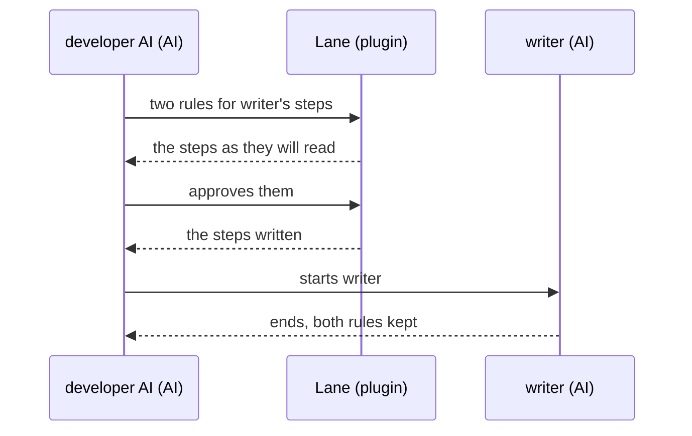
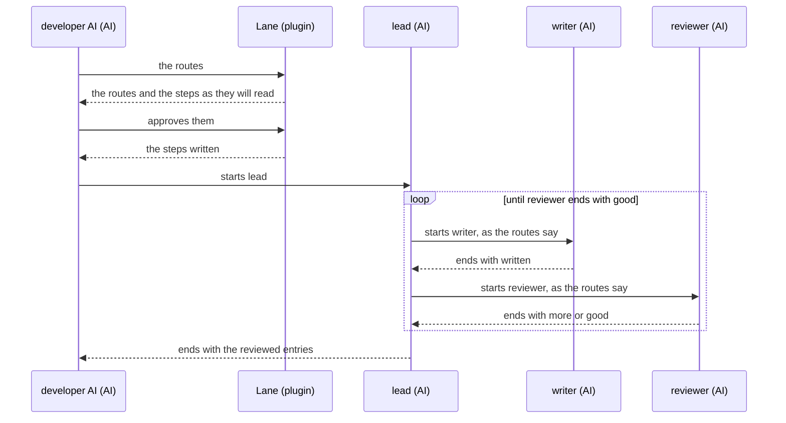

# Lane UX

Lane's user is the developer AI, an AI that builds a Claude Code plugin whose subagents work in
numbered steps.

## OKRs

- O1: The developer AI has its plugin's subagents keep the rules of their steps on every run,
  without writing checks.
  - A rule is a sentence in a step that the subagent must keep, such as "Run only
    `git log --oneline`."
  - KR1.1: Of the subagents' tool calls and ends of their work, the share that goes wrong. A call
    goes wrong when it breaks a rule and goes through, when it breaks a rule, is stopped and is
    then done another way, or when the rules allow it and it is stopped. Lower is better.
  - KR1.2: The lead time from the developer AI's first rule for a plugin to the first run whose
    subagents keep the rules. Shorter is better.
- O2: The developer AI has its plugin's subagents started in the order it set, on every run,
  without writing code for the order.
  - KR2.1: Of the plugin's runs, the share that goes wrong. A run goes wrong when a subagent starts
    that the order does not name, or when a start that the order names is stopped. Lower is better.
  - KR2.2: The lead time from the developer AI's first order for a plugin to the first run that
    keeps it. Shorter is better.

In each objective, the first key result comes first. A change shortens the lead time only if it
keeps the first key result as good.

Key results have no target values. A measure that becomes a target stops being a good measure
(Goodhart's law), so the key results serve only to judge how close the objective is.

## Scenarios

Both scenarios run on `changelog`, a plugin that the developer AI builds to write a project's
`CHANGELOG.md`. The participants:

- **developer AI** (AI): builds `changelog`, and runs it to try it.
- **Lane** (plugin): what the developer AI gives its rules and routes to.
- **`lead`** (AI): the subagent of `changelog` that starts the others.
- **`writer`** (AI): the subagent of `changelog` that writes the new entries into `CHANGELOG.md`.
- **`reviewer`** (AI): the subagent of `changelog` that compares the entries with the commits.

No step waits for a person. Each subagent runs in the background, so the developer AI's
conversation stays free while it runs.

### O1: The developer AI holds writer to two rules

### O2: The developer AI has lead start writer and reviewer in its order

The order the developer AI sets is its routes. A route names the subagent that `lead` starts next
after another one ends with a given result, a word such as `more`.

