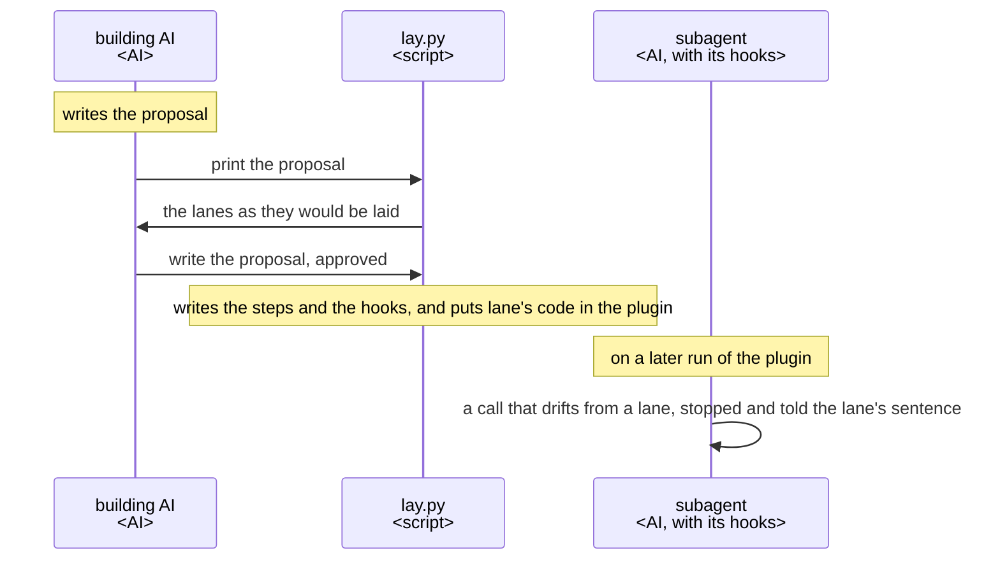
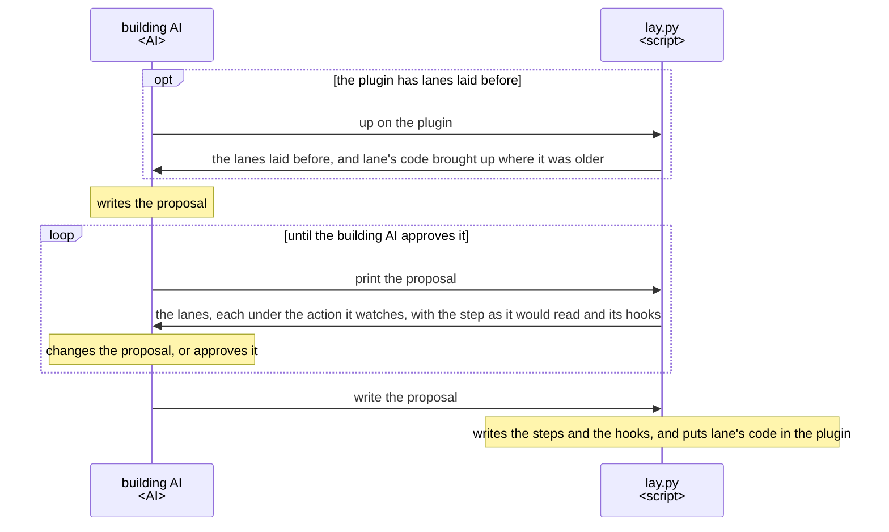
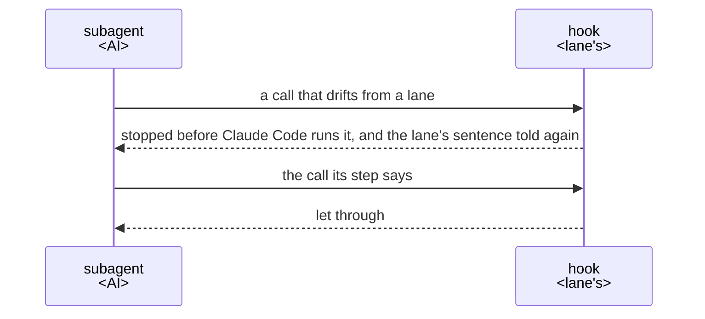
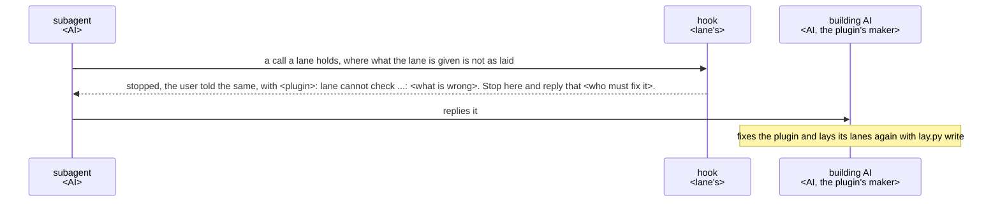

# lane UX

lane lets a plugin's subagents notice when they drift from the steps the building AI set, and tells
them the right way, with lanes. Build and change every part of lane so that the building AI gets
what this UX says, and judge each change by its key result.

A lane is laid on one step of a subagent, one numbered item of its Steps. It is a sentence of that
step with a hook that notices when the subagent drifts from it and tells it the sentence again.

## Users and goals

- G1: The building AI, an AI building a Claude Code plugin whose work an AI does in several steps,
  wants each subagent of that plugin, on every run, to notice when it drifts from one of its steps
  and be told the right way, without writing the checks.

  The building AI, the main conversation or a step of another plugin, calls lane by running its
  layer, `lay.py`, on the lanes it proposes, and approves them itself; no person takes part.

## Key results

There is one key result, so none is traded against another. It has no target value: each version
is judged by how close it brings the building AI to the goal.

- KR1.1: The defects the building AI meets using lane as it is; fewer is better, and none once the
  goal is reached.

  Each of these counts as one defect:

  - a hook lets through a call that drifts from its sentence, in a form its step names, or stops a
    call the sentence allows;
  - something lane writes into the plugin must be changed or worked around by the building AI: a
    step, a setting such as an entry in the plugin's hooks file, or the copy of lane's code it puts
    there.

  Each is work the building AI does in lane's place, and one it misses is a run that drifts from the
  steps it set.

## Scenes

The building AI, `lay.py` and a subagent of the building AI's plugin take part; the proposal is the
file the building AI writes the lanes it proposes in, and the subagent is one with lanes laid in it.

### From proposing lanes to a run that drifts

### Laying lanes

- Lane's code is put in the plugin once for all its subagents: a link to it in a plugin of the ccpm
  marketplace, a copy with its version anywhere else. Where an older copy is, `lay.py up` brings
  the copy and the hooks to lane's version with the same lanes.

### A run that drifts

- The sentence the hook tells is prefixed by the plugin's name.
- A hook acts only in the subagent its lane is laid in; what must hold whatever the AI does, such as
  a merge, is held by GitHub's branch protection or Claude Code's permission rules, not by lane.
- On a machine without Python 3.9 or later, the hooks stop the calls they watch, each asking for
  Python to be installed, and at a subagent's end tell the user so and let it end.

### A lane lane cannot check

- What lane cannot check is never let through: the subagent can only report it, and the plugin's
  maker, or Claude Code where the event is what is wrong, puts it right.

## Benefits

- The building AI proposes and approves lanes instead of writing checks; noticing a drift and
  telling the sentence are lane's, and already tested.
- Hooks stay few, laid only where a step alone is not sure to hold.
