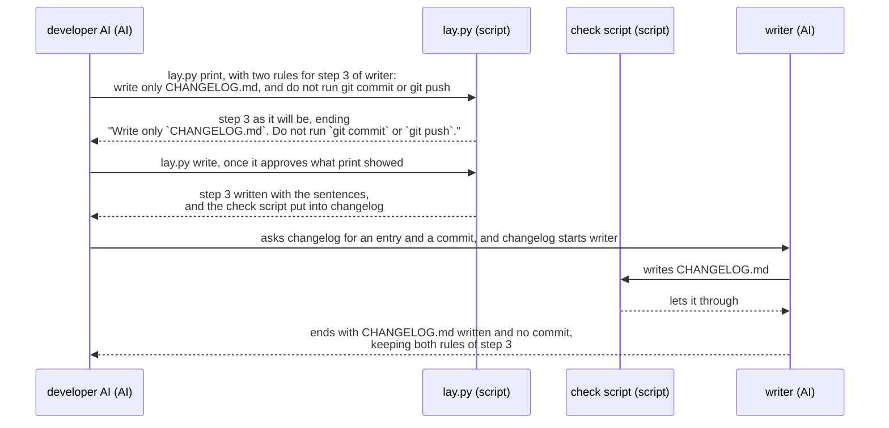
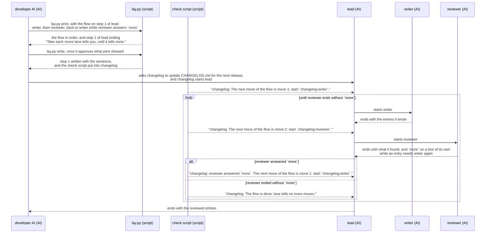

# Lane UX

Lane's user is the developer AI: an AI that builds a Claude Code plugin whose subagents work in
numbered steps. A rule is a sentence in a step that the subagent must keep, such as
``Do not run `git commit` or `git push`.`` The orchestrator is the subagent that starts the others.
The flow is the order in which it starts them, with the answers that send the work back. The
developer AI sets the flow. A move is one start of a subagent that the flow names.

## OKRs

- O1: The developer AI has its subagents keep the rules of their steps on every run, with no check
  code of its own.
  - KR1.1: Of the subagents' tool calls and ends of their work that break a rule, the share that
    goes through. Lower is better.
  - KR1.2: Of the subagents' tool calls and ends of their work that the rules allow, the share that
    is stopped. Lower is better.
  - KR1.3: Of the breaks that are stopped, the share after which the subagent still does not keep
    the rule, such as by trying another way. Lower is better.
  - KR1.4: The lines of code that the developer AI writes by hand for a plugin so that its
    subagents keep the rules. Fewer is better.
  - KR1.5: The time from the developer AI's first rule for a plugin to the first run in which its
    subagents keep the rules. Shorter is better.

  KR1.1 comes before KR1.2: a break that goes through is what the rule is there to stop, while a
  subagent stopped on an allowed call is told why and tries again.
  KR1.1 and KR1.2 each come before KR1.4 and KR1.5: a wrong check acts on every run, while the
  developer AI spends the lines and the time once for each plugin.
- O2: The developer AI has its orchestrator start the other subagents in the order of its flow on
  every run, with no script of its own for the order.
  - KR2.1: Of the plugin's runs, the share in which the subagents are not started in the order of
    the flow. Lower is better.
  - KR2.2: Of the orchestrator's tool calls and ends of its work that the flow allows, the share
    that is stopped. Lower is better.
  - KR2.3: The lines of code that the developer AI writes by hand for a plugin so that its
    subagents start in the order of the flow. Fewer is better.
  - KR2.4: The time from the developer AI's first flow for a plugin to the first run that keeps
    it. Shorter is better.

  KR2.1 comes before KR2.2: a run out of order does not give what O2 says, while an orchestrator
  stopped on an allowed call is told why and tries again.
  KR2.1 and KR2.2 each come before KR2.3 and KR2.4, for the same reason as in O1.

Key results have no target values. When a measure becomes a target, it stops being a good measure
(Goodhart's law). Use the key results to judge how close the objective is.

## Scenarios

Both scenarios run on `changelog`, the developer AI's plugin that writes a project's
`CHANGELOG.md`. The developer AI is an AI, and runs `changelog` itself to try it. `lay.py` is
Lane's script that the developer AI runs. The check script is the script that `lay.py` puts into
`changelog`. The subagents of `changelog` are AIs: `lead` is the orchestrator, `writer` writes the
new entries into `CHANGELOG.md`, and `reviewer` compares the entries with the commits. No step
waits for a person.

### O1: The developer AI holds writer to two rules of its step

### O2: The developer AI has lead start writer and reviewer in its flow's order

