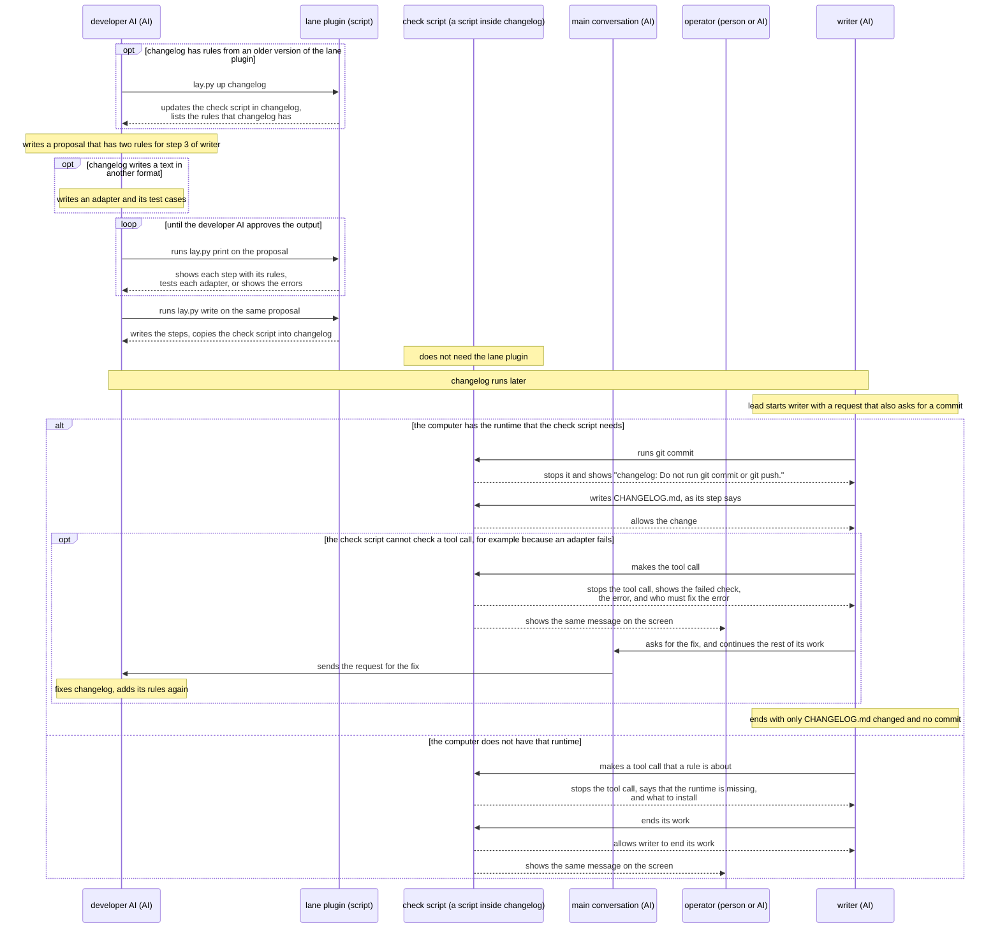
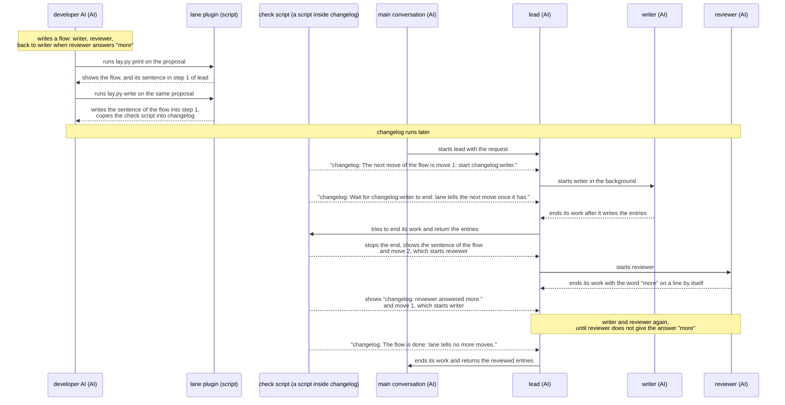

# lane UX

This document says who uses the lane plugin, what they use it for, and how they reach that goal. The
maintainers of the lane plugin build it to deliver this experience.

The user of the lane plugin is the developer AI: an AI that builds a Claude Code plugin. In that
plugin, subagents do the work in numbered steps. A tool call is one use of a tool by a subagent,
such as a command that it runs or a file that it writes. A subagent follows a step if all its tool
calls agree with the step and the end of its work also agrees with the step.

A rule has two parts: a sentence in a step, and a check of that sentence. The lane plugin calls a
rule a "lane". The check runs on each tool call that the sentence is about, and when the subagent
ends its work. A violation is a tool call or an end of work that does not agree with the sentence of
a rule. When the check finds a violation, the check stops that tool call or that end of work. Then
the check shows the sentence of the rule to the subagent again.

The developer AI writes the rules that it wants in a proposal, which is a JSON file. The lane plugin
adds the rules to the developer AI's plugin, here `changelog`. The lane plugin writes each sentence
into its step. The lane plugin also copies a script that does the checks into `changelog`. This
document calls this script the check script. Each message from the check script starts with the name
of the plugin, such as `changelog:`. In these messages, the check script calls itself "lane".

Some checks read a text that the developer AI's plugin writes, such as a list of items that a
subagent must answer. The check script reads each such text in one format. The documents of the lane
plugin describe this format. If the plugin writes the text in another format, the developer AI
writes an adapter as well. An adapter is a small script that converts the other format into the
format that the check script reads. The developer AI also writes test cases for the adapter. Each
test case has two parts: an input for the adapter, and the output that the adapter must give for
that input. The lane plugin runs the adapter on its test cases before it adds the rules. The adapter
only converts the format. The check script still decides what is a violation.

A flow is the order in which one subagent, the orchestrator, starts the other subagents. In the
flow, the developer AI names the answers that send the work back to an earlier subagent. For
example, the developer AI can name the answer `more`. A subagent gives such an answer when it ends
its work with that word on a line by itself. The messages from the check script call each start in
the flow a "move". The messages number the moves in the order of the flow: move 1, move 2, and so
on. The orchestrator follows the flow if it starts the other subagents in the order that the flow
and their answers require. In addition, the orchestrator must end its work only after the flow is
complete. The lane plugin turns the flow into a rule. The lane plugin adds this rule to one step of
the orchestrator. The sentence of that rule is `Take each move lane tells you, until it tells none.`
This document calls this sentence the sentence of the flow.

## OKRs

- O1: The developer AI wants the subagents of its plugin to follow their steps every time that the
  plugin runs. The developer AI does not want to write the code for the checks.
  - KR1.1: The percentage of violations that the check script allows. Lower is better.
  - KR1.2: The percentage of the tool calls and ends of work that the rules allow, but that the
    check script stops. Lower is better.
  - KR1.3: After the check script stops a violation, the subagent sometimes still does not follow
    its step. For example, the subagent finds another way around the rule, or it stops its work.
    This key result is the percentage of such cases among all stopped violations. Lower is better.
  - KR1.4: The number of lines of code that the developer AI writes or changes by hand so that the
    subagents follow their steps. This count includes the adapters but not the proposal. Fewer is
    better.
  - KR1.5: The time from the first proposal that the developer AI writes to the first time that its
    plugin runs and the subagents follow their steps. Shorter is better.
- O2: The developer AI wants the orchestrator of its plugin to follow the flow every time that the
  plugin runs. The developer AI does not want to write a script that controls the order of the
  subagents.
  - KR2.1: The percentage of times that the plugin runs and the orchestrator does not follow the
    flow. Lower is better.
  - KR2.2: The percentage of the tool calls and ends of work of the orchestrator that the flow
    allows, but that the check script stops. Lower is better.
  - KR2.3: The number of lines of code that the developer AI writes or changes by hand so that the
    orchestrator follows the flow. This count includes the adapters but not the proposal. Fewer is
    better.
  - KR2.4: The time from the moment when the developer AI writes the flow to the first time that its
    plugin runs and the orchestrator follows the flow. Shorter is better.

Key results have no target values. When a measure becomes a target, it stops being a good measure
(Goodhart's law). Use the key results to judge how close the objective is.

## Scenarios

The diagrams below have these participants:

- The developer AI is an AI. It approves the rules for `changelog` without help.
- The lane plugin is a script. The developer AI runs the lane plugin as `lay.py`.
- The check script is a script. The check script runs inside `changelog`.
- The main conversation is an AI: the Claude Code conversation that runs `changelog`. When
  `changelog` needs a fix, the main conversation sends the request to the developer AI.
- The operator is a person or an AI. The operator runs `changelog` in Claude Code and sees the
  screen of Claude Code.
- `lead`, `writer` and `reviewer` are AIs. They are subagents of `changelog`. `lead` is the
  orchestrator. `writer` writes the new entries in the `CHANGELOG.md` file of a project. `reviewer`
  compares these entries with the commits of the project.

In the diagrams, a text in quotes is the text of a message that the check script shows.

### O1: The developer AI adds rules to a step of writer, and the check script stops a violation

The developer AI adds two rules to step 3 of `writer`. Later, while `changelog` runs, the check
script stops a violation by `writer`. The sentences of the two rules are `Write only CHANGELOG.md.`
and `Do not run git commit or git push.`

Claude Code can be the cause of the problem instead of `changelog`. In that case, the main
conversation sends the request to the makers of Claude Code. Some actions must never happen,
whatever an AI does. An example is a merge. The developer AI blocks such actions with the branch
protection of GitHub or the permission rules of Claude Code.

### O2: The orchestrator starts writer and reviewer in the order of the flow

The developer AI adds a flow to step 1 of `lead`. Later, while `changelog` runs, the check script
tells `lead` which subagent to start next. The check script stops each tool call of `lead` that does
not start that subagent. The check script also stops `lead` when `lead` tries to end its work before
the flow is complete. Then the check script tells `lead` two things: the sentence of the flow, and
the subagent to start next. While a subagent runs in the background, the check script stops only a
start of `writer` or `reviewer`. After that subagent ends, Claude Code starts `lead` again. At that
time, Claude Code does not always tell `lead` which subagent to start next. In that case, `lead`
learns which subagent to start next at its next tool call or at the end of its work. The check
script stops that tool call or that end, and it tells `lead` the next subagent.

