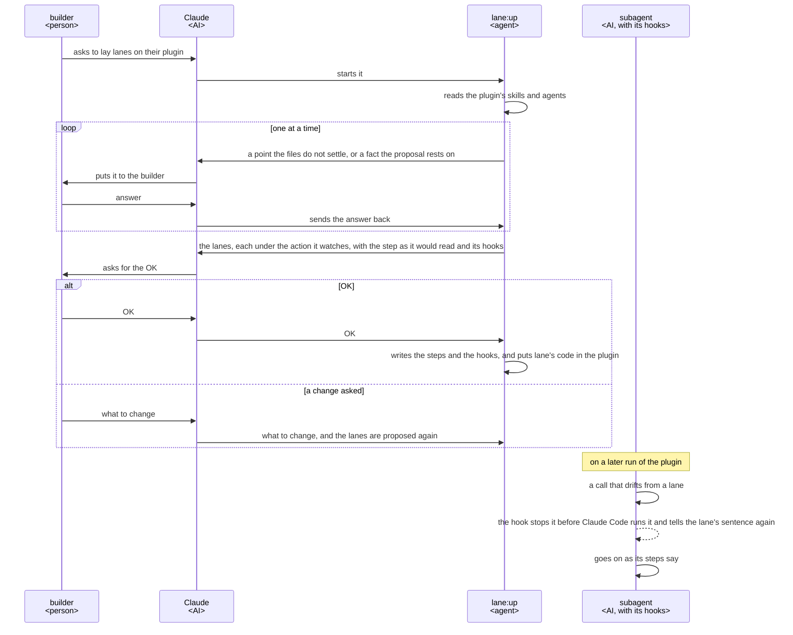

# lane UX

lane lets a plugin's subagents notice when they drift from the steps their builder set, and tells
them the right way, with lanes. Build and change every part of lane so that the builder gets what
this UX says, and judge each change by its key result.

A lane is laid on one step of a subagent, one line of its Steps. It is a sentence of that step with
a hook that notices when the AI drifts from it and tells the AI the sentence again.

## Users and goals

- G1: The builder, whoever builds a Claude Code plugin whose work an AI does in several steps, wants
  each subagent, on every run, to notice when it drifts from one of its steps and be told the right
  way, without writing the checks.

  An AI calls lane for the builder, the builder's Claude or a step of another plugin, by starting
  `lane:up`, lane's agent. A subagent cannot ask a person, so that AI puts
  `lane:up`'s questions to the builder and sends the answers back (dev/architecture.md, Where the
  orchestrator runs).

## Key results

There is one key result, so none is traded against another. It is judged against the version in
use, on the same plugins, with no target value.

- KR1.1: The defects the builder meets using lane as it is; fewer is better, and none once the goal
  is reached.

  Each of these counts as one defect:

  - a hook lets through a call that drifts from its sentence, in a form its step names, or stops a
    call the sentence allows;
  - something lane writes into the plugin must be changed or worked around by the builder: a step, a
    setting such as an entry in the plugin's hooks file, or the copy of lane's code it puts there.

  Each is work the builder does in lane's place, and one they miss is a run that drifts from the
  steps they set.

## Scenes

The figure shows who acts in turn, from asking for lanes to a run that drifts. Claude is the AI that
calls `lane:up` for the builder; a subagent is one of the plugin's, with lanes laid in it.

- Lane's code is put in the plugin once for all its subagents: a link to it in a plugin of the ccpm
  marketplace, a copy with its version anywhere else. Run again where an older copy is, `lane:up`
  brings the copy and the hooks to its own version.
- The sentence the hook tells is prefixed by the plugin's name.
- A hook acts only in the subagent its lane is laid in; what must hold whatever the AI does, such as
  a merge, is held by GitHub's branch protection or Claude Code's permission rules, not by lane.
- On a machine without Python 3.9 or later, the hooks stop the calls they watch, each asking for
  Python to be installed.

## Benefits

- The builder answers and approves instead of writing checks; noticing a drift and telling the
  sentence are lane's, and already tested.
- Hooks stay few, laid only where a step alone is not sure to hold.
