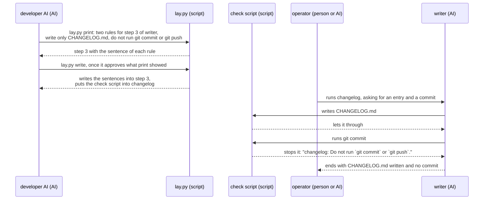
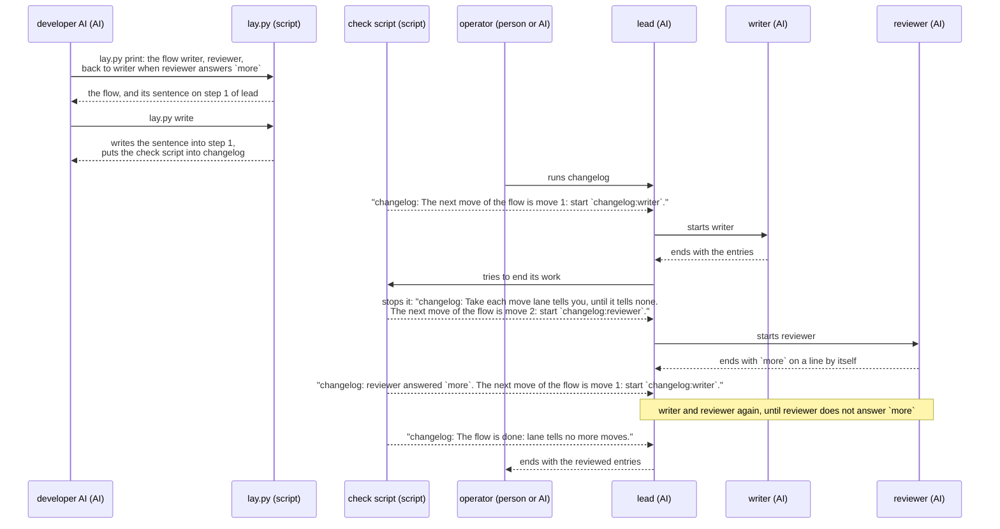

# lane UX

## OKRs

- O1: The developer AI, an AI that builds a Claude Code plugin, wants the subagents of its plugin to
  keep the rules written in their numbered steps on every run, without writing the code that checks
  them.
  - KR1.1: The share of tool calls and ends of work that break a rule and still go through. Lower is
    better.
  - KR1.2: The share of tool calls and ends of work that the rules allow but that are stopped. Lower
    is better.
  - KR1.3: The share of stopped breaks after which the subagent still does not keep the rule, for
    example because it tries another way. Lower is better.
  - KR1.4: The lines of code that the developer AI writes by hand so that its subagents keep the
    rules. Fewer is better.
  - KR1.5: The time from the developer AI's first rule to the first run in which the subagents keep
    the rules. Shorter is better.
- O2: The developer AI wants the orchestrator of its plugin, the subagent that starts the others, to
  start them in the order that the developer AI set, its flow, on every run, without writing a
  script for it.
  - KR2.1: The share of runs in which the orchestrator leaves the flow. Lower is better.
  - KR2.2: The share of the orchestrator's tool calls and ends of work that the flow allows but that
    are stopped. Lower is better.
  - KR2.3: The lines of code that the developer AI writes by hand so that the orchestrator keeps the
    flow. Fewer is better.
  - KR2.4: The time from the developer AI's first flow to the first run that keeps it. Shorter is
    better.

Key results have no target values. When a measure becomes a target, it stops being a good measure
(Goodhart's law). Use the key results to judge how close the objective is.

## Scenarios

The developer AI is an AI. `lay.py` of the lane plugin is a script, and so is the check script that
`lay.py` puts into the developer AI's plugin. The operator runs that plugin, and is a person or an
AI. The example plugin `changelog` has three subagents, each an AI. `lead` is the orchestrator, and
the check script tells it each move, the next subagent to start. `writer` writes new entries into
`CHANGELOG.md`. `reviewer` compares the entries with the commits.

### O1: A rule on writer's step stops a commit

### O2: The orchestrator starts writer and reviewer by the flow

