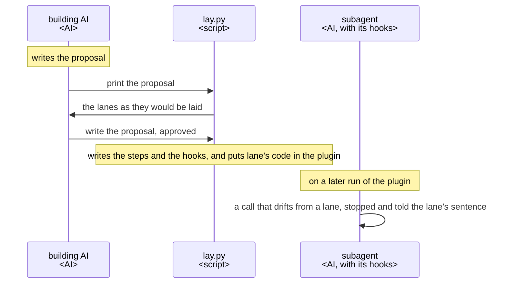
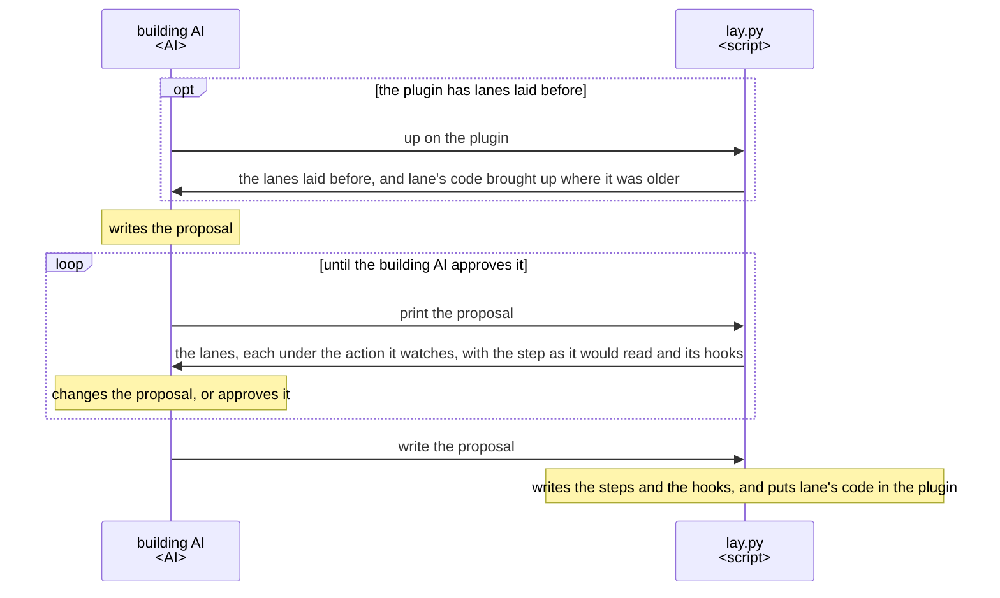
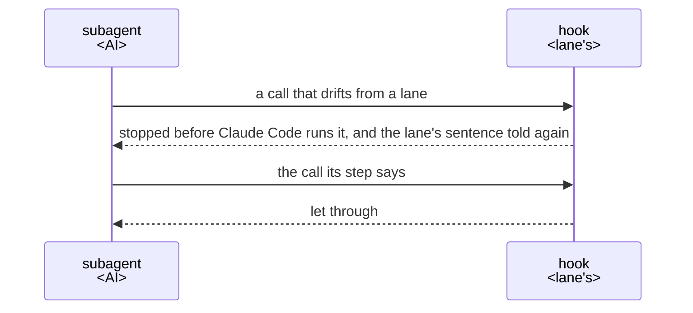
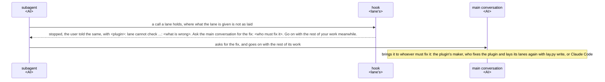

# lane UX

lane gives an AI that builds a Claude Code plugin subagents that notice when they drift from their
steps and are told the right way, with no check written by that AI. Whoever builds lane builds and
changes every part of it to this UX, and judges each change by its key result.

A lane is laid on one step of a subagent, one numbered item of its Steps. It is a sentence of that
step together with a hook that notices when the subagent drifts from the sentence and tells it the
sentence again.

## Users and goals

- G1: The building AI, an AI building a Claude Code plugin whose work an AI does in several steps,
  wants each subagent of that plugin, on every run, to notice when it drifts from one of its steps
  and be told the right way, without writing the checks.

  The building AI is the main conversation or a step of another plugin. It calls lane by running
  lane's layer, the script `lay.py`, on the lanes it proposes, and it approves them itself. No
  person takes part.

## Key results

- KR1.1: The defects the building AI meets using lane as it is; fewer is better, and none once G1 is
  reached.

  Each of these counts as one defect:

  - a hook lets through a call that drifts from its sentence, in a form its step names, or stops a
    call the sentence allows;
  - the building AI must change or work around something lane writes into the plugin: a step, a
    setting such as an entry in the plugin's hooks file, or the copy of lane's code lane puts there.

  Each defect is work the building AI does in lane's place, and one it misses is a run that drifts
  from the steps it set.

KR1.1 is the only key result, so the building AI never trades one against another. It has no target
value: each version is judged by how close it brings the building AI to G1.

## Scenes

The building AI, an AI, writes the proposal, the file that holds the lanes it proposes. `lay.py`,
lane's script, prints the proposal and writes it into the plugin. The subagent, an AI, is one of the
plugin's subagents with lanes laid in it. The main conversation, an AI, is the one the user talks
with, which the subagent asks for what lies outside its work. The hook, lane's code that Claude Code
runs on the subagent's calls, notices a drift and tells the subagent the lane's sentence.

### From proposing lanes to a run that drifts

### Laying lanes

- `lay.py` puts lane's code in the plugin once for all its subagents: a link to it in a plugin of
  the ccpm marketplace, and a copy with its version anywhere else. Where an older copy is, `lay.py
  up` brings the copy and the hooks to lane's version with the same lanes.

### A run that drifts

- The hook heads the sentence it tells with the plugin's name.
- A hook acts only in the subagent its lane is laid in. What must hold whatever the AI does, such as
  a merge, is held by GitHub's branch protection or Claude Code's permission rules, not by lane.
- On a machine without Python 3.9 or later, the hooks stop the calls they watch, each asking for
  Python to be installed. At a subagent's end they tell the user so and let it end.

### A lane lane cannot check

- The hook never lets through what it cannot check. The subagent asks for the fix and goes on with
  the rest of its work. The plugin's maker puts it right, or Claude Code where the event is what is
  wrong.

## Benefits

- The building AI proposes and approves lanes instead of writing checks. Noticing a drift and
  telling the sentence are lane's work, and already tested.
- The hooks stay few, as the building AI lays them only where a step alone is not sure to hold.
