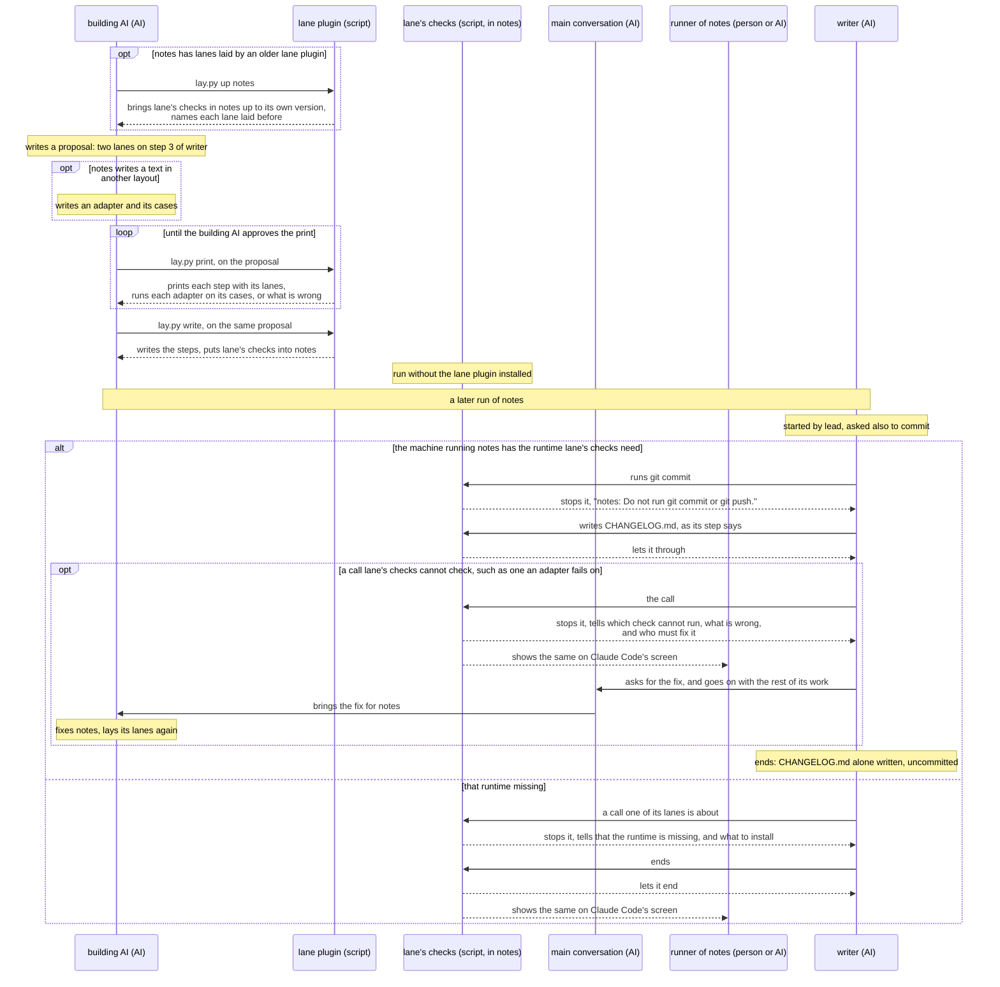
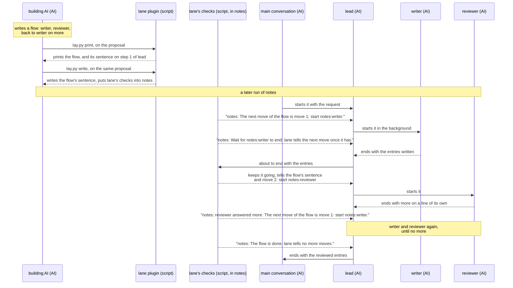

# lane UX

This document says who uses the lane plugin and for what, and how they reach it, so that its
developers build it to deliver that.

The lane plugin serves the building AI: an AI building a Claude Code plugin whose work subagents do
in steps. A step is one numbered item of what a subagent is told to do. A call is one use of a tool
by a subagent, such as running a command or writing a file. An end is a subagent ending its work. A
run keeps a step when each of its calls and its end go as the step says.

A lane is a sentence written into a step, together with a check of that sentence on each call the
sentence is about and at the subagent's end. A drift is a call or an end that goes against a lane's
sentence. On a drift, the check stops the call or the end. It then tells the subagent the sentence
again. The building AI writes the lanes it wants in a proposal, a JSON file. The lane plugin then
lays them. It writes each sentence into its step. It also puts a script into the building AI's
plugin, and this script makes the checks. This document calls that script lane's checks. The
building AI's plugin carries lane's checks and runs them itself. Every line that lane's checks tell
starts with the name of the building AI's plugin, such as `notes:`. These lines call lane's checks
"lane", as in `lane tells the next move`.

Some checks read a text that the building AI's plugin writes, such as the list of items a subagent
must answer. lane's checks read each such text in one layout, the one the lane plugin's docs give.
Where the building AI's plugin writes the text in another layout, the building AI also writes an
adapter. An adapter is a small script that turns that layout into the one lane's checks read. With
it the building AI writes the adapter's cases: each an input the adapter is given and the output it
must give. The lane plugin runs the adapter on its cases before it lays the lanes. The adapter only
turns the layout, and lane's checks still decide what is a drift.

A flow is the order in which one subagent, the orchestrator, starts the others. In the flow, the
building AI names the answers that send the work back to an earlier subagent, such as `more`. A
subagent gives such an answer by ending with it on a line of its own. A move is one start the flow
calls for, numbered by its place in the order. A run takes the order when its orchestrator starts
the other subagents as the flow and their answers call for, and ends only once the flow is done.
The lane plugin lays a flow as a lane on one step of the orchestrator. That lane's sentence is
`Take each move lane tells you, until it tells none.`, called the flow's sentence below.

## OKRs

- O1: The building AI wants each run of its plugin to keep the steps it set for each subagent,
  without writing a check itself.
  - KR1.1: The share of drifts that lane's checks let through; lower is better.
  - KR1.2: The share of the calls and ends that the lanes' sentences allow which lane's checks
    stop; lower is better.
  - KR1.3: The share of stopped drifts after which the subagent, told the sentence, does not take
    its step, but goes around it or stops its work; lower is better.
  - KR1.4: The lines of code the building AI writes or changes by hand to have its steps kept,
    adapters counted and the proposal not; fewer is better.
  - KR1.5: The time the building AI spends from its first proposal to a run of its plugin that keeps
    its steps; shorter is better.
- O2: The building AI wants each run of its plugin to take the order set in its flow, without
  writing a script for that order.
  - KR2.1: The share of runs that do not take the order; lower is better.
  - KR2.2: The share of the orchestrator's calls and ends that the flow allows which lane's
    checks stop; lower is better.
  - KR2.3: The lines of code the building AI writes or changes by hand to have the order taken,
    adapters counted and the proposal not; fewer is better.
  - KR2.4: The time the building AI spends from writing the flow to a run of its plugin that takes
    the order; shorter is better.

Key results have no target values. When a measure becomes a target, it stops being a good measure
(Goodhart's law). Use the key results to judge how close the objective is.

## Scenarios

The diagrams below have these participants:

- The building AI, an AI, is the user of O1 and O2. It builds `notes`, a made-up plugin, and
  approves the lanes laid in `notes` by itself.
- The lane plugin, a script, runs as `lay.py` when the building AI calls it.
- lane's checks, a script, run in `notes`.
- The main conversation, an AI, is the Claude Code conversation that runs `notes`. Where `notes`
  needs a fix, the main conversation brings it to the building AI, the maker of `notes`.
- The runner of `notes`, a person or an AI, runs `notes` in Claude Code and sees Claude Code's
  screen.
- `lead`, `writer` and `reviewer`, each an AI, are subagents of `notes`. `lead` is the
  orchestrator. `writer` writes the new entries of a project's `CHANGELOG.md`, and `reviewer` reads
  them against the project's commits.

A line in quotes in the diagrams is the text that lane's checks tell.

### O1: Lanes laid on the writer's step, and its drift stopped

The building AI lays two lanes on step 3 of `writer`, and on a later run lane's checks stop a
drift of `writer`. The two sentences are `Write only CHANGELOG.md.` and
`Do not run git commit or git push.`

Where Claude Code, not `notes`, is what is wrong, the main conversation brings the fix to Claude
Code's makers instead. lane's checks look only at the subagents with lanes. What must not
happen whatever an AI does, such as a merge, the building AI blocks with GitHub's branch protection
or Claude Code's permission rules.

### O2: The writer and the reviewer taken in their order

The building AI lays a flow on step 1 of `lead`, and on a later run lane's checks tell `lead`
each move. lane's checks stop each call or end of `lead` other than the move due. They then tell
`lead` the flow's sentence with the move. While a subagent that `lead` started in the background
runs, no move is due, and lane's checks stop only a start of `writer` or `reviewer`. After that
subagent ends, Claude Code may start `lead` again without the move. `lead` then learns the move at
its next call or end that is not the move.

