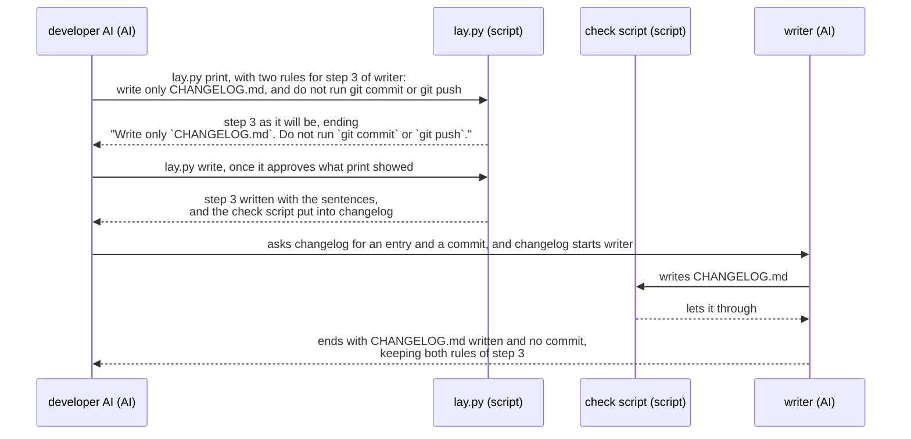
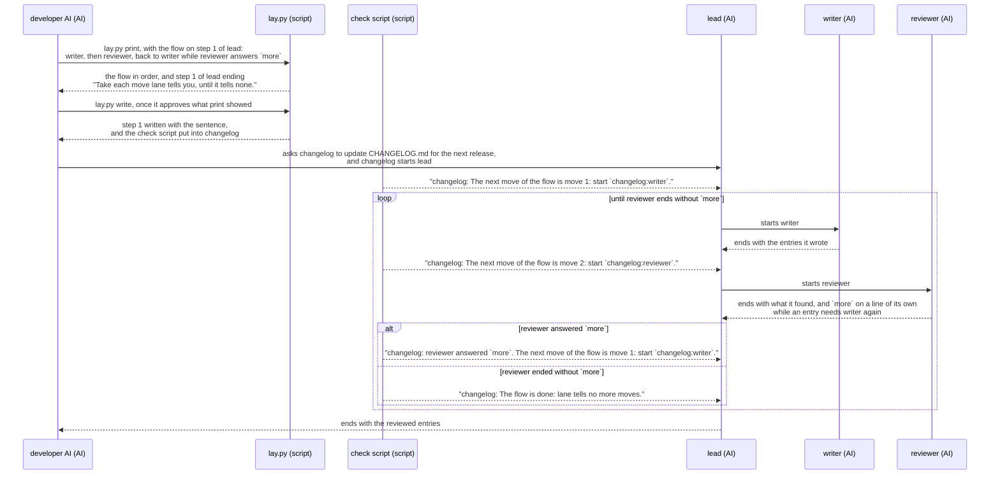

# Lane UX

Lane's user is the developer AI, an AI that builds Claude Code plugins.

## OKRs

- O1: The developer AI has its subagents keep the rules of their steps, the sentences they must
  keep, on every run, with no check code of its own.
  - KR1.1: Of the subagents' tool calls and ends of their work, the share that goes wrong: a break
    of a rule that goes through, a break that is stopped and then done another way, or a call the
    rules allow that is stopped. Lower is better.
  - KR1.2: The lead time from the developer AI's first rule for a plugin to the first run in which
    its subagents keep the rules. Shorter is better.
- O2: The developer AI has its orchestrator, the subagent that starts the others, start them in the
  order of its flow, the order the developer AI sets, on every run, with no script of its own for
  the order.
  - KR2.1: Of the plugin's runs, the share that goes wrong: the subagents are not started in the
    order of the flow, or the orchestrator is stopped on a call the flow allows. Lower is better.
  - KR2.2: The lead time from the developer AI's first flow for a plugin to the first run that keeps
    it. Shorter is better.

In each objective, the first key result comes first: the second is shortened only by a change
that keeps the first.

Key results have no target values. When a measure becomes a target, it stops being a good measure
(Goodhart's law). Use the key results to judge how close the objective is.

## Scenarios

Both scenarios run on `changelog`, the developer AI's plugin that writes a project's
`CHANGELOG.md`. The participants:

- developer AI (AI): builds `changelog`, and runs it itself to try it.
- `lay.py` (script): Lane's script that the developer AI runs.
- check script (script): the script that `lay.py` puts into `changelog`.
- `lead` (AI): the orchestrator of `changelog`.
- `writer` (AI): the subagent of `changelog` that writes the new entries into `CHANGELOG.md`.
- `reviewer` (AI): the subagent of `changelog` that compares the entries with the commits.

No step waits for a person.

### O1: The developer AI holds writer to two rules of its step

### O2: The developer AI has lead start writer and reviewer in its flow's order

