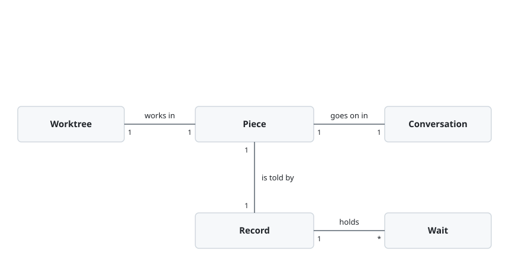
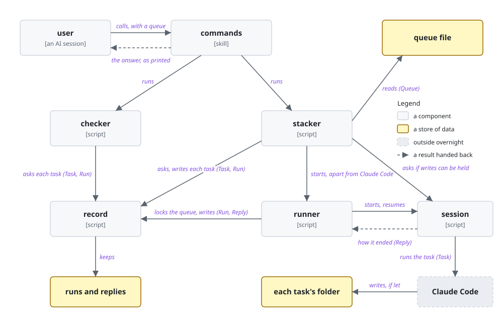
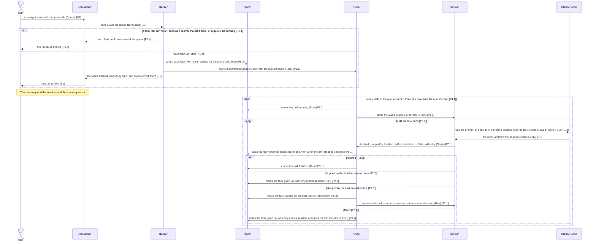
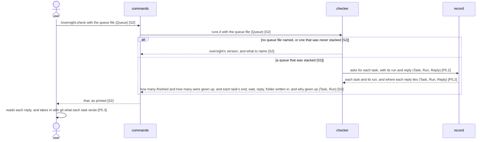
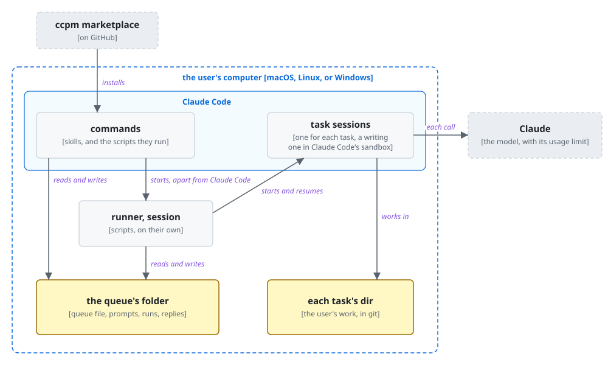

# overnight architecture

## User stories

- S1: the user wants each task they stack done in the hours they set, with no one there.
- S2: the user wants each finished task's whole result afterward, and why each other task ended
  unfinished.

## Solution strategy

### Principles

overnight carries each stacked task to its end without the user, so the user lets go after
stacking.

- P1: no one there while the tasks run
  - P1.1: the tasks run apart from Claude Code, so they go on after the stacking session ends.
  - P1.2: each task starts with its tools allowed and its edits accepted, so it asks no permission.
  - P1.3: a task writes only in its `dir`, and only where the queue lets it write.
  - P1.4: a queue is taken only once each task can start, so mistakes show while the user is there.
  - P1.5: a plugin's own AI stacks its task as a queue of one, which waits and ends as any queue.
- P2: past the usage limit
  - P2.1: a task stopped by the usage limit goes on in its session two minutes after the reset.
  - P2.2: the usage limit stopping a task the seventh time gives the task up, with that reason.
- P3: every task ends, and says how
  - P3.1: each task ends as finished, or as given up with its reason and its session.
  - P3.2: a task given up for any reason stops no other task.
- P4: the people's working day left free
  - P4.1: the first task runs at the queue's `start`, or at once without one, three at a time.
- P5: the whole result, taken in afterward
  - P5.1: a resumed task's reply follows its earlier one, saying when the limit stopped it and when
    it went on.
  - P5.2: where each task stands, and each reply, lies in files beside the queue file, for any
    later session.
  - P5.3: what a task writes stays in its `dir` as written, for the user to take in with git.

### Concept model



- Queue\
  Holds the tasks stacked together and the hour they start, as the user wrote them.
- Task\
  One prompt to carry to its end in its folder, which it reads only, unless the queue lets it
  write.
- Run\
  Holds how far a task got: its session, its stops at the usage limit, and its end.
- Reply\
  Holds what a task's session answered, each part after a resume following the one before.

Strategies:

- Each task's run kept apart from the queue, with all that tells where the task stands. [P5.2]\
  Intent: a session that knows only the queue file's path learns where each task stands.
- Each task's reply one file of its own, which each resume adds to. [P5.1]\
  Intent: the user takes in a task's whole result from one file, and sees where it waited.
- Each run holding the task's session from its first start. [P2.1, P3.1]\
  Intent: the task goes on from its own work, and a task given up names its session.

### Components



- commands (skill)\
  Brings the user's call to overnight, and overnight's answer back as it stands.
- stacker (script)\
  Takes in a queue only where each of its tasks can start, and sets the tasks going.
- runner (script)\
  Carries each stacked task to its end without anyone.
- session (script)\
  Runs a task's Claude Code session, and tells how it ended.
- record (script)\
  Keeps each stacked task with its run and reply, so that any later session reads where it stands.
- checker (script)\
  Tells the user which tasks finished, with each result, and why the others were given up.

Strategies:

- Each command a skill an AI may call, running one script and showing its output as it stands.
  [S1, S2]\
  Intent: an AI stacks and checks its tasks, and reads overnight's own answer.
- Every task checked before any runs, and the queue refused whole with each fault and how to mend
  it. [P1.4]\
  Intent: the user mends the queue while still there, and no task runs from a queue half taken.
- A queue stacked again before its tasks end refused with where they stand. [P1.4]\
  Intent: no task runs twice at once, writing over its own work.
- One runner for each queue, started by the stacker as a program apart from Claude Code. [P1.1]\
  Intent: the tasks go on after the stacking session ends, and each queue moves on by itself.
- Each session run with its task's tools allowed and every other tool refused, so nothing waits.
  [P1.2, P1.3]\
  Intent: no task stops for a permission, and none writes where the queue doesn't let it.
- How a session's end shows the usage limit and its reset read by the session alone. [P2.1]\
  Intent: a change in what Claude Code says at the limit changes one part.
- Each run and reply written only by the record, which the stacker, the runner, and the checker
  go through. [P5.2]\
  Intent: the form of a run changes in one place, and no part reads a run half written.
- Each task carried apart from the others, so that whatever ends one gives up only that one.
  [P3.2]\
  Intent: the queue moves on whatever one task meets.
- A queue of one served by the same commands and runner as any queue, with nothing of its own.
  [P1.5]\
  Intent: every AI that runs a task gets the one wait and end that overnight tests.

### Sequences

#### S1: the stacked tasks carried to their ends



Strategies:

- Tasks started in the order that the queue lists them. [P4.1]\
  Intent: the user decides which task goes first by where they put it.

#### S2: the results taken in



### Deployment



The user installs overnight as [the README](../../plugins/overnight/README.md#installation) says,
and calls `/overnight:stack` with a queue file, which starts the queue's runner.

Strategies:

- The runner kept apart from Claude Code by each OS's own way to outlive what started it. [P1.1]\
  Intent: the tasks go on after the stacking session ends, on each OS that Claude Code runs on.

### Directory structure

```text
plugins/overnight/                 what Claude Code installs for the user
├── skills/                        /overnight:stack and /overnight:check, each running its script
├── scripts/
│   └── queue.py                   queue stack, queue check, and queue run, which the stacker starts
├── domain/
│   ├── stacker/                   the code that checks a queue and starts its runner
│   ├── runner/                    the code that carries each task to its end
│   ├── session/                   the code that runs a task's Claude Code session
│   ├── record/                    the code that keeps each task's run and reply
│   └── checker/                   the code that tells where each task stands
└── images/                        the README's figure

dev/overnight/                     what only overnight's developers use
├── images/                        this document's figures
└── tests/                         the test cases, from unit to integration

<queue's folder>/                  the user's own folder, where they write the queue
├── <queue>.json                   the queue file
└── <queue>/                       what overnight writes for the queue
    ├── runs.json                  each task's run
    └── <task>.md                  each task's reply
```

Strategies:

- Each queue's runs and replies beside the queue file, in place of the plugin guide's run folder.
  [P5.2]\
  Intent: the user finds each result beside their queue, as one queue's tasks work in many folders.

## Test strategy

| Check | Test target | Kind | When | Exit criteria or measure |
|---|---|---|---|---|
| Lint | Parts | Quality | During the work | 0 findings. |
| Static analysis | Parts | Quality | During the work | 0 findings of mismatched types, copied code, or import cycles. |
| Complexity analysis | Parts | Quality | During the work | A cognitive complexity of 15 at most for each function. |
| Unit testing | Parts | Quality | During the work | Every case passes. |
| Code coverage | Parts | Quality | During the work | 100% statement (C0) and branch (C1) coverage. |
| Property-based testing | Parts | Quality | During the work | 0 counterexamples of each invariant that overnight's product vision, README, and this document state. |
| Integration testing | Architecture | Quality | During the work | Every case passes, with a double of Claude Code, and each handoff gives the data that the concept model names. |
| Security testing | Architecture | Quality | During the work | Each write outside a task's folder, and each write by a task that the queue doesn't let write, is refused. |
| Contract testing | Architecture | Quality | Apart from the work | On each new Claude Code version, each recorded session repeats its record: finished, stopped, resumed, failed, or a write refused. |
| Traceability | Architecture | Quality | During the work | Every element tested, every case naming one level up, and each principle's case failing with its part broken. |
| Scenario testing | Product | Quality | At stages | A walkthrough run of the README's queue, past one usage limit, reaches the walkthrough's result, stopped by no fault. |
| Installation testing | Product | Quality | Apart from the work, as it needs ccpm's marketplace to list overnight | overnight installs and uninstalls by the README's commands in a fresh home, and `/overnight:check` shows its version. |
| Configuration testing | Product | Quality | During the work | Every case passes on Python 3.9 and on the newest Python, on macOS, Linux, and Windows. |
| Conformance and compliance testing | Product | Quality | During the work | Claude Code's strict check of the plugin passes. |
| Long-run testing | Product | Benchmark | At stages | The runner's memory and open files over a night's queue. Each case runs until one more run no longer changes the mean. |
