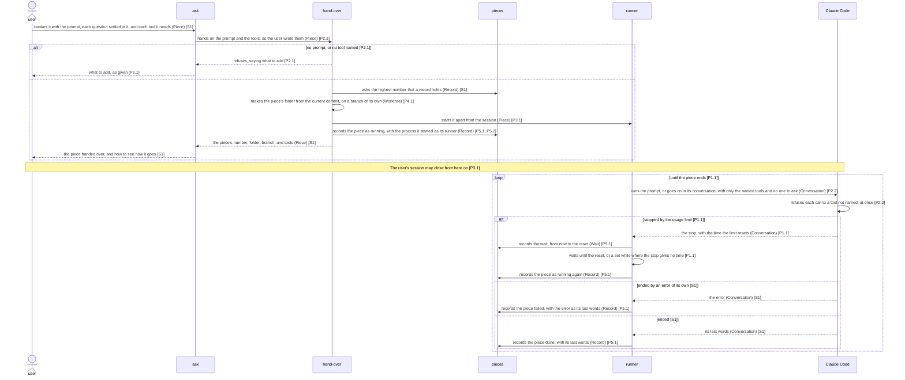
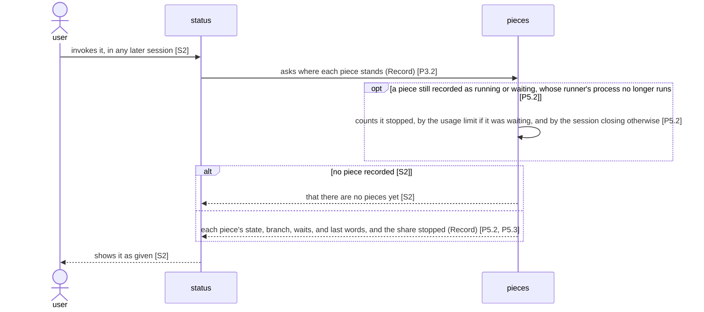

# overnight architecture

## User stories

- S1: the user wants its work run to its end through usage limits, unanswered prompts, and closed
  sessions.
- S2: the user wants to learn how each piece went and what held or stopped it, from any later
  session.

## Solution strategy

### Principles

overnight keeps each piece from stopping by the usage limit, a wait for an answer, or the session
closing.

- P1: waiting out the usage limit
  - P1.1: a piece that the usage limit stops goes on in its conversation at each reset, however
    often it stops.
- P2: nothing to answer
  - P2.1: each piece gets the tools that the user names and a Git worktree of its own before it
    starts.
  - P2.2: each call to a tool that the user didn't name is refused at once, with no one asked.
- P3: running past the session
  - P3.1: each piece runs as a process apart from the session that handed it over.
  - P3.2: where each piece stands is kept apart from any session, so that any later session reads
    it.
- P4: no more than the user let it
  - P4.1: a piece's changes stay on its own branch until someone merges them.
- P5: how the night went, seen at a glance
  - P5.1: each piece's state, each wait that held it, and its last words are recorded as they
    happen.
  - P5.2: each piece that ends short of its work is shown with what stopped it.
  - P5.3: the share of pieces stopped by the limit, a wait for an answer, or the session closing is
    shown.

### Concept model


- Piece\
  One piece of work handed over: its prompt, with each question settled in it, and the tools it
  may use.
- Worktree\
  The folder and the branch where a piece works, apart from the person's own and from each other
  piece's.
- Conversation\
  The talk with the model in which a piece works. It goes on after each reset with all the piece
  has done.
- Record\
  Where a piece stands, its waits, and its last words, for any later session to read.
- Wait\
  One stretch in which the usage limit held a piece, from its stop to the reset.

Strategies:

- Each piece numbered next after the highest that any earlier record, branch, or worktree holds.
  [S1]\
  Intent: one number tells the pieces apart, and no new piece meets an earlier piece's folder or
  branch.
- Each record written whole at each change, never in part. [P3.2]\
  Intent: a session that reads a record while its piece runs reads a whole one.

### Components


- ask (skill)\
  Hands a piece over as the user words it, so that it runs with nothing left to ask.
- status (skill)\
  Shows the user how each piece went.
- hand-over (script)\
  Sets each piece up apart from the person's work and from the session, and starts it.
- runner (script)\
  Carries one piece through the usage limit to its end.
- pieces (script)\
  Keeps each piece's record, and reports where each piece stands.

Strategies:

- ask's steps tell the user to settle each question in the prompt and to name each tool the piece
  needs. [P2.1]\
  Intent: a piece meets no question that it can't settle alone.
- Claude Code started in its mode that asks no one, with only the named tools allowed. [P2.2]\
  Intent: a call outside them ends at once, and never waits on a prompt.
- Each piece started at its hand-over, at once with each piece already running. [S1]\
  Intent: each piece gets the whole night, and none waits on another.
- The runner started as a process of its own, detached from the session, by each OS's own means.
  [P3.1]\
  Intent: closing the session, or its terminal, leaves the piece running.
- The conversation's ID kept from its first reply, and the piece resumed in that conversation after
  each reset. [P1.1]\
  Intent: the piece goes on with all it had done and learned.
- The reset time read from the stop's reply, or a set while waited where none can be read. [P1.1]\
  Intent: the piece starts again once the limit lets it, and an unreadable reply never ends it.
- A piece whose conversation ended counted by how it ended, not by a call refused on the way.
  [P5.3]\
  Intent: a refused call waits on no one, so it stops no piece.
- A runner counted ended once no process with its recorded ID and start time runs, as its OS
  tells. [P5.2]\
  Intent: the status tells which pieces nothing carries, whatever ended their runners, and never
  mistakes a later process for one.
- A piece still recorded as running after its runner ended counted as stopped by the session
  closing. [P5.2]\
  Intent: the status never shows a piece as running once nothing carries it.
- A piece still recorded as waiting after its runner ended counted as stopped by the usage limit.
  [P5.2]\
  Intent: the status never shows a piece as waiting once nothing is left to resume it.
- The record's form, and the share of pieces stopped, held by pieces alone, which the others ask.
  [P5.3]\
  Intent: the writers and the reader of a record never drift apart.

### Sequences

#### S1: a piece handed over and carried to its end



#### S2: how each piece went



### Deployment


The user installs overnight as [the README](../../plugins/overnight/README.md#installation) says,
and invokes the skill `overnight:ask` in the repository that holds the work.

Strategies:

- The prompt handed to Claude Code on its standard input. [P2.1]\
  Intent: the prompt reaches Claude Code whole, whatever options stand before it.
- Each piece's folder made beside the repository, as a Git worktree on a branch of its own. [P4.1]\
  Intent: the person's folder and branch stay as they were, and each piece's changes wait for
  review.

### Directory structure

```text
plugins/overnight/                 what Claude Code installs for the user
├── skills/                        overnight:ask and overnight:status, each pointing to its part
├── domain/
│   ├── ask.md                     how the user hands a piece over
│   ├── status.md                  how the user shows where each piece stands
│   ├── handover/                  the code that sets a piece up and starts its runner
│   ├── runner/                    the code that carries a piece through the usage limit
│   └── pieces/                    the code that keeps each record and tells where each piece stands
└── scripts/                       each command that a skill or the runner runs

dev/overnight/                     what only overnight's developers use
└── tests/                         the test cases, with the stand-in of Claude Code

.overnight/                        what overnight writes in the person's repository
└── <yyyymmdd>-<n>/                one piece's folder, holding its record

../<repository>-overnight-<n>/     one piece's worktree, on the branch overnight/<n>
```

Strategies:

- Each record in `.overnight/` at the repository's root. [P3.2]\
  Intent: the person chooses with one line of `.gitignore` whether git keeps the records.

## Test strategy

| Check | Test target | Kind | When | Exit criteria or measure |
|---|---|---|---|---|
| Lint | Parts | Quality | During the work | 0 findings. |
| Static analysis | Parts | Quality | During the work | 0 findings of mismatched types, copied code, or import cycles. |
| Complexity analysis | Parts | Quality | During the work | Per function, cognitive complexity 15 at most. |
| Unit testing | Parts | Quality | During the work | Every case passes. |
| Code coverage | Parts | Quality | During the work | 100% statement (C0) and branch (C1) coverage. |
| Property-based testing | Parts | Quality | During the work | 0 counterexamples of each invariant that overnight's product vision, README, and this document state. |
| Integration testing | Architecture | Quality | During the work | Every case passes with a stand-in of Claude Code. The cases check the resume after each reset, the hand-over, pieces run at once, and each record. No case waits a night or spends the usage limit. |
| Contract testing | Architecture | Quality | Apart from the work | On each new version of Claude Code, each recorded step gives what it recorded. No step spends the usage limit on purpose. |
| Traceability | Architecture | Quality | During the work | Every element tested, every case naming one level up, and each principle's case failing with its part broken. |
| Scenario testing | Product | Quality | During the work | Once the integration tests pass, one brief walkthrough run of the README's request runs on the real Claude Code. Its ask hands the pieces over, and its status shows them, with no stop a fault caused. overnight is done only once it passes, as the stand-in can't show ask and status on Claude Code. It waits no night and spends no usage limit on purpose, as the integration tests check the waits. |
| Installation testing | Product | Quality | Apart from the work | Once ccpm's marketplace lists overnight, it installs by the README's commands in a fresh home. Then `overnight:status` shows `No pieces yet`. |
| Configuration testing | Product | Quality | During the work | Every case passes on Python 3.9 and on the newest Python, on each OS that Claude Code runs on. |
| Conformance and compliance testing | Product | Quality | During the work | Claude Code's strict check of the plugin passes. |
