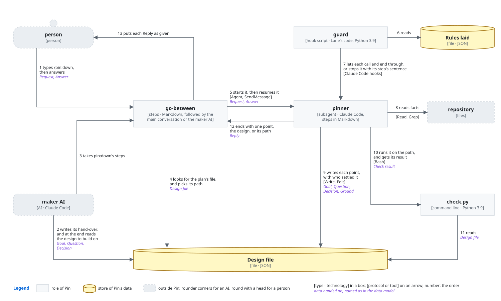
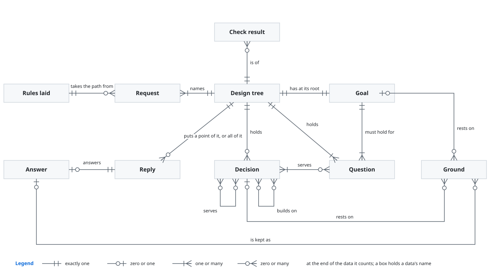
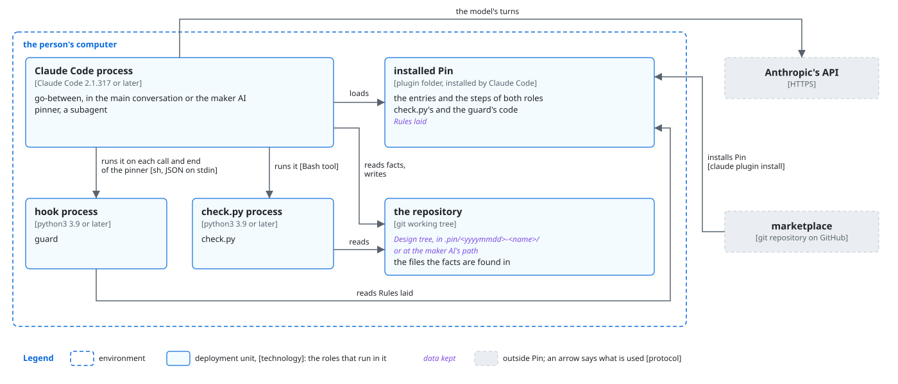
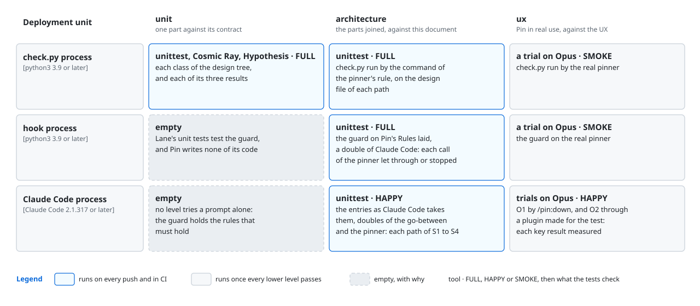

# Pin architecture

This document says how Pin is built to give [its product vision](product-vision.md). It is for a
developer, a person or an AI, who builds or changes Pin.

Pin settles a plan in its design tree, from the plan's goal down, one point at a time. The user
calls the skill `pin:down`, by typing `/pin:down` or as their AI calls it. The main conversation
then follows Pin's orchestrator. It starts the pinner, a subagent that writes the design tree and
ends each start with one point for the person. The orchestrator puts that point to the person as
given, and passes their answer back to the pinner word for word. `check.py` tells the pinner
whether the design tree holds after each change. Hooks hold the pinner to its rules on every call,
and hold the main conversation to the order of the starts while the run lasts. Lane, the plugin
that holds a plugin's skill and subagents to the rules of their steps, lays those hooks into Pin.
This document calls them the guard, as the plugin best practice names a plugin's hooks.

## Principles

Pin builds on these principles of
[the plugin best practice](../plugin-best-practice.md#principles):

- [The core apart from Claude Code](../plugin-best-practice.md#the-core-apart-from-claude-code)
- [An entry points to its part](../plugin-best-practice.md#an-entry-points-to-its-part)
- [What a machine can see of the work](../plugin-best-practice.md#what-a-machine-can-see-of-the-work)
- [No check passes what it did not check](../plugin-best-practice.md#no-check-passes-what-it-did-not-check)
- [The guard tells each role its steps again](../plugin-best-practice.md#the-guard-tells-each-role-its-steps-again)
- [Where a plugin writes its files](../plugin-best-practice.md#where-a-plugin-writes-its-files)
- [Languages](../plugin-best-practice.md#languages)
- [Where the orchestrator runs](../plugin-best-practice.md#where-the-orchestrator-runs)
- [Messages](../plugin-best-practice.md#messages)
- [The form of a file](../plugin-best-practice.md#the-form-of-a-file)
- [Asking until nothing is left to decide](../plugin-best-practice.md#asking-until-nothing-is-left-to-decide)
- [Python 3.9 and the standard library](../plugin-best-practice.md#python-39-and-the-standard-library)
- [Code kept once](../plugin-best-practice.md#code-kept-once)

Under [Read by those who did not make it](../plugin-best-practice.md#read-by-those-who-did-not-make-it),
no evaluator reads the design: the person reads all of it to confirm it.

Pin adds these. Each why says how a point goes wrong without the rule. KR1.1 of the product vision
counts the share of points that go wrong in any such way.

### From the goal down

Every point of the design is found as a means to the point above it, from the plan's goal down.
The design tree keeps it so: each question under the goal, each decision under what it serves. A
point that serves nothing is cut. A decision is concrete enough only once the AI that makes the
work has nothing left to choose, and Pin settles each choice still left as it settles any
decision.

*Why*: a point found as questions occur, or guessed in a plan written up front, leaves out what no
one raised, and the person meets it in the work as rework (KR1.1). A point that serves nothing
spends the person's answer on what the work does not need.

### Whose a decision is

Pin finds every fact itself and shows it to the person to confirm. A decision is the person's only
where two ways serve the goal equally well, or where it is hard to undo, and Pin puts it with a
recommendation. Pin settles every other decision itself.

*Why*: a fact asked spends the person's answer on Pin's job. A decision taken for the person where
their view decides it holds a point otherwise than they mean it. The product vision counts both as
a point gone wrong (KR1.1).

### One point to a message, in order

The pinner ends each start with one point for the person. It puts a decision only once each
decision it builds on is settled.

*Why*: two points in one message let one answer change the other unseen. A decision put before the
decisions it builds on rests on a guess of how they go. Either way a point comes out otherwise than
the person means it (KR1.1).

### The design tree is the only record

Every answer is in the design tree before the next point goes out. The pinner learns which
decisions are open to decide now from `check.py`, not from its conversation.

*Why*: a conversation can end or be compacted. With the plan in the file, a stopped run goes on
from it and asks nothing again (KR1.1, KR1.2). The AI that makes the work then reads the plan the
person confirmed.

### Passed on as given

The main conversation puts each point to the person whole. It passes back word for word whatever
the person says while a point waits. It answers nothing of the plan itself, and writes nothing into
the design tree once the run starts.

*Why*: a point reworded is a question the pinner did not ask, and an answer summed up loses what
the person meant. A point the main conversation answers itself is settled apart from Pin (KR1.1).

### A point the user's AI settled stays

Where the user's AI wrote the design tree before it called the skill, each decision it settled is
marked settled by `maker`, and the goal it wrote stands with its grounds. Pin neither asks the
person about these nor changes them. The AI hands them over in the design tree, not in the text it
calls the skill with. That text names only a point that its work found after the design was
confirmed.

*Why*: a point asked again, or settled otherwise than the AI settled it with the person, fails O1
(KR1.1). A point typed again in a request drifts from the one the AI wrote.

### The design tree is a checked nested list

The design tree is a Markdown nested list whose nesting is what each node serves. The pinner
changes it only with Read and Edit, reading the branch the node stands in. `check.py` checks it
after each change: the tree in form, every question served, every decision reaching the goal, and
each decision after those it builds on. Its form lies in
`tree.py` alone.

*Why*: a tree kept as a flat list of IDs is changed by finding an ID or a word, so the one who
changes a node never sees its branch. The nodes around it then go on saying what held before, and
the tree drifts from its goal unseen (KR1.1). A machine finds a node that serves nothing at once,
where an AI finds only some. A second reader of the form would drift from the first.

## User stories

- **S1**: As the user, a person, I want to type `/pin:down` with my plan in my own words, and get
  the goal as Pin reads it, to confirm. Carries the walkthrough's `/pin:down` and the goal put to
  the person. It also carries, as a branch, a design tree that a stopped run of the same plan left
  in `.pin/`: Pin goes on from it and asks nothing again.
- **S2**: As the user, an AI settling a plan for a person, I want to write the work's goal, its
  questions and what I settled into a design tree, call the skill `pin:down` with its path, and have
  the person get the first point that is theirs. Carries the README's points my AI settled. It also
  carries, as a branch, a point that the AI's work found after the design was confirmed: Pin opens
  that point and each point built on it.
- **S3**: As the user, I want to answer the point Pin puts to me, and get the next point, or the
  whole design to confirm, or once I confirm it, the design tree's path. Carries the rest of the
  walkthrough: each fact confirmed or corrected, each decision answered, the design changed and
  confirmed, and the path handed back.

## Components



What each decides alone:

- **orchestrator**: where the design tree lies: the path the request names, else the file in
  `.pin/` whose goal is this plan's, else a new path in `.pin/`. It decides nothing of the plan. It
  is the main conversation, following the skill `pin:down`.
- **pinner**: what the design tree holds, which point comes next, whose each decision is, what it
  recommends, the words of each point, and when the person has confirmed the design. Once the run
  starts, no other component writes the design tree.
- **check.py**: whether the design tree holds: whether it is in form, every question is served,
  every decision reaches the goal, and each decision comes after those it builds on. It also
  decides which decisions are open to decide now. It writes nothing. Its form and its checks lie in
  `tree.py`.
- **guard**: whether a call or an end of the pinner keeps the pinner's rules, and which start the
  main conversation makes next. Pin writes none of its code. Lane lays it from Pin's proposal,
  which is not kept as a file: `lay.py up plugins/pin` prints it again, as
  [Pin's developer README](README.md) says, and as
  [Lane's lanes](../../plugins/lane/docs/lanes.md) and
  [routes](../../plugins/lane/docs/routes.md) say.

These choices in the components are ones a developer would question. Each says the way it beat,
why, and what it costs.

- **The orchestrator in the main conversation** over a subagent that carries each point between
  the person and the pinner: only the main conversation can ask the person, as
  [Where the orchestrator runs](../plugin-best-practice.md#where-the-orchestrator-runs) says. A
  subagent in between would only carry each point and each answer once more, and could reword
  them (KR1.1). It costs the main conversation passing each point, which no hook sees.
- **The pinner as a subagent** over the main conversation settling the design itself: the guard
  then holds every write and every check of the pinner, as Lane holds a subagent's every call
  (KR1.1). It costs a resume of the pinner for each point (KR1.2).
- **The routes laid by Lane**, `down` starting the pinner, its `asks` waiting for the user, and its
  `done` ending the run, over steps alone: the guard then tells the main conversation each next
  move, and stops a start that is not due (KR1.1). It costs one more hook on the main
  conversation's starts and turns while the run lasts.
- **Each fact found by the pinner itself, with Read and Grep,** over a subagent that searches in
  the background: the end of a subagent the pinner started would start the pinner again while a
  point waits, so a second point could reach the person before the first is answered (KR1.1). It
  costs the pinner finding facts one after another, in its own context (KR1.2).
- **The design tree's path a value given for each start** over a fixed path: each start of the
  pinner then writes only its own design tree, and the user's AI keeps its design where it says.
  It costs the orchestrator putting the path in the Request in the form that
  [Lane's values port](../../plugins/lane/docs/lanes.md#the-ports) reads.
- **The form of the design tree in `tree.py` alone, with Turn taking it through a link,** over a
  reader in each plugin: Turn writes the design tree it hands to Pin's pinner, and a second reader
  would drift from Pin's. It costs a change of the form reaching Turn's tests too, which must pass.
- **`check.py` holding the design tree's form, with the guard holding no rule of form,** over a
  rule that stops a write out of form at once: two components would then each decide the form.
  The guard still holds the pinner to pass `check.py` after each change. It costs a write out of
  form being found at the next check, not at the write.

## Data model



- **Request**: what the orchestrator starts the pinner with: the design tree's path, and the plan
  in the user's words, with any point that the user's AI's work found.
- **Point**: what the pinner ends a start with, for the person: the goal, one fact, one decision,
  the whole design to confirm, or, once confirmed, the design tree's path. The pinner's part calls
  it the Reply.
- **Answer**: the person's words, which the orchestrator passes back to the pinner as they are.
- **Design tree**: the plan, as its Goal, the Questions that must hold for it, the Decisions that
  serve each, and the Grounds each rests on.
- **Check result**: what `check.py` prints: that the design tree holds, with each Decision open to
  decide now, or each problem it found.

The forms of the Request and the Answer lie in
[the orchestrator](../../plugins/pin/core/roles/orchestrator.md), the form of the Point in
[the pinner's Reply](../../plugins/pin/core/roles/pinner.md#the-reply), the lines of the Design
tree in [the design tree](../../plugins/pin/core/roles/pinner.md#the-design-tree), and the form of
the Check result in `tree.py`.

## Sequences

Each story's steps follow in order. The participants are named as in [Components](#components),
and the data in brackets as in [Data model](#data-model). S1 and S2 differ only up to the call of
the skill, so they share one sequence. The pinner ends each start by giving Lane a result: `asks`,
where a Point waits for the person, or `done`, where the run ends, as
[Lane's routes](../../plugins/lane/docs/routes.md) say.

### S1 and S2: the start

```mermaid
sequenceDiagram
  participant U as user
  participant O as orchestrator
  participant GD as guard
  participant PN as pinner
  participant CK as check.py
  participant DT as Design tree
  participant RP as repository
  alt S1
    U->>O: types /pin:down with the plan
  else S2, the user's AI
    U->>DT: writes the Goal, the Questions and the Decisions it settled, as maker
    U->>O: calls the skill pin:down with the path
  end
  GD-->>O: the run begun, start the pinner
  opt O ends its turn with the start due
    GD-->>O: kept going once, told to start the pinner; if O ends again, its turn ends, and the user is told which role's step failed
  end
  O->>DT: looks for the plan's design tree, and picks the path
  O->>PN: starts it in the background [Agent] (Request)
  GD-->>O: wait for the pinner to end
  opt O starts the pinner again while it runs
    GD-->>O: stopped, told to wait
  end
  alt no design tree lies at the path
    PN->>DT: writes the Goal to confirm, the Questions, each Decision open
  else a stopped run or the user's AI left one there
    PN->>DT: reads it (Design tree)
    opt the Request names a point that the user's AI's work found
      PN->>DT: opens that Decision again, and each Decision built on it
    end
  end
  loop until the Check result says the file holds
    PN->>CK: runs it on the path [Bash]
    CK->>DT: reads it (Design tree)
    CK-->>PN: Check result
    opt it names a problem
      PN->>DT: mends it, the user's AI's points kept
    end
  end
  opt the Goal is settled and decisions are open to decide now
    PN->>RP: reads each fact such a Decision rests on [Read, Grep]
    PN->>DT: settles each such Decision that is its own
  end
  PN->>DT: reads the path from each node it changed up to the Goal, and every branch under it
  GD->>PN: checks each call and the end
  alt the call or the end keeps the pinner's rules
    GD-->>PN: lets it through
  else it writes another file, writes the design tree whole once made, runs another command, or ends with the file unchecked
    GD-->>PN: stops it with its step's sentence
  end
  PN-->>O: gives asks, and ends with one Point: the Goal, or, where the user's AI wrote it, the first point that is the person's
  GD-->>O: pinner gave asks: put its point to the user, and resume it with their answer
  O->>U: puts the Point as given, and ends its turn
```

The guard checks every call of the pinner in this way, in both sequences. Each sequence draws the
check once, before the end that it holds.

### S3: an answer

```mermaid
sequenceDiagram
  participant U as user
  participant O as orchestrator
  participant GD as guard
  participant PN as pinner
  participant CK as check.py
  participant DT as Design tree
  participant RP as repository
  U->>O: answers, or says anything while the Point waits (Answer)
  GD-->>O: resume the pinner with the answer
  opt O starts the pinner in place of resuming it
    GD-->>O: stopped, told to put the point and resume the pinner
  end
  O->>PN: resumes it with the words, word for word [SendMessage] (Answer)
  alt the goal confirmed
    PN->>DT: writes the words into the Goal's Grounds
  else a fact confirmed or corrected, or one only the person knows
    PN->>DT: writes it into the Grounds of the Decision it rests on
  else a decision made
    PN->>DT: writes the Decision, settled by the person
  else a decision left to Pin
    PN->>DT: writes the Decision, settled by reasoning, saying so
  else a point not in the file
    PN->>DT: adds an open Decision, joined to what it serves and builds on
  else a change to the design
    PN->>DT: opens that Decision again, and each Decision built on it
  else a wrap-up
    PN->>DT: leaves each open Decision open
  else the design confirmed
    PN->>DT: writes the person's words as the confirmation
  end
  loop until no Decision is open to decide now that is the pinner's, or the person asked to wrap up
    PN->>CK: runs it on the path [Bash]
    CK-->>PN: Check result, with each Decision open to decide now
    opt a Decision open now is the pinner's own
      PN->>RP: reads each fact it rests on [Read, Grep]
      PN->>DT: settles it
    end
  end
  PN->>DT: reads the path from each node it changed up to the Goal, and every branch under it
  GD->>PN: checks each call and the end, as in S1 and S2
  alt a point is open, and the person did not ask to wrap up
    PN-->>O: gives asks, and ends with the next Point
    GD-->>O: put its point to the user
    O->>U: puts the Point as given
  else no point is open or the person asked to wrap up, and the design is not confirmed
    PN-->>O: gives asks, and ends with the whole design, each point with who settled it
    GD-->>O: put its point to the user
    O->>U: puts the Point as given
  else the person confirmed the design
    PN-->>O: gives done, and ends with the design tree's path and the Check result
    GD-->>O: start no more; the run ends
    O->>U: puts the path as given, and gives done
  end
```

## Deployment



The user installs Pin as [the README](../../plugins/pin/README.md#installation) says, and types
`/pin:down`, or their AI calls the skill. Claude Code starts the guard through Pin's hook entries,
and the pinner runs `check.py` through the Bash tool.

- **`check.py` on Python 3.9 and its standard library only**, as
  [Python 3.9 and the standard library](../plugin-best-practice.md#python-39-and-the-standard-library)
  says, over a later Python or packages: the user then installs nothing else for Pin. The guard is
  Lane's code, which needs the same. It costs `check.py` reading Markdown with no parser but its
  own, in `tree.py`.
- **The design tree in `.pin/<yyyymmdd>-<name>/` at the root of the repository**, or where the
  user's AI says, as
  [Where a plugin writes its files](../plugin-best-practice.md#where-a-plugin-writes-its-files)
  says for what may be kept, over the system's temporary folder: a stopped run goes on from it, and
  the AI that makes the work reads it there. It costs the user choosing whether git keeps `.pin/`.

## Directory structure

```text
plugins/pin/
├── .claude-plugin/plugin.json          Pin's manifest and version
├── skills/down/SKILL.md                pin:down, the orchestrator's entry
├── agents/pinner.md                    pin:pinner, the pinner's entry
├── core/roles/orchestrator.md          the orchestrator; the form of Request and Answer
├── core/roles/pinner.md                the pinner; the form of Point and of the Design tree's lines
├── core/domain/tree.py                 check.py's checks; the form of Design tree and Check result
├── core/domain/design-tree-template.md the form of Design tree, for the pinner
├── scripts/check.py                    check.py's entry
├── hooks/hooks.json                    the guard's hook entries
├── hooks/lanes.json                    the guard's rules and routes, as Lane laid them
├── hooks/lane/                         the guard, Lane's code
├── LICENSE-grilling                    Matt Pocock's notice for grilling
└── README.md, CHANGELOG.md, images/    for Pin's users

dev/pin/
├── product-vision.md, architecture.md, images/   Pin's product vision and architecture
├── README.md, design-tree.md           for Pin's developers
├── cosmic-ray.toml                     the mutation testing
└── tests/
    ├── helpers.py                      what Pin's tests share: its code on the path, a small tree
    ├── unit/                           unit tests, at the path of what each tests
    ├── architecture/                   a test for each path of each sequence
    └── ux/                             trial.py, the trial of O1; intent_typed.md and
                                        intent_called.md, the person's intents; notes/, its app;
                                        maker/, the user's AI

.pin/<yyyymmdd>-<name>/design-tree.md   Design tree
```

- **`hooks/lane/` as a link to Lane's code in this marketplace**, as
  [Code kept once](../plugin-best-practice.md#code-kept-once) says, over a copy: a fix in Lane's
  code reaches Pin's guard at once. It costs a fix to the rules or routes reaching Pin only once a
  developer lays Pin's proposal again with `lay.py write`.
- **`LICENSE-grilling` in Pin's folder** over the notice in the repository's root alone: `pin:down`
  is made from Matt Pocock's skill grilling, installing copies only Pin's folder, and the MIT
  License asks that its notice go with each copy. It costs a second license file beside the
  repository's.

## Tests

Pin tests by [Test in the plugin best practice](../plugin-best-practice.md#test), and differs from
it where this section says. Each cell of the figure says how far its level tries the unit: FULL,
each case and edge; HAPPY, the main paths; SMOKE, a run that confirms what lower levels checked.



- **`check.py` tried FULL at unit and at architecture** over HAPPY: a design tree it passes
  wrongly sends a gap into the work unseen (KR1.1). It costs the most tests to keep up as the form
  changes.
- **The guard tried FULL at architecture, on Pin's rules and routes as laid,** over Lane's unit
  tests alone: it alone holds the pinner's rules and the order of the starts on every run, and
  only a test on Pin's own laying shows that Pin laid them as its steps need (KR1.1). Lane's own
  tests test its code.
- **The entries tried HAPPY at architecture** over FULL: a test there only finds sooner an entry
  that Claude Code would not load as Pin needs, which every ux trial would also meet.
- **The ux trial run in an interactive session** over `claude -p`: the person answers each point
  in the main conversation, as only an interactive session lets a stand-in reply between turns. It
  costs the trial driving a terminal.
- **The ux trial of O1 run in both ways the user calls the skill,** typed by the person and called
  by an AI with a design tree it wrote, three runs each, over the typed way alone: the two differ
  in what the pinner must keep, the points the AI settled, and a fault in one does not show in the
  other (KR1.1). It costs six runs of the model for a trial.

At architecture, doubles stand in for the orchestrator, the pinner and the user. The double of
Claude Code sends the main conversation's events as Lane's double sends them, recorded from a try
of Claude Code 2.1.319. A double of the pinner writes only design trees that `check.py`'s unit
tests hold to the form, and Points in the form the pinner's part gives. A double of the
orchestrator passes each Point and each Answer unchanged.

At ux, an AI on Opus stands in for the person. It is given an intent written before the run and
never shown to Pin, and answers each point from it. The subject is a notes app at the size of a
real request: several scripts that read `notes list`, and a plan of about ten points that brings
out a fact confirmed, a fact corrected, a decision of the person's, a decision left to Pin, a point
an answer raises, and a change at the design. Where called, a plugin made for the trial stands in
for the user's AI. The trial measures KR1.1 and KR1.2 from the session's records and the design
tree, as [its driver](tests/ux/trial.py) says. A run counts where each of these came up but those
that only a pinner gone wrong brings out: no run needs a fact corrected, as the repository holds
the facts the intents correct, and a called run needs no decision left to Pin, as it tests keeping
the AI's points. A run passes
where nothing went wrong in KR1.1, and the trial passes where 3 of 3 runs of each way pass.
