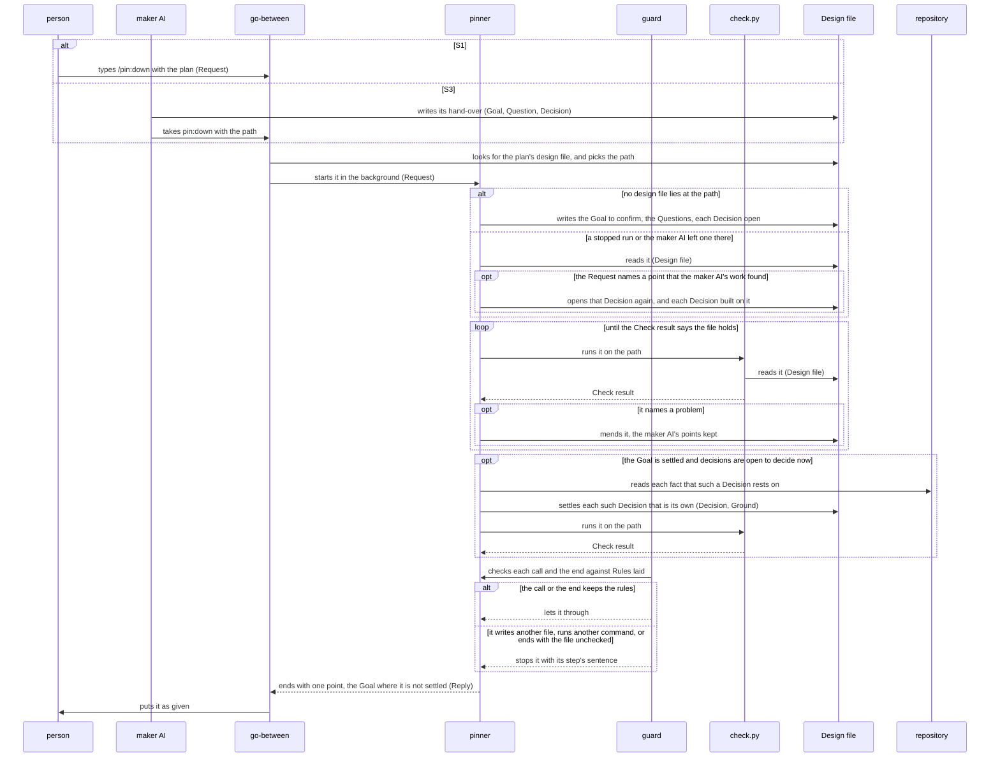
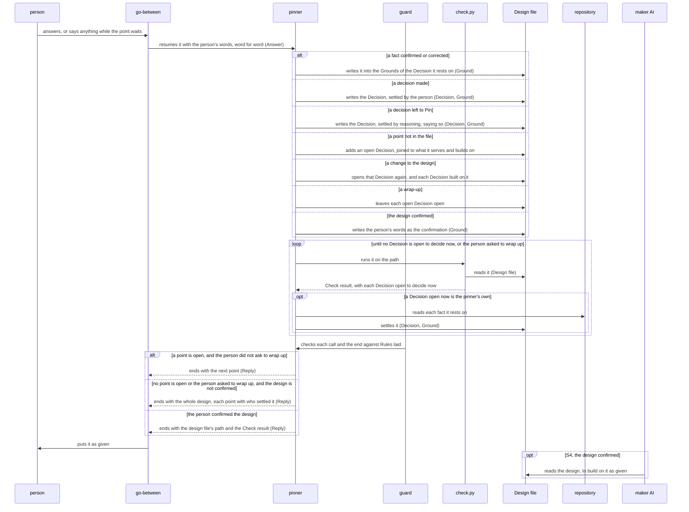

# Pin architecture

This document says how Pin is built to give [Pin's UX](ux.md). It is for a developer, a person or
an AI, who builds or changes Pin.

Pin settles a plan in its design file one point at a time. The pinner, a subagent of Pin, writes
the design file from the plan's goal down. Each run of the pinner ends with one point for the
person, and the next run starts from the person's answer. Whoever starts the pinner carries each
point to the person and each answer back: the main conversation when the person types `/pin:down`,
or the maker AI itself. This document calls that part the go-between. It follows the steps of the
skill `pin:down`. As the pinner is a subagent, hooks hold it to its rules on every call: it writes
only the design file, and has `check.py` check the file after each change. Lane, the plugin that
holds a subagent to the rules of its steps, lays those hooks into Pin. This document calls them the
guard, as the plugin best practice names a plugin's hooks.

## Principles

Pin builds on [the principles of the plugin best practice](../plugin-best-practice.md#principles)
and on its Development section, with these differences:

- Pin departs from
  [Where the orchestrator runs](../plugin-best-practice.md#where-the-orchestrator-runs): the pinner
  runs as a subagent for the person too, as
  [Choices in the components](#choices-in-the-components-and-their-costs) says.
- Pin does not take
  [Learning from each run](../plugin-best-practice.md#learning-from-each-run). Pin ends once the
  person confirms the design, and the UX has no step after that. A design's faults show only in the
  work made from it, which Pin never sees.
- Under [Read by those who did not make it](../plugin-best-practice.md#read-by-those-who-did-not-make-it),
  no evaluator reads the design: the person reads all of it to confirm it.

The principles below are what Pin adds. Each gives its rule, then why.

### Whose a decision is

A decision is the person's only where two ways serve the goal equally well and nothing found
favors either, or where the decision is hard to undo. Pin settles every other decision itself. It
finds every fact itself and shows it to the person to confirm.

*Why*: a fact that Pin could find, or a decision that follows from the goal, spends the person's
answer on Pin's job. A decision taken for the person where their view decides it holds a point
otherwise than they mean it. The UX counts both as a point gone wrong (KR1.1).
[Asking until nothing is left to decide](../plugin-best-practice.md#asking-until-nothing-is-left-to-decide)
says this in general. This principle gives the test.

### One point for each run

The pinner ends each run with one point for the person: the goal, one fact, one decision, or the
whole design to confirm. It puts a decision to the person only once each decision it builds on is
settled.

*Why*: two points in one message let one answer change the other unseen. A decision put before
the decisions under it rests on a guess of how they go. Either way a point comes out otherwise than
the person means it (KR1.1).

### The design file is the only record

Every answer is in the design file before the next point goes out. The pinner learns which
decisions are open to decide now from `check.py`, not from its conversation. Every other reader
reads the plan only from the file.

*Why*: the pinner's conversation can end or be compacted, and the go-between's is another
conversation. With the plan in the file, a stopped run goes on from it and asks nothing again
(KR1.2). The AI that makes the work then reads the same plan that the person confirmed.

### Passed on as given

The go-between puts each point to the person whole. It passes back word for word whatever the
person says while a point waits, as their answer. It answers nothing of the plan itself and writes
nothing into the design file.

*Why*: a point reworded is a question that the pinner did not ask, and an answer summed up loses
what the person meant (KR1.1, KR2.1). A point that the go-between answers itself is settled apart
from Pin, which the UX counts as gone wrong (KR1.1), even where the person asked the go-between and
not Pin.

### What the maker AI settled stays

Pin neither asks the person nor changes a point that the maker AI settled, the goal among them.
Only a new request of the maker AI opens such a point again. The maker AI changes no point of the
design itself: it starts Pin again with the point. The design file marks each decision that the
maker AI settled as settled by `maker`, so the pinner tells it from the file alone.

*Why*: the UX counts as gone wrong a point settled otherwise than the maker AI settled it, a point
asked again, and the maker AI changing the design (KR2.1). A point changed outside Pin also leaves
each point built on it as it was.

### Pin knows no maker AI

No line of Pin names a plugin that uses it. A maker AI reaches Pin only through `pin:down` and the
form of the design file. Pin keeps each key of the design file that it does not know, and reads
nothing from it.

*Why*: every maker AI takes the same Pin. A change made for one maker AI would reach the others
unseen, and could settle their points otherwise than they settled them (KR2.1).

## User stories

Each story names its user, the way that user meets Pin, and the steps of
[the UX's scenarios](ux.md#scenarios) that it carries.

- **S1**: As the person, I want to type `/pin:down` with my plan in my own words, and get the goal
  as Pin reads it, to confirm. Carries the first two steps of O1: the request, and the goal put to
  the person. A design file that a stopped run of the same plan left is a branch: Pin goes on from
  it.
- **S2**: As the person, I want to answer the point that Pin puts to me, and get the next point,
  or the whole design to confirm, or once I confirm it, the design file's path. Carries the rest of
  O1: the yes to the goal, each round of the loop, the design confirmed and the design handed over.
- **S3**: As the maker AI, I want to write the work's goal, its questions and what I settled into a
  design file, take `pin:down` with the file's path, and get the first point for the person.
  Carries the first two steps of O2: the request, and the step where Pin keeps what the maker AI
  settled. A design file that holds a point which the maker AI's work found is a branch: Pin opens
  that point again (KR2.1).
- **S4**: As the maker AI, I want to resume Pin with the person's answer word for word, and get the
  next point for the person, or the design to confirm, or once the person confirms it, the design
  back. Carries the rest of O2 up to the design kept. The maker AI then builds on the design
  outside Pin.

## Components

The figure shows each role of Pin and each store of data that the stories need. The data on its
arrows are named as in [Data model](#data-model).


### What each role alone decides

- The go-between decides where the design file lies: the path the maker AI gives, else the file in
  `.pin/` whose goal is this plan's, else a new path in `.pin/`. It decides nothing of the plan.
- The pinner decides what the design file holds, which point comes next, whose each decision is,
  what it recommends, the words of each point, and when the person has confirmed the design. After
  the maker AI's hand-over, no other role writes the design file.
- `check.py` decides whether the design file holds: whether it is in form, every question is
  served, every decision reaches the goal, and each decision comes after those it builds on. It
  also decides which decisions are open to decide now. It writes nothing.
- The guard decides whether a call or an end of the pinner keeps the pinner's rules. Pin writes
  none of its code. Lane lays it, with the rules from Pin's proposal, as
  [Lane's lanes](../../plugins/lane/docs/lanes.md) say.

### Choices in the components, and their costs

- **The pinner always runs as Pin's subagent, for the person too.** Run in the main conversation
  for the person, it would need no go-between and no resume. But Lane checks only subagents, and no
  level of test tries a prompt alone. So the rules that must hold, such as writing only the design
  file and checking it after each change, hold only where the guard sees the pinner's calls. The
  cost: each point costs a resume of the pinner (KR1.2). The main conversation passes each point
  and could reword it, which no hook sees. Pin runs in an interactive session, where Claude Code
  tells whoever started the pinner that it ended
  ([the routes](../../plugins/lane/docs/routes.md#what-the-orchestrator-is-told)).
- **The pinner finds each fact itself, with Read and Grep.** A subagent that searches in the
  background would let the pinner go on meanwhile. But the pinner ends at each point to wait for
  the person, and the end of a subagent it started would start it again while that point waits.
  A second point could then reach the person before the first is answered (KR1.1). The cost: the
  pinner finds facts one after another, in its own context (KR1.2).
- **The maker AI hands over in the design file, not in the text it starts Pin with.** The pinner
  then keeps the maker AI's points as written, never typed again (KR2.1), as
  [The form of a file](../plugin-best-practice.md#the-form-of-a-file) says. The pinner goes on
  from a file at the path in the same way for a stopped run. The cost: the maker AI writes the
  design file's form, which [the design tree](../../plugins/pin/core/roles/pinner.md#the-design-tree)
  gives.
- **`check.py` holds the design file's form, and the guard has no rule of form.** A rule of form
  would stop a bad write at once. But `check.py` must read the form anyway to check the joins,
  which a JSON Schema cannot express, and two roles would then each decide the form. The guard
  still holds the pinner to pass `check.py` after each change. The cost: a write out of form is
  found at the next check, not at the write.
- **The design file's path is a value given for each run.** A fixed path would need no value. But
  each run of the pinner then writes only its own design file, and a maker AI keeps its design
  where it said. The cost: the go-between puts the path in the request in the form that
  [Lane's values port](../../plugins/lane/docs/lanes.md#the-ports) reads.

## Data model

The figure shows each data that Pin's roles pass or keep, and how each joins another.


- **Request**: what the go-between starts the pinner with. It holds the plan in the person's words,
  or the maker AI's request with any point that its work found, and the design file's path.
- **Design file**: the design, `design-tree.json`. It holds the Goal, the Questions that must hold
  for it, and the Decisions that make each Question hold. A Ground is what a Goal or a Decision
  rests on, such as the person's words or a source quoted.
- **Reply**: what the pinner ends a run with: one point for the person, the whole design to
  confirm, or once confirmed, the design file's path.
- **Answer**: the person's words, which the go-between passes back to the pinner.
- **Check result**: what `check.py` prints and the code it exits with.
- **Rules laid**: the pinner's rules, as Lane laid them from Pin's proposal.

The fields of the design file lie in
[the design tree](../../plugins/pin/core/roles/pinner.md#the-design-tree). The README's
[How it works](../../plugins/pin/README.md#how-it-works) gives the headings that a Reply and an
Answer carry.

## Sequences

Each story's steps follow in order. The participants are named as in [Components](#components).
The data in brackets are named as in [Data model](#data-model). S1 and S3 differ only up to the
start of the pinner, and S2 and S4 not at all, so each pair has one sequence.

### S1 and S3: the start

In S3 the maker AI is the go-between, so it puts the first point to the person itself.



The guard checks every call of the pinner in this way, in both sequences. Each sequence draws the
check once, before the end that it holds.

### S2 and S4: an answer

In S4 the maker AI is the go-between, and the person answers it.



- **Each run of the pinner ends with one Reply.** A pinner that waited for the answer inside one
  run would need no resume. But a subagent cannot ask the person, so it can only end. Its end is
  also where the guard holds the last check of the design file. The cost: each point costs a
  resume of the pinner (KR1.2).

## Deployment

Pin runs on the person's computer. Where a maker AI uses Pin, Pin runs on the computer where the
maker AI runs for the person.


To start Pin, the person installs it as [the README](../../plugins/pin/README.md#installation)
says, and types `/pin:down`. A plugin whose skill or subagent is a maker AI lists `pin` in its
`dependencies`, and its maker AI takes `pin:down`. Claude Code starts the guard through Pin's hook
entries, and the pinner runs `check.py` through the Bash tool.

- **`check.py` uses Python 3.9 and its standard library only**, as
  [Python 3.9 and the standard library](../plugin-best-practice.md#python-39-and-the-standard-library)
  says. The guard is Lane's code, which needs the same. The person installs nothing else for Pin.
- **The design file lies in `.pin/<yyyymmdd>-<name>/` at the root of the repository**, or where the
  maker AI says, as
  [Where a plugin writes its files](../plugin-best-practice.md#where-a-plugin-writes-its-files) says
  for what may be kept. The AI that makes the work reads it there.

## Directory structure

Each role and each data lies on one line below, named as in [Components](#components) and the data
model. The files inside a role are left out.

```text
plugins/pin/
├── .claude-plugin/plugin.json      Pin's manifest and version <JSON>
├── skills/down/SKILL.md            pin:down, the go-between's entry <Markdown>
├── agents/pinner.md                pin:pinner, the pinner's entry <Markdown>
├── core/roles/go-between.md        the go-between; the form of Request, Answer <Markdown>
├── core/roles/pinner.md            the pinner; the form of Reply, Design file <Markdown>
├── scripts/check.py                check.py's entry <command line · Python 3.9>
├── core/domain/tree.py             check.py; the form of Check result <module · Python 3.9>
├── hooks/hooks.json                the guard's hook entries <JSON>
├── hooks/lanes.json                Rules laid <JSON>
├── hooks/lane/                     the guard, Lane's code <Python 3.9>
├── LICENSE-grilling                Matt Pocock's notice for grilling <text>
└── README.md, CHANGELOG.md, images/   for Pin's users <Markdown, SVG>

dev/pin/
├── ux.md, architecture.md, images/, README.md   for Pin's developers <Markdown, SVG>
├── cosmic-ray.toml                 the mutation testing <TOML>
└── tests/
    ├── unit/                       unit tests, at the path of what each tests <Python 3>
    ├── architecture/               a test for each path of each sequence <Python 3>
    └── ux/                         the trials of O1 and O2, and O2's maker AI <Python 3>

.pin/<yyyymmdd>-<name>/design-tree.json   Design file
```

- **`hooks/lane/` is a link to Lane's code in this marketplace**, as
  [Code kept once](../plugin-best-practice.md#code-kept-once) says. `lay.py`, Lane's command, lays
  it with `hooks/hooks.json` and `hooks/lanes.json` from Pin's proposal. The cost: a fix in Lane
  reaches Pin's guard only once a developer lays Pin's rules again.
- **`LICENSE-grilling` lies in Pin's folder.** `pin:down` is made from Matt Pocock's skill grilling.
  Installing copies only Pin's folder, and the MIT License asks that its notice go with each copy.

## Tests

Pin is tested as [Test](../plugin-best-practice.md#test) in the plugin best practice says. The
table and the rules below give only what Pin adds.


Every deployment unit has a row, as each has a level that tests it.

### The weights

- `check.py` weighs ●●● at unit and at architecture. A design file that it passes wrongly sends a
  gap into the work unseen (KR1.1, KR2.1).
- The guard weighs ●●● at architecture. It alone holds the pinner's rules on every run. A rule let
  through lets the pinner write what is not the design, or hand on a design file left unchecked
  (KR1.1, KR2.1). Lane's own unit tests test its code.
- The entries weigh ●●○ at architecture. A test there only finds sooner an entry that Claude Code
  would not load as Pin needs, which every ux trial would also meet.
- The Claude Code process weighs ●●○ at ux, as only these trials run the prompts. The other rows
  weigh ●○○ at ux: the trials only confirm what lower levels have checked.

### Unit

- The tests of `check.py` come from the classes of the design file: in form and out of form; no
  question, and one question; every question served, and a question that no decision serves; every
  decision reaching the goal, and one that reaches none; a decision decided before one it builds on;
  and a key it does not know.
- Which decisions are open to decide now turns on two conditions: whether a decision is decided,
  and whether each decision it builds on is decided. A table gives one rule for each combination,
  and each rule has one test.
- The tests also cover each of the three results of `check.py`, as
  [No check passes what it did not check](../plugin-best-practice.md#no-check-passes-what-it-did-not-check)
  says: the file holds, the file has a problem, and the file cannot be read.
- No person takes part at unit, so nothing stands in for one.
- The tests pass as [Unit: code](../plugin-best-practice.md#unit-code) says.

### Architecture

Each test runs one path of [Sequences](#sequences).

- What joins Pin's parts runs real: `check.py` by the command that the pinner's rule names, the
  guard by Pin's hook entries on Pin's Rules laid, and the entries' files as Claude Code takes them.
- Doubles stand in for the go-between, the pinner, Claude Code and the person. A double of Claude
  Code sends the pinner's hook events in order and runs the hooks' commands. A set answer stands in
  for the person.
- Each double gives only what the contract of its part allows. A double of the pinner writes only
  design files that `check.py`'s unit tests hold to the form, and Replies in the form that
  [the pinner](../../plugins/pin/core/roles/pinner.md) gives. A double of the go-between passes each
  Reply and Answer unchanged. A double of Claude Code sends what Claude Code's hooks reference
  documents. Where that says nothing, it sends what a try of the real Claude Code showed, recorded
  beside the double with the Claude Code version and the date.
- At each step, the test checks the role that acts and the data it hands on: the design file on
  disk, the Check result, and what the guard lets through or stops.
- The tests pass as
  [Architecture: the parts joined](../plugin-best-practice.md#architecture-the-parts-joined) says.

The paths, one test each:

| Sequence | Paths |
|---|---|
| S1 and S3, the start | a new plan, with a new design file; a stopped run's design file found in `.pin/` and gone on from, nothing asked again; the maker AI's hand-over, its points kept and its goal not put; a settled design with a point that the maker AI's work found, that point and each built on it opened; a design file that the check finds at fault, mended; the pinner writing another file, running another command, and ending with the file changed since its last check, each stopped |
| S2 and S4, an answer | a fact confirmed; a fact corrected; a decision made; a decision left to Pin; a point that an answer raises; a change to the design, its decision and each built on it settled again; a wrap-up, with decisions left open; the design confirmed, its path handed back; S4 with each of these through the maker AI |

### ux

A trial runs the scenario of O1 or of O2, as
[ux: the plugin in real use](../plugin-best-practice.md#ux-the-plugin-in-real-use) says.

- The subject is the UX's notes app at the size of a real request: a repository with several
  scripts that read `notes list`, and a plan of about ten points. The subject brings out the
  frequent cases: a fact found and confirmed, a fact corrected, a decision of the person's, a
  decision left to Pin, a point that an answer raises, and a change at the design.
- An AI on Opus stands in for the person. It is given an intent written before the run and never
  shown to Pin, and answers each point from it.
- For O2, a plugin made for the test stands in for a maker AI's plugin. Its maker AI hands over
  a goal, its questions and two settled points, and builds the JSON output on the design it gets
  back.
- A run passes where the stand-in gets what the objective says. A trial passes where 3 runs of 3
  pass, as
  [Results that vary from run to run](../plugin-best-practice.md#results-that-vary-from-run-to-run)
  says.

The trial measures each key result from the session's records and the design file:

| Key result | What the trial measures |
|---|---|
| KR1.1 | of the intent's points and the points put to the person, the share that went wrong in any of the UX's four ways |
| KR1.2 | the time from `/pin:down` to the design that the stand-in confirms |
| KR2.1 | of the designs that the maker AI got back, the share that went wrong in any of the UX's four ways |
| KR2.2 | the time from the maker AI's take of `pin:down` to the design it gets back |

The UX gives no key result a target. So each measure is set against the last trial's, in the
direction that the UX gives it.

### A fault found at a higher level

A fault that a trial finds goes down as
[A fault is tested at the level that must catch it](../plugin-best-practice.md#a-fault-is-tested-at-the-level-that-must-catch-it)
says. A step that the pinner broke, where a hook can see the break, becomes a rule of the guard,
with an architecture test that fails first. Any other fault of a prompt is mended in the prompt,
for a cause that the trial's records confirm. A fault in how Claude Code acts is recorded beside
the double of Claude Code, which then sends what the try showed.
