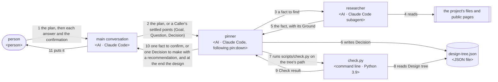
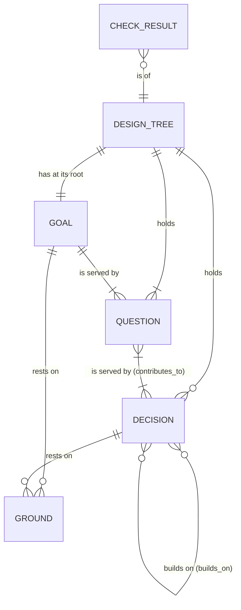
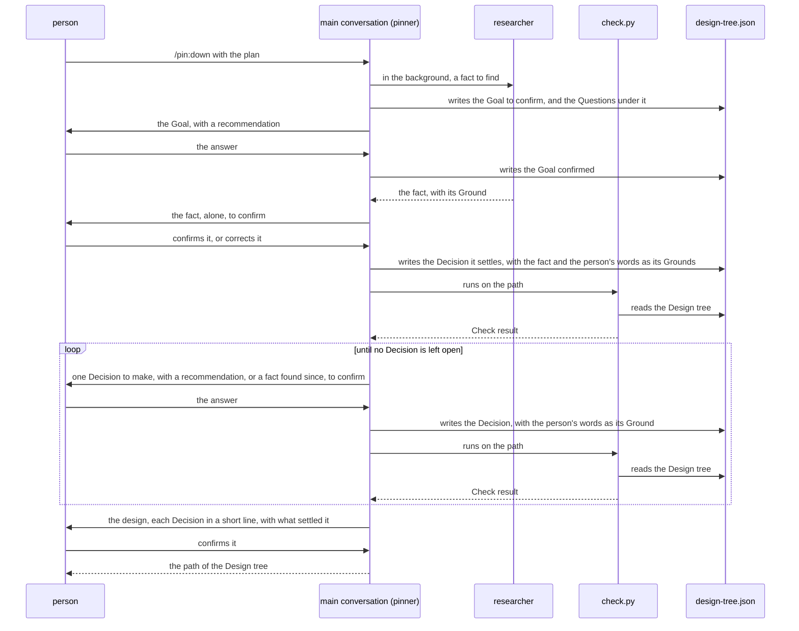
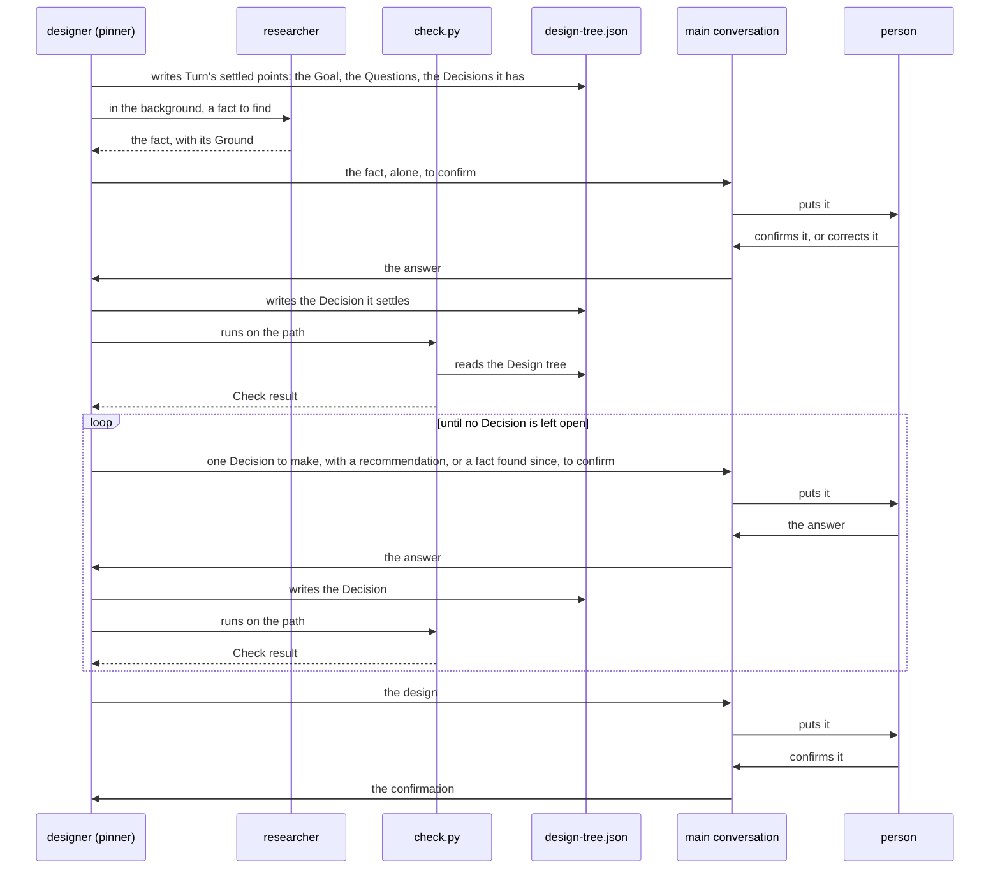
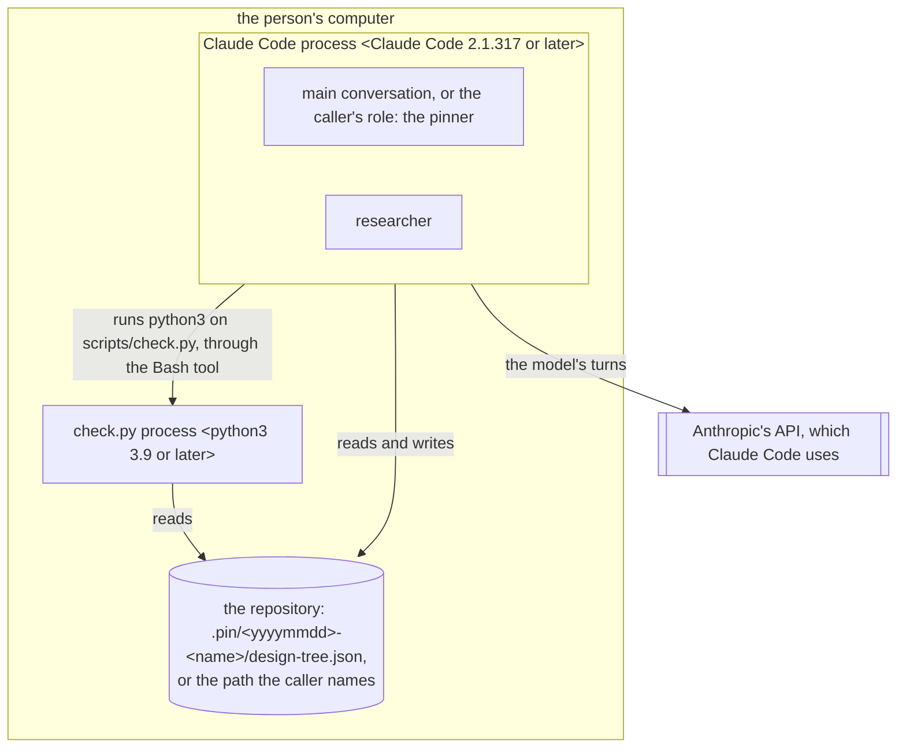

# pin architecture

pin gives its users a design tree, a JSON file that holds a plan's goal, the questions that must
hold for the goal, and the decisions that make each question hold. The pinner, the AI that follows
the skill `pin:down`, builds the tree from the goal down and settles each decision: a subagent
finds each fact, and the person confirms each fact and decides what is theirs, one point at a
time. The pinner is the main conversation when the person runs `/pin:down`, or a role of Turn or rn
that takes the skill. One script, `check.py`, checks after each answer that the tree holds
together. What this gives the person, Turn and rn is in [pin's UX](ux.md).

## Principles

pin follows all nine principles of [how a plugin works](../architecture.md#principles). Under
Principle 5, the person reads the design first, as they read it in full to confirm it. The
principles below are what pin adds.

### Facts are found, decisions are asked

The pinner finds each fact through a subagent, never by asking the person. It shows the person
each fact as it is found, alone, to confirm. It asks the person only a decision that is theirs. It
settles itself a decision that follows from the goal and the decisions before it, and shows it in
the design with what settled it.

A question about a fact spends the person's time on what the AI could look up, and a decision taken
for the person is a guess they never saw (KR1.1, KR1.2). The split of facts and decisions is that of
Matt Pocock's
[grilling](https://github.com/mattpocock/skills/blob/4ae2317ddb22b046e26455e4f9c9b3aaaf62212d/skills/productivity/grilling/SKILL.md):
"Finding _facts_ is your job, never the user's", and "The _decisions_ are the user's: put each to
them and wait." grilling does not show the facts it finds; pin shows each one, as
[Asking until nothing is left to decide](../architecture.md#asking-until-nothing-is-left-to-decide)
says, since a fact found but not shown is still a guess made for the person.

### One point at a time

The pinner puts one point to the person in each message, a fact to confirm or a decision with a
recommendation worded so that "yes" takes it, and waits for the answer before the next.

grilling asks a whole round of questions at once, but its own documentation says that "it can put
two questions in one round and only later find that one answer should have changed the other". One
at a time, each answer is weighed before the next point is chosen. The same page offers this
way as "a supported setting, not a workaround". Each point costs a message of its own, so the lead
time is kept down by the next principle and by asking only what is the person's (KR1.2).

### Research runs beside the questions

The pinner starts each subagent that finds a fact in the background, and meanwhile asks the
decisions that do not build on that fact. Only the decisions that build on it wait for it.

A decision that waits for research it does not need adds the research's time to the lead time, with
nothing gained (KR1.2, KR2.2).

### The tree is the only record

Every fact, decision and answer is written into `design-tree.json` before the next point. The pinner
asks a decision only once each decision it builds on is decided, and it reads which decisions those
are from the tree, not from the conversation.

A conversation can end, be cleared or be compacted, so a plan kept only in it is lost
([Where the course is kept](../architecture.md#where-the-course-is-kept)). A tree in a file is
read the same way by `check.py`, by a new conversation and by the AI that makes the work.

### Every decision reaches the goal

Each decision is joined by `contributes_to` to the questions or decisions it serves, and through
them to the goal. A decision that reaches no question is cut, and a question that no decision
serves is a gap. `check.py` finds both, and also a decision decided before one it builds on.

A decision that serves nothing costs the person a question for nothing, and a gap is a point the
work will guess (KR1.1, KR2.1).

### pin knows no caller

No line of pin names a plugin that uses it. A caller gives `pin:down` the goal, the questions the
work must answer and the path of the tree, and the decisions it has already settled; pin fills the
rest. A caller may add keys of its own to the tree, and `check.py` leaves them.

Turn and rn each take pin in as it is, and a change for one of them would reach the other unseen.

### The check command keeps one form

`pin:down` names the check as `python3 ${CLAUDE_PLUGIN_ROOT}/scripts/<name>.py <args>`, today
`python3 ${CLAUDE_PLUGIN_ROOT}/scripts/check.py <design tree>`. This form stays the same across
pin's versions; only the folder that Claude Code puts in place of `${CLAUDE_PLUGIN_ROOT}` differs.
Claude Code puts pin's folder there wherever the text of `pin:down` is loaded, in a caller's role
too (tried on Claude Code 2.1.317, 2026-11-03). The Bash tool's environment holds no
`CLAUDE_PLUGIN_ROOT`
([plugins reference](https://code.claude.com/docs/en/plugins-reference#where-each-variable-resolves)),
so the command carries the folder written out.

A caller's role runs the command as `pin:down` writes it, and a check that a caller lays on its
role's commands matches each command as it is written. A command whose form changed would be
stopped, or would go unchecked, in every caller at once.

## User stories

- As the person, I want to run `/pin:down` with my plan in rough words, confirm each fact found
  and decide only what is mine, one point at a time, and confirm the design at the end. Carries O1 from the request to the
  confirmed design tree.
- As Turn or rn, I want to give my role `pin:down` with a work's goal, its questions, what I have
  settled and the path of the tree, and get back the confirmed design tree. Carries O2 from the
  call to the design tree.
- As Turn or rn, I want my role to run the check command as `pin:down` writes it, and learn whether the tree holds together, or what is wrong.
  Carries each check step of O2; in O1 the pinner runs it within the first story.
- As Turn or rn, I want to reopen one decision with `pin:down`, and have it and each decision that
  builds on it decided again. Off the main path, serves KR2.1.
- As the person, I want to go on with a stopped run in a new conversation, from the tree it kept.
  Off the main path, serves KR1.2.

## Logical view

### Components



Legend: a rounded box is a person; a box is an AI or a script, with its kind and what it is made
with in angle brackets; a cylinder is a file; a box with double sides lies outside pin. Each
arrow says what one does to another, with the data it hands on named as in the data model, and its
number gives the order.

- Where the pinner is the main conversation, arrows 2, 10 and 11 are the main conversation's own.
- The pinner alone decides which decision to settle next, who settles it, and what to recommend.
  It alone writes the tree.
- The researcher finds one fact and nothing else. It is a subagent that Claude Code ships, such as
  Explore, so pin holds no agent of its own.
- `check.py` alone decides whether the tree holds together. It reads the tree and writes nothing.
- pin has no roles of its own, so a caller starts no orchestrator of pin's, as
  [A plugin that uses another](../architecture.md#a-plugin-that-uses-another) would have it: the
  caller's role takes `pin:down` and runs its steps itself.
- A pinner that is a caller's role asks the person through the main conversation, as
  [Where the orchestrator runs](../architecture.md#where-the-orchestrator-runs) says.
- `pin:down` is a skill that the AI may call: a caller's role takes it by the `skills` field of its
  frontmatter or by the Skill tool, and Claude Code preloads only a skill the AI may call
  ([subagents](https://code.claude.com/docs/en/sub-agents#preload-skills-into-subagents)).

### Data model



- A Caller's settled points are a Goal, Questions and Decisions already decided, in the tree's own
  form, so a caller hands them over by writing the first tree.
- A Decision is settled by the person, by research or by reasoning, and each settled one rests on at
  least one Ground: the person's words, a source quoted, or the goal and decisions it follows from.
  A fact found is a source quoted, and the person's confirmation of it is their words.

### Sequences

The person runs `/pin:down`, O1 of the UX:



Turn's designer has a work's design pinned down, O2 of the UX:



A decision reopened takes the same loop: the pinner marks it and each decision that builds on it
open again in the tree, and settles them in order.

## Physical view

### Deployment



- The person installs pin as [the README](../../plugins/pin/README.md#installation) says. A plugin
  that uses pin lists it in its `dependencies`, and installing that plugin installs pin.
- The person starts pin with `/pin:down`. A caller's role starts it by taking the skill.
- `check.py` uses Python 3.9 and its standard library only, as
  [Python 3.9 and the standard library](../architecture.md#python-39-and-the-standard-library)
  says.
- A person's tree is kept in `.pin/<yyyymmdd>-<name>/` at the root of the repository, as
  [Where a plugin writes its files](../architecture.md#where-a-plugin-writes-its-files) says. A
  caller's tree is kept where the caller names.

### Directory structure

```text
plugins/pin/
├── .claude-plugin/plugin.json      pin's manifest and version <JSON>
├── skills/down/SKILL.md            pin:down's entry, which links the pinner's part <Markdown>
├── scripts/check.py                check.py's entry <command line · Python 3.9>
├── core/domain/tree.py             check.py: the Design tree and its Check result <module · Python 3.9>
├── core/roles/pinner.md            the pinner's flow <Markdown>
├── LICENSE-grilling                Matt Pocock's copyright and permission notice for grilling <text>
└── README.md, CHANGELOG.md         for users <Markdown>

dev/pin/
├── ux.md, architecture.md, README.md   for builders <Markdown>
├── cosmic-ray.toml                 the mutation testing <TOML>
└── tests/
    ├── unit/core/domain/           unit and property tests of tree.py <Python 3>
    ├── integration/                scripts/check.py on real files <Python 3>
    └── e2e/                        the E2E tests and the prompt tests, and their plugin <Python 3>

.pin/<yyyymmdd>-<name>/design-tree.json   a person's Design tree
```

`LICENSE-grilling` lies in pin's folder, as installing copies only that folder, and the MIT
License asks that its notice go with each copy of a substantial portion.

## Test

pin is tested as [Test](../architecture.md#test) says. What follows is what pin adds.

| Deployment unit | Unit | Integration | End-to-end |
|---|---|---|---|
| check.py process [python3 3.9 or later] | unittest, Cosmic Ray, Hypothesis · ●●● · each of the three checks, and the tree's form | unittest, real files · ●●○ · the exit and its message | E2E tests · ●●○ · run by the pinner on each answer |
| Claude Code process: the pinner [Claude Code 2.1.317 or later] | prompt tests · ●●○ · `pin:down` alone, with the person and the researcher stood in for | empty: the pinner's only parts are itself, the researcher Claude Code ships, and `check.py`, whose meeting with the pinner the E2E tests run | E2E tests · ●●● · O1 by `/pin:down`, and O2 by a caller's role that takes `pin:down` |

The researcher has no row of its own: Claude Code ships it, and pin gives it only a prompt, tested
with the pinner's.

- A prompt test runs `pin:down` alone as [Unit: prompts](../architecture.md#unit-prompts) says,
  with Opus. A script stands in for the person, answering each question from a set of answers, and
  a stand-in researcher gives set facts. It passes in three runs of three: each message to the
  person holds one point, each fact found is shown to the person before a decision rests on it, each
  decision asked is one the person decides, and the tree passes `check.py`.
- An E2E test runs Claude Code with Opus on a copy of pin and of a plugin standing in for a caller,
  as [End-to-end: user stories](../architecture.md#end-to-end-user-stories) says. The person's
  answers are given by resuming the session with each next answer. It passes in three runs of three:
  what the prompt test asks, and the person asked to confirm before the run ends; in O2, also no
  point the caller settled is asked again, and the role runs the check in the form that
  [The check command keeps one form](#the-check-command-keeps-one-form) gives.
- `check.py` weighs ●●● in unit tests, as a tree it passes wrongly sends a gap into the work
  unseen. The pinner weighs ●●● in E2E tests, as a question that is not the person's, or a decision
  taken for them, is what pin is there to stop.
- Integration tests and the prompt tests weigh ●●○: the unit tests hold every behavior of
  `check.py`, and the E2E tests run the pinner whole.
