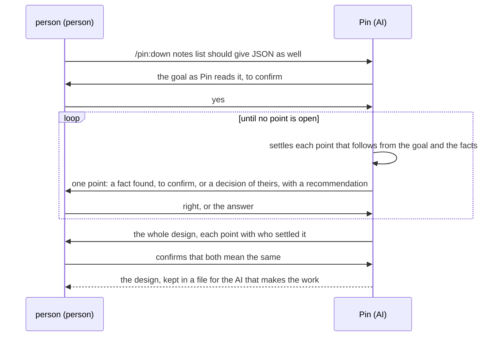
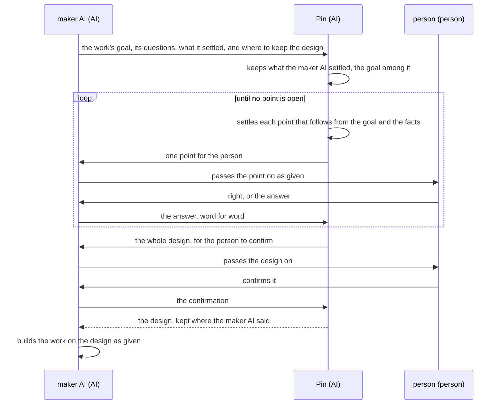

# Pin Product Vision

Pin has two users:

- **the person**: the one whose plan it is, such as a feature or a document, who wants an AI to
  make what they mean;
- **the maker AI**: an AI that is to make a work for a person, such as a role of another plugin,
  and wants the work's design settled with that person before it builds. It hands Pin the work's
  goal and the questions that the work must answer.

A point of a plan is one thing the plan must settle: a fact, such as what reads a file today, or a
decision, such as which fields a note has. The design is the plan's goal with every point settled
under it.

## OKRs

Each objective (O) says what one user gains. Its key results (KR) measure how close it is.

- O1: The person has every point of their plan settled as they mean it before any work starts,
  asked only what is theirs.
  - KR1.1: Of the points of the plan, the share that goes wrong. Lower is better. The points
    counted are those that the work on the plan turns out to need, and those put to the person.
    A point goes wrong in four ways:
    - the work needs it, and the design the person confirmed does not hold it or holds it open;
    - the design holds it otherwise than the person means it, so the work is redone;
    - the person is asked it while it is not theirs to decide, so they leave it to Pin or tell Pin
      a fact that Pin could have found;
    - the person settles it apart from Pin, such as in a chat with the AI that makes the work.
  - KR1.2: The lead time from the person's first request to the design they confirm. Shorter is
    better.
- O2: The maker AI has a work's design settled with the person it is for, keeping what it
  settled, and builds on it as given.
  - KR2.1: Of the designs that the maker AI gets back, the share that goes wrong. Lower is better.
    A design goes wrong in four ways:
    - it settles a point otherwise than the maker AI settled it, or the person is asked that
      point again;
    - a question that the maker AI gave has no decision under it;
    - the maker AI answers or rewords a question meant for the person, as it cannot pass the
      question on as given;
    - the maker AI changes the design, or settles a point with the person itself, before or during
      the work.
  - KR2.2: The lead time from the maker AI's request to the design it gets back. Shorter is better.

In each objective, the first key result comes first. A change shortens the lead time only if it
keeps the first key result as good.

Key results have no target values. A measure that becomes a target stops being a good measure
(Goodhart's law), so the key results serve only to judge how close the objective is.

## Scenarios

Both scenarios settle one plan of the person's: their notes app `notes` prints notes as text with
`notes list`, and should give JSON as well. The participants:

- **person** (person): O1's user, and the one the maker AI works for in O2. Each step the person
  takes waits for them.
- **maker AI** (AI): is to add the JSON output for the person, in O2.
- **Pin** (AI): Claude running Pin. What runs inside Pin, such as its checks, takes no part here.

### O1: The person settles the JSON output of notes list

### O2: The maker AI has the design of the JSON output settled

