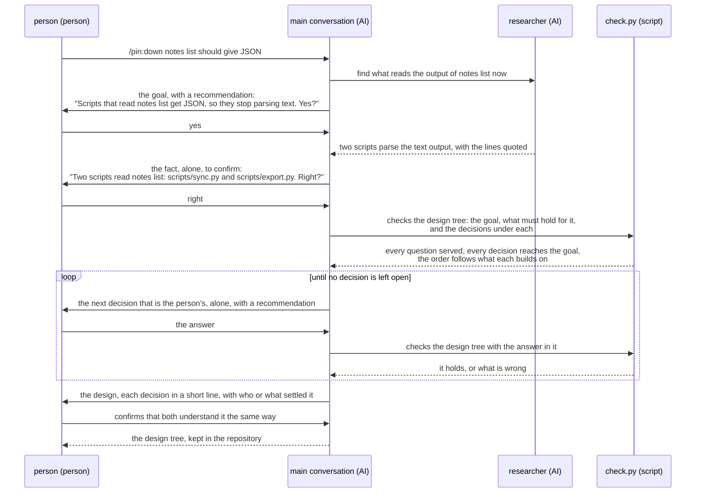
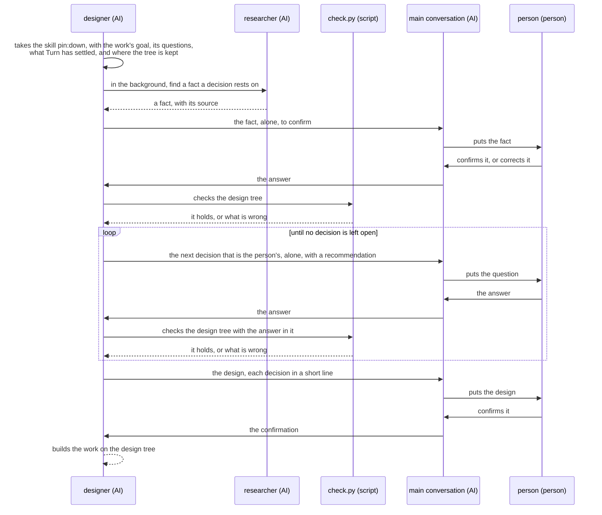

# Pin UX

Pin has two users:

- a person who has a plan to hand to an AI, such as a feature or a document to be made;
- Turn and rn, plugins that make a work for a person, such as a document or code, and settle its
  design first.

Pin keeps a plan as a design tree: the decisions the plan needs, each joined to the goal it serves,
from the goal down.

## OKRs

- O1: A person pins down their plan before any work on it starts, deciding only what is theirs and
  leaving nothing assumed.
  - KR1.1: Of the decisions that the work on the plan turns out to need, the share that the
    confirmed design tree did not hold as the person holds them: left out, left open, or settled
    without the person where the decision was theirs. Lower is better.
  - KR1.2: The lead time from the person's first request to the design tree they confirm. Shorter is
    better.
- O2: Turn or rn hands over a work's goal and the questions the work must answer, and gets back a
  design tree that it can build the work on as given.
  - KR2.1: Of the design trees that Turn or rn gets back, the share that it cannot build on as
    given: a question that no decision serves, a decision that serves no question, a decision made
    before one it builds on, or a point that Turn or rn had already settled and the person was
    asked again. Lower is better.
  - KR2.2: The lead time from the call of Turn or rn to the design tree it gets back. Shorter is
    better.

In each objective, the first key result comes first. A change may shorten the second only where it
keeps the first. All of ccpm aims to shorten the lead time without lowering quality.

Key results have no target values. When a measure becomes a target, it stops being a good measure
(Goodhart's law). Use the key results to judge how close the objective is.

## Scenarios

Both scenarios plan one change: the notes app `notes` gets a `--json` option on `notes list`. These
are the participants:

- person (person): the one whose plan it is, and who decides what is theirs.
- main conversation (AI): the Claude Code conversation the person talks in. In O1 it runs
  `/pin:down`.
- researcher (AI): a subagent that finds one fact, such as what reads the output of `notes list`.
- `check.py` (script): Pin's script that checks a design tree.
- designer (AI): Turn's role that designs a work, in O2.

### O1: The person pins down the plan with /pin:down

### O2: Turn has the design of a work pinned down

