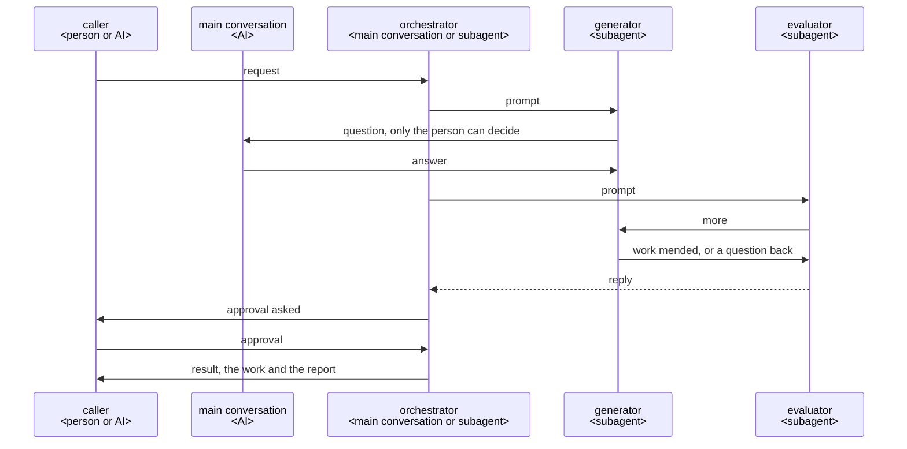

# Best practice for building a Claude Code plugin

This is the best practice for a Claude Code plugin whose roles work together to make something,
such as a document or code. A plugin is built on it, taking what its requirements call for.

## Principles

A plugin takes the principles its requirements call for, and its architecture names them.

### For every plugin

#### The core apart from Claude Code

An entry, a skill, an agent, a hook or a command line, holds only the form Claude Code fixes, and
hands the job to its part, a file of its own in `core/` named after that part. A command line reads
its arguments and calls the part's module, and a hook's script reads the event and calls the part
that answers it. `core/` depends on no agent, such as Claude Code or Codex, and names no tool of
theirs, such as the Agent tool or `AskUserQuestion`; the entries do.

- **Why**: The files then show the parts the logical view draws, and a job is found where the
  logical view puts it, not by the command that calls it. A second entry to the same job would come
  to repeat the first if the job lay in the entry. What the plugin knows outlives the agent it runs
  on. The domain changes only when the work's rules change, and a role only when its way of working
  does, so each is changed without reading the other.
- **Source**: Cockburn's [ports and adapters](https://alistair.cockburn.us/hexagonal-architecture/):
  "as events arrive from the outside world at a port, a technology-specific adapter converts it
  into a usable procedure call or message and passes it to the application", which is "developed
  and tested in isolation from its eventual run-time devices and databases".

#### An entry points to its part

A skill or an agent is its frontmatter and a body that points to its part. An agent's body has the
agent read its part in full before anything else, and a hook holds it to this. A skill's body links
its part. The body says where each script, file or folder the part names lies, and the part names
each by its name alone, such as `turn.py`, never by where it is installed.

- **Why**: Claude Code makes an agent's body its system prompt and takes in no other file. After
  `/compact`, a part a skill links comes back attached in full, while the skill's own body survives
  only as the summary retells it. Claude Code replaces `${CLAUDE_PLUGIN_ROOT}` only in an entry's
  own body, not in what the Bash tool runs nor in a part read with Read, so a part that names it
  runs a wrong path.
- **Source**: [subagents](https://code.claude.com/docs/en/sub-agents);
  [skills](https://code.claude.com/docs/en/skills): "reference supporting files from `SKILL.md`";
  [environment variables](https://code.claude.com/docs/en/plugins/manifest-reference#environment-variables).

#### What a machine can see of the work

A script, a hook or the project's own tools check what a machine can check. A project whose work is
code has a formatter, a linter and a type checker set up, and the command that checks the work runs
them. Generators and evaluators read only for what no machine can check.

- **When**: a work part of whose checks a tool can make.
- **Why**: A tool finds the same thing every time, at once. An AI reading for it finds only some,
  and spends a round on each.

#### The guard tells each role its steps again

A role's step that is not sure to hold gets a hook, which notices when the role drifts from the
step and tells it the step again, or stops what would break a rule. The hooks are in the plugin's
`hooks/hooks.json`, and each acts only in the roles it names. An orchestrator in the main
conversation is held by its own steps or by its router. GitHub's branch protection or Claude Code's
permission rules hold what is hard to undo.

- **When**: a step that an instruction alone does not hold.
- **Why**: A hook runs every time, while an instruction is only advice. A plugin's agent ignores
  `hooks`, `mcpServers` and `permissionMode` in its frontmatter. A hook is told which subagent it
  runs in, but not which skill runs in the main conversation, and a skill's hooks last the whole
  session once it starts.
- **Source**: [best practices](https://code.claude.com/docs/en/best-practices),
  [frontmatter fields in plugin agents](https://code.claude.com/docs/en/plugins/components#frontmatter-fields-in-plugin-agents),
  [hooks](https://code.claude.com/docs/en/hooks#hooks-in-skills-and-agents).

#### Where a plugin writes its files

Besides the work and the files its caller names, a plugin writes what may be kept in
`.<plugin>/<yyyymmdd>-<name>/` at the root of the repository, and what is used only while it runs,
its tests' and trials' included, in `<plugin>/<yyyymmdd>-<name>/` in the system's temporary folder,
the one Python's `tempfile.gettempdir()` gives. A file that an agent reads with its tools goes in
the folder that may be kept, even if it is used only while the plugin runs, and is removed once it
is used. What must outlast an update of the plugin, such as a cache, goes in
`${CLAUDE_PLUGIN_DATA}`, and nothing is written in `${CLAUDE_PLUGIN_ROOT}`.

- **Why**: With one folder named after the plugin, the user chooses with one line of `.gitignore`
  whether git keeps it, and the date at the front sorts the runs and shows the old ones. The system
  clears its temporary folder itself, so a run stopped partway leaves nothing behind. That folder is
  the one TMPDIR names where it is set, and macOS and sandboxes set it, so it is not always `/tmp`.
  Claude Code lets an agent read without asking only inside the working folder and the folders added
  to it, so a file outside them stops an agent that works on its own to ask.
  `${CLAUDE_PLUGIN_ROOT}` changes when the plugin updates, while `${CLAUDE_PLUGIN_DATA}` is kept.
- **Source**: [working directories](https://code.claude.com/docs/en/permissions#working-directories);
  [environment variables](https://code.claude.com/docs/en/plugins/manifest-reference#environment-variables).

#### The purpose before performance

A change is taken only if it still meets the requirements. Time or cost is cut only after that.

- **Why**: A work that misses the purpose costs the caller the fixing as well as the wait, so time
  saved by leaving them more to fix is spent again by them.

#### Asking for what lies outside the work

When something outside the work keeps it from going on, such as a permission not given or a tool
not installed, the role asks the main conversation for what it needs rather than look for a way
round. It goes on with the rest of the work meanwhile, and with the answer once it comes.

- **Why**: The person can clear such a cause in a moment; the run cannot. A way round leaves a work
  checked under other terms than the purpose set. A run that stops brings nothing back.

#### The caller approves what is theirs

What the caller decides, and what is hard to undo, such as a merge, goes to the caller to approve.
An approval counts only when it comes from the caller's own action, such as a skill that the AI
cannot call (`disable-model-invocation: true`); an agent saying it was approved does not count. A
commit or a push can be undone, so it does not go to the caller.

- **Why**: If an AI decides these for the caller, the caller ends up answerable for something they
  never saw. An approval an agent can give itself stops nothing: cc-sdd's agent sets its own
  approval flag.

#### Languages

A plugin that a person calls first proposes two languages: the one it talks in, and the one it
writes the repository in. It proposes what the repository and the person's instructions set, and
otherwise the person's own language for talking and English for the repository, and records the
answer. What it shows the person is in the language of the talk, with nothing added and nothing
left out. A plugin that an AI calls writes in the repository's language, and the caller that talks
with the person translates.

- **When**: a plugin that talks with a person or writes into a repository.
- **Why**: The person decides from what they read, so a translation that adds or leaves out
  something changes what they approve. People who were not in the conversation read the repository
  later, and English reaches most of them.

### For a plugin with an orchestrator and roles

#### The orchestrator holds the whole and decides

The orchestrator talks with the caller, keeps everything the run has found, and decides each move:
what to ask, what to have made, and when to change the plan or remake a work. It reports no
progress while the run goes.

- **When**: a run of several steps, where each step depends on what the last one found.
- **Why**: Only someone who holds the whole run can weigh the facts each move brings. Talking with
  the caller itself, the orchestrator can answer "why" and change its proposal when the caller
  objects; a go-between cannot. Claude Code already shows each role while it runs, so a progress
  message is read by no one.
- **Source**: [Building effective agents](https://www.anthropic.com/engineering/building-effective-agents):
  "a central LLM dynamically breaks down tasks, delegates them to worker LLMs", for "complex tasks
  where you can’t predict the subtasks needed".

#### Where the orchestrator runs

A plugin that a person calls runs its orchestrator in the main conversation, started by a skill. A
plugin that an AI calls, such as one given what to make as JSON, runs its orchestrator as an agent
that the calling AI starts. A role that needs the person's decision asks the main conversation
directly, whoever called the plugin.

- **Why**: Only the main conversation can ask the person; a subagent cannot.
- **Source**: [subagents](https://code.claude.com/docs/en/sub-agents#available-tools).

#### A plugin that uses another

A plugin that has another plugin do a job starts that plugin's orchestrator as one of its roles.
That plugin's roles still ask the main conversation, as every role does.

- **When**: a job that another plugin already does.
- **Why**: The other plugin then runs as it was built and tested, and nothing of it is written
  again. A subagent can start subagents down to three layers below the main conversation.
- **Source**: [subagents](https://code.claude.com/docs/en/sub-agents#let-subagents-spawn-their-own-subagents).

#### One agent for each job

Each job has a role made for it, and the role gets only what the job needs.

- **Why**: A role starts in a fresh context with its own prompt and tools, so nothing from other
  work leads it astray.
- **Source**: [subagents](https://code.claude.com/docs/en/sub-agents).

#### Messages

Nobody relays messages. The orchestrator starts a role with its prompt, and the role replies at its
end, as [Sequences](#sequences) draws; in between, whoever needs something sends a message to
whoever has it, and goes on with the answer. A role runs in the background, and one that has ended
is sent further work with SendMessage, which resumes it with its whole conversation.

- **When**: roles that need something from each other while they run.
- **Why**: A go-between holds nothing of what passes, and adds a move to every exchange. What the
  end of the run needs from an exchange is in the files the roles write, where a script checks it.
  A role resumed keeps what it read and did, so a remake does not start again from nothing.
- **Source**: [background subagents](https://code.claude.com/docs/en/sub-agents#run-subagents-in-foreground-or-background),
  [resume subagents](https://code.claude.com/docs/en/sub-agents#resume-subagents).

#### JSON between agents

What agents pass on as data is JSON, read and changed with `jq`.

- **When**: data that more than one agent reads or changes.
- **Why**: An agent then changes only the part it needs, with a tool it already knows, and leaves
  the rest as it was.

#### Asking until nothing is left to decide

The orchestrator asks the caller every point that only they can decide, one at a time, each with a
recommendation. It finds facts itself, and shows the caller each fact the work depends on, one at a
time, to confirm. A choice that follows from the purpose and the project's usual practice, such as
where a test goes, is decided by the role that meets it and reported with its reason.

- **When**: a request that leaves points open.
- **Why**: A point settled before the work does not come back later as rework. A fact found but not
  shown is still a guess made for the caller, so the work starts only once both understand it the
  same way. Each question costs the caller time and holds the run, so a question about what the
  caller does not care about spends their time on the plugin's job.
- **Source**: [grilling](https://github.com/mattpocock/skills/blob/main/skills/productivity/grilling/SKILL.md),
  [Let Claude interview you](https://code.claude.com/docs/en/best-practices#let-claude-interview-you).

#### Read by those who did not make it

An evaluator, an AI that did not make a work, uses it first, standing in for the work's user with
what the work's user has. Each question of the checklist asks what the work's user should get from
the work. The evaluator puts each question in `good`, with the lines of the work that meet its aim,
or in `more`, with `good_when`: what the work's user gets once it is good, in one sentence, never
how to make it. It tells the generator directly. Before that, the generator checks its own work in
the same form, with lines and no words, and on a remake only the questions sent back. When the
work's user is the caller and the caller reads the work in full to approve it, such as a plan, the
caller reads it first.

- **When**: a work whose user must get something from it that no machine can check.
- **Why**: The generator finds what it meant; an evaluator that did not make the work finds only
  what the lines give, which is what the work's user gets. An evaluator shown someone else's verdict
  finds what it was told, so two readings add a check only when each is made on its own. An
  evaluator that hunts for defects finds one in every work, and the rounds go on without the work
  getting better for its user. The generator holds the sources, so how to make a question `good` is
  the generator's to decide; an evaluator that names a fault starts an argument about the fault.
  Lines can be checked by a script, an evaluator or the caller, and finding them makes the
  generator look at the place; a claim in words is read by no one and costs its writing at every
  round. Each question says what is run and how far, so a `more` does not come from the two running
  different things. A caller who reads the work in full anyway gains nothing from an evaluator in
  their place, and loses its time at every remake.

#### Where the router keeps the course

A run that goes in a fixed loop keeps its course in a router of its own, a Python script. From the
role that ended and its result, the router gives the orchestrator each next move. It gives the
orchestrator only the moves that need it, such as starting a role, sending a message, asking or
returning the result, and does itself what a script can do, such as checking a reply's form or
waiting for a role to end. A run that keeps a state, what it has decided and been answered so far,
writes it to a file in its work folder before each next move, and commits and pushes what is kept
at the end of a step. A run whose course changes with what it finds keeps its course in its skill's
steps and its plan in a document.

- **When**: the router, a run that goes in a fixed loop; the state file, a run that keeps a state.
- **Why**: A course kept in code is followed the same way every time; an AI deciding may not follow
  it. Spec Kit, BMAD-METHOD, OpenSpec, superpowers and cc-sdd all keep a fixed course outside the
  AI; OpenSpec calls its own steps "prompt-level behavior contracts, not enforceable checks". A
  course fixed in code has no move for what it did not foresee, so it does not suit a run whose
  findings keep changing the course. Each move of the orchestrator is a turn of the model, which
  reads the whole conversation, so a move the router could make costs time and adds to what every
  later move reads. A conversation can end, be cleared or be compacted, and what lives only in it is
  lost; with the state in a file, a run stopped anywhere goes on from its last move in a new
  conversation, and takes an answer in where it stands, rather than making again what it had made.

#### Learning from each run

Once the caller approves the finished work, the orchestrator looks once through what the run kept,
each work sent back, each work made again and each point asked again, for what fell short and why:
the run's lessons. It checks each cause it doubts in the run's records, so each lesson comes with
the words it rests on, quoted, and puts each lesson to the user. A lesson of the user's own project
goes into its checklists or rules. A general lesson goes to the plugin's repository as an issue
that holds the lesson and its points, never the user's source; the orchestrator shows it in full
and opens it only on the user's own yes. A plugin called by an AI leaves this to its caller.

- **When**: a plugin that a person calls.
- **Why**: Looked for once, the lessons cost the user one reading; lessons made at every approval
  would be weighed again in every session. What the run kept holds every send-back and remake, as
  [Where the router keeps the course](#where-the-router-keeps-the-course) has it, and a cause named
  without its record is a guess. A general lesson, met once, improves the plugin for every
  user. The work and its source are the user's, and an issue on a
  public repository cannot be undone, so the user chooses what leaves their project. A plugin
  called by an AI is one move of its caller's run, so what fell short in it shows in what that run
  kept.

## Architecture

### Logical view

#### Components


The figure draws the roles the principles above give: the caller, the orchestrator, the generator,
the evaluator, the router and the guard.

#### Sequences

A run, from the caller's request to the result:



Each plugin's architecture draws a sequence for each of its own user stories on this one.

### Development view

#### Directory structure

```text
<repository>/
├── .claude-plugin/marketplace.json     the marketplace: the plugins it lists <JSON>
├── README.md                           leads users to each plugin's README, and developers to dev/ <Markdown>
├── pyproject.toml, uv.lock             the check tools and their locked versions <TOML>
├── .github/workflows/                  CI, which runs the checks on every push <YAML>
├── plugins/                            what runs on users' machines, installed by Claude Code
│   └── <plugin>/
│       ├── .claude-plugin/plugin.json  the manifest, holding the version <JSON>
│       ├── skills/<command>/SKILL.md   a skill's entry <Markdown>
│       ├── agents/<name>.md            an agent's entry <Markdown>
│       ├── hooks/
│       │   ├── hooks.json              the hooks' entries <JSON>
│       │   └── <hook>.py               the hooks' code, the guard among them <Python 3>
│       ├── scripts/                    what runs as a command and depends on Claude Code, as the official plugins keep theirs <Python 3>
│       ├── core/                       the plugin's own logic, apart from Claude Code
│       │   ├── domain/                 the knowledge and rules of the plugin's work, which every role reads alike
│       │   └── roles/                  each role's flow, which uses the domain
│       ├── docs/                       fuller use, named by the README's Documentation <Markdown>
│       ├── README.md                   for the plugin's users <Markdown>
│       └── CHANGELOG.md                what changed for users in each version, in Release's form <Markdown>
└── dev/                                what only the developers need, never installed
    ├── README.md                       the plugins' folders, how to run the shared checks, and the order the work goes in
    ├── plugin-best-practice.md         this document
    ├── scripts/                        the checks every plugin shares, and the hook before a push <sh, Python>
    └── <plugin>/                       one for each folder in plugins/
        ├── README.md                   the way to the plugin's UX, architecture, tests and trials
        ├── ux.md                       the plugin's UX <Markdown>
        ├── architecture.md             the plugin's architecture <Markdown>
        ├── cosmic-ray.toml             the plugin's mutation testing <TOML>
        └── tests/                      as Test says
```

- **When**: a repository that holds several plugins and what their developers need. A repository of
  one plugin takes the same tree with one folder in `plugins/`, so `dev/` still stays off users'
  machines.
- Installing a plugin copies only its folder, so what only developers need stays in `dev/`, off
  users' machines. The plugins' folders lie together in `plugins/`, as the official marketplaces
  [anthropics/claude-plugins-official](https://github.com/anthropics/claude-plugins-official) and
  [anthropics/claude-code](https://github.com/anthropics/claude-code) keep theirs, so the root holds
  only what the whole repository needs.
- The entries lie where Claude Code looks for them. `core/domain/` and `core/roles/` each place
  their prompts, scripts and assets as their parts need.
- No README lies deeper than these. GitHub shows a folder's README when the folder is opened, so a
  visitor finds the way by opening folders, and a README further down would repeat its parent's.
- Each plugin keeps its CHANGELOG at its root, so a user finds what changed in the same place for
  every plugin.
- A document's images lie in `images/` beside it, as `dev/images/` for this document, so a folder
  shows its documents and parts when opened, and an image is found from its document.
- A figure is an SVG in the style of `dev/images/figures.css`, light by default and dark under
  `prefers-color-scheme`. An image shown by `` reads no file beside it, so each SVG carries a
  copy of the style, put in by a script, and the checks fail on a copy left behind.

## Development

### Python 3.9 and the standard library

What runs on users' machines is Python 3, version 3.9 or later, with the standard library only, and
the plugin's README says so. A script that only calls an existing tool may be sh.

- **When**: users' machines may lack other runtimes or packages, as a plugin installs none.
- **Why**: python3 is wherever git is, while Node.js may not be. The oldest version is the oldest
  one the plugin's users run.

### Code kept once

Code that more than one plugin needs, such as how a hook reads a command, is kept once, in the
plugin whose job it is, with its tests in that plugin's `dev/<plugin>/tests/`. Each other plugin
takes it in through a relative symbolic link. What those tests share, such as a repository made
once and copied for each test, is kept beside them.

Installing copies the target of a link within the marketplace into the plugin
([share files within a marketplace with symlinks](https://code.claude.com/docs/en/plugins/host-marketplace#share-files-within-a-marketplace-with-symlinks)),
so each plugin carries the shared code while it is written, tested and fixed in one place.

### No lines copied

No lines are copied between files, except a test's expected value, which is written out from the
specification, as Q6 of [code.json](../plugins/turn/core/domain/best-practices/code.md) says. The
checks fail when two files share four or more similar lines of Python, not counting comments,
docstrings and imports, as pylint's `duplicate-code` finds them; they do not tell a test's expected
value apart.

A copy gets fixed in one file and left wrong in the other.

### Checks on what an AI does

A check on what an AI does is a hook, in a file of its own named after the check, with one entry
file for each hook event, as the official
[`hookify`](https://github.com/anthropics/claude-plugins-official/tree/main/plugins/hookify) plugin
does. A check that more than one plugin needs is kept once, as [Code kept once](#code-kept-once)
says.

A check in a file of its own can be read, fixed and tested on its own. A check kept in each plugin
apart would drift from the others.

## Test

Each plugin is tested at three levels. Each level is named by what its tests check against:

- **unit** checks one part against its contract: what the part takes, what it gives, and the
  forms its results take.
- **architecture** joins all the parts and checks them against the plugin's architecture. It runs
  every user story's sequence from start to end.
- **ux** checks the plugin in real use against its UX.

A **double** is a stand-in for a part that gives set results. A part made of code is tested by
tests of code, and a part run by an AI by a **trial**: a run of the AI, judged from its records.
Each test is drawn from the one thing its level checks against, not chosen by its writer: unit
from the ways a part's contract divides, architecture from the paths the plugin's sequences draw,
and ux from an objective's scenario. Two developers then draw the same tests, and a failure points
to that one thing.

| | unit | architecture | ux |
|---|---|---|---|
| Runs real | the part alone; a part run by an AI on the model its users run | what joins the parts: the hooks, the scripts and the entries, as they are installed | the whole plugin, installed as its user installs it, on the model its users run |
| Doubles stand in for | the part's neighbours, and Claude Code where the part meets it | each role an AI runs, and each thing outside the plugin, such as Claude Code, so no model is called | nothing of the plugin |
| Stands in for the person | a script with set answers, or an AI given an intent | the double of the main conversation, with set answers | an AI holding an intent written before the run and never shown the plugin |
| Covers | each class, each edge and each rule of the part's contract | every path through each sequence: the main flow, each branch, each send-back and each question | each objective's scenario, on a subject as big as a real request |
| Passes when | code: every test passes, every line and branch run, every mutant caught; a trial: as [Results that vary from run to run](#results-that-vary-from-run-to-run) says | every test passes, with the role and the data checked at each step | the stand-in gets what the objective says, as [Results that vary from run to run](#results-that-vary-from-run-to-run) says |
| Runs | code: before each push and in CI; a trial: as the part is made | before each push and in CI | once every lower level passes, at the end of the whole |
| Is written as | `test_*.py`, or `trial_*.py` for a trial | `test_*.py` | `trial_*.py` |

The tests lie in `dev/<plugin>/tests/`, in a folder for each level: `unit/`, at the path of what
each tests, as `tests/unit/core/domain/`; `architecture/`; and `ux/`. What the tests of more than
one level share lies in `tests/` itself, as `tests/helpers.py`. A test is then found from what it
tests, and the folders bear the names of the table's columns. A file of tests of code is named
`test_*.py`, and the code that runs a trial `trial_*.py`, so `unittest` finds only the tests that
CI runs. Each plugin's architecture holds the table, a row for each deployment unit, and its own
test rules give only what differs from these.

### No check passes what it did not check

Every check ends in one of three ways: no problem, a problem found, or could not check, with why.
For each way a check can fail to check, what happens next is decided beforehand and tested: a hook
whose script fails, times out or cannot parse a command stops the call and says so; a skipped test
is not a passed test; a CI job that did not run does not pass; an evaluator whose command did not
run puts no question in `good`.

A check that says nothing when it could not check is read as one that found nothing, and what it
was there to stop goes through unseen. A case decided only when it is met is decided in a hurry, by
whoever meets it.

### Unit: code

Each part made of code has unit tests, written with `unittest` in `dev/<plugin>/tests/unit/`, each
double standing in for a neighbour of the part, such as a module it calls or an event of Claude
Code. Each test is written as Q6 of [code.json](../plugins/turn/core/domain/best-practices/code.md)
says, and the cases are drawn from the part's contract:

1. one test for each class of input or result that the part treats alike, the refused ones among
   them;
2. where a class ends on an ordered scale, such as a length, one test at each end and one at the
   nearest value in the next class;
3. where the result turns on a combination of conditions, a table with one rule for each
   combination that can occur, and one test for each rule.

A part treats every input of a class alike, so one test stands for the class; faults gather at the
edges of a class; and a table shows each combination at once, so none is left out unseen.

Three checks, made as Q8 of code.json says, confirm that the unit tests are enough:

- the unit tests alone run every line and every branch of the part: C0 and C1 coverage, 100%;
- they catch every mutant of Cosmic Ray, except on a line marked `# pragma: no mutate`, where no
  input the code takes can tell the mutant apart, with the reason given once in the plugin's
  `cosmic-ray.toml`;
- the property tests of Hypothesis pass, and each input one fails on is added as a unit test.

The unit tests hold every behavior the code must have. A line that only an architecture test runs
is one whose contract no unit test holds. A gap the other two checks find is a missing unit test,
added so that every push catches it again.

What runs when, and why:

- Before each push, a hook runs the unit and architecture tests of each plugin the push changes,
  counting lines and branches, with the linter, the formatter, the type checker and the manifests'
  check, and stops the push on a failure. A check left to be run by hand gets forgotten, and is
  found only by CI after the push.
- On every push, CI runs every plugin's unit and architecture tests and fails on any line or branch
  the unit tests do not run. It runs the mutation testing and the property tests, on many inputs,
  only on what changed. The tests are designed before the code and the coverage shows each line
  run, so these two only confirm that design; run before every push, they would make every change
  wait. A survivor that CI finds goes back to the test design that missed it.
- When a plugin's version changes, CI runs both on the whole plugin. Checking the whole takes long,
  so it is checked when it reaches users; a test weakened with no line of code changed is among
  what only the whole run finds.
- Each check runs on the oldest Python users run and on the newest; a test tool that needs a newer
  Python runs on the newest only. The code must run on the oldest, and the tools need newer
  versions only to test.

A plugin's whole test run takes seconds, and the time each check takes is read on every run, as
mutation testing runs the tests once for each mutant, and a slow test run makes every change wait.

### Unit: prompts

The developer tries each role, a skill or an agent, on its own, with doubles standing in for its
neighbours and a stand-in for the person, and names in each run the model the plugin's users run.
It judges the role from its input, its output and the records of the run, against its Role and
Steps. The trials are made as Q12 and Q14 to Q16 of
[prompt.json](../plugins/turn/core/domain/best-practices/prompt.md) say: drawn from the role's
contract, one case at a time, each part of a trial checked on a kept record before a run trusts it.

A role tried together with what lies around it does not show which of them went wrong. A smaller
model makes different slips from the ones users meet, and a model left to the runner's settings
changes with whoever runs the trial.

### Architecture: the parts joined

The architecture tests run real what joins the parts, and stand in with a double each role an AI
runs and each thing outside the plugin; each plugin's test rules name what runs real in it. A
double of Claude Code sends the hook events and runs the hooks' commands in `sh`, as Claude Code
does, and is kept once, as [Code kept once](#code-kept-once) says. A double of the main
conversation, or of a caller, answers each question with a set answer.

The tests are drawn from the plugin's sequences:

1. For each user story, list the paths through its sequence: the main flow first, then each branch,
   each step that sends work back to an earlier one, and each question put to the caller or the
   person.
2. Add paths until every move from one step to the next lies on some path.
3. Write one test for each path, from its first step to its end, checking at each step the role
   that acts and the data it hands on.

Each plugin's test rules list its paths. A path the sequences draw that no test runs is a gap in
the tests, and a path no sequence draws is a gap in the sequences.

A fault of a sequence lies between parts, where each part's unit tests pass, so what joins them
runs real. With each role an AI runs a double, no model is called, so the tests take seconds, give
the same result on each run, and every push checks every path.

### ux: the plugin in real use

Once every unit and architecture test passes, the developer tries the whole plugin as its user
uses it, on each objective's scenario, on a subject as big as a real request. The trial confirms
the objective and the key results that no lower level can measure, such as the lead time, and does
not aim to cover every case. An AI stands in for the person, answering from an intent written
before the run and never shown to the plugin, and a run passes where the stand-in gets what the
objective says, judged against that intent. For each key result, the plugin's test rules say what
is measured, and each measure is set against the last run's in the direction the UX gives it. The
developer keeps each run's time and tokens with the trial's records, and shows whoever decides what
reaches users:

- how close it came to the goal and to each key result of the UX;
- the time and the tokens it took, beside the size of the work;
- what could be improved.

That person decides from these whether the plugin reaches users.

Each part can pass, and every sequence too, while the user's objective is missed. The UX gives a
key result no target value, and no bar for time and tokens is known before runs gather, so runs
kept side by side show whether a change made things better or worse, with the purpose met as fully
([The purpose before performance](#the-purpose-before-performance)). A trial takes minutes and
calls the model on each move, so a few trials confirm what the lower levels have already checked.

How a trial runs:

- A plugin made for the test stands in for a plugin that calls the one tried.
- Each Claude Code a trial starts, and each stand-in for a person, runs on a configuration folder of
  its own, made fresh by the trial's code with only the plugins under test, so it reads none of the
  developer's CLAUDE.md, settings or memory, and shows how a plugin behaves for any user. A
  configuration folder holds its own login, so the trial gives the developer's as
  `CLAUDE_CODE_OAUTH_TOKEN`, read from their own folder and never written there
  ([multiple accounts](https://code.claude.com/docs/en/authentication#log-in-with-multiple-accounts)).
- Where Claude Code asks the person to allow a call, the stand-in sees what the screen shows and
  chooses, as a person would.
- A trial that needs a real GitHub repository runs in a repository kept for trials, one at a time,
  on a branch of its own, and removes the branch, its pull requests and all else it made there when
  it ends. Its pull requests and pushes then stay out of every repository people use, `main` there
  takes nothing but a reviewed pull request, and no trial mixes with the next.
- CI cannot start Claude Code, so each trial is a check of its own, and the code that runs a trial
  is not counted in the lines and branches.

### Where a double's results come from

A double is built from the form that the part's contract gives its results, and is set only to
results that form allows, the refusals among them.

- A role's double writes files in the forms the role's part must write, and gives only results
  that the next step of a sequence takes from the role. The architecture test checks each file the
  double writes by the same check that the role's unit test makes of the role's files, such as a
  JSON Schema or a plugin's own check script.
- The double of Claude Code sends the hook events in the fields and the order that Claude Code
  documents. Where its documentation says nothing, the double sends what a try of the real Claude
  Code showed, and the plugin's architecture records each such try with the Claude Code version and
  the date.
- The double of the `claude` command, a script on `PATH`, prints what `claude plugin validate`
  prints.

A double that gave what the part never would would pass a test that the real part fails. A double
held to the part's contract fails as soon as the contract changes, as the part's own unit tests do,
so a pass of unit and architecture holds for the real parts.

### A fault is tested at the level that must catch it

Each fault belongs to the lowest level whose check it breaks:

| The fault | The level that must catch it |
|---|---|
| A part gives what its contract does not allow, or a case of the contract goes wrong | unit |
| A handoff or a result between roles goes wrong, such as a role started that no sequence draws, or a file one role writes that the next cannot read | architecture |
| It shows only in real use at real size, such as the lead time, a work the person would still change, or Claude Code acting otherwise than its double | ux |

Where a higher level finds a fault, the developer names the case or the path the lower level
missed, adds that test at the level that must catch it, sees it fail, and then fixes the fault.
Where Claude Code acts otherwise than its double, the developer first corrects the record of the
try and the double, and then sees an architecture test fail.

A lower-level test points to the part or the handoff at fault, runs in seconds, and catches the
fault again on every push. A fault fixed only where a trial found it comes back unseen, as no trial
runs on every push.

### Results that vary from run to run

A trial passes where its expectation holds in three runs of three, unless the plugin's test rules
give other counts. A run counts only where it tried what the trial invites, such as a break of a
rule, and a run that does not count is no pass. `claude plugin eval` runs each case three times by
default, passing it at its default threshold only when every run passes, and as many times again
with no plugin, so the difference shows what the plugin adds ([plugin evals](https://code.claude.com/docs/en/plugin-evals#how-a-case-is-scored)).

What an AI does varies from run to run, and a user meets every run, so each run must meet the
expectation, not most of them.

## Release

### Released only on an explicit word

A plugin is released only on an explicit word from whoever decides what reaches users, not on a
merge to `main`. Until then, the changes users would notice wait under the CHANGELOG's
`## [Unreleased]`.

Users receive an update only when the version is bumped, so that person decides when it reaches
them.

### The manifests checked

Each plugin passes `claude plugin validate <plugin-path> --strict`, and the marketplace passes
`claude plugin validate <marketplace-root> --strict`.

A malformed manifest fails for every user at install, before any behavior is reached.

### The version

`version` is written in one place only, the plugin's `plugin.json`, always set, in semver, such as
`0.1.0`. The largest change users see decides how far it goes up:

- major for a breaking change, or minor while the version is `0.x`;
- minor for a new or changed behavior users see;
- patch for no change in behavior.

When both are set, `plugin.json` wins over the marketplace entry, so a second copy means nothing.
`claude plugin validate --strict` fails when `version` is not set.

### The CHANGELOG's form

The CHANGELOG is in [Keep a Changelog](https://keepachangelog.com) form.

- Each release has one `## [x.y.z] - YYYY-MM-DD`, with its changes under `Added`, `Changed`,
  `Fixed` and `Removed` as they apply.
- Every change a user would notice gets one line, written as
  `<what changed> — <why it helps the user>`. Typos, refactors, internal documents and formatting
  get none.
- On a release, `## [Unreleased]` is renamed to the version and date, and no empty
  `## [Unreleased]` is left behind. It is made again when the next change users would notice lands.

A user reads what changed for them and why it helps them.

### The steps of a release

1. The developer bumps `version` in `plugin.json`, finalizes `CHANGELOG.md`, reads the whole change
   against its purpose, commits and pushes.
2. Whoever decides what reaches users merges the pull request to `main`. The developer never merges
   it in their place, nor goes round `main`'s protection.
3. The developer tags `main` as `<plugin>--v<version>` with `claude plugin tag --push` from the
   plugin's folder, and publishes a GitHub Release for that tag, with the CHANGELOG's matching
   section as its notes.

The tag is in Claude Code's own form. A plugin that depends on another with a version range
resolves the range against these tags, and the prefix lets each plugin number its versions apart
from the others. The command also checks the plugin, and refuses a tag that already exists. When a
plugin was released is read from its tags and Releases, not from merge commits.

### Registering in the marketplace

The developer registers a plugin on its first release, and again whenever it is renamed or removed,
by changing two things together:

- one entry under `plugins` in `.claude-plugin/marketplace.json`, with `name`, `description`,
  `source`, such as `./plugins/<plugin>`, and `category`
  ([plugin entries](https://code.claude.com/docs/en/plugins/marketplace-reference#plugin-entries));
- a line in the root `README.md` linking the plugin's README, with a one-line description.

Claude Code installs from the marketplace entry, and people find the plugin from the root README. A
plugin counts as shipped only once both reach it.
