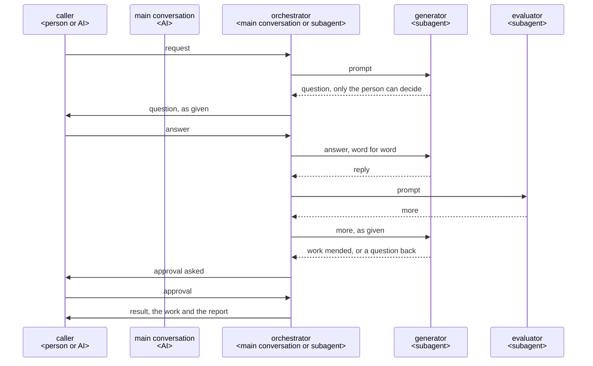
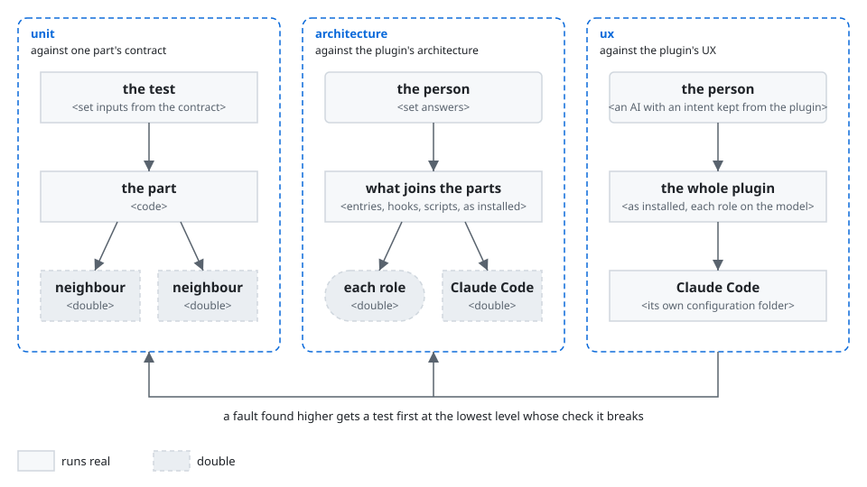

# Best practice for building a Claude Code plugin

This best practice is for a Claude Code plugin whose roles work together to make something, such
as a document or code. A plugin takes from it what its requirements call for.

## Structure

### Components


- **caller**: the person or the AI that calls the plugin. The caller decides what is theirs.
- **main conversation**: the Claude Code conversation the person talks in. Only it can ask the
  person.
- **orchestrator**: the AI that runs the work from the call to the result. It is the main
  conversation, or a subagent where an AI calls the plugin.
- **generator**: a subagent that makes the work. A subagent started for one job, such as the
  generator or the evaluator, is a role.
- **evaluator**: a subagent that checks the work in its user's place. It did not make the work.
- **router**: a script that gives the orchestrator each next move, where the run goes in fixed
  steps.
- **guard**: the plugin's hooks. They tell a subagent its step again when it drifts.

### Sequence



### Directory structure

```text
<repository>/
├── .claude-plugin/marketplace.json     the marketplace: the plugins it lists <JSON>
├── README.md                           leads users to each plugin's README, and developers to dev/ <Markdown>
├── plugins/                            what runs on users' machines, installed by Claude Code
│   └── <plugin>/
│       ├── .claude-plugin/plugin.json  the manifest, holding the version <JSON>
│       ├── skills/<command>/SKILL.md   a skill's entry <Markdown>
│       ├── agents/<name>.md            an agent's entry <Markdown>
│       ├── hooks/
│       │   ├── hooks.json              the hooks' entries <JSON>
│       │   └── <hook>.py               the hooks' code, the guard among them <Python 3>
│       ├── scripts/                    what runs as a command and depends on Claude Code <Python 3>
│       ├── core/                       the plugin's own logic, apart from Claude Code
│       │   ├── domain/                 the knowledge and rules of the plugin's work
│       │   └── roles/                  each role's flow, which uses the domain
│       ├── README.md                   for the plugin's users <Markdown>
│       └── CHANGELOG.md                what changed for users in each version <Markdown>
└── dev/                                what only the developers need, never installed
    ├── plugin-best-practice.md         this document
    └── <plugin>/                       one for each folder in plugins/
        ├── product-vision.md     the plugin's product vision <Markdown>
        ├── architecture.md             the plugin's architecture <Markdown>
        └── tests/                      unit/, architecture/ and ux/, as Test says
```

An entry is a file whose form Claude Code fixes: a skill, an agent, a hook or a command line. Its
part is the file in `core/` that does the entry's job.

Installing a plugin copies only its folder, so what only developers need stays in `dev/`. A
repository of one plugin keeps the same tree with one folder in `plugins/`.

## Principles

A plugin takes the principles its requirements call for, and its architecture names the ones it
takes. Each principle gives its rule, then why. *When* marks a principle that a plugin takes only
in the case it names.

### The core apart from Claude Code

An entry holds only the form Claude Code fixes, and hands the job to its part in `core/`. `core/`
names no tool of an agent, such as the Agent tool or `AskUserQuestion`. Only the entries name them.

*Why*: a developer finds a job where the structure puts it, not by the command that calls it. Two
entries to one job do not drift apart. What the plugin knows outlives the agent it runs on
([ports and adapters](https://alistair.cockburn.us/hexagonal-architecture/)).

### An entry points to its part

A skill's or an agent's body points to its part, and says where each file the part names lies. The
part names each file by its name alone, never by where it is installed. An agent reads its part in
full before anything else, and a hook holds the agent to this.

*Why*: Claude Code makes an agent's body its system prompt, and reads no other file into it. After
`/compact`, a part that a skill links comes back in full. The skill's own body survives only as the
summary retells it. Claude Code replaces `${CLAUDE_PLUGIN_ROOT}` only in an entry's own body. It
does not replace it in what the Bash tool runs, nor in a file that Read reads
([environment variables](https://code.claude.com/docs/en/plugins/manifest-reference#environment-variables)).

### What a machine can see of the work

A script, a hook or the project's own tools check what a machine can check. For code, these are a
formatter, a linter and a type checker. An AI reads only for what no machine can check.

*Why*: a tool finds the same thing every time, at once. An AI finds only some, and spends a round
on each.

### No check passes what it did not check

A check ends in one of three results: no problem, a problem, or could not check. The developer
decides beforehand what follows each result, and tests it. A hook whose script fails stops the
call. A skipped test, a job that did not run or a command that failed counts as no pass.

*Why*: a reader takes a check that stays silent when it could not check for one that found nothing.

### The guard tells each role its steps again

Where an instruction alone does not hold a step, a hook tells the role the step again when it
drifts. A hook also stops what would break a rule. Branch protection or permission rules hold what
is hard to undo.

*Why*: a hook runs every time, while an instruction is only advice. A plugin's agent ignores
`hooks`, `mcpServers` and `permissionMode` in its own frontmatter, so the plugin keeps its hooks in
`hooks/hooks.json`
([plugin agents](https://code.claude.com/docs/en/plugins/components#frontmatter-fields-in-plugin-agents)).

### Where a plugin writes its files

A plugin writes what may be kept in `.<plugin>/<yyyymmdd>-<name>/` at the root of the repository.
It writes what it uses only while it runs in `<plugin>/<yyyymmdd>-<name>/` in the system's
temporary folder, its tests' files included. That folder is the one `tempfile.gettempdir()` gives,
and TMPDIR moves it. The plugin writes what must outlast an update in `${CLAUDE_PLUGIN_DATA}`. It
writes nothing in `${CLAUDE_PLUGIN_ROOT}`.

*Why*: one folder named after the plugin lets the user choose with one line of `.gitignore` whether
git keeps it. The system clears its temporary folder, so a stopped run leaves nothing behind. An
agent reads without asking only inside the working folder
([working directories](https://code.claude.com/docs/en/permissions#working-directories)).
`${CLAUDE_PLUGIN_ROOT}` changes with each update.

### Asking for what lies outside the work

When something outside the work stops it, such as a permission or a tool, the role asks for it. The
role goes on with the rest meanwhile, and never looks for a way round.

*Why*: the person clears such a cause in a moment. A way round leaves the work checked on other
terms than its purpose set.

### The caller approves what is theirs

The caller decides what is theirs, and what is hard to undo, such as a merge. Such a point counts as
approved only by the caller's own action, such as a skill the AI cannot call
(`disable-model-invocation: true`).

*Why*: an AI that decides for the caller leaves them answerable for what they never saw. An approval
that an agent can give itself stops nothing.

### Languages

A plugin talks in the person's language, and writes the repository in the repository's language.
It proposes both languages first. It shows the person what it writes, with nothing added or left
out.

*When*: a plugin that talks with a person.

*Why*: the person approves what they read. Others read the repository later.

### The orchestrator holds the whole and decides

One orchestrator talks with the caller, keeps all that the run has found, and decides each move.
It starts each role, so it carries each point that a role has for the caller, as
[Messages](#messages) says.

*When*: a run of steps that depend on what the last one found.

*Why*: only the one who holds the whole run can weigh what each move brings, and answer the caller's
"why"
([building effective agents](https://www.anthropic.com/engineering/building-effective-agents)).

### Where the orchestrator runs

A plugin that a person calls runs its orchestrator in the main conversation, started by a skill. A
plugin that an AI calls runs its orchestrator as an agent. A role that needs the person ends with
its point, and the one who started the role carries the point on, as [Messages](#messages) says.

*When*: a plugin with an orchestrator and roles.

*Why*: only the main conversation can ask the person
([subagents](https://code.claude.com/docs/en/sub-agents#available-tools)).

### A plugin that uses another

A plugin that has another plugin do a job starts the role of that plugin that does the job as one
of its own roles. It then carries that role's points as [Messages](#messages) says, as any starter
does.

*When*: a job another plugin already does.

*Why*: the other plugin runs as it was built and tested. Nobody writes any of it again.

### One agent for each job

Each job has its own role, and the role gets only what the job needs.

*When*: a work with jobs that need different context or tools.

*Why*: a role starts in a fresh context, so nothing from other work leads it astray
([subagents](https://code.claude.com/docs/en/sub-agents)).

### Messages

The one who starts a role carries each point that the role has for the person to the person, as
given. It carries the person's answer back to the role word for word. Roles run in the background.
The orchestrator sends further work to a role that has ended with SendMessage, which resumes the
role with its whole conversation
([resume subagents](https://code.claude.com/docs/en/sub-agents#resume-subagents)).

*When*: a plugin with an orchestrator and roles.

*Why*: a subagent's last message reaches only the one who started it, and only the main
conversation can ask the person ([subagents](https://code.claude.com/docs/en/sub-agents)). So each
point goes up the line of starters to the person. A point reworded on the way is a question that
the role did not ask, and an answer summed up loses what the person meant. A resumed role does not
start again from nothing.

### The form of a file

A file that a plugin reads is JSON with a schema, and a script checks its form. A file that shows
the form of a deliverable, such as a template or an example, is in the deliverable's own format.

*When*: every plugin.

*Why*: an agent changes only the part it needs, and leaves the rest. A script finds a file out of
form before anyone reads it. A template in another format would show a form that the deliverable
cannot take.

### Asking until nothing is left to decide

The orchestrator asks the caller every point that only they can decide, one at a time, with a
recommendation. It finds facts itself, and shows each fact the work rests on. It decides everything
else, and reports it.

*When*: a plugin with an orchestrator and roles.

*Why*: a point settled before the work does not come back as rework. A question about what the
caller does not care about spends their time on the plugin's job
([grilling](https://github.com/mattpocock/skills/blob/main/skills/productivity/grilling/SKILL.md)).

### Read by those who did not make it

An evaluator that did not make the work checks it first, in the place of the work's user. The
evaluator puts each question of the checklist in `good`, with the lines that meet it, or in `more`,
with `good_when`. `good_when` says what the user gets once the work is good, never how to make it.
Where the caller reads the whole work to approve it, such as a plan, no evaluator reads it first:
the caller is its first reader.

*When*: a work whose user gets something no machine can check.

*Why*: the generator reads what it meant, not what it wrote. A hunt for defects finds something in
every work, and never ends. The generator holds the sources, so how to mend is its call
([harness design](https://www.anthropic.com/engineering/harness-design-long-running-apps)). An
evaluator before the caller adds a reading the caller makes anyway.

### Where the router keeps the course

Where a run goes in a fixed loop, the router keeps its course. It gives each next move from the
role that ended and its result. Where a run's course changes with what it finds, the skill's steps
keep the course. A run that keeps a state writes it to a file before each move.

*Why*: code follows a course the same way every time. A course fixed in code has no move for what
it did not foresee. A conversation can end or be compacted. With the state in a file, a stopped run
goes on from its last move.

### Learning from each run

Once the caller approves the work, the orchestrator looks once through what the run kept, for what
fell short and why. It quotes each cause from the records. It puts a lesson of the project's own
into the project's rules. It sends a general lesson to the plugin's repository as an issue, only
when the user says yes.

*When*: a plugin that a person calls.

*Why*: a lesson met once improves every later run. The user chooses what leaves their project.

## Development

### Python 3.9 and the standard library

What runs on users' machines needs only Python 3.9 or later and its standard library.

*When*: users' machines may lack other runtimes or packages.

*Why*: python3 is wherever git is. A plugin installs no packages.

CI runs the checks on Python 3.9 and on the newest Python.

*Why*: only a run on 3.9 shows that the code still runs there, and 3.9 runs some lines otherwise,
such as which lines coverage counts. Only a run on the newest shows what a new Python breaks, and
the tools that check the tests need it.

### Code kept once

A plugin keeps code that more than one plugin needs once, in the plugin whose job it is. The other
plugins take it in through a relative symbolic link.

*Why*: installing copies a link's target into the plugin
([symlinks in a marketplace](https://code.claude.com/docs/en/plugins/host-marketplace#share-files-within-a-marketplace-with-symlinks)).
So the developer writes, tests and fixes the code in one place.

## Test

A plugin is tested at three levels, each named by what its tests check against. The developer
draws each test from one rule, path or use of that one thing, and never chooses a test by
taste. The developer designs each test before the code, and sees it fail first.

*Why*: a failing test then names the rule, path or use it breaks.

The figure uses these words:

- **contract**: what a part takes, and what it gives or refuses for each.
- **double**: code that takes a part's place in a test, and gives set results.
- **stand-in**: what plays the person in a test.
- **trial**: a test that runs an AI's role on a real model.



### Unit: code

The tests come from the classes, edges and decision-table rules of the part's contract. They pass
when every test passes, every line and branch runs, and every mutant is caught. Before each push,
only the tests that the change reaches run. CI runs every test.

Coverage of each line and branch, mutation testing and property-based tests confirm that the unit
tests hold the contract. Each gap they find becomes a unit test. Mutation and property-based tests
run in CI on what changed.

*Why*: the tests designed first hold the behavior, and these tools only confirm the design. Run
before every push, they would make every change wait. So would every test, and CI catches what the
tests run before the push miss, such as a test that reads a file the change edits.

pytest runs the tests, the unittest tests as they are written. pytest-xdist runs them on every
processor at once. Before each push, pytest-testmon chooses the tests that the change reaches, by
the code that each test ran when it last ran.

*Why*: the other two tools need pytest, and the tests need no change for it. Every test at once
takes a part of the time that one after another takes. testmon sees only the code that a test runs
in its own process, and the architecture tests now join the parts there. It misses a test that
reads a file the change edits, such as JSON or Markdown, or that runs the changed code in a new
process. CI runs every test, so it catches those.

### No trial of a prompt alone

No level runs a prompt, a skill or an agent, alone on a model. The guard holds each rule of a
role's steps that must hold on every run. The architecture tests run the guard on each path, with a
double in each role's place. The ux trials find the faults of a prompt's design, and measure how
its results vary by the key results.

*Why*: a prompt written by
[the best practice for prompts](../plugins/turn/core/domain/best-practices/prompt/best-practice.md)
leaves only the model's variance and the faults of its design. A hook holds a rule on every run,
which a prompt's words cannot
([best practices](https://code.claude.com/docs/en/best-practices)). A trial of one role alone meets
only the cases that its developer set up, so it finds no fault that a real request brings out. The
cost: a fault in a prompt shows only in a ux trial, which runs once every lower level passes.

### Architecture: the parts joined

The tests come from every path through each sequence: the main flow, each branch, each return to an
earlier step, and each question. They pass when every test passes, with the role and the data
checked at each step. They run as the unit tests do: before each push those the change reaches, and
in CI every test.

The parts are joined in the test's own process: the double of Claude Code runs each hook's entry
and each script there, as a new process of Python would run it, with nothing of one call reaching
the next. A configuration file written by hand, such as `hooks.json`, is read once when it is
written, and `claude plugin validate` checks its form. No test runs its commands. A command that a
plugin's code writes, such as those `lay.py write` writes into `hooks.json`, is that code's output,
and its unit tests run it as Claude Code would.

*Why*: a fault of a sequence lies between parts whose unit tests pass. With no model called, every
push checks every path in seconds. A process started for each call checks nothing a call does not,
and a path would wait on hundreds of them.

### ux: the plugin in real use

The trials come from each objective's main use, as the README's walkthrough shows it, on a subject as big as a real request, big enough
to bring out the cases that such requests bring most often. They pass when the stand-in gets what
the objective says. They run once every lower level passes.

A ux trial measures what no lower level can, such as the lead time and how the results vary from
run to run. It finds the faults of the prompts' design. It does not aim to cover cases. Each role
runs on the model its users run. The developer judges each run from its records, and checks each
part of a trial, such as its judge, on a kept record before trusting it. Each Claude Code it starts
runs on a configuration folder of its own. That folder holds only
the plugins under test, and gets the developer's login as `CLAUDE_CODE_OAUTH_TOKEN`
([multiple accounts](https://code.claude.com/docs/en/authentication#log-in-with-multiple-accounts)).
Where Claude Code asks to allow a call, the stand-in chooses from what the screen shows, as a person
would.

*Why*: every part can pass while the user's objective is missed. A trial is slow and calls the
model at each move, so it tries no case that a lower level can test. Another model makes other
slips than the ones users meet. The developer's own settings would change what the trial tries.

### Where a double's results come from

A double gives only what the part's contract allows. The check that checks the part's own files also
checks what the double gives. A double of Claude Code sends what its documentation says, or what a
recorded try of the real Claude Code showed.

*Why*: a double that gives what the part never would passes a test that the real part fails.

### A fault is tested at the level that must catch it

When a higher level finds a fault, the developer first writes a test at the lowest level whose
check the fault breaks, and sees it fail. Only then does the developer fix the fault. A broken
contract goes to unit, a broken handoff to architecture, and what shows only in real use to ux.

*Why*: no trial runs on every push, so a fault fixed only where a trial found it comes back unseen.

### Results that vary from run to run

A trial passes only when its expectation holds in every run, three of three by default. A run that
did not try what the trial invites does not count
([plugin evals](https://code.claude.com/docs/en/plugin-evals#how-a-case-is-scored)).

*Why*: a user meets every run, not most of them.

## Release

### The manifests checked

Each plugin and the marketplace pass `claude plugin validate --strict`.

*Why*: a malformed manifest fails every user at install.

### The version and the CHANGELOG

A plugin is released only when whoever decides what reaches users says so. `plugin.json` holds
`version` once, in semver. The largest change that users see decides which part of it rises. The
CHANGELOG, in [Keep a Changelog](https://keepachangelog.com) form, gives each change that users
notice one line, with why it helps them. `claude plugin tag --push` tags each release
`<plugin>--v<version>`. `.claude-plugin/marketplace.json` and the root README list each release.

*Why*: users get an update only when the version rises. `plugin.json` wins over the marketplace
entry. A dependency's version range resolves against these tags.
